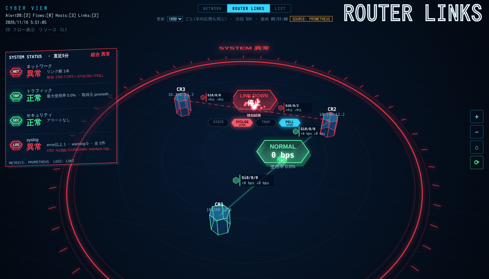

# Cyber View スタンドアロン版 / Cyber View Standalone

> 🇯🇵 日本語はこのすぐ下 / 🇬🇧 English is at the [end of this page](#english)



network-lab-emulator の `/cyber-view`(NIRVANA 改風の 3D 監視画面)を、**実機の監視環境**で使うための単体版。
エミュレータには依存せず、既にある監視基盤からデータを読む。

| データ元 | 読むもの | 画面での使われ方 |
|---|---|---|
| Prometheus + snmp_exporter | `rate(ifHCIn/OutOctets)`・`ifOperStatus`・`up` | リンクの流量と流れのアニメ、LINK DOWN の検知経路「POLL」、「NO RESPONSE 消失」 |
| Loki(syslog) | ログ行 | 装置の上に浮かぶログ、LINK DOWN の検知経路「SYSLOG」、error 以上の警報、フラップの警告(注) |
| Zabbix(API) | `Interface …: Bits received / Bits sent / Operational status`、未解決の問題、ホストの到達性 | 流量(Prometheus が無い場合)、「POLL」、Zabbix の問題を警報として表示 |
| SNMP trap(任意) | linkDown / linkUp | LINK DOWN の検知経路「TRAP」 |

装置とつながり(トポロジ)は設定ファイルに手書きする。

実機の Catalyst を登録する手順(装置側の SNMP/syslog 設定から確認方法まで)は、リポジトリの `docs/real-catalyst-registration.md`。

画面では Prometheus を **ヴァルハラ(VALHALLA)** と表示する(呼び名だけ。設定項目名 `sources.prometheus` などは Prometheus のまま)。

## 必要なもの

- Python 3.9 以上(`pip install -r requirements.txt` … FastAPI / uvicorn / PyYAML のみ)、または docker
- 監視基盤への HTTP 到達性(Prometheus 9090 / Loki 3100 / Zabbix フロントエンド)

## 使い方

いちばん簡単なのはインストーラー。Prometheus(+snmp_exporter)・Loki・Zabbix・MRTG・Cacti・Ollama・AI の鍵を探し、
見つかった装置とつながり(同じ /30・/31)から `config.yaml` の下書きを作って venv に入れる:

```bash
./install.sh --detect-only     # 何が見つかるかだけ
./install.sh                   # config.yaml を作って起動の仕方を表示(既存の config.yaml は --force が無ければ上書きしない)
./install.sh --service         # systemd に登録(root)/ --docker で docker compose
```

手で入れる場合:

```bash
cd cyber-view-standalone
cp config.example.yaml config.yaml     # 装置・つながり・データ元を自分の環境に書き換える
pip install -r requirements.txt
ZABBIX_TOKEN=xxxx python3 server.py -c config.yaml --port 8090
# → ブラウザで http://<このホスト>:8090/
```

docker で動かす場合:

```bash
cp config.example.yaml config.yaml
ZABBIX_TOKEN=xxxx docker compose up -d --build
```

社内プロキシで独自の CA を使っている環境では、その CA 証明書(`.crt`)を `extra-ca/` に置いてからビルドする。

## 設定ファイル

`config.example.yaml` にすべての項目の説明がある。要点:

- **devices**: `id`(画面内の名前)、`hostname`(表示名。syslog 本文・Zabbix のホスト名との照合にも使う)、
  `type`(`cisco` / `catalyst` / `nexus` / `sir` / `srs` など。フラップ検知でログ形式を判定する)、
  `mgmt_ip`(Prometheus の instance / syslog の送信元)、`interfaces`(IP アドレス空間の画面に置く IF。
  `name` は ifName と同じ表記。`GigabitEthernet0/0/0` と `Gi0/0/0` は同じものとして扱う)
- **links**: `a` / `a_if` / `b` / `b_if`、`speed`(bps。使用率の分母)
- **sources**: 使うものだけ書く。トークンは `${ZABBIX_TOKEN}` のように環境変数で渡す
- **auth.token**(任意): 設定すると `http://host:8090/?token=...` で開く必要がある

### どのデータ元で何が見えるか

| | Prometheus だけ | Zabbix だけ | Loki を追加 |
|---|---|---|---|
| 流量・流れのアニメ | ○ | ○ | — |
| LINK DOWN | POLL(ifOperStatus) | POLL(Operational status) | + SYSLOG |
| 応答なし(消失) | ○(up=0) | ○(ホストの SNMP 到達性) | — |
| 警報・警告 | link_down | link_down + Zabbix の問題 | + error 以上のログ、フラップ |

### Zabbix で気をつけること

- テンプレートは「Network interfaces by SNMP」系(`Cisco IOS by SNMP` など)のアイテム名を前提にしている。
- これらのテンプレートは、管理者が `shutdown` した IF を自動検出(LLD)から外し、アイテムを
  「検出ルールにより無効化」する。この画面はそれを「その IF は落とされている(down)」として扱う。
  **復旧後も Zabbix 側は次の自動検出(テンプレート既定 1 時間)まで無効のまま**なので、早く戻したい場合は
  Zabbix で検出ルールを「今すぐ実行」するか、検出間隔を短くする。
- 流量は Zabbix の取得間隔(Cisco テンプレートは 1 分ごとの SNMP walk)で更新される。

### ヴァルハラ(Prometheus)からの再生・予測・OSPF・警報

`sources.prometheus` があれば次も使える(詳細は `docs/valhalla-nirvana.md`):

- ROUTER LINKS の「⏪ 再生」: `rate(ifHC*Octets)` と `ifOperStatus` の履歴から過去の各時刻を 3D で再生
- 予測: IF の使用率(`rate / ifHighSpeed`)から「このままだと何日で 80%」と、平常時とのずれ
- OSPF ボタン: snmp_exporter で OSPF-MIB(`ospfRouterId` / `ospfNbrState`)を取っていれば、設定ファイルのリンクごとの
  隣接状態を出す(最短経路ツリーと Dead タイマーは SNMP では取れないので出さない)。snmp_exporter の設定例は
  リポジトリの `iac/cisco-traffic-monitoring/snmp_exporter/snmp.yml`
- ヴァルハラで発報中の警報を、警報の花に「VALHALLA」の花びらで出す(新しく出たものだけ)

### 経路と CPU の「情」「注」(SNMP の直接取得)

`sources.snmp` を書くと、各装置の `mgmt_ip` に SNMPv2c で直接問い合わせ、経路表(inetCidrRouteTable、無ければ
ipCidrRouteTable)と CPU(cpmCPUTotal5minRev)を定期取得する。経路の追加・削除・変更と CPU の急上昇・回復が「情」、
CPU が高い状態が続くと「注」(警告)。しきい値は `sources.snmp.cpu`。詳細はリポジトリの `docs/snmp-route-cpu-info.md`。

#### 流量も SNMP で直接取る(`sources.snmp.traffic`)

Prometheus も Zabbix も無い環境(実機を 1〜2 台つないで試す、など)向け。`traffic: true`(間隔を変えるなら
`traffic: {interval: 10}`、秒)を足すと、IF-MIB の `ifHCInOctets` / `ifHCOutOctets`(64bit。無い機種は 32bit)と
`ifOperStatus` を直接読み、前回との差から bps を出す。

- リンクの流量・流れのアニメ、LINK DOWN の検知経路「POLL」、応答なし(2 回続けて取れなかったとき)に使う。
  取得元は画面で `snmp` と出る(Prometheus → Zabbix → SNMP → MRTG / Cacti の順で、先に取れたものを使う)
- 1 回目は基準を取るだけで、流量は 2 回目から出る。装置の再起動でカウンタが戻ったときの 1 回は捨てる
- 初期値は無効(`traffic` を書いたときだけ動く)。`interval` ごとに装置へ数回 walk するので、台数が多い環境では間隔を広げる
- `links` には両端の IF を書く。片側が SNMP に応答しない装置(監視用の PC など)なら、その装置に `snmp: false` を書く
  (問い合わせから外れる。画面のアドレス空間・リンクには載り、流量は相手側の装置のカウンタを使う)

```yaml
devices:
  - {id: cat01, hostname: CAT-01, type: catalyst, mgmt_ip: 192.168.1.254,
     interfaces: [{name: Vlan263, ip: 192.168.1.254, prefix: 24}]}
  - {id: pc, hostname: MY-PC, type: pc, snmp: false,
     interfaces: [{name: Ethernet, ip: 192.168.1.10, prefix: 24}]}
links:
  - {a: pc, a_if: Ethernet, b: cat01, b_if: GigabitEthernet0/4, speed: 1000000000}
sources:
  snmp: {community: netlab-ro, interval: 60, traffic: true}
```

### SNMP trap(linkDown / linkUp)の受け方

`sources.snmp_trap: {listen: 0.0.0.0:1162}` を書くと、UDP 1162 で trap を待つ。装置側は
`snmp-server enable traps snmp linkdown linkup` と `snmp-server host <このPCのIP> version 2c <community> udp-port 1162`。

- 解釈するのは **SNMPv2c の trap だけ**(v1 と inform は無視)。community は照合しない。`linkDown` / `linkUp` 以外は捨てる
- 装置は、送信元 IP が `mgmt_ip` か `interfaces` の IP と一致したものにする。IF 名は trap の `ifDescr` / `ifName` を使う(`Gi0/4` と `GigabitEthernet0/4` は同じ)。
  Catalyst なら、送信元をそろえるために `snmp-server trap-source <管理IF>` も入れておく
- リンクの検知経路 `TRAP` が down になり、次の収集周期(`poll_interval`)で `LINK DOWN`・SYSTEM STATUS「異常」・アラート `リンク断` が出る
- trap は UDP なので `linkUp` を取りこぼすことがある。**linkDown の trap から `stale_after` 秒(既定 90)以上たっても、POLL
  (ifOperStatus の読み取り)が up を返しているなら、その down は捨てる**。新しい linkDown(POLL の更新が追いついていない間)と、
  POLL が取れていないときは、そのまま down とする。秒数は `sources.snmp_trap.stale_after`

### ATT&CK・ネクサス・ダークネット・フロー・外部センサー・回線チェック

- **ATT&CK**: 警報を ATT&CK の戦術・手法に結びつけ、拠点・装置ごとの進行度を出す(設定不要)
- **ネクサス**(`sources.nexus`): 複数拠点の横断分析。警報と ATT&CK のイベントを中央へ送り、共通の攻撃元などの所見を受け取る
- **フロー**(`sources.flow`): NetFlow v5 / sFlow v5。**ダークネット**(`sources.darknet`)の観測と通信の粒に使う
- **外部センサー**: Loki のログに FortiGate / ASA / Snort・Suricata / Palo Alto のアラートがあれば警報にする(設定不要)
- **回線チェック**(`sources.wan_probe`): 本物の ping で遅延とロスを測る
- メール通知: ALERTS の連絡先に「メール」(SMTP のパスワードは環境変数 `NIRVANA_SMTP_PASSWORD`)

詳細はリポジトリの `docs/nirvana-response-attack-nexus-wan-flow.md`。

### BOARD / EXPLORE / ALERTS(Grafana が持つ機能)

ダッシュボード(8種のパネル・変数・時間範囲・自動更新・注釈・編集)、問い合わせ(PromQL / LogQL / 内部ログ)、
アラートルールと webhook 通知が使える。データソースは `sources.prometheus` / `sources.loki` と、collector が組み立てた
リンク状態・状態ボードを貯める「NIRVANA 内部」。Grafana のダッシュボード JSON もそのまま取り込める。
保存先は `nirvana_board.json`(`board.path` または `NIRVANA_BOARD_PATH` で変更)。詳細はリポジトリの `docs/nirvana-board.md`。

## 何が保存されるか(git pull で更新するとき)

| もの | 保存 | 場所 |
|---|---|---|
| 装置・つながり・データ元の設定 | ○(自分で書いたファイル) | `config.yaml`(.gitignore 済み。`git pull` で上書きされない) |
| BOARD のダッシュボード・アラートルール・連絡先・注釈・ルールの状態履歴 | ○ | `nirvana_board.json`(docker は `./data/`) |
| SNMP で取った経路表・CPU の生の値、snmpwalk の結果 | × | 前回の値だけメモリに持ち、差分(情)を作るのに使う |
| 経路・CPU の「情」、警報(注)、ログ、流量の推移 | × | メモリだけ(情は直近2000件)。再起動で消える |
| BOARD の内部データソース(NIRVANA 内部)の時系列 | × | メモリに6時間分 |

長く残したい履歴は Prometheus(ヴァルハラ)・Loki・Zabbix 側にある(この画面はそこから読むだけ)。
再起動直後の SNMP の1回目は基準を取るだけで、情は出ない(全経路が「追加」に見えるのを避けるため)。

## ラボ版との違い

- MRTG・Cacti・Zabbix の取り込み口は単体版だけ(取り込み順は Prometheus → Zabbix → SNMP 直接(`sources.snmp.traffic`)→ MRTG / Cacti)。
- AI ログ解析は単体版でも使えるが、提案されたコマンドは表示とコピーだけ(装置にはログインしない)。
- 地球儀(WORLD)は単体版でも使える(MAWI の再生はラボ版だけ)。

- ラボ専用のもの(ping の経路の粒、ポートスキャン検知、DEMO)は無い。経路の変化「情」は `sources.snmp` を書いたときだけ出る。DEMO ボタンは自動で隠れる。
- 検知経路の「STATE」(エミュレータ内部の IF 状態)は無い。
- 画面(`web/cyber_view.html`)と検知ルール(`cvs/flap_rules.py`・`cvs/link_evidence.py`)はラボ版と同じファイル。
  ラボ側を直したら `cp static/cyber_view.html cyber-view-standalone/web/` 等で揃える
  (`tests/test_cyber_view_standalone.py` がずれを検出する)。

MRTG・Cacti・インストーラー・AI ログ解析: `../docs/nirvana-addon-monitoring-ai.md`

動作確認の記録(本物の Prometheus・snmp_exporter・Loki・Zabbix 7.0 で試した結果と画面): `../docs/cyber-view-standalone.md`

---

## English

A standalone edition of network-lab-emulator's `/cyber-view` (the NIRVANA-Kai-style 3D monitoring view, called "Nirvana")
for **real networks**. It does not depend on the emulator; it reads from the monitoring you already have.
On screen, Prometheus is labelled **VALHALLA** (display name only; config keys such as `sources.prometheus` keep the real name).

| Source | What it reads | Used for |
|---|---|---|
| Prometheus + snmp_exporter | `rate(ifHCIn/OutOctets)`, `ifOperStatus`, `up` | link traffic and flow animation, LINK DOWN evidence "POLL", "NO RESPONSE" |
| Loki (syslog) | log lines | logs floating above devices, LINK DOWN evidence "SYSLOG", alerts for error and above, flap notices |
| Zabbix (API) | `Interface …: Bits received / Bits sent / Operational status`, open problems, host reachability | traffic (when there is no Prometheus), "POLL", Zabbix problems as alerts |
| SNMP (direct, optional) | route table (IP-FORWARD-MIB), CPU (CISCO-PROCESS-MIB) | route add/delete/change and CPU jump/recovery as "info", sustained high CPU as "notice" |
| SNMP trap (optional) | linkDown / linkUp | LINK DOWN evidence "TRAP" |

Devices and links (the topology) are written by hand in the config file.
How to register a real Catalyst (device-side SNMP/syslog settings and checks): `docs/real-catalyst-registration.md` in the repository.

### Requirements

- Python 3.9+ (`pip install -r requirements.txt`: FastAPI / uvicorn / PyYAML only), or docker
- HTTP reachability to your monitoring (Prometheus 9090 / Loki 3100 / Zabbix frontend); UDP/161 to devices if you use `sources.snmp`

### Usage

```bash
cd cyber-view-standalone
cp config.example.yaml config.yaml     # edit devices, links and sources for your network
pip install -r requirements.txt
ZABBIX_TOKEN=xxxx python3 server.py -c config.yaml --port 8090
# → open http://<this host>:8090/
```

With docker:

```bash
cp config.example.yaml config.yaml
ZABBIX_TOKEN=xxxx docker compose up -d --build
```

If your proxy uses a private CA, put its certificate (`.crt`) in `extra-ca/` before building.

### Config file

Every key is explained in `config.example.yaml`. In short:

- **devices**: `id` (name used on screen), `hostname` (display name; also matched against syslog text and Zabbix host names),
  `type` (`cisco` / `catalyst` / `nexus` / `sir` / `srs` …, selects the log format for flap detection),
  `mgmt_ip` (Prometheus instance / syslog source / SNMP target), `interfaces` (placed in the IP address space view;
  `name` uses the ifName spelling, `GigabitEthernet0/0/0` and `Gi0/0/0` are treated as the same)
- **links**: `a` / `a_if` / `b` / `b_if`, `speed` (bps, the denominator of utilization)
- **sources**: only the ones you use. Pass tokens through environment variables, e.g. `${ZABBIX_TOKEN}`
- **sources.snmp**: `community`, `interval`, `full_every`, `cpu: {high: 80, jump: 20, hold: 2}` (thresholds are adjustable)
- **sources.snmp_trap**: `listen`, `stale_after` (default 90 s: a linkDown trap older than this is dropped when POLL reports the interface up, so a lost linkUp trap cannot leave a link "down" forever)
- **auth.token** (optional): when set, open the page as `http://host:8090/?token=...`

### What is saved (when updating with `git pull`)

| Item | Saved | Where |
|---|---|---|
| Devices, links and sources | yes (your own file) | `config.yaml` (git-ignored, never overwritten by `git pull`) |
| BOARD dashboards, alert rules, contact points, annotations, rule state history | yes | `nirvana_board.json` (`./data/` with docker) |
| Raw SNMP values / snmpwalk results | no | only the previous value is kept in memory to compute the diff |
| Info events, alerts, logs, traffic history | no | memory only (the last 2000 info events), lost on restart |
| BOARD internal data source time series | no | 6 hours in memory |

Long-term history lives in Prometheus (VALHALLA), Loki or Zabbix; this view only reads it.
The first SNMP poll after a restart only takes a baseline, so it produces no info events.

### More features

- **ATT&CK** (no config), **nexus** cross-site analysis (`sources.nexus`), **NetFlow v5 / sFlow v5** (`sources.flow`) feeding the **darknet**
  (`sources.darknet`) and flow particles, **external security sensors** read from Loki logs (FortiGate / ASA / Snort·Suricata / Palo Alto),
  **line check** with real pings (`sources.wan_probe`), and **e-mail** contact points (SMTP password from `NIRVANA_SMTP_PASSWORD`).
  See `docs/nirvana-response-attack-nexus-wan-flow.md`.

- **VALHALLA (Prometheus)**: replay past states in 3D from `rate(ifHC*Octets)` / `ifOperStatus` history, utilization forecast,
  OSPF adjacencies from OSPF-MIB, and VALHALLA's firing alerts as "VALHALLA" petals (`docs/valhalla-nirvana.md`).
- **BOARD / EXPLORE / ALERTS**: Grafana-like dashboards (8 panel types, variables, time range, auto refresh, annotations),
  queries (PromQL / LogQL / internal logs), alert rules with webhooks; Grafana dashboard JSON can be imported (`docs/nirvana-board.md`).

### Differences from the lab edition

- Lab-only features (ping particles, port-scan detection, DEMO) are not available. The DEMO button hides itself.
  Route-change info appears only when `sources.snmp` is configured.
- There is no "STATE" evidence (the emulator's internal interface state).
- The page (`web/cyber_view.html`) and detection rules (`cvs/flap_rules.py`, `cvs/link_evidence.py`, `cvs/route_watch.py`, …)
  are the same files as the lab edition; `tests/test_cyber_view_standalone.py` and friends detect drift.

Verification records (tested against real Prometheus, snmp_exporter, Loki and Zabbix 7.0, with screenshots): `../docs/cyber-view-standalone.md`
