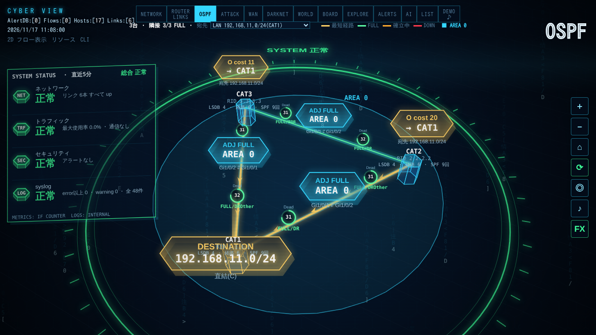

# Catalyst 3台の OSPF と、各配下の LAN セグメント

ユーザーの依頼(2つ):

- 「Catalyst 3台で OSPF 構成を組んでいる状態をニルヴァーナで表示してほしい。音楽はレゲエで」
- 「各 Catalyst 配下にセグメントを1つ設置して、そのセグメントを含むルーティングテーブルも表示して」

## 構成

```
              10.10.12.0/30
   CAT1 Gi1/0/1 ───────────── Gi1/0/2 CAT2
     │ Gi1/0/2                Gi1/0/1 │
     │ 10.10.13.0/30    10.10.23.0/30 │
     └──────── Gi1/0/1 CAT3 Gi1/0/2 ──┘
   (装置どうしのポートはすべて no switchport の L3。OSPF は area 0、Router-ID は 1.1.1.1 / 2.2.2.2 / 3.3.3.3)

   CAT1 Gi1/0/3(access vlan 10)── PC1 192.168.11.10   … Vlan10 192.168.11.1/24
   CAT2 Gi1/0/3(access vlan 10)── PC2 192.168.12.10   … Vlan10 192.168.12.1/24
   CAT3 Gi1/0/3(access vlan 10)── PC3 192.168.13.10   … Vlan10 192.168.13.1/24
```

各 Catalyst の配下の LAN(Vlan10)には PC を1台ずつ置いた。PC の既定ゲートウェイは、各 Catalyst の Vlan10 にしている。

## ルーティングテーブルと疎通(本物のエミュレータで実行した結果)

```
CAT1# show ip route
Gateway of last resort is not set
C        10.10.12.0/30 is directly connected, GigabitEthernet1/0/1
L        10.10.12.1/32 is directly connected, GigabitEthernet1/0/1
C        10.10.13.0/30 is directly connected, GigabitEthernet1/0/2
L        10.10.13.1/32 is directly connected, GigabitEthernet1/0/2
C        192.168.11.0/24 is directly connected, Vlan10
L        192.168.11.1/32 is directly connected, Vlan10
O        10.10.23.0/30 [110/2] via 10.10.12.2, GigabitEthernet1/0/1
O        192.168.12.0/24 [110/2] via 10.10.12.2, GigabitEthernet1/0/1
O        192.168.13.0/24 [110/2] via 10.10.13.2, GigabitEthernet1/0/2

CAT2# show ip route
Gateway of last resort is not set
C        10.10.12.0/30 is directly connected, GigabitEthernet1/0/2
L        10.10.12.2/32 is directly connected, GigabitEthernet1/0/2
C        10.10.23.0/30 is directly connected, GigabitEthernet1/0/1
L        10.10.23.1/32 is directly connected, GigabitEthernet1/0/1
C        192.168.12.0/24 is directly connected, Vlan10
L        192.168.12.1/32 is directly connected, Vlan10
O        10.10.13.0/30 [110/2] via 10.10.12.1, GigabitEthernet1/0/2
O        192.168.11.0/24 [110/2] via 10.10.12.1, GigabitEthernet1/0/2
O        192.168.13.0/24 [110/2] via 10.10.23.2, GigabitEthernet1/0/1

CAT3# show ip route
Gateway of last resort is not set
C        10.10.13.0/30 is directly connected, GigabitEthernet1/0/1
L        10.10.13.2/32 is directly connected, GigabitEthernet1/0/1
C        10.10.23.0/30 is directly connected, GigabitEthernet1/0/2
L        10.10.23.2/32 is directly connected, GigabitEthernet1/0/2
C        192.168.13.0/24 is directly connected, Vlan10
L        192.168.13.1/32 is directly connected, Vlan10
O        10.10.12.0/30 [110/2] via 10.10.23.1, GigabitEthernet1/0/2
O        192.168.11.0/24 [110/2] via 10.10.13.1, GigabitEthernet1/0/1
O        192.168.12.0/24 [110/2] via 10.10.23.1, GigabitEthernet1/0/2

PC1$ ping -c 3 192.168.13.10
3 packets transmitted, 3 received, 0% packet loss, time 3000ms
rtt min/avg/max/mdev = 1.384/1.825/2.260/0.100 ms

PC2$ ping -c 3 192.168.11.10
3 packets transmitted, 3 received, 0% packet loss, time 3000ms
rtt min/avg/max/mdev = 1.063/1.675/2.354/0.100 ms

PC3$ ping -c 3 192.168.12.10
3 packets transmitted, 3 received, 0% packet loss, time 3000ms
rtt min/avg/max/mdev = 1.018/1.772/2.272/0.100 ms

PC1$ traceroute 192.168.13.10
traceroute to 192.168.13.10 (192.168.13.10), 30 hops max, 40 byte packets
 1  CAT1 (192.168.11.1)  3.527 ms  3.522 ms  2.359 ms
 2  CAT3 (10.10.13.2)  5.509 ms  2.666 ms  5.058 ms
 3  PC3 (192.168.13.10)  5.762 ms  5.225 ms  8.849 ms
```

- 3台とも、自分の配下の LAN は C(直結)で、相手2台の配下の LAN は O(OSPF)で入っている。
- PC どうしの ping はすべて通った。
- traceroute は CAT1 → CAT3 → PC3 の順で届いた。

コストは実機の IOS と同じく、相手の LAN まで `[110/2]` になる。GigabitEthernet と Vlan はどちらも cost 1 なので、リンク 1 + 相手の Vlan10 1 = 2。

当初は CAT1 と CAT2 が `[110/20]`、CAT3 だけ `[110/11]` と出ていた。これは後から直した(下の「4. OSPF のコスト」)。



画面は `/cyber-view?view=ospf&bgm=reggae` で開いた。宛先の選択欄から、3つの LAN と3本のリンクを選べる。
レゲエの BGM 付きの動画は `videos/cyber-view-catalyst3-ospf-reggae.mp4`。

## 途中で見つけて直した不具合

1. **L2 ループの誤検知**
   - 症状: L3 にしたポートで三角形につないだだけなのに、「L2 ループ発生 CAT1-CAT2-CAT3」の警報が出た。
   - 原因: `no switchport` を記録していなかった。
   - 修正: `no switchport` を受けた IF に印を付け、ループの判定から外す。詳しくは [l2-loop-detection.md](l2-loop-detection.md)。
2. **PC の既定ゲートウェイを変えても古い経路が残る**
   - 症状: `ip route add default via 192.168.11.1` をしても、PC の経路表には作成時の既定(192.168.1.1)のデフォルト経路が残っていた。
     そのため、別の LAN の PC への ping が届かなかった(`Destination Host Unreachable`)。
   - 修正: ゲートウェイを登録し直すときに、違う宛先のデフォルト経路を外す。
3. **traceroute の最後に宛先そのものが出ない**
   - 症状: 宛先の手前のルータで表示が終わっていた。実機の traceroute は、最後の行が宛先そのもの。
   - 修正: 宛先が最後のルータの直結先なら、最後の行に宛先(PC3 (192.168.13.10))を出す。IOS 形式・Linux 形式の両方を直した。

テスト: `tests/test_pc_gateway_and_traceroute_last_hop.py`、`tests/test_l2_loop.py::test_routed_ports_are_not_an_l2_loop`。

4. **OSPF のコスト**(後から直した)
   - 症状: CAT1 と CAT2 は `[110/20]`、CAT3 だけ `[110/11]` と出た。実機なら3台とも `[110/2]`。
   - 原因は2つ。
     - コストがインタフェースごとではなく、ルータ単位で一律 10 だった。
     - SPF が DR の Network LSA をたどるときだけ、コストを決め打ちで +1 していた。CAT3 は DR だったので、CAT3 を通る経路だけ 10+1 になっていた。
   - 修正: コストをインタフェースごとに実機と同じ決め方で計算する。優先順は次のとおり。
     1. インタフェースの `ip ospf cost`
     2. 参照帯域(IOS は 100Mbps、NX-OS は 40Gbps、`auto-cost reference-bandwidth` で変更)÷ 帯域(`bandwidth` で変更)。小数は切り捨てで、最小は 1。
   - 例: Gi・Vlan は 1、FastEthernet は 1、Serial は 64、Tunnel は 1000。NX-OS の 10G Ethernet は 4。
   - Arista EOS は既定の 10 のまま。Si-R など、帯域からコストを決める仕様を確かめていない機種も、これまでどおり 10。
   - DR を通るときも、DR のそのリンクのコストを足す。
   - `show ip ospf interface` の Cost もインタフェースごとに出す。running-config には `ip ospf cost`・`bandwidth`・`auto-cost reference-bandwidth` を出す。
   - 確認: 3台とも `[110/2]` になった。CAT1 の Gi1/0/1 に `ip ospf cost 50` を入れると、CAT2 の LAN が CAT3 経由の `[110/3]` に切り替わった。`no ip ospf cost` で元に戻った。テストは `tests/test_ospf_interface_cost.py`。
