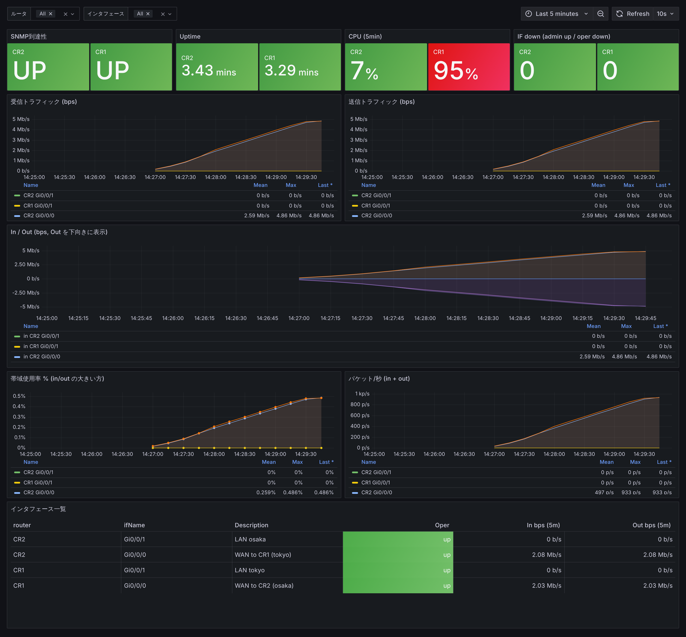

# Cisco ルータのトラフィック監視 (Prometheus + snmp_exporter + Grafana) — IaC

エミュレータの Cisco ルータを、実機の監視とまったく同じ方法で監視する:
Prometheus 公式の **snmp_exporter** が Cisco の実 SNMP(UDP/161、v2c、
GETBULK)を叩き、IF-MIB の 64bit カウンタからトラフィックを算出して
Grafana に出す。スタックは docker compose、Grafana のデータソースと
ダッシュボードは provisioning ファイル、Cisco 側の構成もスクリプトで
コード化してあり、`./deploy.sh up` 一発で再現できる。

```
Cisco CR1/CR2 (エミュレータ, 実SNMP UDP/161)
      ^  SNMP GETBULK (community netlab-ro)
snmp_exporter :9116  <── /snmp?target=10.240.12.1&module=cisco_if&auth=netlab_v2
      ^  15秒ごとに scrape
Prometheus :9090  (file_sd で監視対象, alert_rules で IF down / 使用率 / CPU)
      ^
Grafana :3000  (データソース・ダッシュボードは provisioning で自動登録)
```

## ファイル構成 (`iac/cisco-traffic-monitoring/`)

| ファイル | 役割 |
|---|---|
| `docker-compose.yml` | snmp_exporter / Prometheus / Grafana の定義(host ネットワーク) |
| `deploy.sh` | `up` / `status` / `down` / `destroy` |
| `snmp_exporter/snmp.yml` | 取得する OID(ifXTable・ifTable の状態・CPU・sysUpTime)と SNMP 認証 |
| `prometheus/prometheus.yml` | snmp_exporter 経由の scrape 設定(標準の relabel パターン) |
| `prometheus/targets/cisco_routers.yml` | 監視対象ルータ(IP を足せば再起動なしで増える) |
| `prometheus/alert_rules.yml` | SNMP 不達 / IF down / 使用率 80% 超(in・out) / CPU 90% 超 |
| `grafana/provisioning/datasources/prometheus.yml` | Prometheus データソース |
| `grafana/provisioning/dashboards/provider.yml` | ダッシュボード自動読み込み |
| `grafana/dashboards/cisco-traffic.json` | ダッシュボード本体 |
| `lab/provision_cisco_lab.sh` | エミュレータ上に CR1/CR2 を構築(IF・経路・`snmp-server community`) |
| `lab/traffic_gen.sh` | IOS の `ping ... repeat N size S` で WAN にトラフィックを流す |

host ネットワークにしているのは、エミュレータの装置がそれぞれの管理 IP を
ホストのループバックにエイリアスとして載せて SNMP を待ち受けるため
(ブリッジネットワークのコンテナからは 10.240.x.x に届かない)。

## 使い方

```bash
NETLAB_AUTH_DISABLE=1 python app.py &          # エミュレータ
cd iac/cisco-traffic-monitoring
./deploy.sh up                                  # ラボ構築 + 3コンテナ起動 + ヘルス待ち
./lab/traffic_gen.sh &                          # トラフィックを流す
open http://localhost:3000/d/cisco-traffic      # admin / admin
./deploy.sh status
./deploy.sh down                                # (destroy でデータも消す)
```

ポートやパスワードは環境変数で変えられる(`PROM_PORT`, `GRAFANA_PORT`,
`SNMP_EXPORTER_PORT`, `GRAFANA_ADMIN_PASSWORD`, `PROM_RETENTION`, `EMU_URL`)。
実機のルータを監視する場合は `snmp.yml` のコミュニティと
`targets/cisco_routers.yml` の IP を実機に合わせるだけでよい。

## ダッシュボード



- 上段: SNMP 到達性・Uptime・CPU(5分)・down 中の IF 数(ルータごと)
- 受信/送信 bps(`rate(ifHCInOctets[$__rate_interval]) * 8`)、In/Out を上下に分けた表示
- 帯域使用率 %(`ifHighSpeed` で割る、80% の閾値線)、パケット/秒
- IF 一覧(ifName・description(ifAlias)・状態・直近5分の bps)
- 変数でルータ・インタフェースを絞り込める

## ライブ検証 (このサンドボックスで実施)

```
$ ./deploy.sh up
[lab] CR1(10.240.12.1) / CR2(10.240.12.2) を構築しました
 Container ctm-snmp-exporter Started
 Container ctm-prometheus Started
 Container ctm-grafana Started
[deploy] snmp_exporter: ready
[deploy] prometheus: ready
[deploy] grafana: ready

$ snmpwalk -v2c -c netlab-ro 10.240.12.1 1.3.6.1.2.1.31.1.1.1
iso.3.6.1.2.1.31.1.1.1.1.1 = STRING: "Gi0/0/0"
iso.3.6.1.2.1.31.1.1.1.6.1 = Counter64: 0
iso.3.6.1.2.1.31.1.1.1.15.1 = Gauge32: 1000
...

$ curl -s '127.0.0.1:9116/snmp?target=10.240.12.1&module=cisco_if&auth=netlab_v2'
ifHCInOctets{ifAlias="WAN to CR2 (osaka)",ifIndex="1",ifName="Gi0/0/0"} 0
ifOperStatus{ifAlias="LAN tokyo",ifIndex="2",ifName="Gi0/0/1"} 1
snmp_scrape_duration_seconds{module="cisco_if"} 0.048

(traffic_gen.sh を約100秒流した後、Prometheus に問い合わせ)
rate(ifHCInOctets{job="cisco-snmp"}[1m])*8
   CR2 Gi0/0/0 2865280.0
   CR1 Gi0/0/0 2552704.0
   CR1 Gi0/0/1 0.0          ← ping の宛先はルータ自身なので LAN 側は 0 で正しい
targets: cisco-snmp 10.240.12.1 up / 10.240.12.2 up / snmp-exporter up / prometheus up
```

Grafana は Playwright でログインしてダッシュボードを開き、全パネルに
データがあること("No data" 0 件)・JS エラー 0 件を確認した(上の画像)。

## この作業で見つけて直したエミュレータ側の問題

1. **IF-MIB ifXTable が無かった** — 実機 Cisco の監視は、1Gbps だと約34秒で
   一周する Counter32 の `ifInOctets` ではなく、64bit の `ifHCInOctets`/
   `ifHCOutOctets` と `ifName`/`ifAlias` を使う。ifXTable(ifName は
   `Gi0/0/0` の短縮名、ifAlias は interface の description、ifHighSpeed)と
   BER の Counter64 型(0x46)を追加した。
2. **Counter32 が 2^32 で折り返さなかった** — 2^32 を超えると5バイト以上の
   不正な BER になっていた。実機同様に折り返す。
3. **ping のカウンタ加算が「5パケット×100バイト」固定で、往路しか数えず、
   経路に関係なく送信元の全リンクに入っていた** — IOS の
   `ping <dest> repeat <n> size <bytes>` を解釈して表示(`Sending 100,
   1500-byte ...`、`!` は70個で折り返し)とカウンタに反映し、Echo Reply
   (復路)も数え、trace_path のホップ列上のリンクだけに載せるようにした。
4. **CPU 使用率が数分で95%に張り付いた** — CISCO-PROCESS-MIB の CPU 値は
   「MIB を組み立てるたびに乱歩で1歩」進めていたため、1回の scrape で
   何度も GETBULK を送る snmp_exporter ではすぐ上限まで振り切れていた
   (ダッシュボードで CR1 が 95% の赤になって気づいた)。時間ベース
   (5秒に1歩)に変えた。

## テスト

`tests/test_cisco_traffic_monitoring.py`: ifXTable の各カラム、
Counter32/64 のエンコードと折り返し、ping repeat/size の往復カウンタと
経路外リンクが動かないこと、CPU が高頻度ポーリングで動かないこと、
IaC 定義同士の整合(ダッシュボード/アラートが参照するメトリクスが
snmp.yml にあるか、walk する OID がメトリクスとlookupを網羅しているか、
コミュニティ・監視対象 IP がラボ構築スクリプトと一致するか、
データソース UID)。docker を起動するところは上記の手動ライブ検証。

## スコープ外

- ifTable に出るのは IP が付いたインタフェースだけ(エミュレータの既存仕様)
- エラー/破棄カウンタ(ifInErrors 等)はエミュレータが持っていないので取得していない
- トラフィックは ping 由来のみ(実データプレーンは無い)
