# Cyber View(/cyber-view): NIRVANA改風の3D表示

NICT の NIRVANA改 の論文図(Network View・/0〜/32 のドリルダウン・Host View・
サブネットを球で囲む表示・赤い六角形のアラート)を参考に、このエミュレータの
実データだけで描く3Dビュー。ロゴ・名称・実在ベンダーのマークは使っていない
(名前は「CYBER VIEW」)。外部ライブラリ無しの Canvas 2D と自前の透視投影で描いている。

`/traffic-flow`(2Dの経路アニメ + アラート + 再現)と相互にリンクしている。

## 画面

| 階層 | 表示 |
|---|---|
| /0・/8・/16 | 16×16 = 256枚のパネルが床面に並ぶ。1枚が1つのアドレスブロック(/0なら x.0.0.0/8)。装置のいるブロックは明るく、直近30秒の通信量で白く光る。クリックで1階層下へ |
| /24 | サブネット全体を**ワイヤーフレームの球で囲む**(論文の図2)。パネル=各IPで、装置のいるIPには通信量に比例した高さの柱が立つ。クリックで Host View |
| /32 (Host View) | 球の中央に装置カード(ホスト名・機種・全IF の IP/UP・DOWN/入出力バイト・フロー数・失敗数)、球面に通信相手(リンク相手 + 実際に通信した相手)、下に SESSION(そのホストの直近7フロー) |

共通:
- 三角形の粒が通信の向きに飛ぶ(水色=到達、赤=到達不可で途中で×、橙=アラートに関係したフロー)。
  今のブロックの外にいる相手とのフローは外周の上空から飛んでくる。
- アラート(直近10分)は、対象パネルの上に赤い「警」の六角形と、ルール別の花びら
  (SCAN / UNRCH / FLOOD / MTU / LINK と件数、色は重要度)が浮かび、パネルまで螺旋の柱で繋がる。
- 左上: `AlertDB:[n] Flows:[n] Hosts:[n] Links:[n]` と時刻。右上: 今の CIDR を大きく表示 + パンくず。
- 左下: `ANY -> ANY` に送信元・宛先(IPの前方一致かホスト名の一部)を入れるとその粒だけ表示。
- 右: 最新アラート6件。クリックするとそのアラートの送信元の Host View へ飛ぶ。
- ドラッグで回転、ホイールで拡大縮小、Esc / Backspace / 「↑ 戻る」で1階層戻る。操作が無いとゆっくり自転する。
- 最初は前回見ていたブロックを開く(localStorage、使えなくても動く)。


## データ

- `GET /api/traffic/hosts`(新規): 全装置の IP・プレフィックス・IF の UP/DOWN
  (shutdown と vnet のリンク断)・入出力バイト(dp_engine、SNMP の ifHC*Octets と同じ値)・リンク相手。
  127.0.0.0/8 は表示の意味が無いので除外。5秒ごと。
- `GET /api/traffic/flowmap?since=&alert_since=`(既存): 新しいフローとアラートだけを2秒ごとに取得。
- フローイベントに **`src_ip`** を追加した(以前は送信元の装置IDだけで、IPアドレス空間に置けなかった)。
  送信元IP = 経路の次ホップへ向くIFのIP(IOS の ping と同じ選び方)。次ホップが無ければ最初のIP。

## ライブ検証

CR1–CR2–CR3 のラボ(`iac/cisco-traffic-monitoring/lab/provision_cisco_lab.sh` + CR3 追加)を作り、
`ping 10.240.3.1 repeat 50 size 1500`(CR1→CR3 LAN)、CR3 から 172.16.1〜9.1 へのスイープ
(SCAN と UNRCH のアラート)、`ping 10.240.12.2 size 9000`(MTU アラート)、
到達不可の宛先への ping を流しながら Playwright で /0 → 10 → 240 → 12 → 10.240.12.1 と
実際にパネルをクリックして降り、各階層を撮影した(上の画像。1400×860 と 390×800、JS エラー 0)。
Esc で /32 → /24 に戻ることも確認。

確認しながら直したもの: 階層を移った後に前の階層のツールチップが残る、/24 の球が画面からはみ出す
(/24 だけカメラを引く)、Host View で SESSION 表示がフィルタ欄と重なる、スマホ幅でパンくずが
状態行と重なる・カードの列がはみ出す(スマホではバイト列を省略)。

## テスト

`tests/test_cyber_view.py`: ページのルート・認証除外・トークンのキー、2つのページの相互リンク、
`/api/traffic/hosts` の形と値(カウンタ・shutdown で DOWN・127.x 除外)、
フローの `src_ip` が次ホップ側IFのIPになること。

## スコープ外

- 論文の図にある「通信の自動遮断」は入れていない(アラートは表示のみ)。
- 描けるのは ping 由来のフローだけ(エミュレータに実データプレーンが無いのは /traffic-flow と同じ)。
- 同じIPを持つ装置が複数ある場合(デフォルト装置どうし等)、パネルには最初の1台だけを表示する。

## ROUTER LINKS(ルータ間トラフィックと問題の有無)

上部の **ROUTER LINKS** ボタン(または `/cyber-view?view=links`)で、ルータ同士のリンクだけを
円形に並べた表示に切り替わる。端末(pc)・NetAttest・ALB とのリンクは出さない。

- **更新間隔**: 既定1分(10秒 / 1分 / 5分を選べる)。表示する bps はその間隔の平均で、
  画面上部に「次回 n秒」と最終更新時刻が出る。
- **リンクの線**: 太さ=通信量(対数)、色=状態。両方向それぞれに三角形の粒が流れ、量が多いほど本数が増える。
  中点に「→ A→B の bps / ← B→A の bps」と状態のラベル。
- **状態**(悪い順): `断`(どちらかのIFがshutdown/リンク断、破線が点滅 + ×) /
  `警告`(使用率80%以上、または両端の装置にアラート。ラベル横に「警」) /
  `注意`(使用率50%以上、またはそのリンクを通ったpingが失敗) / `正常`。
  使用率は ifHighSpeed と同じ 1Gbps を分母にしている。
- **ルータ**: 六角柱。枠の色は接続しているリンクの中で最も悪い状態。
- **右のリスト**: 悪い順に並び、各リンクの両方向 bps・使用率バー・直近1時間のスパークライン
  (1分刻み)・問題の理由(「IF断」「使用率 85%」「経由pingの失敗 3」「警 …」)。クリックで3D側を強調。

### データソース(Prometheus から渡すか)

`GET /api/traffic/links?window=60`:

- **PROMETHEUS_URL が無い場合(既定)**: エミュレータのIFカウンタを10秒ごとにサンプリングし
  (起動時から常時。画面を開いた瞬間から1分平均が出る)、window 秒の差分で bps を出す。
  このカウンタは SNMP の `ifHCInOctets`/`ifHCOutOctets` と同じ値なので、Prometheus で
  `rate(ifHCOutOctets[1m])*8` を取るのと同じ意味の数字になる。
- **PROMETHEUS_URL=http://127.0.0.1:9090 を付けて起動した場合**: `iac/cisco-traffic-monitoring` の
  Prometheus に `rate(ifHCOutOctets{job="cisco-snmp"}[1m]) * 8` を問い合わせ、`instance`(ルータのIP)と
  `ifName`(Gi0/0/0 等の短縮名)でリンクの各IFに対応づける。画面右上のバッジが
  `SOURCE: PROMETHEUS` になる。監視対象外のルータのリンクは内部カウンタで補い、
  Prometheus に繋がらない時は内部カウンタに戻してバッジに「Prometheus 不達」と出す。

実機のルータを Prometheus で監視していて、その数字をこの画面に出したい場合は後者を使う。
エミュレータのラボだけなら Prometheus を挟まなくても同じ数字になる。

## 状態ボード(正常/注意/異常)と立体感

画面左上の **SYSTEM STATUS** に、直近5分の状態を4つの観点で出す
(`GET /api/traffic/health?window=300`、10秒ごとに更新)。問題が無ければ緑の「正常」。

| 観点 | 正常 | 注意 | 異常 |
|---|---|---|---|
| ネットワーク | 全リンク up | 端末側のリンク断 | ルータ間のリンク断 |
| トラフィック | 到達率100%・使用率50%未満 | 到達不可が1件以上 / 使用率50%以上 | 使用率80%以上 / 到達率50%未満(4件以上) |
| セキュリティ | アラートなし | 重要度 low/medium のアラート | 重要度 high のアラート |
| syslog | error・warning なし | warning(重要度4) | error 以上(重要度3以下) |

- syslog は、装置が出すログ(syslog送信と同じ `%LINK-3-UPDOWN` 等、OSPF/IKE などのプロトコルログ)を
  送信先の設定の有無にかかわらず記録したもの。重要度は Cisco 形式の `%FAC-<数字>-` を優先する。
  実機同様 `changed state to up` も `%LINK-3` だが、復旧なので問題には数えない。
  装置側の時刻プレフィックス付き/無しで同じ事象が2回入るのは1件にまとめる。
- 総合状態は床のリング(緑/橙/赤)と、床に貼った「SYSTEM 正常/異常」でシーン内にも出る。
  異常時は /24 の球が赤い六角タイルで覆われ、背景も赤く染まる。
- 立体感: アドレスのパネルを厚みのある板にし(装置のいるパネルは厚く)、遠いパネルは霧で薄くした。
  状態ボードは奥へ少し傾けたホログラム板(厚み・走査線付き)、アイコンは押し出した六角柱。
- ROUTER LINKS で断のリンクは、区間平均に断前の通信が残るため速度ではなく「停止」と出す。
- スマホ幅では状態ボードは上部の4つのチップになる。
- 復旧後、ネットワーク観点はすぐ正常に戻るが、トラフィック・セキュリティ・syslog は
  直近5分の履歴で判定するため、問題のあった時刻が5分の窓から外れるまでは注意/異常のまま残る。

正常時と異常時(CR2–CR3 を shutdown、スイープ、9000byte ping、到達不可 ping)のライブ検証:


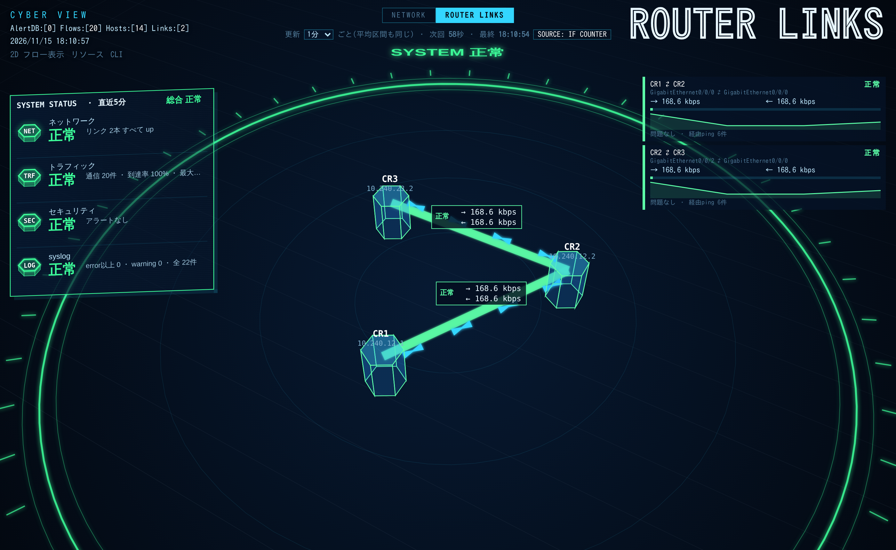


## Grafana / Grafana Loki の表示部分をこのビューで(v3)

Grafana がやっている「Prometheus のメトリクスと Loki のログを画面に出す」部分を、この 3D ビューで
行えるようにした。データの収集(snmp_exporter → Prometheus、`tools/device_log_to_loki.py` → Loki)は
そのまま使い、表示だけを置き換える構成。

```
Cisco CR1/CR2/CR3 ─SNMP→ snmp_exporter → Prometheus ─┐ PROMETHEUS_URL (rate(ifHCOutOctets[1m])*8)
                 └show logging→ device_log_to_loki → Loki ─┤ LOKI_URL (query_range {job=~".+"})
                                                           ↓
                                         エミュレータ /api/traffic/links・health・logs → /cyber-view
```

```bash
PROMETHEUS_URL=http://127.0.0.1:9090 LOKI_URL=http://127.0.0.1:3100 python app.py
```

どちらも無い/繋がらない時は、同じ値を持つエミュレータ内のIFカウンタ・ログ記録で表示する
(状態ボード下部に `METRICS: PROMETHEUS|IF COUNTER  LOGS: LOKI|INTERNAL` と出る)。
Prometheus が片側のIFしか監視していないリンクは、監視外の方向だけ内部カウンタで補う(`source: mixed`)。

### 画面内に立体で出すようにしたもの(右脇の文字一覧は既定で隠し、LIST ボタンで出せる)

- **ROUTER LINKS**: リンクの中点に、通信量に比例した高さの六角柱と、その上の立体プレート
  「NORMAL 7.3 Mbps」(状態: NORMAL / HIGH LOAD / CRITICAL / LINK DOWN)。リンク断は赤く脈動する
  「LINK DOWN 停止」プレート + 火花。両端には**インタフェースごと**の送受信
  (「Gi0/0/2 ↑3.9 Mbps ↓3.4 Mbps」)。真ん中のルータは、繋がるリンクごとに別のIFとして出る。
- **リンクの状態はリンク自体(断・使用率)だけで決める**: 1Gbps に 35Mbps 流れているような
  通常の通信は「NORMAL/正常」。両端装置のアラートや経由pingの失敗ではリンクを警告にしない
  (アラートは「警」の六角形、pingの失敗は PING NG プレートで別に出す)。
- **ping を打つと**、宛先の上に「PING OK 200/200・1500B」(緑)/「PING NG 0/5」(赤)の
  六角プレートが立ち上がる。
- **ログ**(Loki または内部記録)は、出した装置の上に「LOG ERROR %LINK-3-UPDOWN」(赤)/
  「LOG WARN」(橙)/「RECOVER」(緑)のプレートで浮かぶ。
- **NETWORK(/24 等)**: 直近30秒に通信のあった装置の上に「NORMAL 200 kbps」/「NG ×10」の
  プレート(重ならないよう左右に振り分け)。
- **アラートの花(図9風)**: 中央の赤い「警」、周りに検知元ごとの白い花びら
  (IDS=侵入検知ルール、FW=ASA の threat-detection が送信元を shun、SYSLOG=error 以上のログ、
  NET=リンク断)、黄色の多重六角、パネルまでのコイルの柱。実在製品のロゴは使わない。
  セキュリティ観点の判定は IDS/FW のアラートだけで行う。

ライブ検証(本物の Prometheus v2.54.1 + snmp_exporter + Loki 3.1.1 を起動、
`device_log_to_loki.py` で CR1〜CR3 の `show logging` を Loki へ送り、ping でトラフィック):

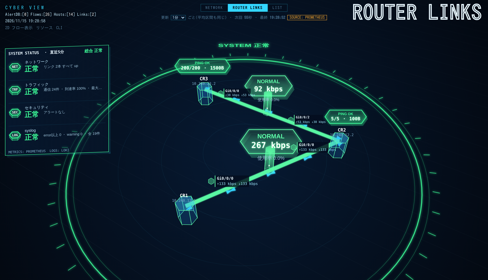
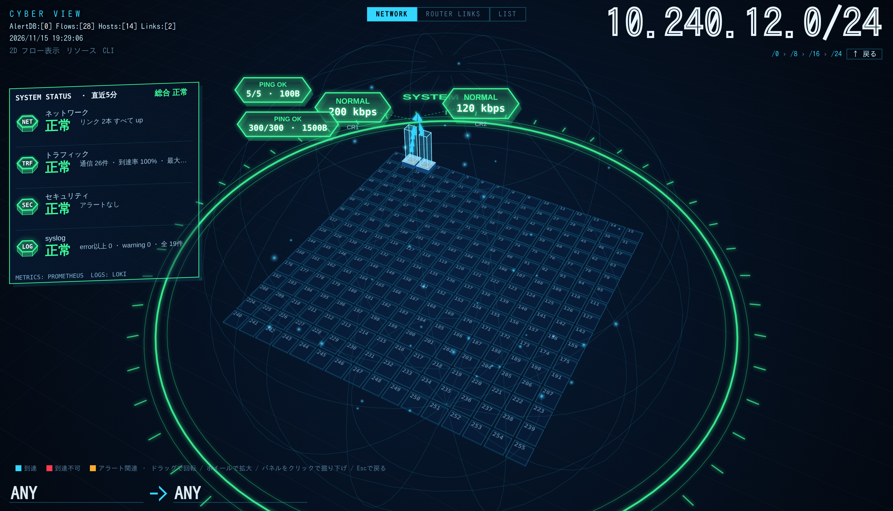
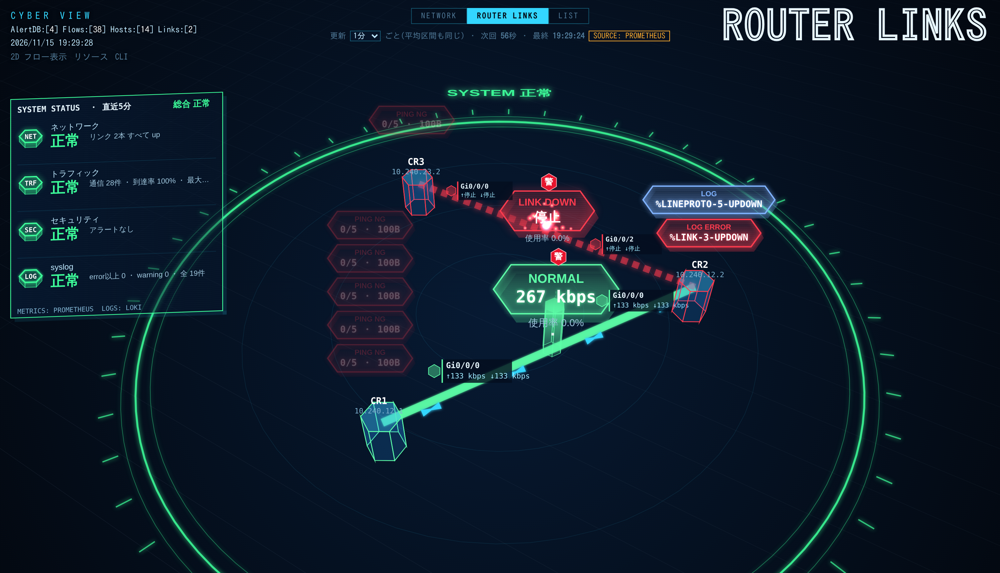


## link down の検知経路(STATE / SYSLOG / TRAP / POLL)(v4)

link down は、どの経路で気づいても同じ「LINK DOWN」表示になる。LINK DOWN プレートの下に
4つの検知経路のチップが並び、**点灯 = その経路が断を示している / 暗い = up を示している /
破線 = その経路のデータが無い** で、どれで気づいたか・全部一致しているかが分かる。

| 経路 | データ | 断/復旧の判定 |
|---|---|---|
| STATE | エミュレータ自身の IF 状態(ラボ内の装置のみ) | shutdown・リンク断 |
| SYSLOG | `LOKI_URL` があれば Loki(直近1時間)、無ければ内部記録 | `Interface X, changed state to (administratively) down/up`、Si-R の `X Link Down/Up` |
| TRAP | `SNMP_TRAP_LISTEN=0.0.0.0:1162` でアプリが受信した linkDown/linkUp | sysDescr(`host: IF down`)か ifDescr/ifName の varbind と送信元IPで装置・IFを特定 |
| POLL | `PROMETHEUS_URL` の snmp_exporter `ifOperStatus` | 2(down)/7(lowerLayerDown)=断、1=up、その他は判定に使わない |

リンク両端のどちらかの IF について、どれか1経路でも「最後に見た状態が down」ならリンクは断。
`/api/traffic/links` の各リンクに `evidence`(経路ごとの up/down/null)と `down_sources`、
状態ボードのネットワーク観点に「検知: CR2 ⇄ CR3 = STATE / SYSLOG / TRAP / POLL」が出る。
実機監視で trap だけ/syslog だけの環境でも、その経路のチップだけが点いて同じ LINK DOWN になる。

```bash
SNMP_TRAP_LISTEN=0.0.0.0:1162 PROMETHEUS_URL=http://127.0.0.1:9090 LOKI_URL=http://127.0.0.1:3100 python app.py
# 装置側: trap の送信先をこのアプリにする(エミュレータの Cisco)
snmp-server host 127.0.0.1 udp-port 1162 traps public
```

ライブ検証(本物の Prometheus + snmp_exporter + Loki + trap 受信): CR2 で
`snmp-server host 127.0.0.1 udp-port 1162 traps public` → `interface Gi0/0/2` → `shutdown`。
約35秒後(Prometheus の scrape 後)に4経路すべてが DOWN、`no shutdown` で全経路 up に戻り NORMAL。


この作業で見つけて直した問題: syslog の重複除外(同じ出来事を実 syslog 送信と CLI 通知の両方で
拾うための1秒以内の同文除外)が、`shutdown`→`no shutdown` を1秒以内に繰り返すと最後の
「changed state to up」を重複として捨ててしまい、復旧したのに断のまま残っていた。
間に同じ IF の逆の状態変化が挟まる場合は別の出来事として残すようにした。

## 応答なし(消失)と、スキャン/総当たりの検知(v5)

### SNMP 応答なし(消失)
`PROMETHEUS_URL` があるとき、Prometheus の `up{job="cisco-snmp"}` が 0 の装置(snmp_exporter が
SNMP の応答を得られない: 電源断・到達不可・コミュニティ不一致など)を「応答なし」にする。

- ROUTER LINKS: その装置の六角柱が灰色で点滅し「NO RESPONSE 消失 / SNMP 応答なし」。
  つながるリンクは灰色の点線・「NO RESPONSE 不明」になり(量は分からないので「不明」)、
  検知経路チップの POLL が「LOST」。STATE/SYSLOG/TRAP のチップと見比べると、
  装置自体が落ちたのか SNMP だけが届かないのかが分かる(下の画像は SNMP だけ止めた例で、
  STATE・SYSLOG は up のまま)。
- NETWORK: 装置のパネル上に「NO RESPONSE 消失」。状態ボードのネットワーク観点は
  「異常 ・ 応答なし 1台 / 応答なし: CR2 (10.240.12.2)」。
- `/api/traffic/links` は `unreachable`(装置と instance)と、リンクごとの `lost`・`state: "lost"` を返す。

### Cisco IOS の login block-for(実機コマンド)
```
login block-for 60 attempts 3 within 60
login on-failure log
login on-success log
show login
```
実 SSH/Telnet リスナーでのログイン失敗を数え、閾値で Quiet Mode に入って以降のログインを拒否し、
実機と同じ `%SEC_LOGIN-4-LOGIN_FAILED` / `%SEC_LOGIN-1-QUIET_MODE_ON` /
`%SEC_LOGIN-5-QUIET_MODE_OFF` を出す(`show logging`・Loki・/cyber-view の SYSLOG 花びら)。
`show running-config` にも出て、設定は保存・復元される。

### ポートスキャン(IDS)
実機の IOS ルータにはポートスキャン(接続だけで認証しない)の標準検知は無いので、ネットワーク側の
センサーとして /cyber-view の IDS ルール `conn_scan` を追加した: 同じ送信元から装置の実リスナー
(SSH/Telnet)へ 30秒間に10回以上の TCP 接続で「短時間の大量接続(ポートスキャン/総当たりの疑い)」
(high)。アラートの花は装置の上に IDS の花びらで出る。ASA なら従来どおり
`threat-detection scanning-threat shun` が送信元を遮断し FW の花びらになる。

ライブ検証(本物の nmap 7.94 で CR2 の実 SSH リスナー 10.240.12.2:22 を攻撃):
```
$ nmap -Pn -sV -p 21-25,80,161,443,830 10.240.12.2
22/tcp  open   ssh   Paramiko Python sshd 5.1.0 (protocol 2.0)
$ nmap -Pn -p 22 --script ssh-brute --script-args userdb=users.txt,passdb=pass.txt 10.240.12.2
CR2# show login
     Router presently in Quiet-Mode.
     Will remain in Quiet-Mode for 60 seconds.
CR2# show logging
*Nov 15 23:46:57.218: %SEC_LOGIN-4-LOGIN_FAILED: Login failed [user: admin] [Source: 10.240.12.2] ...
*Nov 15 23:46:57.218: %SEC_LOGIN-1-QUIET_MODE_ON: Still timeleft for watching failures is 60 secs, ...
$ (nmap -sT -sV -p 22 を連続実行)
alert: conn_scan IDS high cr2  10.240.12.2 から 30秒間に 10 回接続 (port 22)
CR2(config)# no snmp-server community netlab-ro     → 約35秒後 up{instance="10.240.12.2"}=0 → 応答なし
```
nmap は同じホスト上から実行したので、Source が装置自身のIPになっている(ラボの都合)。
既定の SYN スキャン(-sS)は TCP 接続を完了しないため装置側の accept に現れず、数に入らない
(実機の IOS も同じく、完了しない接続はログイン失敗にならない)。


## 攻撃を受けたときの見え方(ライブ確認)

### ポートスキャン(nmap -sT -sV)

CR2(10.240.12.2)の SSH を有効にし、本物の nmap で `nmap -Pn -sT -sV -p 1-1024 10.240.12.2` を5回実行した。
実リスナーへの accept 数から IDS ルール `conn_scan` が発火する
(`cr2 10.240.12.2 から 30秒間に 10 回接続 (port 22)`)。

- CR2 の柱の上に赤い「警」六角形(IDS の花びら・PSCAN)と螺旋柱
- 状態ボード: セキュリティ「異常 / 短時間の大量接続(ポートスキャン/総当たりの疑い)」、他の3観点は正常のまま
- Host View(/32)の上部にも「警 ×1 PSCAN」

SYN スキャン(`-sS`)は接続が成立しないため数えない(実機の IOS と同じ)。

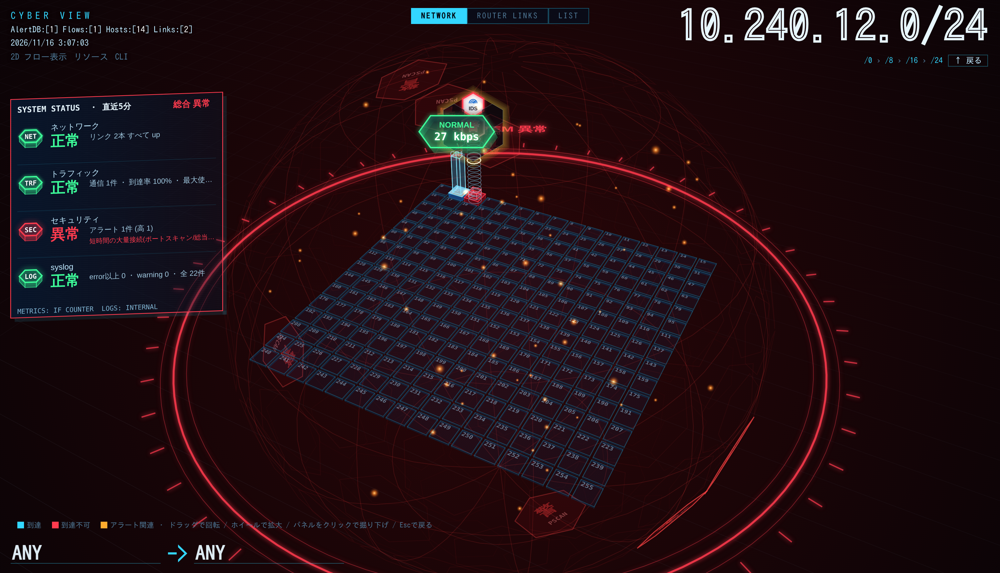


### SSH 総当たり + login block-for

```
login block-for 60 attempts 3 within 30
login on-failure log
login on-success log
```

を入れた CR2 に `nmap -p 22 --script ssh-brute` を実行。3回失敗で `%SEC_LOGIN-1-QUIET_MODE_ON`、
`show login` は `Router presently in Quiet-Mode`、以降は正しいパスワードでも接続を即切断。
画面では CR2 上に LOG ERROR(QUIET_MODE)/ LOG WARN(LOGIN_FAILED)/ LOG(LOGIN_SUCCESS)の
プレートが立ち、状態ボードは syslog「異常」になる。

ライブ確認中に、ボードが最大10秒古いまま(ログは浮かんでいるのに「正常」)になる表示ずれを見つけた。
新しいアラートや warning 以上のログを受け取った時点でボードも即時更新するよう修正済み。

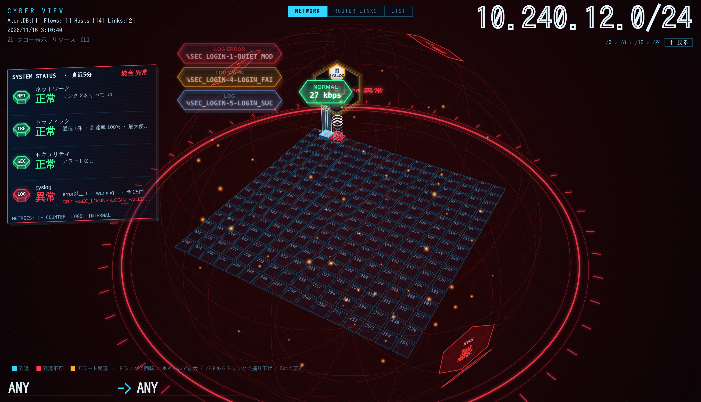

## 経路の Info 表示 / フラップの警告 / 視点操作 (v8)

### 経路の追加・削除・変更 → INFO

`engine/route_watch.py` が3秒ごとに全装置の最良経路(`rib_engine.get_best_routes`)を前回と比べ、
差分を `GET /api/traffic/routes?since=<seq>` で返す。static / connected / OSPF / BGP / RIP / EIGRP
すべて同じ扱いで、OSPF 等の次ホップは `show ip route` と同じ実IPに直してある。最初に見た装置は
基準を取るだけ(起動直後に全経路が「追加」にならない)。画面では装置の上に
`INFO ROUTE ADD`(水色)/ `INFO ROUTE DEL`(灰)/ `INFO ROUTE CHG` が浮かび、LIST にも並ぶ。
実機の IOS は経路の増減を syslog に出さない(debug ip routing を除く)ため、syslog とは別のイベント。

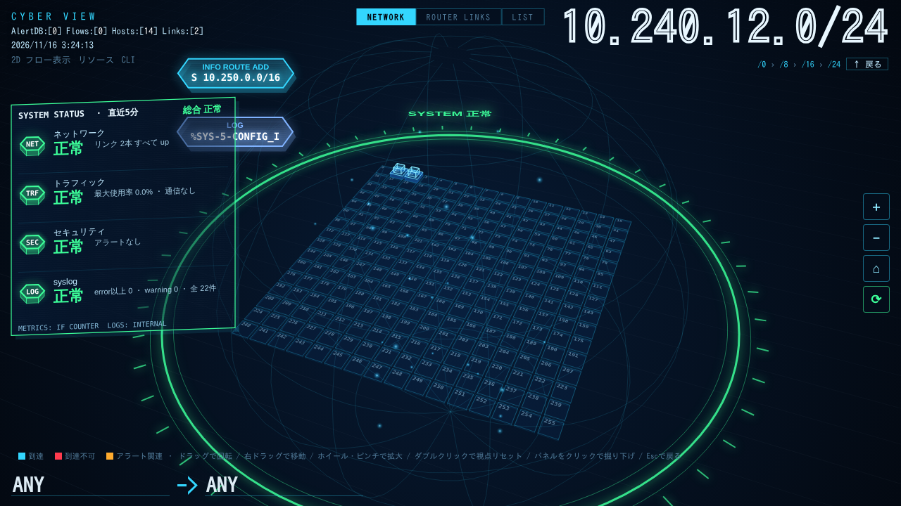

### ログからのフラップ検知 → WARN(警告)

ルールは `engine/flap_rules.py`(一覧は `GET /api/traffic/flap-rules`)。1回の down は
既存の LINK DOWN / syslog error が受け持ち、ここでは「繰り返し」だけを見る。

| ルール | 機種 | 元のログ | しきい値 |
|---|---|---|---|
| if_flap | Cisco/Catalyst(/Nexus) | `%LINK-n-UPDOWN` / `%LINK-5-CHANGED` | 60秒に状態変化3回 |
| if_flap | Si-R/SR-S | `[LINK] lanN Link Down/Up` | 60秒に3回 |
| ospf_flap | Cisco/Catalyst/Si-R | `%OSPF-5-ADJCHG` / `[OSPF] neighbor X ... state: Full / is down` | 120秒に3回 |
| bgp_flap | Cisco/Catalyst/Si-R | `%BGP-5-ADJCHANGE` / `[BGP] peer X ... Established / is down` | 300秒に3回 |
| eigrp_flap | Cisco/Catalyst | `%DUAL-5-NBRCHANGE` | 120秒に3回 |
| fhrp_flap | Cisco/Catalyst/Si-R | `%HSRP-5-STATECHANGE` / `%VRRP-6-STATECHANGE` / `[VRRP] VRID n ... state changed` | 120秒に4回 |
| stp_tc_flap | Catalyst | `%SPANTREE-6-TOPOTRAP` | 60秒に5回 |
| stp_root_flap | Catalyst | `%SPANTREE-5-ROOTCHANGE` | 300秒に3回 |
| mac_flap | Catalyst | `%SW_MATM-4-MACFLAP_NOTIF` | 1回(IOSが判定済み) |
| errdisable_flap | Cisco/Catalyst | `%PM-4-ERR_DISABLE: link-flap` | 1回(IOSがポートを停止) |
| route_flap | 全機種 | 経路の追加/削除/変更(上の route_watch) | 120秒に4回 |

数えるのは「前回と違う状態」だけ(LINK と LINEPROTO の同じ down を二重に数えない)。
アラートは severity `warning`。画面では装置の上に `WARN IF FLAP` などの橙のプレート、
警告だけの装置は花の中央が橙の「注」(警報が混ざると赤の「警」)。状態ボードの syslog 観点は
「注意 ・ フラップ N件」(error 以上があれば異常)。セキュリティ観点には数えない。

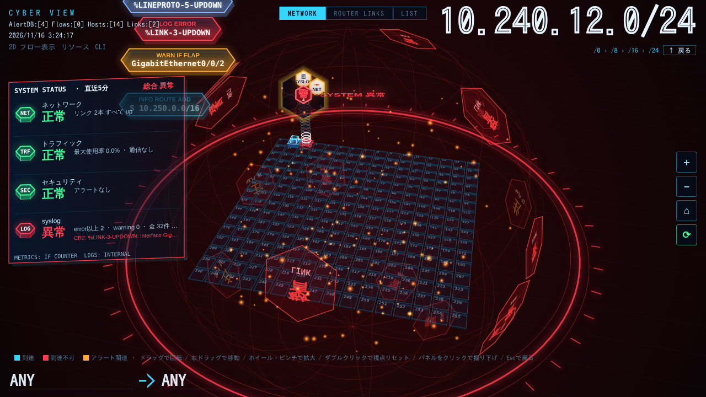

### 視点操作

- 何もしないと2.5秒後からゆっくり回転し、少し上下に揺れる(右側の ⟳ でオン/オフ)
- マウス: 左ドラッグ=回転 / 右ドラッグ(または Shift+ドラッグ)=平行移動 / ホイール=ズーム / ダブルクリック=リセット
- タッチ: 1本指=回転 / 2本指=ピンチでズーム+平行移動 / ダブルタップ=リセット
- 右側のボタン: ＋ / － / ⌂(リセット) / ⟳(自動回転)

## デモモード(DEMO ♪)

上の DEMO ボタンで、デモ用ラボの自動シナリオ・合成音楽・視点の自動巡回が始まる(もう一度押すと止まる)。

- **ラボ**(`engine/demo_scenario.py`、`POST /api/demo/start` / `stop`、`GET /api/demo/status`):
  Cisco 4台(demo-r1〜r4)を四角形につないで OSPF(`network 10.200.0.0 0.0.255.255 area 0`)。
  90秒周期で「通常運用 → R3⇄R4 障害(R2 経由に迂回) → 復旧 → R1⇄R2 フラップ → 経路追加 → 経路削除」を繰り返し、
  その間 R1→R3 の LAN へ強弱をつけた通信を流す。画面上部に今の場面を表示する。
- **音楽**: 外部の音源ファイルは使わず、Web Audio でその場で合成する(A マイナーのアンビエント、
  Am-F-C-G・BPM 92。和音・ベース・ペンタトニックのアルペジオ・軽いキック)。著作権の心配が無く、オフラインでも鳴る。
  出来事に合わせて効果音(情=高いチャイム、注=短い警告音、警=低い音)。ブラウザの自動再生制限のため、
  DEMO ボタンを押した時に鳴り始める。字幕の ♪ で消音/再開。
- **視点**: 25秒ごとに ROUTER LINKS と NETWORK(10.200.0.0/16)を行き来する。触っている間(8秒)は巡回しない。

デモを作る途中で、OSPF の `network` 文を広い範囲(/16)で書くと経路が1本も入らないエミュレータの不具合を見つけて直した
(範囲をそのまま広告していた。実機どおり範囲に入るインタフェースのサブネットを広告するように変更、
`tests/test_ospf_network_range_and_demo.py`)。

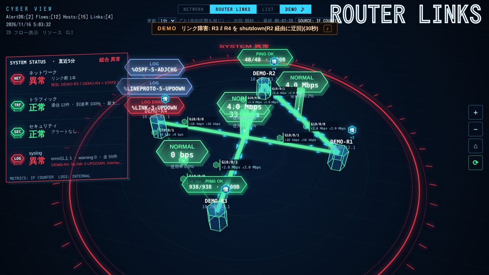
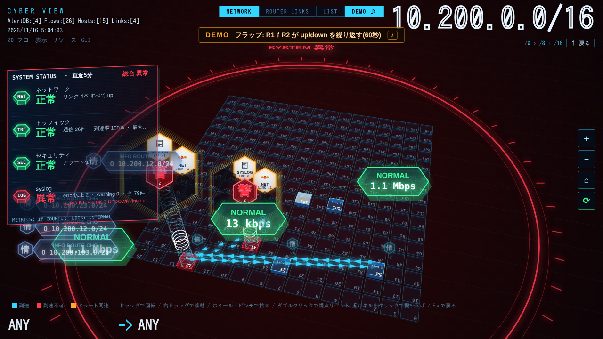

## OSPF モード(v12)— 隣接状態・エリア・最短経路ツリー

依頼: 「3台繋いだ状態で OSPF を組んだ場合、どう表現できるか」→ 不足していた OSPF 固有の情報
(隣接ごとの状態・Dead タイマー・エリア・ABR・SPF の経路)を描く OSPF ボタンを追加。

データは `GET /api/traffic/ospf?dest=<net/len>`(`engine/ospf_view.py`)。エンジンが持っている隣接と経路を
そのまま返すだけで、画面側では計算しない(`show ip ospf neighbor` / `show ip route` と同じ値になる)。2秒ごとに取得。

| 画面の要素 | 意味 | 元データ |
|---|---|---|
| 床の円(色付き) | エリア。ABR は複数の円にまたがり、柱に2つ目のエリア色の帯と紫の「ABR」バッジ | network 文のエリア |
| リンクの線 | 下地=エリアの色、上=隣接状態(緑 FULL / 橙 確立中・片側だけ / 赤点滅 DOWN) | 両端の neighbor テーブル |
| 両端の丸いバッジ | **その装置から見た**隣接(`FULL/DR` など)と **Dead タイマーの残り秒**(円弧。Hello を受けるたびに満タンに戻り、30%未満で赤) | `show ip ospf neighbor` の State / Dead Time |
| 中点のプレート | `ADJ FULL` / `ADJ DOWN` / `ADJ DOWN/FULL`(片側だけ)とエリア、理由(リンク断・エリア不一致・Hello間隔の不一致・認証キーの不一致) | |
| 金色の線と流れる矢印 | 選んだ宛先への**最短経路ツリー**(各ルータの OSPF 経路の次ホップ) | 各ルータの OSPF 経路 |
| 宛先ルータの光の柱 | `DESTINATION 10.70.103.0/24`(直結で持つルータ) | |
| 各ルータ上のプレート | `O IA cost 20 → OSPF-R3`(経路の種類・コスト・次ホップ)、経路が無ければ赤の `NO ROUTE` | |
| ルータ名の下 | Router-ID、LSDB 件数・経路数・SPF 計算回数 | |
| 金色の波紋「SPF」 | そのルータで SPF を再計算した | SPF 回数の増加 |
| ポップアップ | 隣接の変化(`ADJ R1⇄R3 FULL → PARTIAL`、警/情)、`SPF 経路変更 R1 → R2 (cost 30)`、`NO ROUTE`、経路の復旧 | 前回との差分 |

宛先は上部のセレクトで選ぶ(LAN が先、ルータ間リンクが後)。スマホ幅では FULL の隣接の中点プレートと
LSDB 行を省く。スタンドアロン版(実機監視)は OSPF の状態を持たないので、API が 404 → OSPF ボタンを隠す。

### ライブ確認(3台の三角形、R3 の LAN を area 1 にして R3 を ABR に)

```
R1(1.1.1.1) ─ 10.70.12/24 ─ R2(2.2.2.2) ─ 10.70.23/24 ─ R3(3.3.3.3, ABR)
     └──────────────── 10.70.13/24 ───────────────────┘
R1 LAN 10.70.101.0/24 (area 0)                 R3 LAN 10.70.103.0/24 (area 1)
```

正常時(宛先 10.70.103.0/24): R1・R2 とも R3 へ直行(`O IA cost 20 → OSPF-R3`)、隣接 3/3 FULL。


R1 の Gi1/0/2(R3 向け)を shutdown:

- R1 側は IF 断で隣接が即 Down、**R3 側は Hello が来なくなっても Dead タイマー(40秒)が切れるまで FULL のまま**
  → リンクは橙の `ADJ DOWN/FULL`、R3 側のバッジの数字が減っていく
- R1 の経路が `→ OSPF-R2 (cost 30)` に切り替わり、ツリーの矢印が R1→R2→R3 に変わる(`SPF 経路変更` のポップアップ)

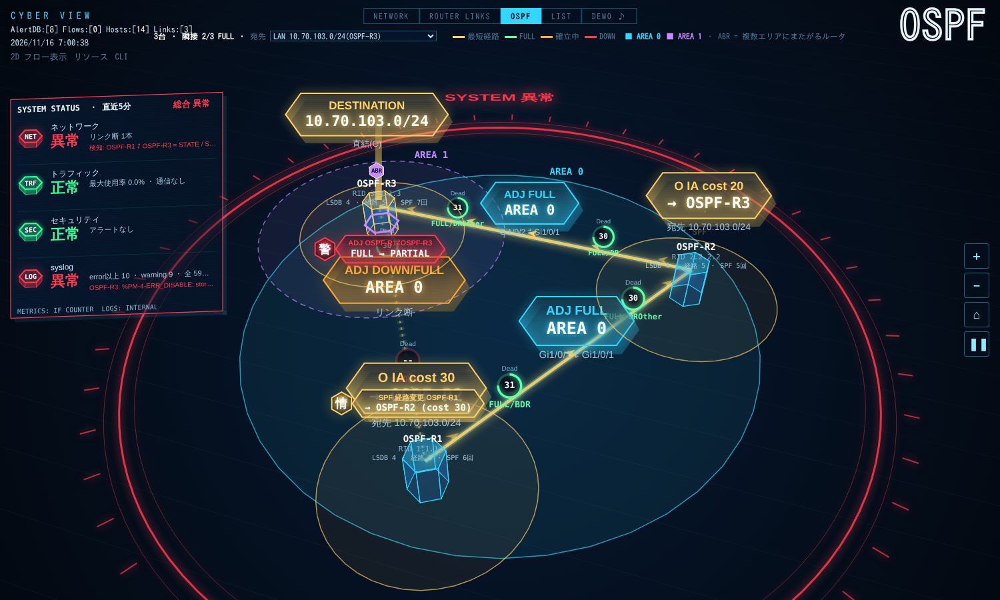


API で追った R3 側の状態(2.5 秒ごと):

```
0s  full    R1=Full R3=Full dead_b=34
3s  partial R1=Down R3=Full dead_b=32
...
33s partial R1=Down R3=Full dead_b=2
36s down    R1=Down R3=Down dead_b=-      ← Dead timer expired
```

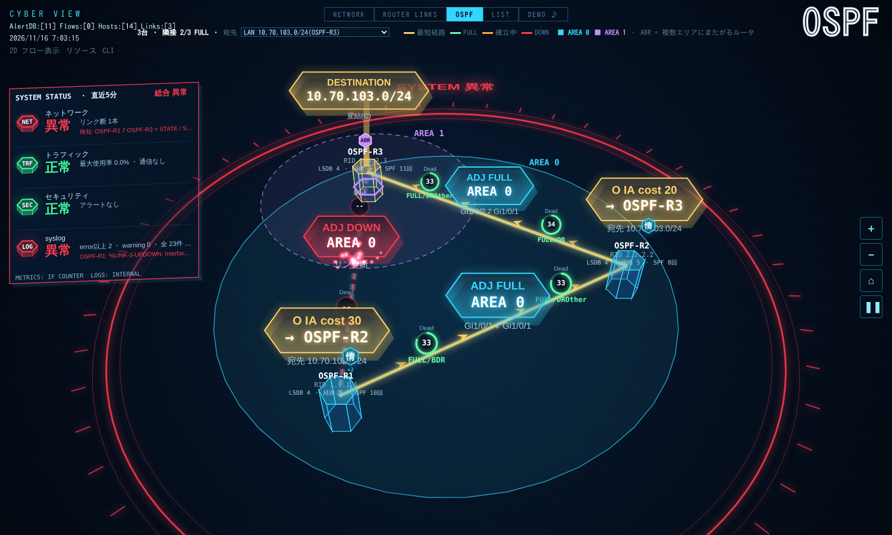

no shutdown → 次の Hello で隣接が FULL に戻り、R1 の経路が R3 直行(cost 20)に戻る。

スマホ幅:

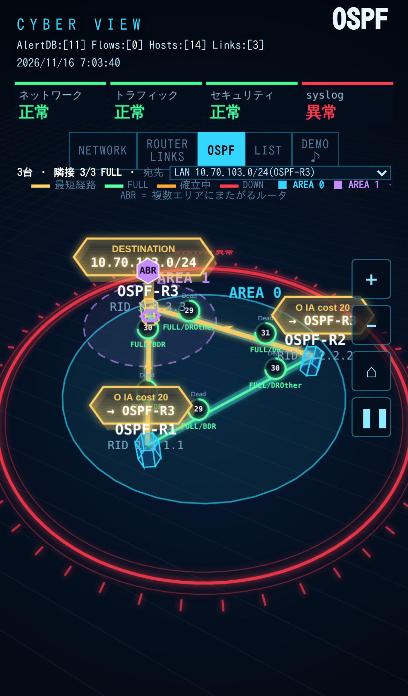

### 気づいたこと(直していない)

- エンジンの DR/BDR はルータ単位(リンク=セグメントごとではない)ので、同じルータが相手によって
  `BDR` / `DROther` と違って見えることがある。画面は `show ip ospf neighbor` の表示どおりに出している。
- 同じ構成でも、DR になっているルータの経路だけコストが小さく出る(三角形で R3 から R1 の LAN が cost 11、
  R2 からは cost 20)。Network LSA 経由の計算のずれで、`show ip route` も同じ値。
- 片側だけ shutdown したとき、対向は Dead タイマー待ちになる(実機でもメディアコンバータや L2 スイッチを挟むと同じ)。
  直結の実機なら対向もリンクダウンを検知して即 Down になる。

## 背景の切り替え(標準 / 金魚鉢 / 富士山)(v13)

依頼: 「ニルバーナの背景を金魚鉢か富士山か選べてほしい」。右の操作ボタン列の一番下(◎ → 🐟 → 🗻)を押すたびに
**標準 → 金魚鉢 → 富士山** と切り替わる。選んだ背景はブラウザに記憶され、`?bg=goldfish` / `?bg=fuji` でも指定できる。
NETWORK / ROUTER LINKS / OSPF のどのモードでも使える。

- 画像ファイルは使わず Canvas で描いている(外部素材・著作権の心配なし)。
- **金魚鉢**: 丸いガラス鉢の中に水・差し込む光・水面のゆらぎ・砂利と揺れる水草・立ちのぼる泡、金魚4匹(和金・更紗・黒など)が左右に泳ぐ(依頼により大きめ。鉢の大きさに合わせて拡大)。
- **富士山**: 夜明け前の空と星・月、平らな山頂と筋状の雪、サイバー風に流れる等高線、裾野のもや、湖面への逆さ富士と月明かり。
- 視点を回すと背景も少しだけ横にずれる(奥行き感)。スマホ幅では、上の状態表示に隠れないよう富士山の地平線を低めにしている。
- アラートで画面が赤く染まる動きは、どの背景でも赤い半透明を重ねて残している。
- ヘッドレス Chromium で約 34〜38fps(金魚鉢、1500×900)。


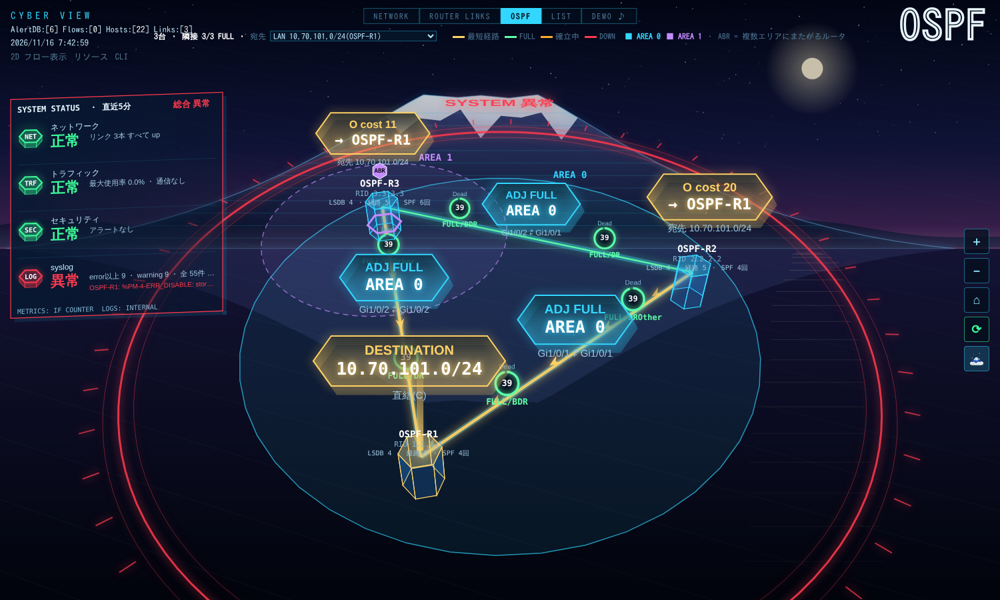
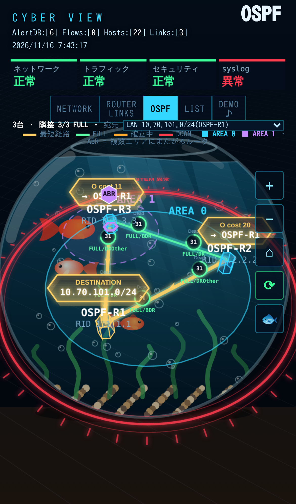
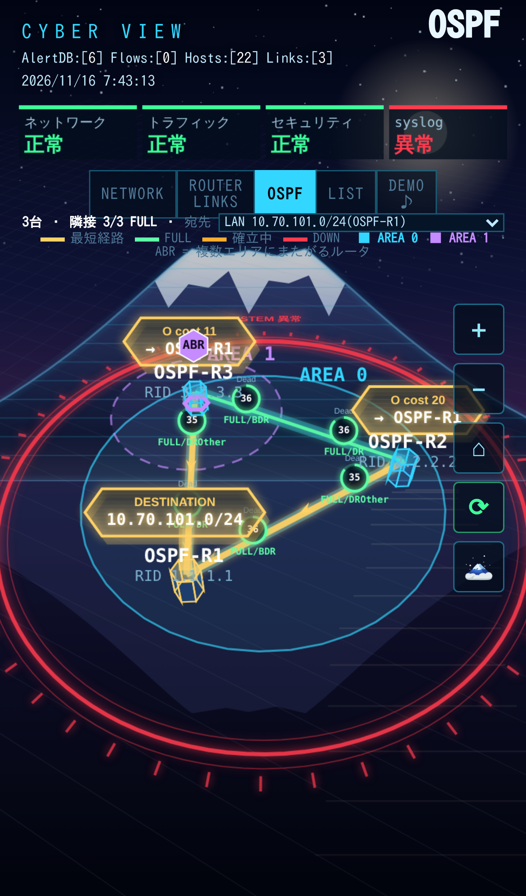

## メトリクス収集基盤の呼び名「ヴァルハラ」(v14)

依頼: 「Prometheus のネーミングをヴァルハラにしよう」。Cyber View の画面上では、メトリクス収集基盤(Prometheus)を
**ヴァルハラ / VALHALLA** と呼ぶ。

- 変わるのは画面の表示だけ: `SOURCE: VALHALLA`、状態ボードの `METRICS: VALHALLA`、不達時の「(ヴァルハラ 不達)」、
  スタンドアロン版の状態ボード「取得元 ヴァルハラ」。両方を混ぜて使っている場合は `VALHALLA+IF COUNTER`。
- 変えていないもの: 接続先の実体(本物の Prometheus)、環境変数 `PROMETHEUS_URL`、設定ファイルの `sources.prometheus`、
  API の `source: "prometheus"` / `prometheus_url` / `prometheus_error`。既存の設定やスクリプトはそのまま動く。
- `SOURCE:` にマウスを乗せると「ヴァルハラ(Prometheus): <URL>」と中身が分かるようにしている。

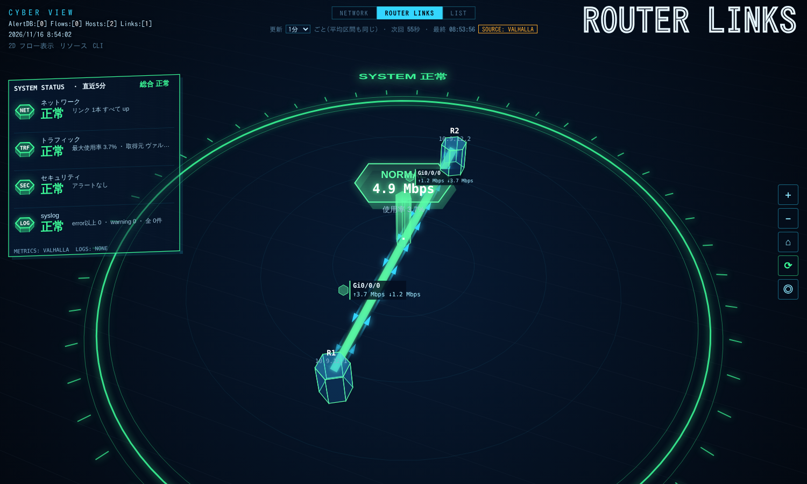

## ヴァルハラとの連携(再生・予測・OSPF-MIB・警報の取り込み)(v15)

ニルヴァーナの判断を `/metrics` でヴァルハラに貯め、その記録から過去を 3D で再生する(ROUTER LINKS の「⏪ 再生」)、
使用率の予測と「いつもと違う」をリンクのプレートに出す、ヴァルハラの警報を花の「VALHALLA」花びらで出す、
エミュレータの SNMP に OSPF-MIB を足してスタンドアロン版でも実機の OSPF 隣接を表示する。詳細とライブ確認は
[valhalla-nirvana.md](valhalla-nirvana.md)。


## BGM(ジャズ / レゲエ / アンビエント)(v16)

依頼: 「ニルヴァーナを動作させる時にジャズかレゲエを流して欲しい。通常も流せる?」。右の操作ボタン列の一番下の ♪ を押すたびに
**なし → ジャズ(🎷)→ レゲエ(🌴)→ アンビエント(🎹)→ なし** と切り替わる。DEMO 中でなくても鳴る。DEMO は選んだ曲調で鳴る
(なしの時はアンビエント)。

- 曲は Web Audio でその場で合成(音源ファイル無し)。既存曲のコピーではなく、ジャンルらしいリズムと和音の型だけを使う。
  - ジャズ: スウィングの ii-V-I(Dm7-G7-Cmaj7-A7)、ウォーキングベース、ライドシンバルの「チン・チキ」、2・4拍の裏のエレピ風コンピング、BPM 132
  - レゲエ: ワンドロップ(3拍目にキックとリム)、裏拍のスカンク、オルガンのバブル、2拍目から入るベース、Am7-D7、BPM 74
- 選んだ BGM は記憶する。ブラウザは操作なしでは音を出せないので、次に開いた時は最初に画面を触った時に鳴り始める。
  `?bgm=jazz` / `?bgm=reggae` でも指定できる。

