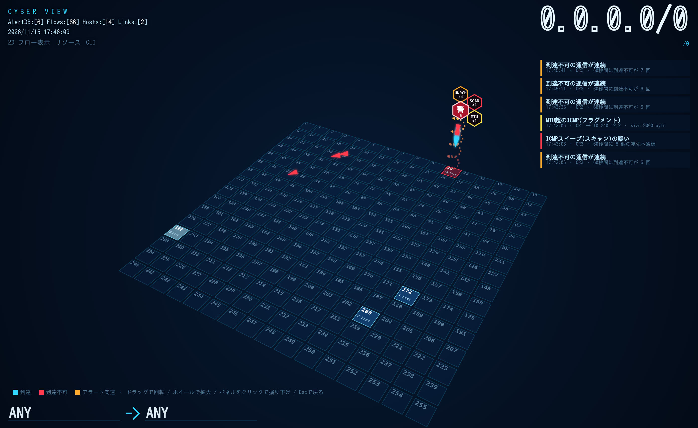

# Cyber View(/cyber-view): NIRVANA改風の3D表示

NICT の NIRVANA改 の論文図(Network View・/0〜/32 のドリルダウン・Host View・
サブネットを球で囲む表示・赤い六角形のアラート)を参考に、このエミュレータの
実データだけで描く3Dビュー。ロゴ・名称・実在ベンダーのマークは使っていない
(名前は「CYBER VIEW」)。外部ライブラリ無しの Canvas 2D と自前の透視投影で描いている。

`/traffic-flow`(2Dの経路アニメ + アラート + 再現)と相互にリンクしている。

## 画面

| 階層 | 表示 |
|---|---|
| /0・/8・/16 | 16×16 = 256枚のパネルが床面に並ぶ。1枚が1つのアドレスブロック(/0なら x.0.0.0/8)。装置のいるブロックは明るく、直近30秒の通信量で白く光る。クリックで1階層下へ |
| /24 | サブネット全体を**ワイヤーフレームの球で囲む**(論文の図2)。パネル=各IPで、装置のいるIPには通信量に比例した高さの柱が立つ。クリックで Host View |
| /32 (Host View) | 球の中央に装置カード(ホスト名・機種・全IF の IP/UP・DOWN/入出力バイト・フロー数・失敗数)、球面に通信相手(リンク相手 + 実際に通信した相手)、下に SESSION(そのホストの直近7フロー) |

共通:
- 三角形の粒が通信の向きに飛ぶ(水色=到達、赤=到達不可で途中で×、橙=アラートに関係したフロー)。
  今のブロックの外にいる相手とのフローは外周の上空から飛んでくる。
- アラート(直近10分)は、対象パネルの上に赤い「警」の六角形と、ルール別の花びら
  (SCAN / UNRCH / FLOOD / MTU / LINK と件数、色は重要度)が浮かび、パネルまで螺旋の柱で繋がる。
- 左上: `AlertDB:[n] Flows:[n] Hosts:[n] Links:[n]` と時刻。右上: 今の CIDR を大きく表示 + パンくず。
- 左下: `ANY -> ANY` に送信元・宛先(IPの前方一致かホスト名の一部)を入れるとその粒だけ表示。
- 右: 最新アラート6件。クリックするとそのアラートの送信元の Host View へ飛ぶ。
- ドラッグで回転、ホイールで拡大縮小、Esc / Backspace / 「↑ 戻る」で1階層戻る。操作が無いとゆっくり自転する。
- 最初は前回見ていたブロックを開く(localStorage、使えなくても動く)。

## データ

- `GET /api/traffic/hosts`(新規): 全装置の IP・プレフィックス・IF の UP/DOWN
  (shutdown と vnet のリンク断)・入出力バイト(dp_engine、SNMP の ifHC*Octets と同じ値)・リンク相手。
  127.0.0.0/8 は表示の意味が無いので除外。5秒ごと。
- `GET /api/traffic/flowmap?since=&alert_since=`(既存): 新しいフローとアラートだけを2秒ごとに取得。
- フローイベントに **`src_ip`** を追加した(以前は送信元の装置IDだけで、IPアドレス空間に置けなかった)。
  送信元IP = 経路の次ホップへ向くIFのIP(IOS の ping と同じ選び方)。次ホップが無ければ最初のIP。

## ライブ検証

CR1–CR2–CR3 のラボ(`iac/cisco-traffic-monitoring/lab/provision_cisco_lab.sh` + CR3 追加)を作り、
`ping 10.240.3.1 repeat 50 size 1500`(CR1→CR3 LAN)、CR3 から 172.16.1〜9.1 へのスイープ
(SCAN と UNRCH のアラート)、`ping 10.240.12.2 size 9000`(MTU アラート)、
到達不可の宛先への ping を流しながら Playwright で /0 → 10 → 240 → 12 → 10.240.12.1 と
実際にパネルをクリックして降り、各階層を撮影した(上の画像。1400×860 と 390×800、JS エラー 0)。
Esc で /32 → /24 に戻ることも確認。

確認しながら直したもの: 階層を移った後に前の階層のツールチップが残る、/24 の球が画面からはみ出す
(/24 だけカメラを引く)、Host View で SESSION 表示がフィルタ欄と重なる、スマホ幅でパンくずが
状態行と重なる・カードの列がはみ出す(スマホではバイト列を省略)。

## テスト

`tests/test_cyber_view.py`: ページのルート・認証除外・トークンのキー、2つのページの相互リンク、
`/api/traffic/hosts` の形と値(カウンタ・shutdown で DOWN・127.x 除外)、
フローの `src_ip` が次ホップ側IFのIPになること。

## スコープ外

- 論文の図にある「通信の自動遮断」は入れていない(アラートは表示のみ)。
- 描けるのは ping 由来のフローだけ(エミュレータに実データプレーンが無いのは /traffic-flow と同じ)。
- 同じIPを持つ装置が複数ある場合(デフォルト装置どうし等)、パネルには最初の1台だけを表示する。

## ROUTER LINKS(ルータ間トラフィックと問題の有無)

上部の **ROUTER LINKS** ボタン(または `/cyber-view?view=links`)で、ルータ同士のリンクだけを
円形に並べた表示に切り替わる。端末(pc)・NetAttest・ALB とのリンクは出さない。

- **更新間隔**: 既定1分(10秒 / 1分 / 5分を選べる)。表示する bps はその間隔の平均で、
  画面上部に「次回 n秒」と最終更新時刻が出る。
- **リンクの線**: 太さ=通信量(対数)、色=状態。両方向それぞれに三角形の粒が流れ、量が多いほど本数が増える。
  中点に「→ A→B の bps / ← B→A の bps」と状態のラベル。
- **状態**(悪い順): `断`(どちらかのIFがshutdown/リンク断、破線が点滅 + ×) /
  `警告`(使用率80%以上、または両端の装置にアラート。ラベル横に「警」) /
  `注意`(使用率50%以上、またはそのリンクを通ったpingが失敗) / `正常`。
  使用率は ifHighSpeed と同じ 1Gbps を分母にしている。
- **ルータ**: 六角柱。枠の色は接続しているリンクの中で最も悪い状態。
- **右のリスト**: 悪い順に並び、各リンクの両方向 bps・使用率バー・直近1時間のスパークライン
  (1分刻み)・問題の理由(「IF断」「使用率 85%」「経由pingの失敗 3」「警 …」)。クリックで3D側を強調。

### データソース(Prometheus から渡すか)

`GET /api/traffic/links?window=60`:

- **PROMETHEUS_URL が無い場合(既定)**: エミュレータのIFカウンタを10秒ごとにサンプリングし
  (起動時から常時。画面を開いた瞬間から1分平均が出る)、window 秒の差分で bps を出す。
  このカウンタは SNMP の `ifHCInOctets`/`ifHCOutOctets` と同じ値なので、Prometheus で
  `rate(ifHCOutOctets[1m])*8` を取るのと同じ意味の数字になる。
- **PROMETHEUS_URL=http://127.0.0.1:9090 を付けて起動した場合**: `iac/cisco-traffic-monitoring` の
  Prometheus に `rate(ifHCOutOctets{job="cisco-snmp"}[1m]) * 8` を問い合わせ、`instance`(ルータのIP)と
  `ifName`(Gi0/0/0 等の短縮名)でリンクの各IFに対応づける。画面右上のバッジが
  `SOURCE: PROMETHEUS` になる。監視対象外のルータのリンクは内部カウンタで補い、
  Prometheus に繋がらない時は内部カウンタに戻してバッジに「Prometheus 不達」と出す。

実機のルータを Prometheus で監視していて、その数字をこの画面に出したい場合は後者を使う。
エミュレータのラボだけなら Prometheus を挟まなくても同じ数字になる。
