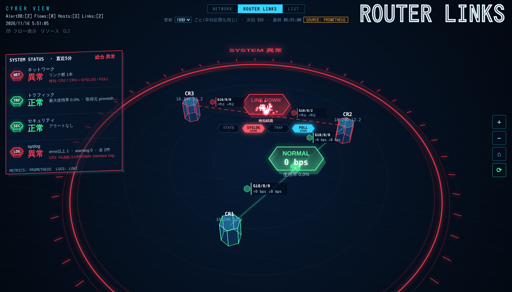
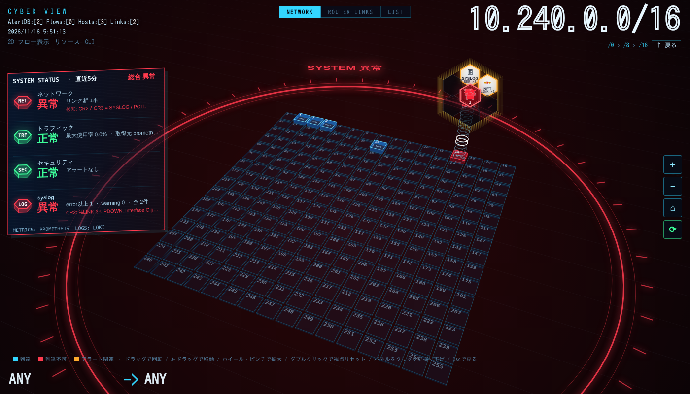
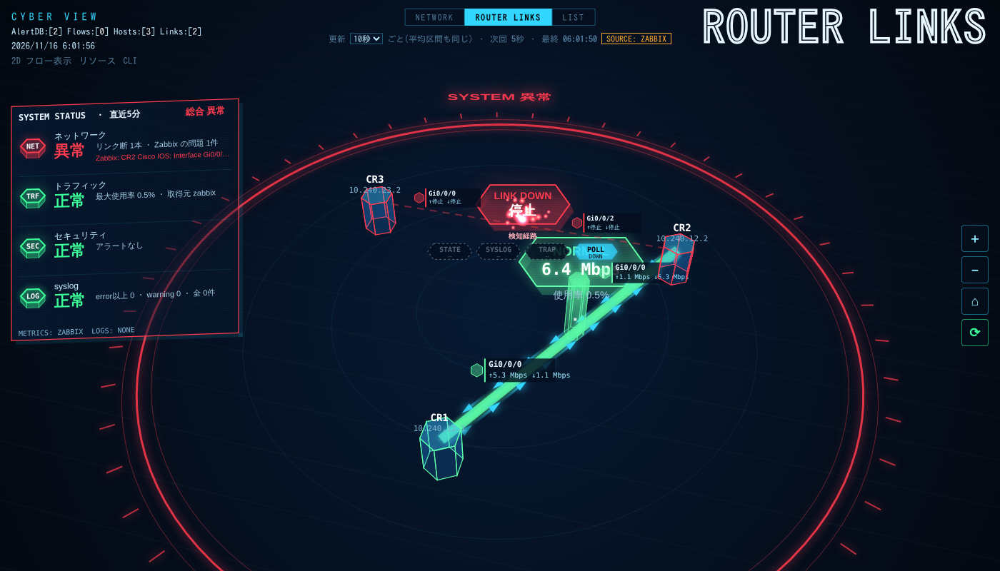

# Cyber View スタンドアロン版 — 実機の監視環境向け(動作確認の記録)

依頼: 「別のシステムやリポジトリ(実機の監視環境など)に、同じような画面を作りたい」。
データ元は Prometheus+snmp_exporter / Loki(syslog)/ Zabbix、トポロジは設定ファイルに手書き、
置き場所はこのリポジトリ内の単体版(`cyber-view-standalone/`)。使い方は `cyber-view-standalone/README.md`。

## 作りの要点

- 画面(`web/cyber_view.html`)はラボ版と**同じファイル**。画面が呼ぶ `/api/traffic/*` を、エミュレータではなく
  監視基盤のデータから返す小さな FastAPI サーバー(`server.py` + `cvs/`)を作った。
- 検知ルール(フラップ・LINK DOWN のログ判定)はラボ版の `engine/flap_rules.py` / `engine/link_evidence.py` を
  そのまま使う(コピー。ずれはテストで検出)。
- 依存は FastAPI / uvicorn / PyYAML だけ。監視基盤への問い合わせは標準ライブラリの urllib。
- 画面側の変更(ラボ版にも効く): DEMO の無いサーバーでは DEMO ボタンを隠す、`?token=` で認証トークンを受け取る、
  データ元の表示を実際の取得元(PROMETHEUS / ZABBIX / LOKI …)にする。

## 動作確認(2026-11-16)

ラボの CR1─CR2─CR3(Cisco、実 SNMP エージェント付き)を「実機」に見立て、本物の監視基盤を立ててから、
スタンドアロン版には**監視基盤からだけ**データを読ませた。

| 監視基盤 | バージョン | 構成 |
|---|---|---|
| Prometheus + snmp_exporter | v2.54.1 / v0.28.0 | `iac/cisco-traffic-monitoring/deploy.sh up`(CR3 を targets に追加) |
| Loki | 3.1.1 | `tools/device_log_to_loki.py` で装置ログを送信 |
| Zabbix | 7.0.32(server / web / PostgreSQL 16) | API で CR1〜CR3 を登録、テンプレート「Cisco IOS by SNMP」、SNMP v2c |

### 1. Prometheus + Loki だけで動かす(ポート 8090)

正常時(CR1 から CR3 の LAN へ通信を流した状態):

```
source: prometheus
CR1 CR2 3726133 3791867 ok prometheus {'STATE': None, 'SYSLOG': None, 'TRAP': None, 'POLL': 'up'}
CR2 CR3 3791867 4169200 ok prometheus {'STATE': None, 'SYSLOG': None, 'TRAP': None, 'POLL': 'up'}
health: network ok「リンク 2本 すべて up」/ traffic ok「最大使用率 4.2% ・ 取得元 prometheus」
```

CR2 の Gi0/0/2 を shutdown(Loki に `%LINK-3-UPDOWN … down` が届き、snmp_exporter の ifOperStatus も 2 になる):

```
CR2 CR3 down ['SYSLOG', 'POLL'] {'STATE': None, 'SYSLOG': 'down', 'TRAP': None, 'POLL': 'down'}
network crit リンク断 1本 ['断: CR2 ⇄ CR3', '検知: CR2 ⇄ CR3 = SYSLOG / POLL']
syslog  crit error以上 1 ・ warning 0 ・ 全 2件
alerts: syslog_error(%LINK-3-UPDOWN …)/ link_down(CR2 GigabitEthernet0/0/2 ⇄ CR3 GigabitEthernet0/0/0 が down)
```

no shutdown で SYSLOG も POLL も up に戻り、LINK DOWN が解除されることも確認。




### 2. Zabbix だけで動かす(ポート 8091)

Zabbix の Cisco テンプレートが自動検出した IF のアイテム(1 分ごとの SNMP walk)から流量を取る:

```
source: zabbix
CR1 CR2 5280824 5278600 ok zabbix {'POLL': 'up', ...}
CR2 CR3 3998936 3999840 ok zabbix {'POLL': 'up', ...}
traffic ok 最大使用率 4.0% ・ 取得元 zabbix      ← CR2-CR3 は speed 100Mbps と設定
```

CR2 の Gi0/0/2 を shutdown → Zabbix が「Cisco IOS: Interface Gi0/0/2(): Link down」(Average)を出し、
画面は LINK DOWN(POLL)、状態ボードは「リンク断 1本 ・ Zabbix の問題 1件」:



**ライブ確認で見つけて直したこと**: Cisco テンプレートは管理者 shutdown した IF(ifAdminStatus=down)を自動検出から外し、
その IF のアイテムを「検出ルールにより無効化」(`itemDiscovery.disable_source=1`)にする。最初は有効なアイテムしか
読んでいなかったため、Zabbix は Link down を出しているのに画面は up のままだった。無効化されたアイテムを
「その IF は落とされている」として読むように修正。なお復旧後、Zabbix は次の自動検出(既定 1 時間)まで
その IF を無効のまま持つ(Zabbix 自体の仕様。README に記載)。

### 3. docker イメージ

`docker build` → `docker run --network host -v config.yaml:/config/config.yaml` で起動し、Prometheus から流量が取れる
ことを確認。このサンドボックスは HTTPS を独自 CA で中継しているため、ビルド中の pip が証明書エラーになった。
社内プロキシでも同じことが起きるので、`extra-ca/*.crt` を置けばイメージ内で信頼する仕組みを Dockerfile に入れた。

## 回帰テスト

`tests/test_cyber_view_standalone.py`(6 件、ネットワーク・docker 非依存): 偽の Prometheus / Loki / Zabbix
(実物と同じ形の応答)で、流量・POLL/SYSLOG の LINK DOWN・応答なし・フラップ・error 警報・Zabbix の問題・
LLD 無効化 IF の down 扱い・トークン認証を確認し、画面と検知ルールがラボ版とずれていないことも確認する。

## 今はできないこと

- 経路の変化(情)・ping の経路の粒・ポートスキャン検知はラボ専用(実機監視のデータからは作れない)。
- トポロジの自動取得(LLDP/CDP、NetBox)は未対応(今回は手書きを選択)。
