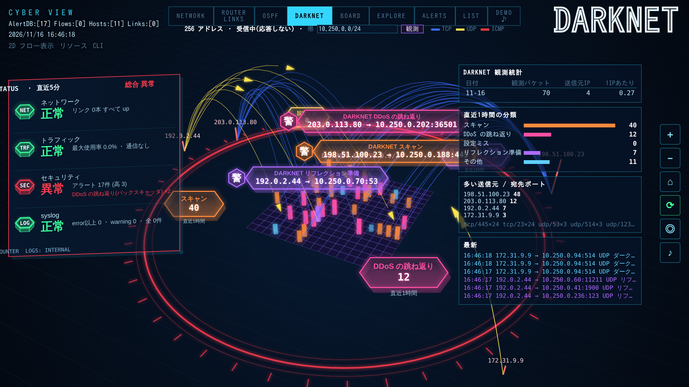

# ダークネット観測(NICTER のエッセンス)— /cyber-view の DARKNET(v20)

依頼: NICT の講演資料(NICTER / DAEDALUS / NIRVANA改)のスライドを受けて、「ここら辺のエッセンスも追加して欲しい」。

## スライドから取り入れたこと

| スライドの要素 | ニルヴァーナでの形 |
|---|---|
| ダークネット = 使われていないアドレス帯。正規の通信は来ないので、届いたものはそれだけで怪しい | 組織内ダークネット: 帯を1つ決めて(例 `10.250.0.0/24`)、そこに届いた通信をすべて記録する |
| マルウェアによるスキャン(ワーム型の探索活動) | **スキャン**: 同じ送信元が 60秒に 5アドレス以上を叩く |
| DDoS 攻撃の跳ね返り(送信元を偽装された SYN Flood の被害サーバーが返す SYN-ACK)、1パケット目から早期検知 | **DDoS の跳ね返り**: TCP の SYN-ACK / RST、ICMP の応答・到達不能、UDP の応答。1パケットで決まる |
| 設定ミス(組織内ダークネット) | **設定ミス**: 同じ送信元が同じアドレス・ポートへ 300秒に 5回以上(スキャンでない) |
| リフレクション攻撃の準備活動(DNS オープンリゾルバ探索、NTP 探索 等) | **リフレクション攻撃の準備**: UDP 53 / 123 / 161 / 1900 / 11211 / 19 / 389 等への問い合わせ。1パケットで決まる |
| NICTER Atlas(送信元から放物線の矢が飛んでくる。色はプロトコル) | DARKNET 画面: 外周の送信元から放物線の矢。TCP 青・UDP 黄・ICMP 赤(NICTER と同じ色分け)。着地したアドレスのマスが分類の色で光る |
| ダークネット観測統計(年間総観測パケット数・観測 IP アドレス数・1 IP アドレス当たり) | 右のパネルに日ごとの表(観測パケット・送信元 IP・1 IP あたり)、直近1時間の分類のグラフ、多い送信元・宛先ポート |
| グローバル観測(ダークネット)とローカル観測(ライブネット)の両輪 | NETWORK / ROUTER LINKS / OSPF(ライブネット)に DARKNET を並べた。警報は同じ花に **DARKNET** の花びら(蜘蛛の巣) |



## 使い方

```bash
python app.py
# /cyber-view → 上の DARKNET → 帯に 10.250.0.0/24 を入れて「観測」
# または起動時から: NETLAB_DARKNET=10.250.0.0/24 python app.py
```

入力は2つあります。

- **本物のパケット**(root の Linux のとき): 帯を lo に引き込み、AF_PACKET で受け身に数えます。
  - 引き込み: `ip route add local <帯> dev lo table local`
  - 応答を止める: `iptables -I INPUT -d <帯> -j DROP`(カーネルが RST や応答を返さないように。ダークネットは何も返さない)
  - nmap などの本物のツールの通信がそのまま入ります。観測をやめる(帯を空にする)かアプリを止めると、引き込みと iptables の行は外れます。
- **ラボの ping**: エミュレータ内の装置からダークネットのアドレスへ ping すると、ICMP として記録します。root は要りません。

装置が使っている帯は、ダークネットにできません(400 で拒否)。`/16` より広い帯も拒否します。

試験用の通信を流すツール(宛先が lo に引き込まれたプライベートな帯のときだけ送る):

```bash
python3 tools/darknet_traffic.py --prefix 10.250.0.0/24 all           # 4種類すべて
python3 tools/darknet_traffic.py --prefix 10.250.0.0/24 --src 198.51.100.23 scan
nmap -sT -Pn -n -p 22,80 -S 127.0.0.88 -e lo 10.250.0.100-110          # 本物の nmap でも
```

API: `GET /api/darknet?since=<seq>`、`POST /api/darknet/config {"prefixes": [...], "sensor": true}`、`POST /api/darknet/clear`。

## ライブ確認

`10.250.0.0/24` を観測し、試験ツールと本物の nmap で流しました。

```
$ ip route get 10.250.0.9          → local 10.250.0.9 dev lo        (引き込み)
$ iptables -S INPUT                → -A INPUT -d 10.250.0.0/24 -j DROP (受け身)

日ごとの統計: packets 83, srcs 3, dsts 43, per_ip 0.32
分類: scan 48 / backscatter 12 / reflection 7 / misconfig 4 / other 12

警報(花びら DARKNET):
darknet_scan        high   127.0.0.88 → 10.250.0.105:80 TCP ダークネットを探索            ← 本物の nmap
darknet_backscatter medium 203.0.113.80 → 10.250.0.59:30595 TCP DDoS の跳ね返り(偽装された送信元への応答)
darknet_reflection  medium 192.0.2.44 → 10.250.0.16:53 UDP リフレクション攻撃の踏み台探し(DNS)
darknet_misconfig   low    172.31.9.9 → 10.250.0.123:514 UDP 使われていないアドレスへ繰り返し送信(設定ミスの疑い)
```

アプリを止めると、iptables の行と lo への引き込みが消えることも確認しました。

### 確認中に見つけて直したこと

- 試験ツールで送信元を決めずに送ると、カーネルが宛先(lo に引き込んだダークネットのアドレス)そのものを送信元にしてしまい、すべての送信元が別々に見えてスキャンと判定されなかった → ツールで送信元を bind する(`--src`、既定 127.0.0.66)。
- 右のパネルがズームのボタンと重なっていた → パネルを左へ寄せた。

## 分類の決まり方とわかっていること

- スキャン・設定ミスは数で決まるので、しきい値に届くまでの最初の数パケットは「その他」になります(しきい値は `engine/darknet.py` の `SCAN_*` / `MISCONF_*`)。
- 送信元の位置は、同じ /16 が近くに並ぶように置いています(NICTER の国ごとの地図の代わり。GeoIP は使っていません)。
- 数え方は組織内の小さな帯向けです。NICTER のような数十万アドレス・年に数百億パケットの規模は想定していません。
- スタンドアロン版にはまだありません(ボタンは自動で隠れます)。実機で使うには、ダークネットの帯へのミラーポートや sFlow の受け口が要ります。

## テスト

`tests/test_darknet.py` で確かめていること:

- 分類(1パケットで決まるもの、数で決まるもの)
- 日ごとの統計
- フレームの読み取り
- API(装置が使う帯・広すぎる帯の拒否、ラボの ping の記録、警報、消去)
- root のときは本物のパケット(試験ツールのスキャン・跳ね返り・リフレクションが届くこと、観測をやめると引き込みが外れること)
