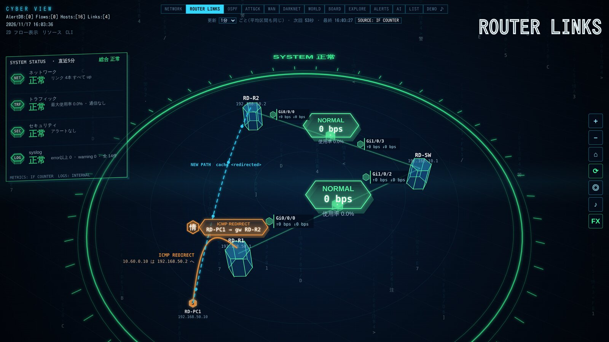
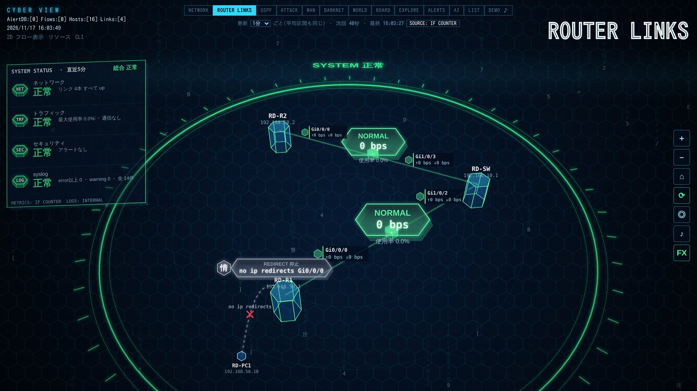

# ICMP Redirect をニルヴァーナ(サイバービュー)で見る

ユーザーの依頼: 「ICMP redirect が発生したときもモックニルヴァーナ、サイバービューで表現して」

これまでエミュレータの ICMP Redirect は、`show ip traffic` の `redirects` の回数を数えるだけでした。
今回、次の3つを入れました。

- 発生を1件ずつ記録する
- ホストが Redirect を受けて経路を変える動き(実機の Linux と同じ)
- サイバービューへの描画

## 実機の動き(再現したもの)

1. ホスト PC1(既定ゲートウェイ R1)がサーバへ送る。
2. R1 のサーバへの次ホップ R2 が、PC1 と同じセグメントにいる。
   つまり R1 は、受けたのと同じ IF からパケットを出すことになる。
3. R1 はパケットを R2 へ転送しつつ、PC1 に ICMP Redirect(type 5)を返す。
   中身は「その宛先には 192.168.50.2 へ直接送れ」。
4. Linux は Redirect を受け入れ、経路を例外キャッシュに入れる。
   `ip route get` に `cache <redirected>` と出て、既定では約300秒で消える。
   以後のパケットは R2 へ直接行くので、R1 の Redirect は最初の1回だけになる。
5. R1 のその IF に `no ip redirects` があれば、Redirect は送られない。PC1 は R1 経由のまま。

R1・R2 のようなルータは、Redirect を受けても経路を変えません(実機と同じ)。

## 構成

```
            (VLAN 50 のスイッチ RD-SW)
  RD-PC1 192.168.50.10 ──┬── RD-R1 Gi0/0/0 192.168.50.1   (ip route 10.60.0.0/24 → 192.168.50.2)
                         └── RD-R2 Gi0/0/0 192.168.50.2 ── Gi0/0/1 10.60.0.1 ── RD-SV 10.60.0.10
  RD-PC1 の既定ゲートウェイ = 192.168.50.1(R1)
```

## 本物のエミュレータでの結果

```
RD-PC1$ ping -c 3 10.60.0.10          ← 1回目: R1 経由。R1 が Redirect を返す
3 packets transmitted, 3 received, 0% packet loss
RD-R1# show ip traffic
  Sent:  1 redirects, 0 unreachable, 0 echo, 0 echo reply
RD-PC1$ ip route get 10.60.0.10
10.60.0.10 via 192.168.50.2 dev eth0 src 192.168.50.10 uid 0
    cache <redirected> expires 299sec
RD-PC1$ traceroute 10.60.0.10        ← 以後は R2 へ直接
 1  RD-R2 (192.168.50.2)
 2  RD-SV (10.60.0.10)

RD-PC1$ ip route flush cache
RD-R1(config-if)# no ip redirects    ← Gi0/0/0
RD-PC1$ traceroute 10.60.0.10        ← Redirect が来ないので R1 経由のまま
 1  RD-R1 (192.168.50.1)
 2  RD-R2 (192.168.50.2)
 3  RD-SV (10.60.0.10)
RD-R1# show running-config
interface GigabitEthernet0/0/0
 no ip redirects
```

traceroute のプローブも R1 を通るので、ping と同じく Redirect の対象になります。

## サイバービューの表示

`GET /api/traffic/redirects?since=<seq>` を2秒ごとに読みます。表示するのは、開いた時点より後に起きたものだけです。
描くモードは NETWORK・ROUTER LINKS・OSPF の3つです。

| | 表示 |
|---|---|
| Redirect を送った | R1 に「情 ICMP REDIRECT PC1 → gw R2」のポップアップ |
| | R1 から PC1 への橙の弧と、その上を走る「5」(ICMP type 5)の粒、「10.60.0.10 は 192.168.50.2 へ」の文字 |
| | 粒が届いたあと、PC1 から R2 へ水色の破線「NEW PATH cache <redirected>」が伸びる |
| `no ip redirects` で送らなかった | R1 に「情 REDIRECT 抑止 no ip redirects Gi0/0/0」 |
| | R1 から PC1 への灰色の破線に、赤い × |

ROUTER LINKS にはホスト(PC)が表示されないことがあります。そのときは、PC を R1 の外側に仮置きし、六角の印と名前・IP を付けて描きます。





## SNMP ポーリングで検知する(ヴァルハラ = Prometheus)

ユーザーの質問: 「ICMP redirect もどうやって検知するか、SNMP ポーリングで検知できそう?」

標準の IP-MIB(RFC 1213)の ICMP グループに、Redirect の回数があります。
エミュレータの SNMP エージェントは、この ICMP グループを `show ip traffic` と同じ値で返します。

| OID | 名前 | 意味 |
|---|---|---|
| `1.3.6.1.2.1.5.20.0` | icmpOutRedirects | その装置が**送った** Redirect の累計 |
| `1.3.6.1.2.1.5.7.0` | icmpInRedirects | その装置が**受けた** Redirect の累計 |
| `1.3.6.1.2.1.5.30.1.4.1.5` | icmpMsgStatsOutPkts(IPv4・type 5) | 新しい表の形。中身は icmpOutRedirects と同じ |

ICMP グループのほかの列(Echo・Echo Reply・Destination Unreachable)も返します。icmpMsgStatsTable には type 0・3・5・8 の行があります。

### 本物の net-snmp

```
$ snmpget -v2c -c public -On 192.168.50.1 1.3.6.1.2.1.5.20.0 1.3.6.1.2.1.5.7.0 1.3.6.1.2.1.5.30.1.4.1.5
.1.3.6.1.2.1.5.20.0 = Counter32: 1          ← R1 が PC1 に Redirect を1回送った
.1.3.6.1.2.1.5.7.0 = Counter32: 0
.1.3.6.1.2.1.5.30.1.4.1.5 = Counter32: 1
```

### 本物の snmp_exporter(v0.28.0)とヴァルハラ(Prometheus v2.54.1)

`iac/cisco-traffic-monitoring/` に、次の2つを足しました。

- `snmp_exporter/snmp.yml` の `cisco_if` モジュールで、icmpInRedirects・icmpOutRedirects を取る(counter)。
- `prometheus/alert_rules.yml` に、警報 `CiscoIcmpRedirectSent` を足す。

```yaml
- alert: CiscoIcmpRedirectSent
  expr: increase(icmpOutRedirects{job="cisco-snmp"}[5m]) > 0
  labels: {severity: info}
```

確かめた結果です。

```
$ curl 'http://127.0.0.1:9126/snmp?target=192.168.50.1&module=cisco_if&auth=netlab_v2' | grep ^icmp
icmpInRedirects 0
icmpOutRedirects 1
  (PC1 で ip route flush cache → ping すると 2 に増えた)

$ promtool check rules alert_rules.yml
  SUCCESS: 13 rules found

Prometheus /api/v1/alerts:
CiscoIcmpRedirectSent firing RD-R1 が ICMP Redirect を送信(5分で 1 回)
```

ヴァルハラの firing は、ニルヴァーナが15秒ごとに取り込みます(`_valhalla_alert_loop`)。取り込んだ警報は、VALHALLA の花びらとして画面に出ます。

### SNMP で分かること・分からないこと

- **分かる**: どのルータが Redirect を出しているか(回数)。同じセグメントにゲートウェイが2台あって遠回りしている、という設計の問題に気づけます。
- **分からない**:
  - 誰に・どの宛先で・どのゲートウェイを指したか。
  - ポーリング間隔より細かい時刻。
- **苦手**: ゲートウェイではない機器が出す偽の Redirect(攻撃)。受ける側はふつう SNMP エージェントを持たない PC です。エミュレータの pc も、実機と同じく SNMP では見えません。
- **補い方**:
  - フロー: NetFlow なら宛先ポート欄に `type×256+code`(1280〜1283)が入る。
  - パケット取得・IDS の Redirect ルール。
  - ホスト側の `nstat`(IcmpInRedirects)や `ip route get`。
  - このラボなら、`GET /api/traffic/redirects` に相手・宛先・ゲートウェイまで記録されています。

## 作り

- `engine/icmp_redirect.py`
  - 発生の記録(最新500件)
  - ホストの Redirect キャッシュ(300秒)
  - `no ip redirects` の IF
  - CLI: ルータの config-if の `no ip redirects` / `ip redirects`、PC の `ip route get <dest>` / `ip route flush cache`
- `engine/protocols.py` の `IcmpEngine`
  - `_maybe_generate_redirect`: ping・traceroute のあとに発生条件(次ホップがホストと同じサブネット)を見る。
    R1 がホストから受けた IF を求め、`no ip redirects` なら送らずに記録だけする。
  - `trace_path`: 送信元のキャッシュがあり、覚えたゲートウェイが同じセグメントにいれば、それを最初の次ホップにする。
- `app.py`
  - CLI のフック(2層より前)
  - `GET /api/traffic/redirects`
  - running-config の ` no ip redirects`
  - 保存・復元: `interfaces[*].no_redirects`
- SNMP: `SnmpAgent._build_mib` に ICMP グループ(5.1〜5.26)と icmpMsgStatsTable(5.30)
- テスト: `tests/test_icmp_redirect.py`(SNMP と IaC の定義も)

## スコープ外

- 本物の ICMP パケットは送りません。経路計算の上での発生です。
- 次の実機の細かい挙動は再現していません。
  - IOS の Redirect のレート制限
  - HSRP を設定した IF で Redirect が無効になる
  - セカンダリアドレスの扱い
