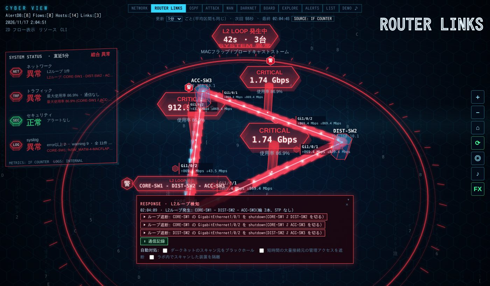
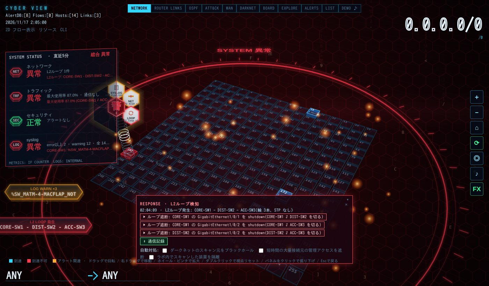
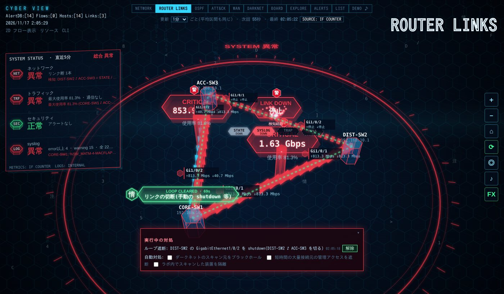
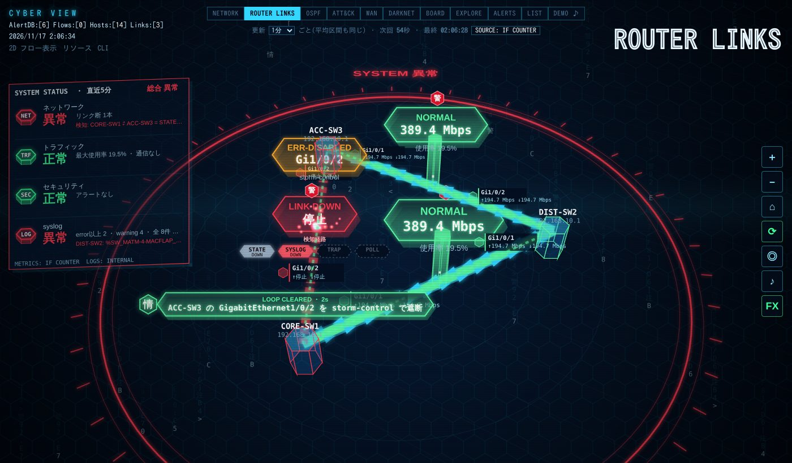

# L2 ループの検知・嵐・止め方(`engine/l2_loop.py`)

依頼:「loop detect するとめっちゃ検知感出ますか？」→ 案 1〜5 を出して「それぞれの実装をお願いします」。

ループは数秒でネットワーク全体に広がり、ログ・流量・CPU が同時に跳ねます。以前のラボでもリンクを足して輪ができた瞬間にログは出ていましたが、次のような問題がありました。

- MAC フラップ・ストーム・err-disable のログが別々に1回出るだけで、「ループが起きている」というまとまった表示がない。
- `no shutdown` で輪ができた場合は何も出ない。
- storm-control を設定していないポートにも `%PM-4-ERR_DISABLE` を出していた。しかも実際にはポートを止めていなかった。
- APRESIA の `loopdetect` は設定と show だけで、実際には何も止めなかった。

[](videos/cyber-view-l2-loop-catalyst.mp4)

動画(80秒・字幕つき): [videos/cyber-view-l2-loop-catalyst.mp4](videos/cyber-view-l2-loop-catalyst.mp4)

## 何をするか

`engine/l2_loop.py` の `LoopEngine` が1秒ごとに、スイッチ(catalyst / nexus / srs / apresia)どうしの「生きているリンク」で輪を探します。橋でない辺を Tarjan 法で求め、連結成分ごとに1つのループとして扱います。

- 輪の上のスイッチが**全台 STP を動かしていれば**ループにしません。実機は冗長リンクを Blocking にするからです。
- 1台でも STP を動かしていなければ「ループ発生中」です。
- 同じ2台の間の並列リンクは、EtherChannel と区別できないので1本として数えます(誤検知を避けるため)。
- ルータ(cisco 等)は L2 の輪を作りません。

| 案 | 実装 |
|---|---|
| 1 ループ専用の警報 | 警報 `l2_loop`「L2ループ検知」(重要度 high、花びら **LOOP**=ぐるぐる矢印)。1つのループにつき1件。状態ボードのネットワーク観点は「異常・L2ループ N件」 |
| 2 ループの輪を描く | ROUTER LINKS で輪の辺を赤く太く脈打たせ、輪の真ん中に「L2 LOOP 発生中 ・ 経過秒 ・ 台数」の大きなプレート |
| 3 嵐らしい見た目 | 輪の上の各ポートのカウンタが毎秒 約 0.9Gbps 相当(64 バイト × 170 万 pps)増え、リンクの使用率が実際に 90% 前後になる。CPU も上がる。光る粒が輪の中をぐるぐる回る。Cisco 系は `%SW_MATM-4-MACFLAP_NOTIF` を 15 秒ごとに出す |
| 4 機種ごとの本物の止め方 | 下の表 |
| 5 RESPONSE 連携 | 警報 `l2_loop` の対処案「ループ遮断: <装置> の <IF> を shutdown(<A> ⇄ <B> を切る)」。押すと本物の CLI が入り、解除で `no shutdown` に戻る |

止まると「どうやって止まったか」が履歴に残り、画面に緑の「情 LOOP CLEARED ・ 何秒」が出ます。例:「ACC-SW3 の Gi1/0/2 を storm-control で遮断」「RESPONSE: ループ遮断: …」「STP が全台で有効になり冗長リンクを Blocking」。止まった輪は緑の点線で消えていきます。

### 止め方(実機の構文とログ)

| 機種 | 設定 | 動作 |
|---|---|---|
| Catalyst / Nexus / SR-S | `storm-control broadcast level <n> [<falling>]` | 超えた分を捨てる。そのポートの流量は level% に下がり、`%STORM_CONTROL-3-FILTERED` を出す。**ループ自体は続く**(実機と同じ) |
| 〃 | `+ storm-control action shutdown` | 1秒で `%STORM_CONTROL-3-SHUTDOWN` → `%PM-4-ERR_DISABLE: storm-control error detected on …` → `%LINK-3-UPDOWN … down`。ポートは本当に落ちる(`show interfaces status err-disabled` に出る) |
| 〃 | `storm-control action trap` | FILTERED に加えて SNMP trap(CISCO-PORT-STORM-CONTROL-MIB cpscEventRev1)を送る |
| 〃 | `spanning-tree bpduguard enable` | 相手のスイッチが STP を動かしていると BPDU が届くので `%SPANTREE-2-BLOCK_BPDUGUARD` → err-disable |
| 〃 | `errdisable recovery cause <bpduguard\|storm-control\|loopback\|all>`<br>`errdisable recovery interval <30-86400>` | 時間が来たら `%PM-4-ERR_RECOVER` でポートを戻す。原因の輪が残っていればまたループして、また止まる(実機と同じ繰り返し) |
| 〃 | `shutdown` → `no shutdown` | 手で戻すと err-disable が解ける |
| APRESIA | `enable loopdetect`<br>`config loopdetect interval <s>`(既定 10)<br>`config loopdetect recover_timer <s>`(既定 60、0 は戻さない)<br>`config loopdetect ports <list> state enabled\|disabled` | interval 秒ごとの検知フレームが戻ってきたら、輪の2本目のポートを Block する(`Port Port1/0/2 LBD loop occurred. Port blocked`)。recover_timer 秒で戻す(`LBD port recovered. Loop detection restarted`) |

APRESIA のログの文言と `config loopdetect …` の構文は、このエミュレータの APRESIA が元々使っている D-Link 系(`enable loopdetect`)に合わせました。実機 APRESIA の機種・OS 版によって表記が違う可能性があります。

show: `show storm-control [IF]`、`show errdisable recovery`(次に戻るまでの残り秒)、`show loops`(このエミュレータ独自)、APRESIA の `show loopdetect`(ポートごとの Normal / Loop!)。

running-config と保存: `storm-control …` は IF 配下、`errdisable recovery …` はグローバルに出ます。`storm_control`・`errdisable_recovery`・`loopdetect` は `saved_config.json` に保存・復元します。

API: `GET /api/traffic/loops`(active / recent / blocked)、`/api/traffic/links` の `loops`。スタンドアロン版にはこの API が無いので、画面側は何も描きません。

## ライブ確認

`NETLAB_AUTH_DISABLE=1 python -m uvicorn app:app --port 8765` に curl で装置を作りました。

```
CORE-SW1 Gi1/0/1 ── Gi1/0/1 DIST-SW2 Gi1/0/2 ── Gi1/0/1 ACC-SW3 Gi1/0/2 ── Gi1/0/2 CORE-SW1   (全台 catalyst、STP なし)
```

### 1. 輪を閉じた直後(ACC-SW3 Gi1/0/2 は storm-control level 5 だけ)

```
$ curl /api/traffic/links?window=10
CORE-SW1 ACC-SW3  crit 919 Mbps 92 %
CORE-SW1 DIST-SW2 crit 919 Mbps 92 %
DIST-SW2 ACC-SW3  crit 919 Mbps 92 %

ACC-SW3# show storm-control
Interface  Filter State   Upper        Lower        Current
Gi1/0/2    Blocking       5.00%        5.00%        100.00%

health: network=crit 'L2ループ 1件' / traffic=crit / syslog=crit(MACFLAP)
```

level 5% のポートだけは、受信側が `↑43.5 Mbps`(1Gbps の約5%)に絞られています。



NETWORK 表示では、「警」に LOOP の花びら、火の粉、「L2 LOOP 発生」のポップアップが出ます。



### 2. RESPONSE で止める

`POST /api/response/run {"seq": <l2_loop の警報>, "action": "loopcut:sw2:GigabitEthernet1/0/2"}` を実行しました。

```
→ ループ遮断: DIST-SW2 の GigabitEthernet1/0/2 を shutdown(DIST-SW2 ⇄ ACC-SW3 を切る)
/api/traffic/loops: active 0, recent [(69.0 秒, 'RESPONSE: ループ遮断: DIST-SW2 の …')]
```

画面には、切ったリンクの LINK DOWN、緑の点線の輪、「情 LOOP CLEARED ・ 69s」が出ます。



(確認したときは「リンクの切断(手動の shutdown 等)」と出ていました。RESPONSE の対処で止まったときは、その対処名を書くように直しました。)

### 3. storm-control action shutdown + errdisable recovery 30 秒

```
ACC-SW3(config-if)# storm-control broadcast level 5
ACC-SW3(config-if)# storm-control action shutdown
ACC-SW3(config)# errdisable recovery cause storm-control
ACC-SW3(config)# errdisable recovery interval 30
(輪を閉じる)
%SW_MATM-4-MACFLAP_NOTIF: Host 001b.0da6.bbd9 in vlan 1 is flapping between port Gi1/0/2 and port Gi1/0/1
%STORM_CONTROL-3-SHUTDOWN: A packet storm was detected on GigabitEthernet1/0/2. The interface has been disabled.
%PM-4-ERR_DISABLE: storm-control error detected on GigabitEthernet1/0/2, putting GigabitEthernet1/0/2 in err-disable state

ACC-SW3# show errdisable recovery
Interface  Errdisable reason   Time left(sec)
Gi1/0/2    storm-control       27

/api/traffic/loops: recent [(2.0 秒, 'ACC-SW3 の GigabitEthernet1/0/2 を storm-control で遮断')]
```



30 秒後に `%PM-4-ERR_RECOVER` でポートが戻ります。輪はそのままなので、またループして2秒で止まります。これが 30 秒ごとに繰り返されました(実機の errdisable recovery と同じ動き)。

```
%PM-4-ERR_RECOVER: Attempting to recover from storm-control err-disable state on GigabitEthernet1/0/2
%STORM_CONTROL-3-SHUTDOWN: A packet storm was detected on GigabitEthernet1/0/2. The interface has been disabled.
%PM-4-ERR_DISABLE: storm-control error detected on GigabitEthernet1/0/2, putting GigabitEthernet1/0/2 in err-disable state
```

(このとき err-disable で `%LINK-3-UPDOWN` が出ていなかったので、down / up の両方で `%LINK-3-UPDOWN`・`%LINEPROTO-5-UPDOWN` を出すようにしました。)

### BPDU guard / APRESIA / 全台 STP

TestClient で確かめました。

- **BPDU guard**: SW1 だけ STP、SW2 の SW1 向け Gi1/0/1 に `spanning-tree bpduguard enable`。輪を閉じた1秒後に `%SPANTREE-2-BLOCK_BPDUGUARD: Received BPDU on port GigabitEthernet1/0/1 with BPDU Guard enabled. Disabling port.` → err-disable → 解消。
- **APRESIA**: `enable loopdetect` / `config loopdetect interval 3` → 3 秒後に `Port Port1/0/2 LBD loop occurred. Port blocked`。`show loopdetect` で Port1/0/2 が `Loop!`、60 秒後に `LBD port recovered. Loop detection restarted`。
- **全台 STP**: ループにならない。警報もログも出ない。

## 直したこと(以前からの問題)

- `VirtualNetwork.add_link` が、輪ができた瞬間に storm-control の設定と関係なく全ポートへ `%PM-4-ERR_DISABLE: storm-control …` と `%SPANTREE-2-LOOPGUARD_BLOCK` を出していました。しかもポートは止まっていませんでした。この1回きりの通知をやめ、検知とログは `l2_loop` に一本化しました。
- 状態ボードとループ API は、もう存在しない装置のループを数えません(装置を消した直後の1秒間の取り残し)。
- 画面のプレートが画面の左右からはみ出さないようにしました。

## テスト

`tests/test_l2_loop.py`(11 件)で確かめていること:

- 輪の判定(木・2つの輪・橋・ルータ)
- 警報・MAC フラップ・ストームのカウンタ・API・状態ボード
- 全台 STP でループにならないこと
- storm-control: level だけ / shutdown / errdisable recovery → 再ループ → 再停止
- BPDU guard
- 手動の shutdown → no shutdown で err-disable が解けること
- APRESIA loopdetect の有効・無効
- RESPONSE で止めたときの解消理由
- 保存・復元

## スコープ外

- EtherChannel と並列リンクの区別(並列は1本と数える)
- VLAN ごとのループ(全 VLAN をまとめて1つ)
- loopguard / UDLD
- 実フレームの増殖(カウンタ・CPU・ログで表す)
