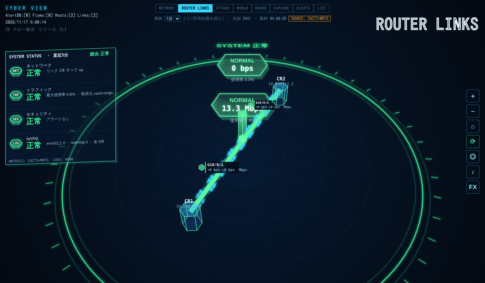
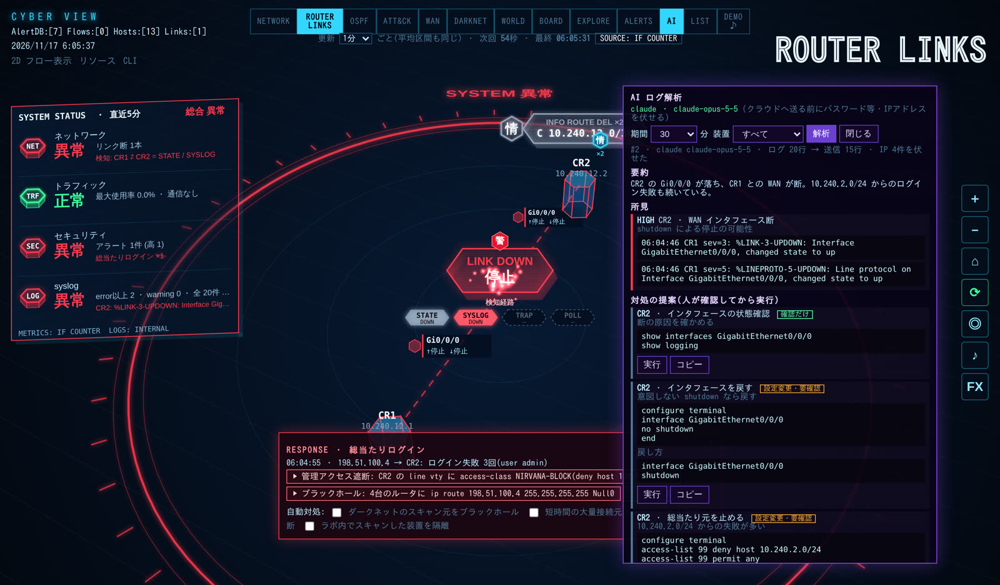
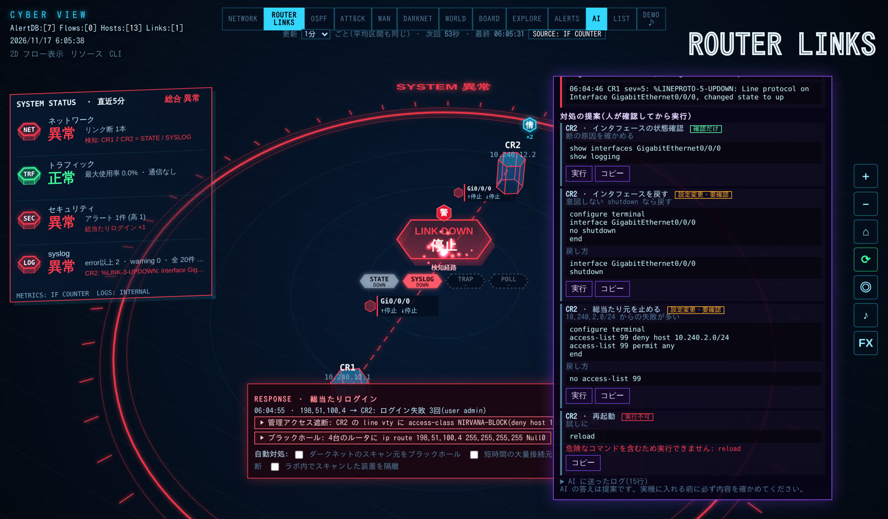

# モックニルヴァーナを既存の監視に足す: Prometheus / Loki / Zabbix / MRTG / Cacti・地球儀・AI ログ解析

ユーザーの質問と依頼:

- 「Prometheus や Loki は10年前はあまり使われてなかったよね」
- 「Prometheus や Loki、MRTG、Cacti、地球儀、LLM 連携があれば、モックニルヴァーナが使えるようなインストーラーやアドオンになってますか?」
- 「ここらもマークダウンに残して」「syslog も LLM やクラウド AI で読み込んで対処も考えて」

## 1. 10年前の監視と今の監視

NIRVANA / NIRVANA改 が作られた 2010 年代前半〜半ばは、Prometheus と Loki はまだ広まっていなかった。

| 年 | 出来事 |
|---|---|
| 1995 | **MRTG**(Tobi Oetiker)。SNMP でカウンタを数分おきに取り、流量のグラフを作る。ネットワーク監視の原点 |
| 1999 | NetSaint(のちの Nagios)。死活監視 |
| 2001 | **Cacti**(RRDtool + PHP + MySQL)、**Zabbix**(最初の公開) |
| 2012 | Prometheus を SoundCloud で開発開始(公開は 2015、CNCF 入りと 1.0 は 2016) |
| 2014 | Grafana |
| 2018〜2019 | **Loki**(2018 年末に発表、2019 年に 1.0) |

つまり「10年前」(2016 年ごろ)の現場は MRTG・Cacti・Zabbix・Nagios が中心で、Prometheus は出たばかり、
Loki はまだ無かった。今も MRTG・Cacti が動いている現場は多いので、このプロジェクトでは**古いものも今のものも
そのまま読める**ようにした。

## 2. いま対応しているもの(アドオンとしての対応表)

モックニルヴァーナには2つの形がある。

- **ラボ版**(`/cyber-view`): エミュレータの中の装置を見る
- **単体版**(`cyber-view-standalone/`): 実機の監視基盤からデータを読む

| データの出どころ | ラボ版 | 単体版 | 読むもの |
|---|---|---|---|
| Prometheus + snmp_exporter(ヴァルハラ) | ○ | ○ | 流量 `rate(ifHCIn/OutOctets)`・`ifOperStatus`・`up`、再生・予測・警報 |
| Loki | ○ | ○ | syslog(状態ボード・浮かぶログ・フラップ検知・AI ログ解析) |
| Zabbix | — | ○ | Bits received/sent・Operational status・問題(problem) |
| **MRTG**(今回) | — | ○ | `.log`(既定形式)と `LogFormat: rrdtool` の `.rrd`。`mrtg.cfg` から装置・IF を自動で対応づけ |
| **Cacti**(今回) | — | ○ | データソースの RRD(`traffic_in` / `traffic_out`)。ファイルと IF の対応は設定に書く |
| SNMP 直接 | ○(内部) | ○ | 経路表・CPU(情・注) |
| NetFlow v5 / sFlow v5 | ○ | ○ | 通信の粒・ダークネット・持ち出し・地球儀 |
| **地球儀(WORLD)** | ○ | ○(今回) | クラウド宛て流量・Cloudflare Radar・IIJ IHR・RIPE Atlas の都市間経路・攻撃元の都市(MAWI 再生はラボ版のみ) |
| **AI ログ解析**(今回) | ○(実行まで) | ○(表示・コピー) | Claude(公式 SDK)/ OpenAI 互換(Groq・OpenAI 等)/ Ollama / ルール |

取り込み口は同じリンクにいくつあってもよく、**Prometheus → Zabbix → MRTG / Cacti** の順に使う。
画面の `SOURCE:` に、実際に使ったもの(例 `CACTI+MRTG`)が出る。



(CR1 側は MRTG、CR2 側は Cacti の RRD から。どちらもエミュレータの本物の SNMP を取ったもの)

## 3. インストーラー(`cyber-view-standalone/install.sh`)

```bash
cd cyber-view-standalone
./install.sh --detect-only          # 何が見つかるかだけ表示
./install.sh                        # venv に入れて config.yaml を作り、起動の仕方を表示
./install.sh --service              # systemd に登録して起動(root)
./install.sh --docker               # docker compose で起動
# 場所を指定: --prometheus URL --loki URL --zabbix URL --mrtg-cfg PATH --cacti-rra DIR --ollama URL
```

中身は `cvs/installer.py` で、次のことをする。

- **探す**
  - Prometheus: 既定は :9090。snmp を含む job と、その対象の装置・IF を `ifHCInOctets` の系列から読む
  - Loki: 既定は :3100
  - Zabbix: `/etc/zabbix/web/zabbix.conf.php` か `--zabbix`
  - MRTG: `/etc/mrtg.cfg`・`/etc/mrtg/*.cfg`
  - Cacti: `/var/lib/cacti/rra` など
  - Ollama と AI の鍵
- **装置をまとめる**: Prometheus と MRTG に同じ装置が出れば1台にまとめる。ホスト名は sysName か MRTG の Title から取る。
- **つながりを推定する**: 同じ /30・/31 に IP がある2台をつなぐ。その IF は /30 か /31、それ以外は /24 とする。
  推定なので必ず見直す。
- **設定ファイルを書く**
  - 既存の `config.yaml` は `--force` が無ければ上書きしない。
  - 秘密は `${ZABBIX_TOKEN}` のまま書き、値は環境変数や `/etc/default/cyber-view` で渡す。
  - 書いたファイルは、その場で読み込めることを確かめる。
- **Cacti の扱い**: どの RRD がどの IF かは Cacti の DB にしか無いので、自動では対応づけない。
  見つけたファイル名をコメントとして下書きに出す。

## 4. AI ログ解析(syslog を LLM / クラウド AI に読ませて対処を考える)

`/cyber-view` の **AI** ボタンで、右にパネルが開く。期間と装置を選んで「解析」を押す。



### 流れ(`engine/log_ai.py`。単体版も同じファイル)

1. **集める**
   - 内部の syslog(Loki があれば Loki も)を集める。
   - ニルヴァーナ自身の検知(総当たり・スキャン・ループなど)も、同じ形の行(`%NIRVANA-4-ALERT: …`)として足す。
2. **下ごしらえ**
   - 時刻の接頭辞を外し、同じ文は「×N」にまとめる。
   - 重要度の高いもの(`%FAC-0〜4-`)を優先し、上限(既定 200 行)に収める。
   - **クラウドへ送る前に**、パスワード・secret・community・鍵は `<REDACTED>` に置き換える。
   - IP アドレスも `IP_1` 等に伏せ(既定)、返ってきた答えの中で元に戻す。
   - AI に教える装置の一覧は、ログに出た装置だけにする。
3. **問い合わせる**
   - **Claude**: Anthropic の公式 SDK(`anthropic`)を使う。モデルは既定 `claude-opus-5-5`(`NIRVANA_AI_MODEL` で変更)。
     - 構造化出力(JSON スキーマ)を使うので、必ず決まった形の JSON が返る。
     - effort は medium。
     - 安全分類で断られた時はサーバー側で別のモデルに回す(`fallbacks: "default"`)。
   - **OpenAI 互換**: Groq・OpenAI・Mistral など。`NIRVANA_AI_BASE_URL` と `NIRVANA_AI_KEY`、無ければ `GROQ_API_KEY` か `OPENAI_API_KEY`。
   - **Ollama**: `OLLAMA_URL`。ログを外へ出したくない時はこれ。
   - `NIRVANA_AI_PROVIDER` が無ければ、鍵のあるものを claude → openai → ollama の順で使う。
4. **確かめる**
   - 答えに出てくる装置は、知っている装置だけに絞る。
   - コマンドは危険度で3つに分ける。
     - **実行不可**(表示だけ): `reload`・`write erase`・`erase`・`format`・`delete`・`crypto key zeroize`・`no username`・`boot system` など。
     - **要確認**: `shutdown`・`clear`・ACL・`line vty`・config モードの変更。
     - **確認だけ**: show 系。
5. **人が実行する**
   - ラボ版は「実行」を押すと確認画面に、入れるコマンドと戻し方(rollback)が出る。OK で本物の CLI として装置に入る。
   - 自動では入れない。`NIRVANA_AI_APPLY=0` で実行そのものを止められる。
   - 単体版は装置にログインしないので、コピーだけ。
6. **AI が使えない時**: ルールで解析する。リンク断・OSPF / BGP の隣接断・ログイン失敗・MAC フラップ・設定変更・CPU を見つけ、
   確認用の show コマンドを出す。画面には「ルール」と理由を出す。
7. 重要度 high 以上の所見は警報 `ai_finding` になり、花びらは **AI** で出る。



| API | |
|---|---|
| `GET /api/ai/status` | 使うプロバイダ・モデル・実行の可否・IP を伏せるか |
| `POST /api/ai/logs/analyze` | `{minutes, device?, use_ai, max_lines}` → 要約・所見・対処・AI に送った本文 |
| `POST /api/ai/logs/apply` | `{id, action, confirm: true}`(ラボ版のみ。危険なコマンドを含むものは 400) |
| `GET /api/ai/logs/history` | 直近 30 件 |

| 環境変数 | |
|---|---|
| `NIRVANA_AI_PROVIDER` | `claude` / `openai` / `ollama` / `rules`(既定は鍵で自動) |
| `NIRVANA_AI_MODEL` | 例 `claude-opus-5-5`・`llama-3.1-8b-instant` |
| `ANTHROPIC_API_KEY` | Claude |
| `NIRVANA_AI_BASE_URL` / `NIRVANA_AI_KEY` | OpenAI 互換(未設定なら `GROQ_API_KEY` / `OPENAI_API_KEY`) |
| `OLLAMA_URL` | Ollama |
| `NIRVANA_AI_REDACT_IPS=0` | IP アドレスを伏せない |
| `NIRVANA_AI_APPLY=0` | 実行を止める(提案の表示だけ) |

**注意**
- AI の答えは提案で、正しいとは限らない。画面と API の結果には、必ずどのプロバイダ・モデルが答えたかを出す。
- クラウド AI に送る内容は「AI に送ったログ」で、そのまま確かめられる。

## 5. ライブ検証(この作業環境で)

### MRTG(本物の `cfgmaker` / `mrtg` を、エミュレータの本物の SNMP に)

- `apt-get install mrtg rrdtool` を入れ、CR1 / CR2 に `cfgmaker` を実行した。その時に**エミュレータの実バグを2つ見つけて直した**。
  1. **負の INTEGER を符号化できず、応答を返していなかった**(`engine/snmp_udp_agent.py` の `_encode_int`)。
     - SNMP の request-id は符号付き 32 ビットで、MRTG / cfgmaker が使う Perl の SNMP_Session は負の値をよく使う。
     - そのため、2台をまとめて `cfgmaker` すると半分ほどが「no response received」で飛ばされていた。
     - 修正後は3回続けて実行しても、2台・4 IF がすべて出る。
  2. **ipAddrTable にアドレスの列しか無かった**。ipAdEntIfIndex・ipAdEntNetMask が無く、cfgmaker の出力が全部 `Ip: 'No Ip'` になっていた。
     - 2列を足して、`MRTG_INT_IP="10.240.12.1"` が入るようになった。
- `traffic_gen.sh` を流しながら `mrtg` を1分ごとに4回実行し、本物の `.log` ができた。
  CR1 Gi0/0/0 の値は 1185184 バイト/秒 ≒ 9.5 Mbps。
- Cacti 形式の RRD は次のように作った。
  - `traffic_in` / `traffic_out` を COUNTER として作った(Cacti の「Interface - Traffic」と同じ形)。
  - 本物の SNMP の `ifHCInOctets` / `ifHCOutOctets` を `rrdtool update` で書いた。
- 単体版を `sources.mrtg.cfg` と `sources.cacti.targets` で起動した。
  - `/api/traffic/links` の値は CR1–CR2 = 5.74 Mbps / 7.51 Mbps、`source: cacti+mrtg`。
  - 画面の `SOURCE: CACTI+MRTG` も確認した(上の画像)。

### インストーラー

- 既存の IaC(`iac/cisco-traffic-monitoring`。本物の Prometheus v2.54.1 + snmp_exporter)と本物の Loki 3.1.1 を docker で立てた。
- そのうえで、作業用のコピーで `./install.sh --mrtg-cfg … --service` を実行した。
  - venv 作成・pip(PyPI から取得)が通った。
  - 検出結果: Prometheus v2.54.1 `job=cisco-snmp`、Loki、MRTG 4 対象。装置は CR1 / CR2 の2台で、Prometheus と MRTG の両方から見つかり1台ずつにまとまった。
  - つながりは推定で1本(10.240.12.1 と .2 が同じ /30)。
  - この環境には systemd が無いので「手で起動」の案内に切り替わった。
  - 2回目の実行では、既存の `config.yaml` を上書きしなかった。
- できた `config.yaml` で起動し、`/api/traffic/links` が `source: prometheus` で返ることを確認した。

### AI ログ解析

- この作業環境からはクラウドの AI に届かない。そこで公式 SDK を `ANTHROPIC_BASE_URL` で手元の **Messages API の代役**に向け、
  SDK が実際に送るリクエストを確かめた。
  - エンドポイント `/v1/messages`。
  - `anthropic-beta: server-side-fallback-2026-07-01` と `fallbacks: "default"`。
  - `output_config.format.type: json_schema`、`effort: medium`、モデル `claude-opus-5-5`。
- エミュレータで次の本物の出来事を起こし、解析させた。
  - CR2 の Gi0/0/0 を shutdown(本物の `%LINK-3-UPDOWN` が出る)。
  - 外のアドレスから実 SSH でログイン失敗を4回(ニルヴァーナの総当たり検知が出る)。
- 解析の結果、次を確認した。
  - IP 4件が伏せて送られ、答えでは元に戻った。
  - `reload` は実行不可、`no shutdown` は要確認に分かれた。
  - 確認なしの実行・`reload` の実行は 400 で断られた。
  - 「実行」を押すと本物の CLI(`configure terminal` → `interface …` → `no shutdown` → `end`)が入り、CR2 Gi0/0/0 が up に戻った。
    `show ip interface brief` で確認した。
- 見つけたこと: IOS は `login on-failure log` が無いと、ログイン失敗を syslog に出さない(実機と同じ)。
  そのままでは AI がログイン失敗を知らないので、ニルヴァーナ自身の検知も AI に渡すようにした。

### 地球儀の実バグ(ついでに見つけた)

- サーバーは IHR / Radar の警報を `source: 'WORLD'` で送るのに、画面の花びらの表に WORLD が無かった。
  本物の警報が来た時に描画で例外になるところだった(見本モードは警報を作らないので表に出ていなかった)。
- WORLD と AI の花びらを足し、知らない検知元は IDS として描くようにした。

## 6. まだ確かめていないこと

- 本物の Claude / Groq / Ollama の答えの質(この環境から届かない)。
- systemd への登録と `--docker` での起動(この環境に systemd が無い。docker build は社内 CA の都合で試していない)。
- 本物の Cacti(PHP + MySQL)での運用。RRD の形は Cacti と同じものを rrdtool で作って確かめた。
- 単体版で、本物の syslog を Loki 経由で AI に読ませる流れ(ラボ版で確かめた処理と同じファイル)。

テスト: `tests/test_log_ai.py`(7件)、`tests/test_legacy_monitoring_and_installer.py`(6件)、
`tests/test_cyber_view_standalone.py`(共有ファイルのずれ)。
