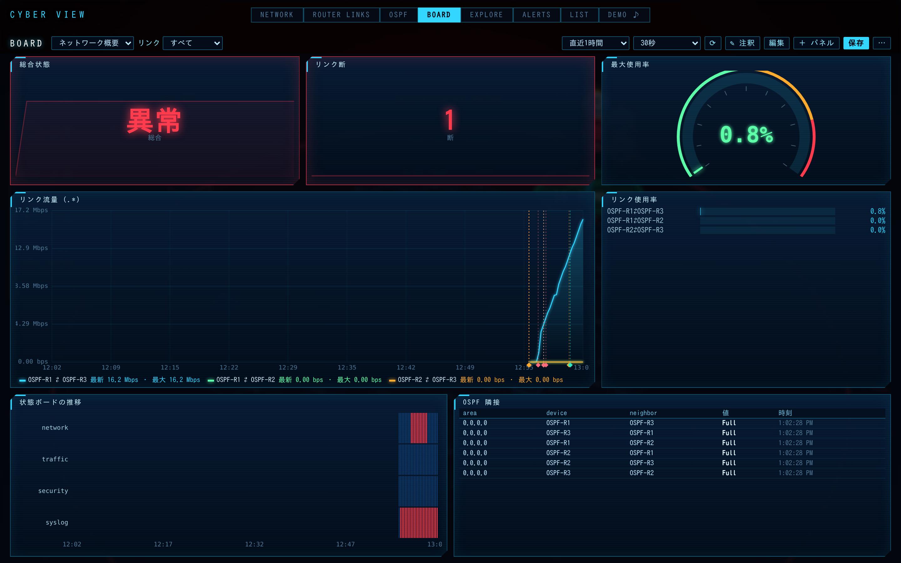
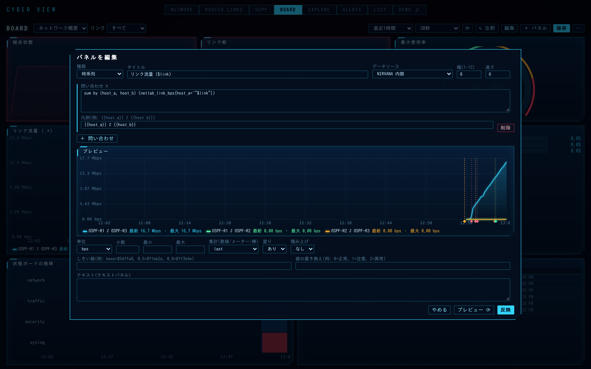
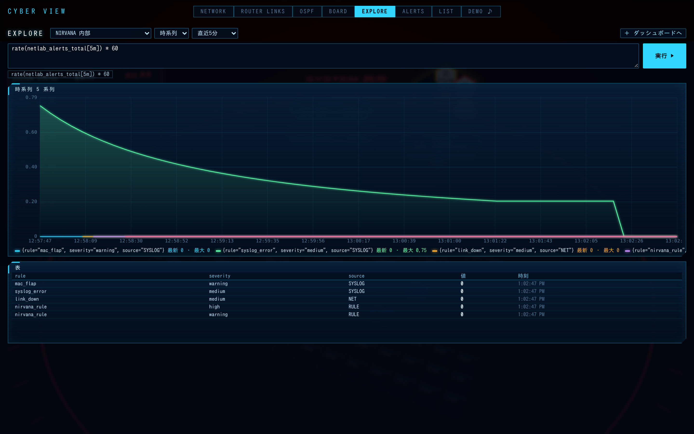
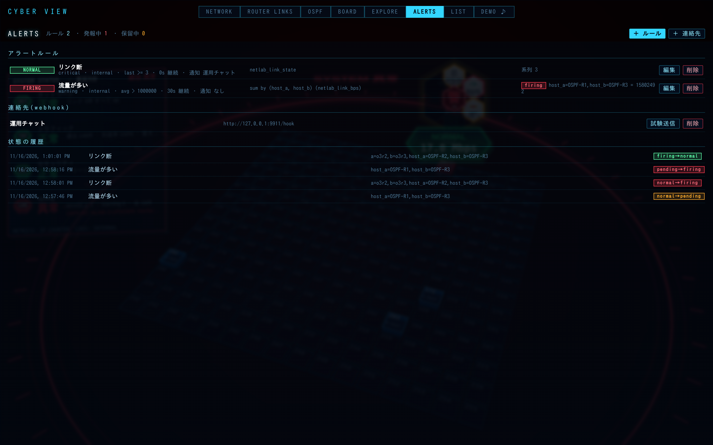
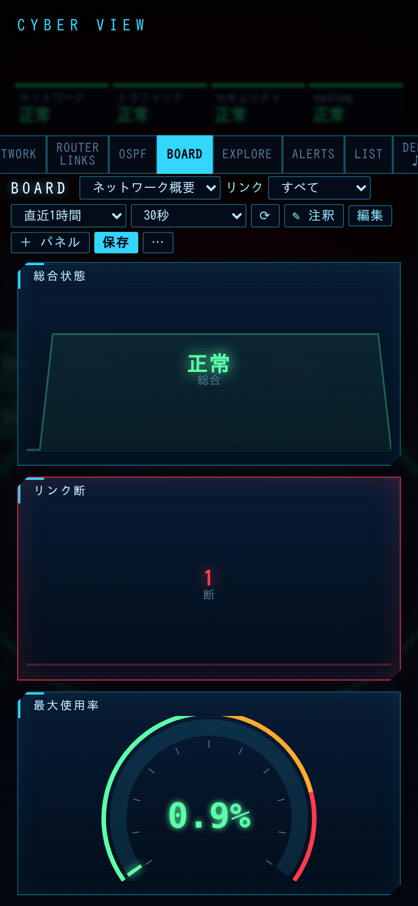
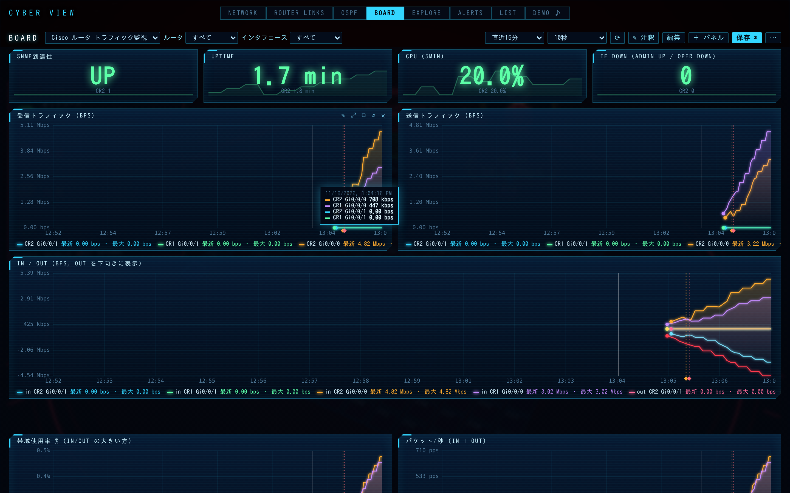

# ニルヴァーナのボード — Grafana が持つ機能を /cyber-view の見た目のまま(v18)

依頼: 「ニルヴァーナですが、grafana が持つような機能も全て持ってください、ただし GUI は今のニルバーナのままで作り替えてください」。

/cyber-view の上部に **BOARD / EXPLORE / ALERTS** の3つのボタンを足した。3D の画面は後ろで暗くぼかして動かし続け、
その上に角を切り落としたホログラムのパネル(走査線・光る線・ネオンのメーター)を並べる。Grafana と同じ考え方で、
ダッシュボード・問い合わせ・アラートを一通り使える。ラボ版とスタンドアロン版(実機の監視環境向け)の両方で動く。



## できること(Grafana との対応)

| Grafana | ニルヴァーナ |
|---|---|
| ダッシュボード(パネルを並べる・保存・版管理) | BOARD。12列の格子、編集モードでドラッグ移動・右下の角でサイズ変更、保存すると版が上がる(古い版での上書きは 409 で止める) |
| パネルの種類 | 時系列(線・塗り・積み上げ・しきい値の線)、数値(Stat、背景に推移)、メーター(Gauge、しきい値の色の帯)、棒(Bar gauge)、表、ヒートマップ、ログ、テキスト |
| パネルの編集 | ✎ で開く。種類・タイトル・データソース・問い合わせ(複数)・凡例(`{{host_a}}`)・単位(bps/B/s/bytes/%/秒…)・小数・最小/最大・集計(last/avg/max/min/sum)・しきい値・値の置き換え(0=正常 等)、その場でプレビュー |
| 変数(テンプレート) | query(`label_values(メトリクス, ラベル)`)と custom(`a,b,c`)。複数選択・「すべて」。`$__interval` / `$__rate_interval` / `$__range` も使える |
| 時間範囲・自動更新 | 直近5分〜7日・期間指定、自動更新 5秒〜5分 |
| 十字線とツールチップ | 時系列パネルにマウスを乗せると全パネルで同じ時刻に縦線、値の一覧と近くの注釈を表示 |
| 凡例 | 系列ごとの最新・最大。クリックで表示/非表示 |
| 注釈(Annotations) | 「✎ 注釈」で今の時刻に、時系列を Ctrl+クリックでその時刻に。ニルヴァーナの警報・リンク断・ルールの発報/解消も自動で縦線と菱形で出る |
| Explore | EXPLORE。PromQL(ヴァルハラ/内部)・LogQL(Loki)・内部ログ(正規表現)、結果の時系列と表、履歴、そのままダッシュボードのパネルにできる |
| データソース | NIRVANA 内部 / VALHALLA(Prometheus)/ Loki。内部は Prometheus が無い環境(Render 等)でも動くように、/metrics と同じ値を5秒ごとに6時間分貯め、PromQL の基本部分を自前で計算する |
| アラートルール | ALERTS。問い合わせを系列ごとに判定(集計・比較・しきい値・期間・継続時間)、Normal → Pending → Firing → Normal。今の値で試せる |
| 連絡先・通知 | webhook。発報と解消のたびに Grafana / Alertmanager の webhook に近い JSON を POST。試験送信ボタンあり |
| 発報の見え方 | ニルヴァーナの警報の花に **RULES** の花びら(計器のアイコン)として出る。状態の履歴も残る |
| ダッシュボードの取り込み・書き出し | JSON の書き出し、取り込み。**Grafana の書き出し JSON もそのまま読める**(24列→12列、`fieldConfig` の単位・しきい値・値の置き換え、`datasource`、`templating`、row の中のパネル) |
| 複製・新規・削除・設定 | 「…」メニュー |
| スマホ | パネルを1列に並べ直す |

入れていないもの: 利用者・組織・権限の管理(このアプリのログインをそのまま使う)、プラグイン、PDF レポート、
Slack/Teams/メールの専用連絡先(webhook の受け口側で変換)、内部データソースでの `or`/`and`/`offset`/`histogram_quantile`
(ヴァルハラを使えば Prometheus 本体が計算する)。

## 使い方

```bash
python app.py                                   # 内部データソースだけで動く
PROMETHEUS_URL=http://127.0.0.1:9090 LOKI_URL=http://127.0.0.1:3100 python app.py   # ヴァルハラ・Loki も
# /cyber-view → 上の BOARD / EXPLORE / ALERTS
```

- 最初から「ネットワーク概要」ダッシュボードが入っている(総合状態・リンク断・最大使用率・リンク流量・使用率・状態ボードの推移・OSPF 隣接・ログ)。
- 保存先は `nirvana_board.json`(`NIRVANA_BOARD_PATH` で変更可、.gitignore 済み)。
- API は `/api/nirvana/*`(`engine/nirvana_board_api.py` の先頭に一覧)。スタンドアロン版は同じファイルを `cvs/` にコピーして使い、
  内部データソースには collector が組み立てたリンク状態・状態ボードを貯める。

## ライブ確認

### ラボ(内部データソース)— 3台の OSPF、トラフィック、本物の webhook 受け口

ルール「リンク断」(`netlab_link_state` ≥ 3、継続 0秒、連絡先あり)と「流量が多い」(`sum by (host_a, host_b) (netlab_link_bps)` の平均 > 1Mbps、継続30秒)を作り、
OSPF-R2 の Gi1/0/2 を shutdown:

```
a=o3r2,b=o3r3,host_a=OSPF-R2,host_b=OSPF-R3 firing 3
host_a=OSPF-R1,host_b=OSPF-R3 firing 3133587          # 30秒 pending の後に firing
webhook 受信: {"status": "firing", "title": "[FIRING] リンク断", "labels": {"alertname": "リンク断", "severity": "critical", "a": "o3r2", ...}}
ニルヴァーナの警報: nirvana_rule RULE ルール: リンク断 o3r2 o3r3 high
```

no shutdown 後に解消の通知も届いた:

```
{"status": "resolved", "title": "[RESOLVED] リンク断", ...}
```






### Grafana のダッシュボードをそのまま取り込む(本物の Prometheus / snmp_exporter)

`iac/cisco-traffic-monitoring/grafana/dashboards/cisco-traffic.json`(Grafana 用に作ったもの)を変更せずに取り込んだ:

```
cisco-traffic Cisco ルータ トラフィック監視 10 panels, variables ['router', 'ifname']
labels router: ["CR1","CR2","CR3"]
```

変数(ルータ・インタフェース)、`rate(...[$__rate_interval])`、Out を下向きにした In/Out、SNMP 到達性の値の置き換え(UP)まで
ニルヴァーナの見た目で表示された。



## ライブ確認で見つけて直したこと

- 3D 画面の状態ボードや警報の花がパネルの後ろに透けて読みにくい → 3D を暗くぼかし、パネルの背を濃くした。
- ボードの操作列が左上の状態表示と重なる → ボード表示中は左上を「CYBER VIEW」だけにした。
- 数値パネルの値が下に寄る(全体の `#nb canvas` の指定が背景の推移グラフに勝っていた)→ 指定を強くした。件数が「1.00」と出る → 整数はそのまま。
- スマホでパネルが重なる(列だけ1列にして行の位置が残っていた)→ 行も自動で並べ直す。操作列が折り返すとパネルに隠れる → 縦に積む配置に。
- 時系列の縦軸の負の値の「-」が左端で切れる → 余白を広げた。
- Grafana の JSON は 24 列・`fieldConfig`・パネルごとの `datasource` なので、取り込み時に変換するようにした。
