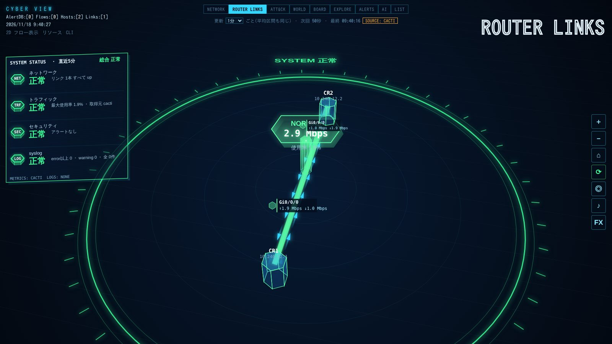

# ニルヴァーナのデータの取り込み方法と実装

[ニルヴァーナの紹介](nirvana-introduction.md) の「取り込めるデータ」の表を、データ元ごとに具体的に書きます。各データ元について、次の6点を書きます。

- 何を、どの手段で取るか
- 設定に何を書くか
- どの周期で取るか
- どのファイルのどの関数が受け持つか
- 装置とどう対応づけるか
- 前提と、できないこと

## まず決めること: ニルヴァーナはどこで動き、どう取りに行くか

| 取り方 | 対象 | ニルヴァーナから見た通信 |
|---|---|---|
| HTTP で問い合わせる(pull) | Prometheus(ヴァルハラ)、Loki、Zabbix | ニルヴァーナ → 各サーバーの HTTP API |
| SNMP で問い合わせる(pull) | 装置の経路表・CPU | ニルヴァーナ → 装置の UDP 161 |
| 受け口で待つ(push を受ける) | SNMP trap、NetFlow / sFlow | 装置 → ニルヴァーナの UDP 1162 / 2055 / 6343 |
| ローカルのファイルを読む | MRTG、Cacti の RRD | ニルヴァーナが動くマシンのファイルシステム(HTTP ではない) |
| DB に問い合わせる(pull) | Cacti の DB(RRD と装置・IF の対応) | ニルヴァーナ → Cacti の MySQL / MariaDB(`mysql` クライアント経由) |

**MRTG と Cacti の RRD は HTTP では取りに行きません。** ニルヴァーナが動いているマシンのファイルを、設定に書いたパスから直接読みます。MRTG・Cacti が別のサーバーにある場合は、次のどちらかにします。

- そのサーバーでニルヴァーナを動かす
- NFS・sshfs・docker のボリュームで、WorkDir や rra ディレクトリを共有する

HTTP のディレクトリ一覧から選んで取りに行く方式はありません。

設定ファイルは2種類あります。

- **単体版**: `cyber-view-standalone/config.yaml` の `sources:` に書きます。書き方の例は `config.example.yaml` です。`install.sh` が既存の監視を探して下書きを作ります。
- **ラボ版**: 環境変数で指定します。ラボ版は、SNMP の直接取得・MRTG・Cacti・Zabbix の代わりにエミュレータの内部の値を使います。

取り込みの順番は単体版の `cvs/collector.py` の `Collector.tick()` が決めます。周期は `poll_interval` 秒で、既定は10秒です。

---

## 1. Prometheus(ヴァルハラ)+ snmp_exporter

| 項目 | 内容 |
|---|---|
| 取るもの | IF の流量・IF の状態・装置が収集できているか |
| 取り方 | HTTP `GET <url>/api/v1/query?query=<PromQL>`(instant query) |
| 単体版の設定 | `sources.prometheus: {url: http://<ヴァルハラ>:9090, job: <snmp_exporter の scrape job 名>}` |
| ラボ版の設定 | 環境変数 `PROMETHEUS_URL`(job は `cisco-snmp`) |
| 周期 | `poll_interval`(既定10秒)。値そのものはヴァルハラの scrape 周期(IaC では15秒)で更新 |
| 実装 | `cvs/sources.py` の `Prometheus`(`rates()` / `oper_status()` / `targets_up()` / `counters()`)。ラボ版は `engine/link_stats.py` と `engine/link_evidence.py` |

実際に投げる PromQL:

```
rate(ifHCInOctets{job="<job>"}[60s]) * 8      # 受信 bps(窓は画面の「更新」の秒数、最小60秒)
rate(ifHCOutOctets{job="<job>"}[60s]) * 8     # 送信 bps
ifOperStatus{job="<job>"}                     # 1=up、2=down・7=lowerLayerDown=断(POLL の検知経路)
up{job="<job>"}                               # 0 なら「NO RESPONSE」+「警 SNMP」
ifHCInOctets{job="<job>"} / ifHCOutOctets     # 累積カウンタ(IF ごとのタイル)
```

- **装置との対応**: 結果の `instance` ラベル(ポートは外す)が設定の `devices[].mgmt_ip` と一致するものを、その装置とみなします。
- **IF との対応**: `ifName` ラベルを使います。そのため snmp_exporter の `if_mib` モジュールは `ifName` を lookup する設定にしてください(IaC の `snmp.yml` はそうなっています)。名前は `Gi0/0/0` と `GigabitEthernet0/0/0` のような略記の違いを吸収して照合します。
- **使う画面**: ROUTER LINKS の流量と使用率、リンク断の検知経路 POLL、NO RESPONSE。履歴の再生・予測・OSPF ビュー(`cvs/valhalla_views.py`)もヴァルハラに問い合わせます。

## 2. Grafana Loki(syslog)

| 項目 | 内容 |
|---|---|
| 取るもの | 装置の syslog の行 |
| 取り方 | HTTP `GET <url>/loki/api/v1/query_range?query=<LogQL>&start=&end=&limit=1000&direction=backward` |
| 単体版の設定 | `sources.loki: {url: http://<loki>:3100, query: '{job=~".+"}', device_labels: [device_id, host, hostname, instance]}` |
| ラボ版の設定 | 環境変数 `LOKI_URL` |
| 周期 | `poll_interval` ごとに、前回読んだ時刻の5秒前から今までを読む(重なった分は重複として除く) |
| 実装 | `cvs/sources.py` の `Loki.logs()`、`cvs/collector.py` の `Collector.poll_logs()`、判定は `cvs/analytics.py` の `record_log()` |

- **装置との対応**: ログのラベルを `device_labels` の順に見て、設定の装置ID・hostname・mgmt_ip・`loki_host` のどれかと一致するものを探します。ラベルで決まらなければ、本文に装置の hostname が含まれるかで決めます。
- **装置から Loki まで**: IaC では装置 → syslog-bridge(UDP 5515、`tools/syslog_to_loki.py`)→ Loki と流します。ラベルは `job="netlab-syslog"` と送信元 IP です。
- **判定**: 次のように判定します。
  - `%LINK-3-UPDOWN` などのリンクの上下はリンク断の検知経路 SYSLOG(`parse_log_link_event`)
  - error 以上のログは「警」(`syslog_error`)
  - 同じ IF の上下の繰り返しは「注」(フラップ、`flap_rules.py`)

## 3. SNMP(ニルヴァーナが直接ポーリング)

| 項目 | 内容 |
|---|---|
| 取るもの | 経路表、CPU 使用率 |
| 取り方 | SNMP GET / GETNEXT(v2c、または v3 の USM)。標準ライブラリだけで書いたクライアント(`cvs/snmp_client.py`、v3 は `cvs/snmp_usm.py`) |
| 単体版の設定 | `sources.snmp: {community: ..., interval: 60, full_every: 5, cpu: {high: 80, jump: 20, hold: 2}}`。v3 は `sources.snmp.v3: {user, auth, auth_password, priv, priv_password}`。装置ごとの上書きは `devices[].snmp_community` / `snmp_v3` / `snmp_cpu_oid` |
| ラボ版 | SNMP は使わず、エミュレータの経路表(`rib_engine`)と CPU を直接見る(`app.py` の `_route_watch_tick`) |
| 周期 | `interval`(既定60秒)。経路の数が変わらなければ表全体は取らず、`full_every` 回に1回は取り直す |
| 実装 | `cvs/snmp_poll.py` の `SnmpPoller`。差分の判定は `cvs/route_watch.py`(`RouteWatcher` / `CpuWatch`) |

問い合わせ先は `devices[].mgmt_ip` の UDP 161 です。使う OID は次のとおりで、上から順に、取れたものを使います。

| 目的 | OID |
|---|---|
| 経路の数 | `1.3.6.1.2.1.4.24.6.0`(inetCidrRouteNumber)、`1.3.6.1.2.1.4.24.3.0`(ipCidrRouteNumber) |
| 経路表 | `1.3.6.1.2.1.4.24.7.1`(inetCidrRouteTable)→ `1.3.6.1.2.1.4.24.4.1`(ipCidrRouteTable)→ `1.3.6.1.2.1.4.21.1`(RFC1213 ipRouteTable) |
| CPU | `1.3.6.1.4.1.9.9.109.1.1.1.1.8`(Cisco cpmCPUTotal5minRev)→ `1.3.6.1.2.1.25.3.3.1.2`(hrProcessorLoad)。機種固有なら `cpu.oid` で指定 |
| IF 名 | `1.3.6.1.2.1.31.1.1.1.1`(ifName。経路の出口 IF の表示用) |

- **判定**:
  - 経路の追加・削除・変更は「情」
  - CPU が前回より `jump` 以上上がると「情」
  - CPU が `high` 以上の状態が `hold` 回続くと「注」
- **前提**: 装置の SNMP の ACL で、ニルヴァーナの IP を許可しておく必要があります。

## 4. SNMP trap

| 項目 | 内容 |
|---|---|
| 取るもの | linkDown(`1.3.6.1.6.3.1.1.5.3`)/ linkUp(`1.3.6.1.6.3.1.1.5.4`) |
| 取り方 | UDP の受け口で待つ |
| 単体版の設定 | `sources.snmp_trap: {listen: 0.0.0.0:1162}` |
| ラボ版の設定 | 環境変数 `SNMP_TRAP_LISTEN=0.0.0.0:1162` |
| 装置の設定(IOS) | `snmp-server host <ニルヴァーナ> traps version 2c <community> udp-port 1162`、`snmp-server trap-source <IF>`、`snmp-server enable traps snmp linkdown linkup` |
| 実装 | `cvs/link_evidence.py`(= `engine/link_evidence.py`)の `TrapStore.start()` が受け、`decode_trap()` で分解 |

- **分解の中身**: varbind の `snmpTrapOID`、`ifDescr`(`1.3.6.1.2.1.2.2.1.2.<ifIndex>`)または `ifName`、`sysDescr` を読みます。
- **装置と IF の対応**: 装置は送信元 IP か `sysDescr` の hostname で、IF は `ifDescr` で決めます。そのため `trap-source` で装置自身の IP から送ってください。
- **判定**: その IF の最新が down ならリンク断の検知経路 TRAP になり、「警」が出ます。up に戻れば「情」が出ます。
- **できないこと**: 受けられるのは SNMPv2c の trap(PDU 0xA7)だけです。v1 の trap、inform、v3 の trap は読みません。ポートを 162 にする場合は、root 権限で動かしてください。

## 5. NetFlow v5 / sFlow v5

| 項目 | 内容 |
|---|---|
| 取るもの | 送信元・宛先・プロトコル・ポート・パケット数・バイト数 |
| 取り方 | UDP の受け口で待つ |
| 単体版の設定 | `sources.flow: {netflow: 2055, sflow: 6343, bind: 0.0.0.0}`、ダークネットは `sources.darknet: {prefixes: [10.250.0.0/24]}` |
| ラボ版の設定 | 環境変数 `NETLAB_FLOW_COLLECT=2055,6343` |
| 装置の設定 | IOS `ip flow-export destination <ニルヴァーナ> 2055` + `ip flow-export version 5` + IF に `ip flow ingress`。NX-OS `feature sflow` + `sflow collector-ip <ニルヴァーナ> vrf default` + `sflow data-source interface <IF>` |
| 実装 | `cvs/flow_collector.py`(= `engine/flow_collector.py`)の `FlowCollector`、`parse_netflow_v5()` / `parse_sflow_v5()`。受けたフローは `cvs/security.py` の `on_flow()` へ |

- **sFlow の分解**: フローサンプルに入っているパケットの先頭(Ethernet + IPv4)を分解し、サンプリング率を掛けて量を見積もります。
- **使われ方**: `on_flow()` は1件ごとに次の4つへ渡します。
  - ダークネットの分類(`darknet.py`。スキャン・DDoS の跳ね返り・設定ミス・リフレクション、「警」)
  - 外部への大量送信の検知
  - WORLD のクラウド宛て流量と攻撃元の都市
  - 画面の「NetFlow / sFlow 送信元 → 宛先 ・ 量」のプレート
- **できないこと**: NetFlow v9 と IPFIX は読みません。

## 6. MRTG

| 項目 | 内容 |
|---|---|
| 取るもの | IF の入力・出力の bps(MRTG が5分ごとに書いた最新の区間の平均) |
| 取り方 | **ローカルのファイルを読む**(HTTP ではない) |
| 単体版の設定 | `sources.mrtg: {cfg: /etc/mrtg.cfg, stale: 900}`。書くのは `mrtg.cfg` のパスだけ |
| 実装 | `cvs/legacy_sources.py` の `parse_mrtg_cfg()`、`LegacyRates.map_mrtg()`、`read_mrtg_log()` / `rrd_last()` |

**ファイル名は `mrtg.cfg` から自動で決まります。** RRD のパスやファイル名を設定に書く必要はありません。

1. `mrtg.cfg` の `WorkDir:` で、ファイルのあるディレクトリが決まります。`LogFormat: rrdtool` があれば RRD、無ければ MRTG の `.log` を読みます。
2. `Target[<名前>]: <ifIndex または #IF名 または /IP>:<community>@<装置>` の各行から、次の名前のファイルを読みます。MRTG と同じく、ファイル名は小文字にします。
   ```
   <WorkDir>/<名前を小文字にしたもの>.log   (または .rrd)
   ```
   例: `Target[10.240.12.1_gi0_0_0]: ...` なら `WorkDir/10.240.12.1_gi0_0_0.log` を読みます。
3. Target の `@` の後ろ(装置の IP か名前)を、設定の装置と照合します。IF は `#IF名`・`/IP`・ifIndex の順に、設定の IF と照合します。cfgmaker が書く `SetEnv[<名前>]: MRTG_INT_IP="…" MRTG_INT_DESCR="…"` があれば、その IP と IF 名も使います。
4. `.log` は2行目(最新の区間)の入力・出力のバイト/秒を、8倍して bps にします。RRD は `rrdtool fetch <ファイル> AVERAGE -s -1800` を実行し、値の入っている最新の行の `ds0`(入力)・`ds1`(出力)を読みます。

補足:

- `rrdtool` コマンドは PATH から探します(`shutil.which('rrdtool')`)。パスを設定で変えることはできません。
- 次のときは、設定で上書きできます。
  - `WorkDir`・`LogFormat` を変えたい: `sources.mrtg.workdir` / `logformat`
  - 自動の対応づけが外れる: `sources.mrtg.targets: [{target: <名前>, device: <装置ID>, if: <IF名>}]` で、その Target だけ指定
  - ファイル名を小文字にしない: `lowercase: false`
- `stale` 秒より古い値は表示しません。MRTG が止まっていても 0 bps とは見せません。
- **`mrtg.cfg` の場所の候補**(インストーラーが順に探します):

  | 場所 | よくある環境 |
  |---|---|
  | `/etc/mrtg.cfg` | Debian / Ubuntu |
  | `/etc/mrtg/*.cfg`(`mrtg.cfg`) | RHEL / Rocky / Alma |
  | `/usr/local/etc/mrtg/*.cfg` | FreeBSD |
  | `/usr/local/mrtg-2/conf/*.cfg` | MRTG のソースを自分で入れた場合(MRTG の手順書の場所) |

  どれにも無いときは、`find / -name 'mrtg*.cfg' 2>/dev/null` で探し、`./install.sh --mrtg-cfg <パス>`(複数回指定できます)で渡すか、設定の `sources.mrtg.cfg` に書きます。
- **探した場所は画面に出ます**: `./install.sh --detect-only` を実行すると、各候補が「無い」か「ある」かと、あっても使えなかった理由(読めない、`Target[...]` が1つも無い)が出ます。
  ```
  MRTG 候補 /etc/mrtg.cfg: 無い
  MRTG 候補 /etc/mrtg/*.cfg: /etc/mrtg/mrtg.cfg
  注: MRTG: /etc/mrtg/mrtg.cfg はありますが Target[...] が1つもありません(cfgmaker で作ると入ります)
  ```
- **設定に書いたパスが無いとき**: 実行中は、`GET /api/health` の `errors.mrtg` に `mrtg.cfg が見つかりません: <パス>(候補: …)` と出ます。以前は黙って対象なしになっていました。

## 7. Cacti

| 項目 | 内容 |
|---|---|
| 取るもの | IF の入力・出力の bps(Cacti の「Interface - Traffic」のデータソース) |
| 取り方 | **RRD はローカルのファイルを `rrdtool fetch` で読む**。**RRD と装置・IF の対応は、Cacti の DB(MySQL / MariaDB)から自動で読む** |
| 単体版の設定 | `sources.cacti: {db: {config: /etc/cacti/debian.php}, stale: 900}`。`rra_dir` は書かなくても動きます(Cacti の設定 `path_rra` を使う) |
| 実装 | `cvs/cacti_db.py`(DB の読み取りと対応づけ)、`cvs/legacy_sources.py` の `LegacyRates`(RRD の読み取り) |

### 自動の対応づけの仕組み

Cacti 1.x の RRD のファイル名は `<path_rra>/<host_id>/<local_data_id>.rrd` のように数字だけで、名前から IF は分かりません。対応は Cacti の DB にしか無いので、DB を読み取り専用で引きます。

1. **接続先を読む**: `sources.cacti.db.config` の PHP ファイルから `$database_hostname` / `$database_username` / `$database_password` / `$database_default` / `$database_port` を読みます。パスワードはニルヴァーナの設定ファイルには書きません。直接指定したい項目は `host` / `port` / `user` / `password` / `database` で上書きできます。
2. **`mysql`(または `mariadb`)クライアントで SELECT を1回**流します。パスワードはコマンドラインに載せず、環境変数 `MYSQL_PWD` で渡します(`ps` に出ません)。標準ライブラリだけで動かす方針と、`rrdtool` を呼ぶ既存の作りに合わせた方式です。
3. **読むテーブル**(Cacti 1.2.26 の `cacti.sql` で確認):

   | テーブル | 使う列 | 目的 |
   |---|---|---|
   | `host` | `hostname`(IP か名前)、`description`、`disabled` | 装置 |
   | `data_local` | `host_id`、`snmp_query_id`、`snmp_index`(= ifIndex) | データソースと装置・IF の結びつき |
   | `data_template_data` | `data_source_path`(`<path_rra>/…rrd`) | RRD のファイル |
   | `data_template_rrd` | `data_source_name` | `traffic_in` と `traffic_out` の両方を持つものだけ(CPU など他のデータソースを除く) |
   | `host_snmp_cache` | `field_name`(`ifName` / `ifDescr` / `ifIP`)、`field_value`、`snmp_index` | IF の名前と IP |

4. **設定の装置・IF と照合**します。装置は、Cacti のホスト名(IP か名前)か説明が、設定の装置の `id` / `hostname` / `mgmt_ip` / `zabbix_host` / `loki_host` のどれかと一致するもの。IF は、`ifName` か `ifDescr` が設定の IF 名と一致するか(`Gi0/0/0` と `GigabitEthernet0/0/0` のような略記の違いは吸収します)、`ifIP` が設定の IF の IP と一致するもの。
5. `<path_rra>` を実際のディレクトリ(`rra_dir`、書かなければ Cacti の設定 `path_rra`)に置き換え、`rrdtool fetch` で最新の値を読みます。

### 運用

- DB は `db_ttl` 秒(既定300)に1回だけ引きます。RRD の読み取りは毎回です。
- **対応づけの結果は `GET /api/health` の `notes.cacti` に出ます**。対応づけできなかったものは理由つきです。
  ```
  DB に traffic の RRD が 4 本、装置・IF に対応づけ 3 本。対応づけできなかった 1 本: OLD-SW Fa0/1(装置が設定に無い: 10.9.9.9)
  ```
- **DB に繋がらないとき**は `errors.cacti_db` に理由が出ます。前回の対応を使い続けるので、流量の表示は止まりません。接続情報のファイルが無いときは `errors.cacti` に候補つきで出ます。
- **同じ装置・IF を `targets` に手で書いたときは、手書きが優先**されます。DB に無い RRD や、対応づけできなかったものは、`targets` で補えます(`file` は `rra_dir` からの相対でも可、`ds_in` / `ds_out` でデータソース名を変更)。
- DB を使わないなら、これまでどおり `targets: [{device, if, file}]` を手で書きます。
- DB の接続は、Cacti とは別のサーバーでも構いません(`$database_hostname` の先へ繋ぎます)。ただし RRD は、ニルヴァーナが動くマシンから読めるパスにある必要があります。
- **必要なもの**: `mysql` クライアント(`mariadb-client` か `mysql-client`)と `rrdtool`。**Docker の単体版のイメージには、どちらも入っていません**(イメージを作り直すか、ホストで動かしてください)。DB のユーザーは `SELECT` だけで足ります。

### 接続情報のファイルの場所(インストーラーが探す順)

| 場所 | 環境 |
|---|---|
| `/etc/cacti/db.php` | RHEL / Rocky / Alma(EPEL) |
| `/etc/cacti/debian.php` | Debian / Ubuntu(`/usr/share/cacti/site/include/config.php` はこれへの symlink) |
| `/usr/share/cacti/site/include/config.php` | Debian 系(上の symlink) |
| `/var/www/html/cacti/include/config.php` | ソースから入れた場合 |
| `/usr/share/cacti/include/config.php` | 古い配置 |

`./install.sh --detect-only` に「Cacti DB 候補」として出ます。別の場所なら `--cacti-db-config <パス>` で渡します。見つかると、設定の下書きに `sources.cacti.db.config` を書きます。RRD はサブディレクトリの中も数えます(以前は直下の `traffic` を含む名前しか数えず、Cacti 1.x では見つかりませんでした)。

### 本物で確かめた結果

**本物の MariaDB 10.11 に、Cacti 1.2.26 の `cacti.sql` をそのまま読み込み**、Cacti 1.x と同じ形(`<path_rra>/<host_id>/<id>.rrd`、`host_snmp_cache` に ifName / ifDescr / ifIP)でデータを入れ、本物の `rrdtool` で作った RRD を読みました。CPU のデータソースと、設定に無い装置を混ぜています。

```
$ python3 -c '... LegacyRates({"sources":{"cacti":{"db":{"config":"debian.php"}}}}, devs, lookup).rates(now)'
('cr1', 'gi0/0/0')  in=2000000 bps  out=1920000 bps  src=cacti      ← RRD は 250000 B/s・240000 B/s
('cr1', 'gi0/0/1')  in=8000 bps     out=6400 bps     src=cacti
('cr2', 'gi0/0/0')  in=1000000 bps  out=1000000 bps  src=cacti
errors: {}
notes: {'cacti': 'DB に traffic の RRD が 4 本、装置・IF に対応づけ 3 本。対応づけできなかった 1 本: OLD-SW Fa0/1(装置が設定に無い: 10.9.9.9)'}
```

- 間違ったパスワード: `errors.cacti` に `Cacti の DB に繋がりません: ERROR 1045 (28000): Access denied …`
- DB が落ちた間: 前回の対応で流量を出し続け、`errors.cacti_db` に理由。復旧すると消える
- ニルヴァーナの単体版を Cacti の DB だけを取り込み元にして起動すると、`SOURCE: CACTI` で CR1 ⇄ CR2 が約 1.9 Mbps / 1.0 Mbps と表示された



**未確認のこと**: 本物の Cacti(PHP のアプリ)を動かしたものではありません。Cacti のテーブルと列は 1.2.26 の `cacti.sql` で確認しましたが、データの入り方(`data_source_path` の形、`host_snmp_cache` の `ifIP` の有無)は私の知る Cacti 1.x の動きに合わせて作ったものです。実機で `notes.cacti` の本数が合わないときは、`host_snmp_cache` の中身(`SELECT DISTINCT field_name FROM host_snmp_cache`)を見せてください。

## 8. Zabbix

| 項目 | 内容 |
|---|---|
| 取るもの | IF の流量・IF の状態・未解決の問題・ホストの到達性 |
| 取り方 | HTTP `POST <url>/api_jsonrpc.php`(JSON-RPC)。`host.get`、`item.get`、`problem.get` |
| 単体版の設定 | `sources.zabbix: {url: http://<zabbix>/api_jsonrpc.php, token: ${ZABBIX_TOKEN}}`(user / password でも可) |
| 実装 | `cvs/sources.py` の `Zabbix`(`hosts()` / `interface_items()` / `problems()`) |

- **ホストとの対応**: `host.get` を、設定の装置の `zabbix_host`(無ければ hostname)で絞って呼びます。
- **流量と IF の状態**: `item.get` で「Network interfaces by SNMP」系テンプレートのアイテムを読みます。名前が `Interface <IF名>: Bits received / Bits sent / Operational status` のものを使います。
- **問題**: `problem.get` の重大度を、Disaster・High は「警」(high)、Average は「警」(medium)、Warning は「注」にします。
- **注意**: Zabbix の Cisco テンプレートは、admin shutdown の IF のアイテムを LLD で無効化します。これは「断」として扱います。
- **認証**: API トークンは Zabbix 7.2 以降の `Authorization` ヘッダと、それより前の `auth` パラメータの両方で送ります。

---

## 取り込みの優先順位

1本のリンクの流量が複数のデータ元から取れる場合は、次の順に使います。画面右上の `SOURCE:` に、どこから取ったかが出ます。

1. Prometheus(ヴァルハラ)
2. Zabbix
3. MRTG / Cacti

リンク断は、STATE(ラボのみ)・SYSLOG・TRAP・POLL のどれか1つでも断を示せば断とします。

## 確かめ方

| データ元 | 確かめ方 |
|---|---|
| Prometheus・Loki・trap・フロー・SNMP の ACL | `iac/nirvana-monitoring` で `./deploy.sh check`(結果は [nirvana-monitoring-iac.md](nirvana-monitoring-iac.md)) |
| MRTG・Cacti | 本物の MRTG(cfgmaker)と Cacti の RRD での確認は [nirvana-addon-monitoring-ai.md](nirvana-addon-monitoring-ai.md) |
| Zabbix | 本物の Zabbix 7.0 での確認は [cyber-view-standalone.md](cyber-view-standalone.md) |
| 取り込みの状態 | 単体版の `GET /api/health` の `errors` に、取れなかったデータ元とその理由が出る |
