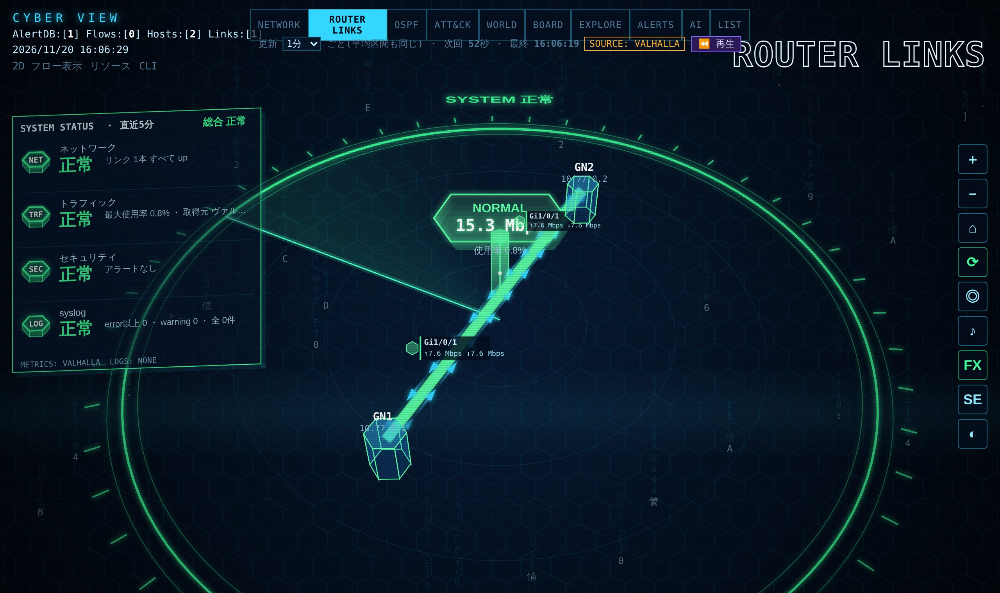
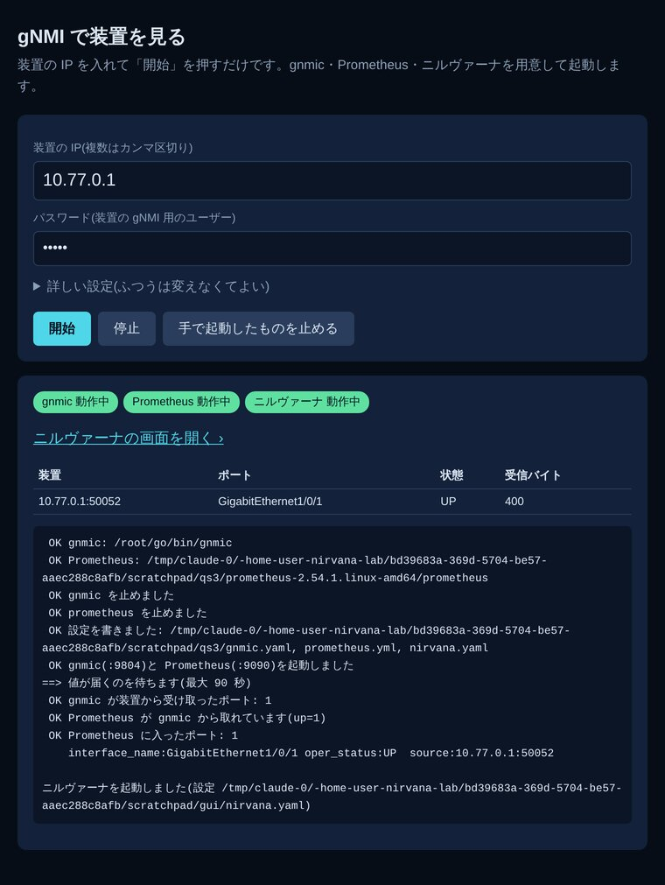

# ニルヴァーナで gNMI の値を見る(gnmic → Prometheus 経由)

```
Catalyst ──gNMI(50052)──▶ gnmic ──:9804/metrics──▶ Prometheus(ヴァルハラ)──▶ ニルヴァーナ
```

ニルヴァーナ単体版(`cyber-view-standalone`)は gNMI を直接は話しません。
gnmic が gNMI で購読した値を Prometheus の形で公開し、ニルヴァーナはそれを Prometheus から読みます。

- 流量: `interfaces_interface_state_counters_in/out_octets` の rate
- リンクの断(POLL): `interfaces_interface_state_oper_status` の `oper_status` ラベル(UP / DOWN / LOWER_LAYER_DOWN)

snmp_exporter と並べて使えます(`flavor: both` では同じ装置・IF は SNMP を優先し、無いところを gNMI で埋めます)。



## コマンドを打たない方法: 設定画面(`setup_gui.py`)

装置の設定(下の 1)を済ませたら、Windows では `cyber-view-standalone\start-nirvana-gnmi.bat` をダブルクリックします。
ブラウザで設定画面(http://localhost:8092/)が開くので、**装置の IP とパスワードを入れて「開始」を押すだけ**です。



- 裏で `gnmi-quickstart.sh up` を動かします。Windows では WSL の中で動かし、gnmic・Prometheus の用意・設定・起動・確認まで行います。
- 続けてニルヴァーナを 8091 番で起動し、画面を開きます。選んだポートの先に「相手」を置いて、リンクとして表示します。
- うまくいかないときは、原因の目安を画面に出します(装置に届かない / パスワード / ポートの取り合い など)。
- 「停止」で全部止まります。前に手で起動した gnmic・Prometheus があるときは、「手で起動したものを止める」を押します。
- 見るポートとユーザーは「詳しい設定」で変えられます。前回の IP・ポート・ユーザーは覚えますが、パスワードは保存しません。
- 設定画面はこの PC の中(127.0.0.1)からしか開けません。入力した値は確かめてから渡します(IP の形・ポート名の形)。
- 必要なもの: Windows の Python(ニルヴァーナの部品は .bat が初回に入れる)と、WSL の Ubuntu(gnmic を入れるとき sudo のパスワードを聞かれるため、gnmic だけは最初に一度 WSL で入れておくと確実)。

ラボの Catalyst(gNMI 有効)に対して、Linux 上で画面から「開始」→ 約 20 秒で gnmic・Prometheus・ニルヴァーナが動作中になり、ポートの状態が表に出ることを Playwright で確かめました。
設定画面を強制終了して残ったニルヴァーナも、次の「開始」で入れ替わります。Windows の .bat と WSL 経由の呼び出しは、この作業環境では動かせないため、実機の Windows で確かめてください。

## いちばん簡単な方法: `gnmi-quickstart.sh`(Linux / WSL)

装置の設定(下の 1)を済ませたら、WSL では次の 1 行で、gnmic と Prometheus の用意・設定・起動・確認まで終わります。

```bash
cd nirvana-lab/cyber-view-standalone && ./gnmi-quickstart.sh up --target 192.168.1.1 --ports Gi1/0/1
```

- gnmic が無ければ公式の導入スクリプトで入れ、Prometheus は `~/nirvana-gnmi` に取ってきます。
- 設定は 16.x の癖に合わせて書きます(ポートごとの `/state` 購読、`export-timestamps` なし、`expiration` は間隔の 2.5 倍)。パスワードを含む `gnmic.yaml` は本人だけが読めるようにします。
- `nohup` で起動するので、画面を閉じても止まりません。
- 値が Prometheus まで届いたかを確かめ、だめならログから原因の目安(届かない / 認証 / 購読の打ち切り など)を出します。
- ニルヴァーナの設定 `~/nirvana-gnmi/nirvana.yaml` も作ります(つながり `links` は手で足します)。

| コマンド | 何をするか |
|---|---|
| `./gnmi-quickstart.sh up --target <IP>[,<IP>...] --ports <ポート>[,...]` | 用意して起動し、確かめる。ユーザー・パスワードは聞かれる(`--user`・`--password` や `GNMI_PASSWORD` でも渡せる) |
| `./gnmi-quickstart.sh status` | 動いているかと、値が届いているか |
| `./gnmi-quickstart.sh down` | 止める |
| `./gnmi-quickstart.sh config ...` | 設定ファイルだけ書く(起動しない) |

以下は、スクリプトが中でやっていることを手で行う手順です。


## 1. 装置(Catalyst)の設定

IOS XE 16.x(例: WS-C3650 16.12.11)の場合です。17.x では `gnmi-yang` の代わりに `gnxi` / `gnxi server` を使います。

```
aaa new-model
aaa authentication login default local
aaa authorization exec default local
username admin privilege 15 secret <パスワード>
netconf-yang           ! 16.x では gNMI の土台(DMI)を起こすために必要
gnmi-yang
gnmi-yang server       ! 暗号化なし・ポート 50052
```

`show platform software yang-management process` で `gnmib : Running` になるまで 1〜3 分待ちます。
`show running-config | include gnmi` に `gnmi-yang` と `gnmi-yang server` の 2 行が出ることを確かめます。

## 2. gnmic(Linux / WSL)

gnmic は Linux と Mac 向けだけです。Windows では WSL の Ubuntu で動かします。

```bash
bash -c "$(curl -sL https://get-gnmic.openconfig.net)"
```

`cyber-view-standalone/gnmic.example.yaml` を `gnmic.yaml` にコピーし、`targets` に装置の IP を書きます。

```bash
export GNMI_USER=admin GNMI_PASSWORD='<パスワード>'
nohup gnmic --config gnmic.yaml --log subscribe > gnmic.log 2>&1 &
```

```bash
curl -s http://127.0.0.1:9804/metrics | grep in_octets
```

IOS XE 16.x では、購読するパスにポート名(キー)を必ず書きます。
`/interfaces/interface/state/counters` のようにポート名を省くと、次のエラーで断られます(WS-C3650 16.12.11 で確認)。
17.x とラボはポート名を省いても通ります(全ポート分)。

```
rpc error: code = InvalidArgument desc = Subscription to filter '/oc-if:interfaces/interface/state/counters' ...
has missing keys. All key values must be specified for parent lists
```

また、`oper-status` だけの購読は、少しすると装置に打ち切られます(装置のログに `%MDT_SUBSCRIPTION-4-TERMINATED ... run-time error`、gnmic に `Canceled by operator`)。
ポートの `state` をまとめて購読すれば、`oper-status` もカウンタも 1 本で届きます。メトリクス名は同じ(`..._state_oper_status`・`..._state_counters_in_octets`)です。

監視するポートを 1 つずつ並べたパスは、次のように作れます(例: Gi1/0/1〜24)。

```bash
for i in $(seq 1 24); do echo "      - \"/interfaces/interface[name=GigabitEthernet1/0/$i]/state\""; done
```

`state` をまとめて購読すると、`strings-as-labels` によってカウンタの系列にも `oper_status` や `admin_status` のラベルが付きます。
そのため、ポートの状態が変わるたびに系列が分かれます(古い方も gnmic の `expiration` まで残ります)。
ニルヴァーナは装置・ポートごとに `max by (source, interface_name)` で 1 本にまとめてから `rate` を取るので、分かれ目でも流量は途切れず、2 重にも数えません。

装置の時計も合わせてください(`clock timezone JST 9 0` と `clock set`、本番は `ntp server`)。
`export-timestamps: true` は装置の時刻をそのまま使うので、時計が遅れていると、Prometheus は届いた値を古い値として扱います。

gnmic は `--log` を付けないと、つながらないときのエラーを何も出しません。最初は `gnmic --config gnmic.yaml --log subscribe` で起動してください。
WSL では、Ubuntu の画面を閉じると `&` で起動したプログラムも止まります。`nohup` を付けて起動します。

`prometheus` 出力の `strings-as-labels: true` は外さないでください(oper-status を見るのに使います)。

`export-timestamps: true` は、装置の時計が NTP で正確なときだけ付けます。装置の時刻をそのまま Prometheus に渡すため、時計がずれていると値が捨てられます。
WS-C3650 では、Prometheus の `up` が 1 なのに値が空になりました。付けない場合は `expiration` を短く(25 秒)して、状態が変わったときに古い系列が残る時間を短くします。

- `strings-as-labels: true`: oper-status(文字列)をラベルにします。これが無いと断を判定できません。
- 状態が UP → DOWN に変わると、古い UP の系列も gnmic の `expiration` まで残ります。ニルヴァーナは系列ごとの最新時刻で新しい方を選びます。`export-timestamps` が無いと両方の時刻が同じになるため、`expiration` のあいだは古い方を選ぶことがあります。

## 3. Prometheus

```yaml
scrape_configs:
  - job_name: gnmic
    static_configs: [{targets: ['<gnmic を動かす機械>:9804']}]
```

## 4. ニルヴァーナ

```yaml
devices:
  - id: sw1
    hostname: Switch
    type: catalyst
    mgmt_ip: 192.168.1.1          # gnmic の targets と同じ IP
    interfaces:
      - {name: GigabitEthernet1/0/1, ip: 192.168.1.1, prefix: 24}
sources:
  prometheus:
    url: http://127.0.0.1:9090
    flavor: gnmic                 # SNMP も使うなら both
    gnmic_job: gnmic
```

`install.sh` は Prometheus に gnmic の系列があれば見つけて、`flavor` と `gnmic_job` を書きます。
gnmic は IF の IP を出さないので、リンク(`links`)は手で書きます。

gnmic には装置ごとの `up` が無いので、gnmic だけのときは「応答なし」の判定はしません。

## ライブ確認(2026-11-20)

ラボの Catalyst 2 台(`gnxi server`、10.77.0.1 / 10.77.0.2、Gi1/0/1 同士をリンク)に対して、本物の gnmic と Prometheus 2.54.1 を使い、
`python3 server.py -c <設定> --port 8091` のニルヴァーナで次のとおり確かめました。

| 操作 | gnmic の出力 | ニルヴァーナ(`/api/traffic/links`) |
|---|---|---|
| 起動直後 | `oper_status="UP"` | `POLL: up`・0 bps |
| `ping 10.77.0.2 repeat 2000 size 1500` を流す | `in_octets` が増える | 約 8.1 Mbps ずつ(上の画面写真は約 15.3 Mbps)、`source: prometheus`(ヴァルハラ) |
| GN2 で `shutdown` | `oper_status="DOWN"`(古い UP の系列も残る) | `down: true`・`POLL: down` |
| `no shutdown` | `oper_status="UP"`(古い DOWN の系列も残る) | `down: false`・`POLL: up` |

実機の 3650 と同じ「`state` をまとめて購読」の形でも確かめました。GN2 の `shutdown` → `no shutdown` のあと、ポートごとにまとめない問い合わせでは
GN2 の流量が UP と DOWN の 2 本に分かれました(3.9 Mbps と 1.8 Mbps)。まとめる問い合わせでは 1 本(3.5 Mbps)で、断の判定も復旧後は UP に戻りました。

最初は oper_status の問い合わせで `timestamp(... == 1)` と書いていました。比較の結果には問い合わせ時刻が付くため、新旧の系列を区別できませんでした。
`timestamp(M) and (M == 1)` に直して、断と復旧の両方が正しく切り替わることを確かめています。

実機の WS-C3650-24TD(IOS XE 16.12.11)では、ユーザーが gnmic(WSL)で同じパスの購読ができることを確かめています。
Windows の pygnmi は get は通りましたが、subscribe は `Unsupported subscription list qos selection` で断られました
(pygnmi が付ける QoS の欄を 16.12 が受け付けない)。gnmic は QoS を付けないので通ります。

## 実機で確かめた(2026-11-21、WS-C3650-24TD / IOS XE 16.12.11)

Windows の PC(192.168.1.100)を Gi1/0/1 に直結し、WSL の Ubuntu で gnmic と Prometheus 2.54.1、Windows の Python でニルヴァーナ単体版(`--port 8091`)を動かしました。
ROUTER LINKS に Switch ─ PC のリンクが出て、gNMI のカウンタから送受信の流量(数百 bps)と NORMAL、SYSTEM STATUS「総合 正常」、取得元ヴァルハラが表示されました。

途中でつまずいたことと、その対処です(上の各節に反映済み)。

| 起きたこと | 原因 | 対処 |
|---|---|---|
| `has missing keys` で購読が断られる | 16.x はポート名(キー)の無いパスを受け付けない | `[name=GigabitEthernet1/0/1]` を付ける |
| oper-status の購読が `Canceled by operator`(装置に `%MDT_SUBSCRIPTION-4-TERMINATED`) | 16.12 が値 1 つの購読を打ち切る | `/state` をまとめて購読する |
| Prometheus の `up` は 1 なのに値が空 | `export-timestamps` が装置の時刻(ずれていた)を渡し、Prometheus が捨てた | `export-timestamps` を外し、`expiration: 25s` にする |
| gnmic のログが空 | `--log` が無いと何も出さない | `--log` を付ける |
| 前日の設定が消えた | `write memory` をしていなかった | 設定後に `write memory` |

試験は `tests/test_nirvana_gnmic_source.py` です。
