# ニルヴァーナ(Cyber View)の紹介

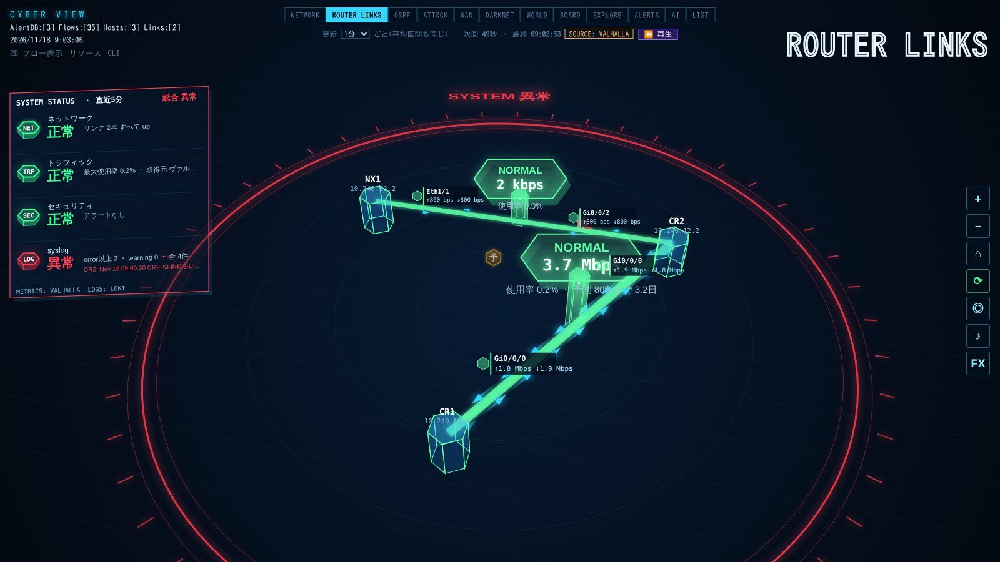

ニルヴァーナは、いま使っている監視のデータを読み込み、ネットワークを 3D のサイバービューで見せる監視画面です。
読み込めるのは Prometheus(ヴァルハラ)、Grafana Loki、SNMP、SNMP trap、NetFlow / sFlow、MRTG、Cacti、Zabbix です。

データの保存は、いまの監視の仕組みに任せます。ニルヴァーナが受け持つのは、状態を見せることと、変化を「情」「注」「警」で知らせることです。

- ラボ版: `python app.py` を起動して `http://localhost:8000/cyber-view` を開きます。エミュレータの装置がそのまま映ります。
- 単体版(実機向け): `cyber-view-standalone/` にあります。既存の監視から読み込みます。
- 監視スタック一式: `iac/nirvana-monitoring/` にあります。`./deploy.sh up` で、ヴァルハラ・Loki・snmp_exporter・ニルヴァーナをまとめて立てます。

PowerPoint 版: [nirvana-introduction.pptx](nirvana-introduction.pptx)

---

## 1. 取り込めるデータ

データの種類ごとに、受け取る場所を1か所に決めています。ヴァルハラ(Prometheus)は自分から取りに行く方式なので、TRAP とフローは受け取れません。そのため TRAP とフローはニルヴァーナが直接受け、syslog は Loki に集めてからニルヴァーナが読みます。

| データ | 装置からの送り先 | ニルヴァーナでの使われ方 |
|---|---|---|
| SNMP ポーリング | snmp_exporter → ヴァルハラ(Prometheus) | リンクの流量・使用率(`rate(ifHCInOctets)`)、IF の状態(`ifOperStatus`)、装置の応答なし(`up`)。過去の再生と予測 |
| SNMP(直接) | ニルヴァーナが v2c / v3 で直接ポーリング | 経路表(IP-FORWARD-MIB)の変化、CPU、OSPF の隣接(OSPF-MIB) |
| SNMP trap | ニルヴァーナ UDP 1162 | linkDown / linkUp を、ポーリングの周期を待たずにリンク断として表示 |
| syslog | syslog-bridge UDP 5515 → Grafana Loki | ログのプレート、syslog 観点の状態、リンク断の検知、フラップ検知、AI ログ解析 |
| NetFlow v5 / sFlow v5 | ニルヴァーナ UDP 2055 / 6343 | 通信のプレート、ダークネットに届いた通信の分類、クラウド各リージョン宛ての流量 |
| MRTG | (既存の MRTG のファイルを読む) | `mrtg.cfg` から `.log` 形式か rrdtool 形式かを自動で判別し、リンクの流量を表示 |
| Cacti | (既存の RRD ファイルを読む) | `traffic_in` / `traffic_out` を `rrdtool fetch` で読み、リンクの流量を表示 |
| Zabbix | Zabbix API | 流量、IF の状態、問題(problem)、ホストの到達性 |

MRTG と Cacti はどちらも、値を RRD(Round Robin Database)に持てます。RRD を扱う道具が rrdtool です。MRTG は独自の `.log` 形式も使えますが、ニルヴァーナはどちらの形式も読めます。設定した秒数より古い値は表示しません。

単体版のインストーラー(`cyber-view-standalone/install.sh`)は、動いている Prometheus・Loki・Zabbix・MRTG・Cacti を探して設定ファイルを作ります。

データ元ごとの取り込み方(投げる PromQL・LogQL、SNMP の OID、受け口のポート、設定に書くこと、受け持つ関数)は [nirvana-data-ingestion.md](nirvana-data-ingestion.md) にまとめました。MRTG と Cacti は HTTP では取りに行かず、ニルヴァーナが動くマシンのローカルのファイルを読みます。MRTG は `mrtg.cfg` のパスだけでファイル名まで決まります。Cacti は RRD のファイル名と IF の対応を設定に書きます。

## 2. ヴァルハラ(Prometheus を拡張したもの)との連携

ヴァルハラは、Prometheus を中心に、ニルヴァーナ用の収集ジョブ(SNMP・OSPF-MIB・ICMP)と警報ルールを足したものです。画面では Prometheus を「ヴァルハラ / VALHALLA」と表示します。データは両方向に流れます。

| 向き | 内容 |
|---|---|
| ヴァルハラ → ニルヴァーナ | 過去の状態を 3D で再生(時刻を指定して巻き戻す)。使用率の予測と、いつもと違う動きの検知。ヴァルハラで発報した警報を VALHALLA の花びらで表示。BOARD / EXPLORE から PromQL で直接問い合わせ |
| ニルヴァーナ → ヴァルハラ | ニルヴァーナの判定を `/metrics` で公開(リンクの状態・bps・使用率、4観点の状態、OSPF、警報の数、経路の変化の数)。ヴァルハラ側で長く保存し、警報ルールにも使える |

| ヴァルハラの履歴から再生 | 使用率の予測 |
|---|---|
| 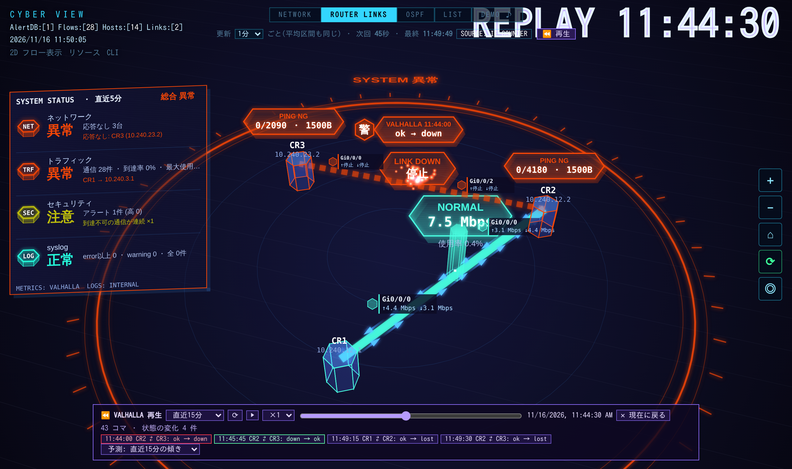 | 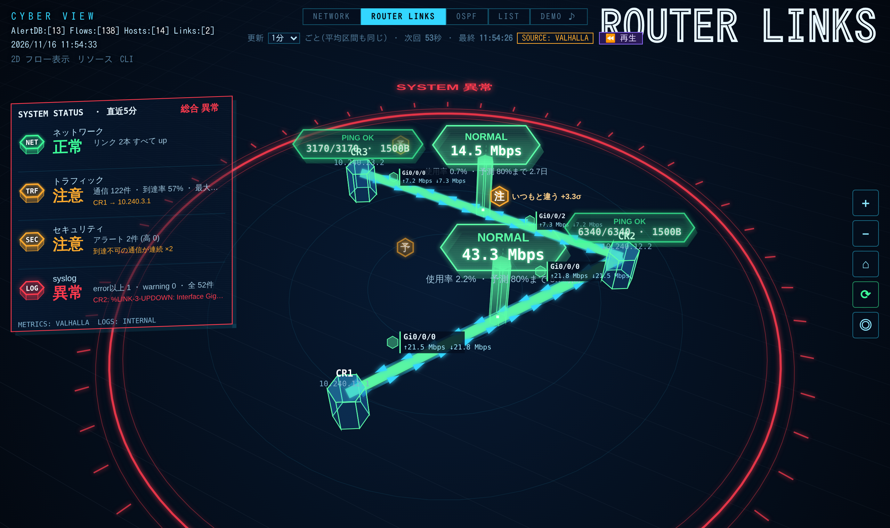 |

## 3. 「情」「注」「警」の出し方

ニルヴァーナは変化を3段階で知らせます。

| 印 | 意味 | 色 |
|---|---|---|
| 情 | 知っておくとよい変化。経路の追加・削除、CPU の急上昇と回復、リンクの復旧、SNMP の応答の回復、ICMP Redirect など | 水色・緑 |
| 注 | 注意が要る状態。CPU の高負荷が続く、フラップ(短時間に何度も上下する) | 橙 |
| 警 | 警報。リンク断、SNMP の応答なし、error 以上のログ、ダークネットへのスキャン、ヴァルハラの警報など | 赤 |

警報は、検知元ごとの花びら(NET / SYSLOG / IDS / FW / DARKNET / VALHALLA / RULES / AI など)の付いた六角形でも表示します。画面左の SYSTEM STATUS は、ネットワーク・トラフィック・セキュリティ・syslog の4観点を、それぞれ 正常・注意・異常 で表示します。

どの経路から入った情報でも、変化はこの3つのどれかとして画面に出ます。

| 経路 | 情 | 注 | 警 |
|---|---|---|---|
| SNMP ポーリング(ヴァルハラ) | SNMP の応答が戻った | | リンク断(POLL)、SNMP 応答なし、ヴァルハラの警報 |
| SNMP(直接) | 経路の追加・削除・変更、CPU の上昇・回復 | CPU の高負荷が続く | |
| SNMP trap | リンクの復旧 | | リンク断(TRAP) |
| syslog(Loki) | | フラップ | error 以上のログ、リンク断(SYSLOG) |
| NetFlow / sFlow | | | ダークネットへのスキャン・DDoS の跳ね返り・リフレクション攻撃の準備 |

## 4. 4つの経路は画面でどう見えるか

`iac/nirvana-monitoring` の `./deploy.sh check` は、SNMP ポーリング・TRAP・syslog・フローの4経路と、SNMP の許可制限を実際に試します。本物の docker で実行した結果です。

```
OK   SNMP ポーリング: ヴァルハラが 3 台から取得
OK   SNMP 許可: 10.240.0.0/16 からは応答
OK   SNMP 制限: 許可していない 10.99.0.9 からは無応答
OK   フロー: NetFlow / sFlow から(フロー 5 件)
OK   リンク断を TRAP で検知
OK   リンク断を SYSLOG で検知
OK   リンク断を POLL で検知
OK   syslog: Loki に UPDOWN が 2 行
```

以下は、同じスタックで各項目を起こしたときのニルヴァーナの画面です(2026-11-18 に撮影)。ラボは CR1 ─ CR2 ─ NX1 の3台です。

### SNMP ポーリング: リンクの流量

ヴァルハラが snmp_exporter から集めた IF の流量を、リンクの太さ・六角柱の高さ・流れる粒で表示します。
CR1 ⇄ CR2 は約 5 Mbps、CR2 ⇄ NX1 は約 2 kbps です。プレートの右下の `SOURCE: VALHALLA` が、ヴァルハラから読んでいることを示します。


### TRAP / SYSLOG / POLL: リンク断と「警」、復旧と「情」

CR1 の Gi0/0/0 を shutdown すると、まず TRAP と SYSLOG が数秒で届き、リンクが赤い破線の LINK DOWN になって「警」が出ます。

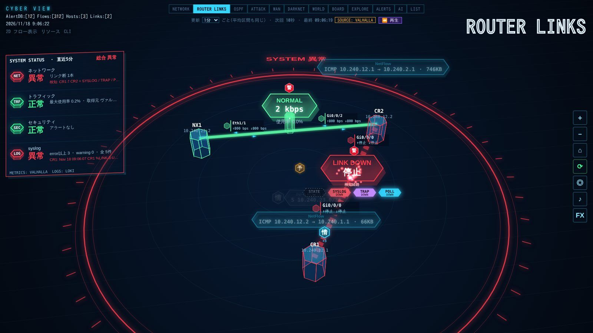

ヴァルハラの次の取得(15秒ごと)で POLL も断を示し、LINK DOWN の下の検知経路に SYSLOG・TRAP・POLL がそろいます。SYSTEM STATUS のネットワークは「異常・リンク断 1本」になり、どの経路で検知したかも書かれます。

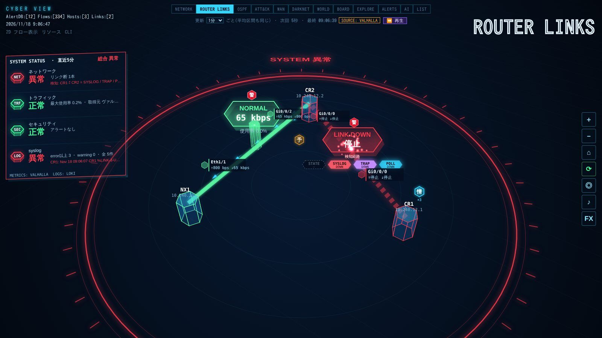

no shutdown で戻すと、すべての経路が up になった時点で「情 INFO LINK UP」が出ます。経路が戻ったことも「情 INFO ROUTE ADD」で出ます。

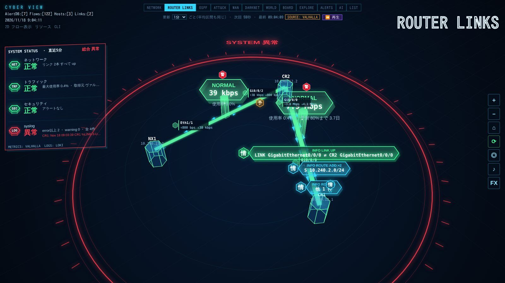

### SNMP の許可制限: 応答なしの「警」と回復の「情」

CR2 の SNMP の ACL から収集元を外すと、ヴァルハラの取得に CR2 が応答しなくなります(`up=0`)。CR2 は灰色の「NO RESPONSE 消失」、CR2 につながるリンクは「不明」になり、「警 SNMP」が出ます。収集元を許可していない装置は、ニルヴァーナからはこの形に見えます。

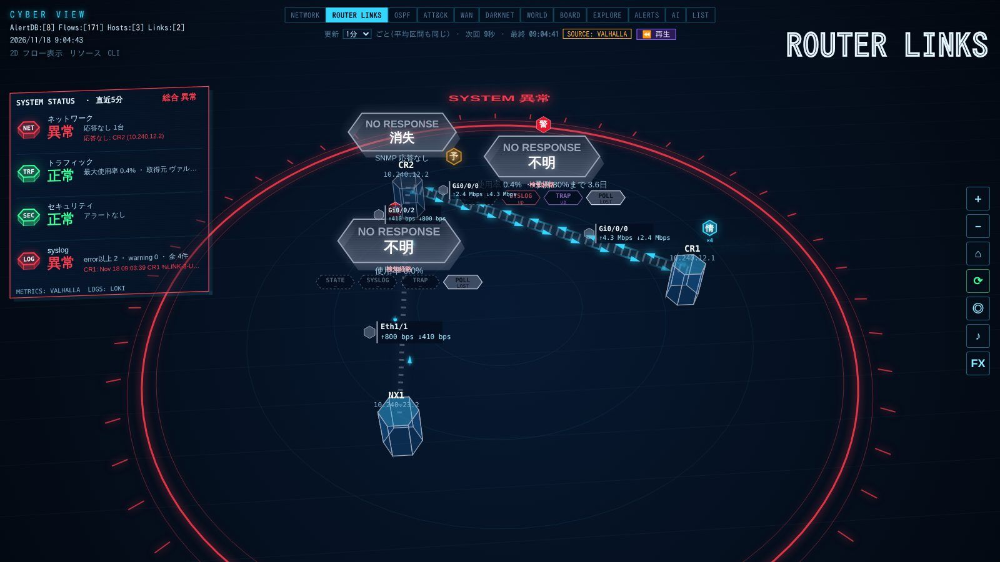

ACL を戻すと、次の取得で「情 INFO SNMP OK(SNMP の応答が戻った)」が出て、リンクの表示も戻ります。

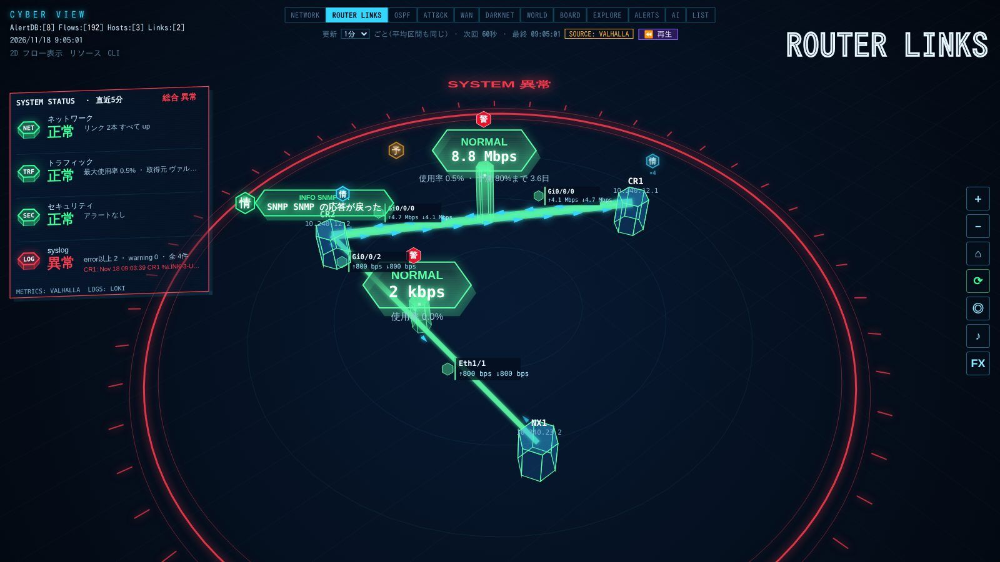

### フロー(NetFlow / sFlow): ダークネットの「警」

NX1 から、使われていない帯(10.250.0.0/24)へ ping でスキャンのような通信を流しました。NX1 が出した sFlow をニルヴァーナが受け、DARKNET 画面で「スキャン」に分類して「警」を出します。ROUTER LINKS では、NetFlow / sFlow で届いた通信が「NetFlow ICMP 送信元 → 宛先 ・ 量」のプレートで出ます。

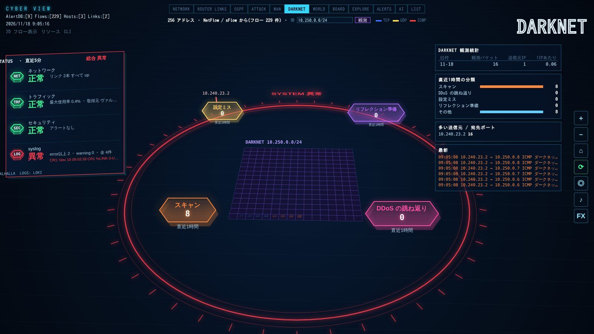

### syslog(Loki): ログのプレート

CR2 の LAN 側の IF を落とすと、syslog-bridge 経由で Loki に入ったログを、ニルヴァーナが装置の上のプレートとして浮かべます。SYSTEM STATUS の syslog 観点は「異常」になり、左下に `LOGS: LOKI` と出ます。

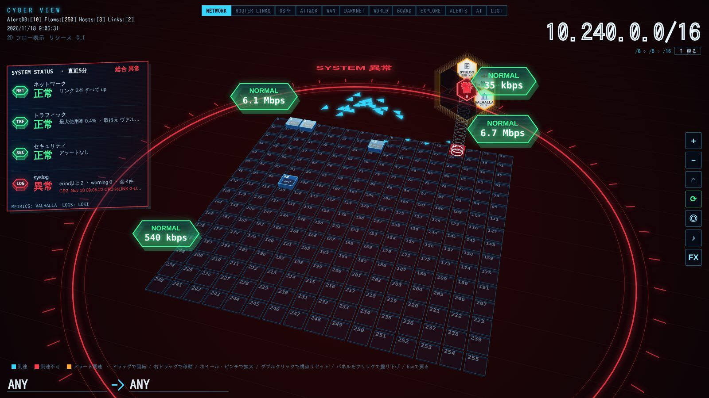

## 5. 流量の大きさと粒の動き

リンクの上を流れる三角形の粒は、流量が大きいほど速く、数が多く、大きく、尾が長くなります。向きごとに別の車線で流れるので、行きと帰りで速さが違うこともあります。


上の GIF では、CR1 ⇄ CR2(約 4 Mbps)は粒が速く密に流れ、CR2 ⇄ NX1(約 2 kbps)はゆっくり少しだけ流れます。

流量は 1 kbps から 1 Gbps までを対数で 0〜1 にならして使います(`static/cyber_view.html` の `flowStream`)。

| 流量(1方向) | 粒の速さ(床の単位/秒) | 粒の数 |
|---|---|---|
| 0 | 流れない(線が薄くなる) | 0 |
| 1 kbps | 1.6 | 2 |
| 10 kbps | 2.7 | 4 |
| 100 kbps | 4.2 | 6 |
| 1 Mbps | 5.7 | 9 |
| 10 Mbps | 7.2 | 11 |
| 100 Mbps | 8.7 | 14 |
| 1 Gbps 以上 | 10.2 | 16 |

- **速さ**: 床の上の距離で決まります。リンクの長さには左右されません。
- **大きさ・尾・光**: 流量が大きいほど、粒は最大で約2倍、尾は約4倍の長さになり、光のにじみも強くなります。
- **色**: 流量ではなく使用率で決まります。50% 未満は水色、50〜80% は橙、80% 以上は赤です。
- **太さと高さ**: リンクの線の太さと、中央の六角柱の高さも、往復の合計流量の対数で大きくなります。
- **なめらかさ**: 新しい値が届いても急に変えず、表示中の値を少しずつ寄せます(1秒ほどで追いつきます)。

点線・破線は流量ではなく状態を表します。

| 線 | 意味 |
|---|---|
| 実線+流れる粒 | 正常に流れている |
| 薄い実線(粒なし) | up だが流量が 0 |
| 赤い破線が点滅 | リンク断(LINK DOWN) |
| 灰色の点線が点滅 | 片側の装置が SNMP に応答しない(不明) |

## 6. ルーティング情報を 3D で見る

| OSPF | 経路の変化 |
|---|---|
| 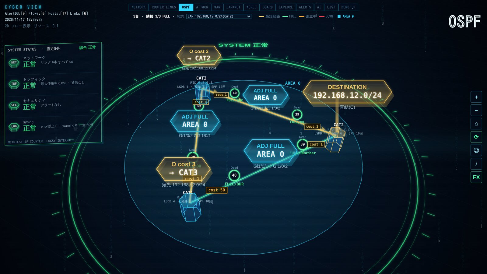 | 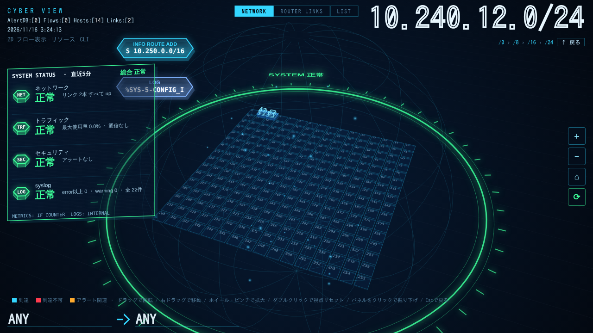 |
| 隣接の状態と Dead タイマーの残りを円弧で、宛先までの最短経路ツリーを金色の矢印で描きます。リンク両端の IF コスト、エリアと ABR も表示し、SPF が再計算されると波紋が出ます | SNMP で取った経路表の差分を、装置の上に「情 INFO ROUTE ADD / DEL / CHG」で浮かべます。短時間に何度も変わると「注」(経路のフラップ)になります |

| ICMP Redirect | L2 ループ |
|---|---|
| 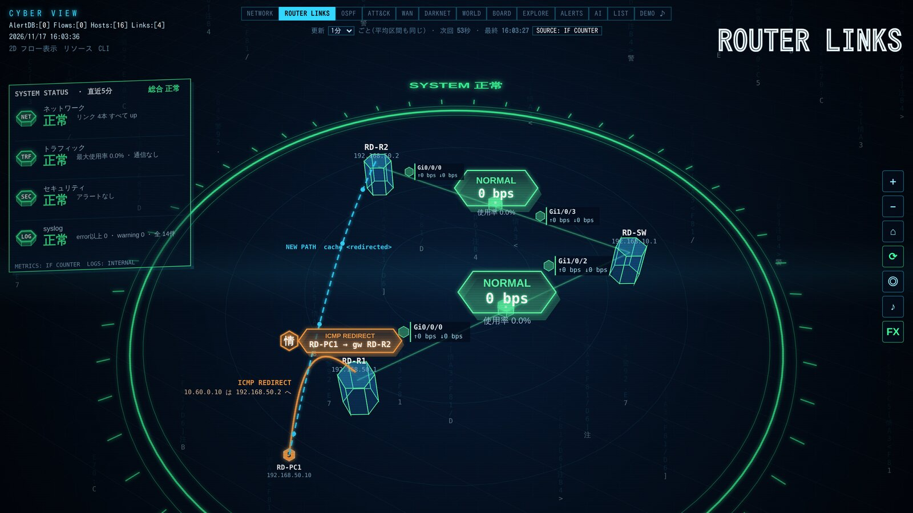 | 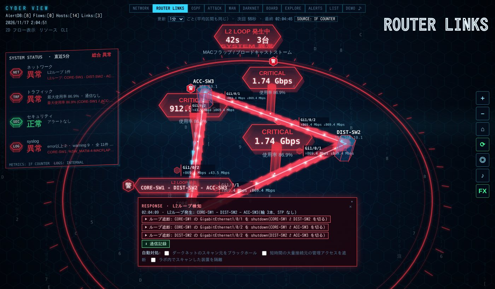 |
| Redirect が出ると、ルータからホストへの橙の弧と新しい経路(NEW PATH)を描きます。SNMP の icmpOutRedirects でも数えられます | STP で止まっていないスイッチの輪を1秒で検知し、赤く脈打つ輪と「警」で示します |

## 7. ほかの画面

| 画面 | できること |
|---|---|
| NETWORK | IP アドレス空間を /0 → /8 → /16 → /24 → 装置 とクリックで掘り下げます |
| DARKNET | 使われていない帯に届いた通信を、スキャン・DDoS の跳ね返り・設定ミス・リフレクション攻撃の準備に分類します |
| WORLD | 地球儀に、クラウド各リージョン宛ての流量、攻撃元の都市、都市間の実際の経路と遅延を描きます |
| ATT&CK | 検知した事象を ATT&CK の戦術・手法に対応づけ、攻撃の進行度を円柱で示します。複数拠点を横断して見られます |
| RESPONSE | 警報から遮断・隔離の CLI を装置に入れ、解除もできます(ラボ版のみ) |
| WAN | フレッツ網の PPPoE / IPoE / IPsec の状態と、経路ごとの遅延・ロスの推移 |
| BOARD / EXPLORE / ALERTS | Grafana 相当。ダッシュボード、PromQL と LogQL の問い合わせ、アラートルールと webhook。Grafana のダッシュボード JSON も取り込めます |
| AI | syslog とニルヴァーナの検知を AI(Claude、OpenAI 互換、Ollama)に読ませ、要約と対処の CLI を提案させます。パスワードと IP は伏せてから送ります |

| WORLD | BOARD |
|---|---|
| 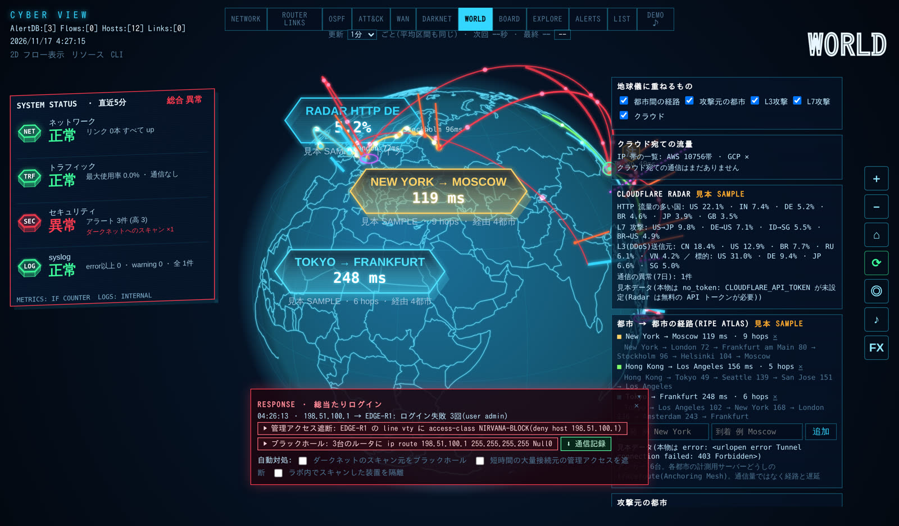 | 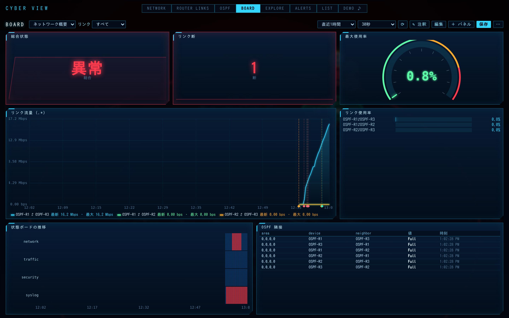 |
| ATT&CK | AI ログ解析 |
| 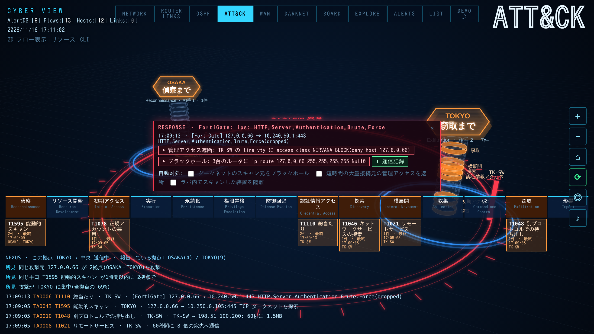 | 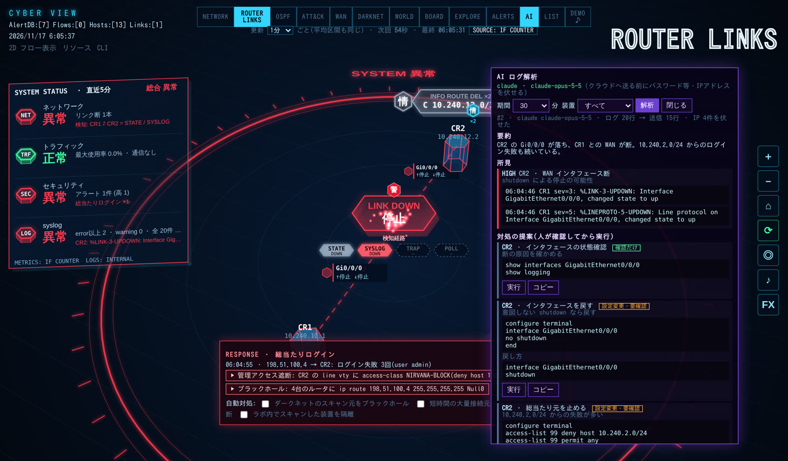 |

## 8. スキン(背景)

背景は 標準・金魚鉢・富士山・太陽系 から選べます。画面右の背景ボタンで切り替えるか、URL に `?bg=goldfish` / `?bg=fuji` / `?bg=solar` を付けます。選んだ背景はブラウザに覚えておきます。どの背景でも、リンク・プレート・「警」の表示は同じです。

| 金魚鉢(`?bg=goldfish`) | 富士山(`?bg=fuji`) |
|---|---|
| 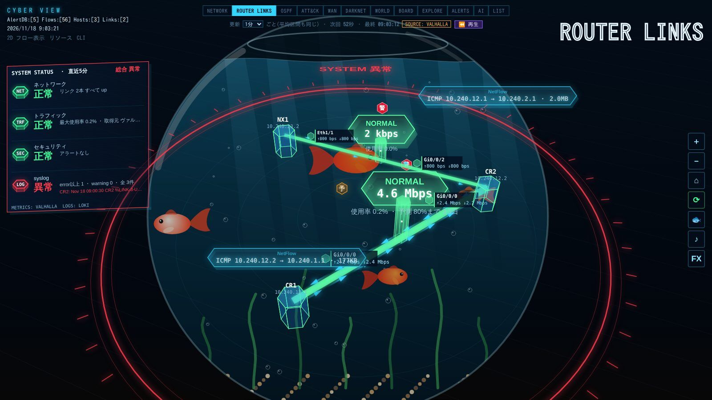 | 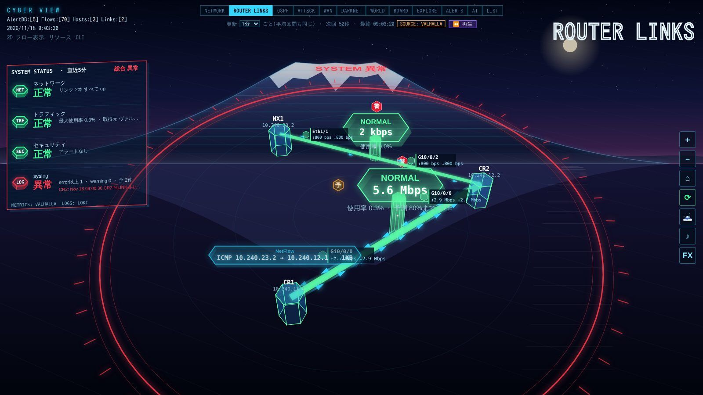 |

ほかに、BGM(ジャズ・レゲエ・アンビエント)、DEMO(障害のシナリオを音楽つきで自動再生)、FX(六角グリッド・データの雨・警報中の火の粉・走査線)があります。

## 9. 知っておいてほしいこと

- **保存**: SNMP の値、「情」、警報、ログはメモリにだけ置きます。長く残す履歴はヴァルハラ・Loki・Zabbix 側に任せます。
- **遮断・隔離**: 装置にコマンドを入れるのはラボの装置だけです。単体版から本物の装置へコマンドは入れません。
- **未確認のデータ元**: 外部の公開データ(Cloudflare Radar、IIJ IHR、RIPE Atlas、MAWI)は、開発環境から届かないため、まだ本物で確かめていないものがあります。
- **名前**: ニルヴァーナは、NICT の NIRVANA改 の考え方を参考に、いまの監視技術で作り直したもの(リイマジン)です。名前とロゴは独自のもので、実在の製品のマークは使っていません。

## 詳しい資料

| 内容 | 資料 |
|---|---|
| データの取り込み方法と実装 | [nirvana-data-ingestion.md](nirvana-data-ingestion.md) |
| 3D 画面の作り | [cyber-view-3d.md](cyber-view-3d.md) |
| 監視スタック一式(IaC)と4経路の確認 | [nirvana-monitoring-iac.md](nirvana-monitoring-iac.md) |
| ヴァルハラ連携 | [valhalla-nirvana.md](valhalla-nirvana.md) |
| 単体版 | [cyber-view-standalone.md](cyber-view-standalone.md) |
| 既存の監視(MRTG・Cacti)と AI ログ解析 | [nirvana-addon-monitoring-ai.md](nirvana-addon-monitoring-ai.md) |
| 経路と CPU の「情」「注」 | [snmp-route-cpu-info.md](snmp-route-cpu-info.md) |
| ダークネット | [darknet-nicter.md](darknet-nicter.md) |
| BOARD / EXPLORE / ALERTS | [nirvana-board.md](nirvana-board.md) |
