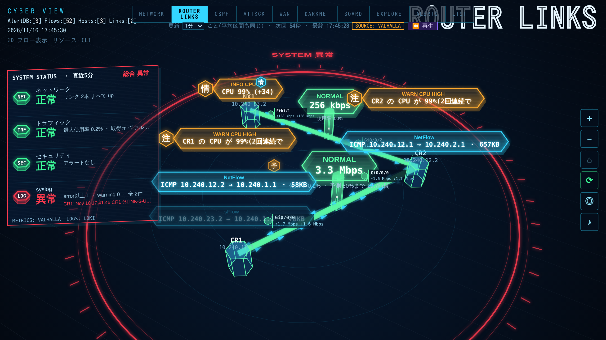
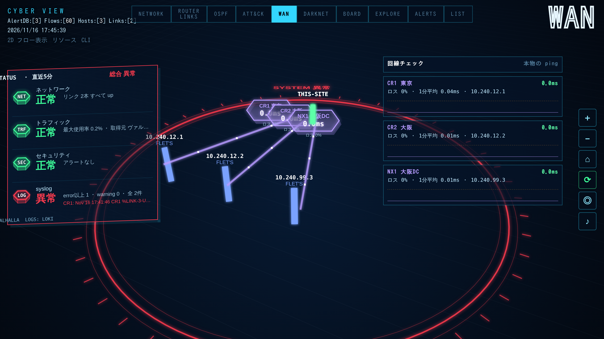
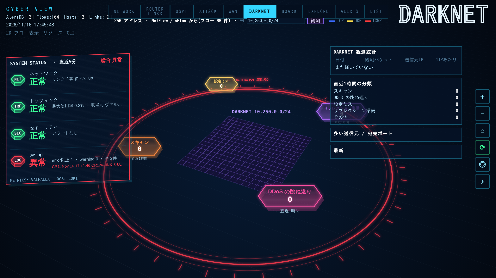

# ニルヴァーナで見るトラフィック監視の IaC(`iac/nirvana-monitoring/`)

[cisco-traffic-monitoring-iac.md](cisco-traffic-monitoring-iac.md)(Prometheus + snmp_exporter + **Grafana**)のニルヴァーナ版です。Grafana の代わりに、ニルヴァーナ(Cyber View のスタンドアロン版)で見ます。

依頼:「これのニルバーナベースのものはありますか？ なければ追加を」。

```
  Cisco CR1 / CR2 / Nexus NX1(エミュレータ。本物の SNMP UDP/161・syslog・sFlow・NetFlow)
     │ SNMP                 │ syslog UDP/5515      │ sFlow UDP/6343 ・ NetFlow UDP/2055
     ▼                      ▼                      │
  snmp_exporter :9117    syslog-bridge ─▶ Loki :3101│
     ▲                                      │      │
  ヴァルハラ(Prometheus):9091 ───────────────┼──────┤
                                            ▼      ▼
                             ニルヴァーナ :8090(スタンドアロン版)
            NETWORK / ROUTER LINKS / ATT&CK / WAN / DARKNET / BOARD・EXPLORE・ALERTS
            + SNMP で経路と CPU の「情」「注」 + 本物の ping で回線チェック + 複数拠点の中央
```

| コンテナ | 役割 | ポート |
|---|---|---|
| snmp-exporter | 装置の IF-MIB・CPU・OSPF-MIB を読む(モジュールは Grafana 版と同じ `snmp.yml`) | 9117 |
| valhalla | Prometheus。ニルヴァーナが流量・断・再生・予測・警報に使う | 9091 |
| loki | syslog の保存 | 3101 |
| syslog-bridge | 装置の syslog(UDP)を受けて Loki へ(`tools/syslog_to_loki.py`) | UDP 5515 |
| nirvana | ニルヴァーナ本体(`cyber-view-standalone` をビルド)。sFlow / NetFlow もここで受ける | 8090、UDP 6343 / 2055 |

Grafana 版と同時に動かせるよう、ポートをずらしています。どのコンテナも host ネットワークです(エミュレータの装置の IP がホストの lo に載るため)。

## 使い方

```bash
NETLAB_AUTH_DISABLE=1 python app.py            # エミュレータ
cd iac/nirvana-monitoring
./deploy.sh up                                  # ラボを作って、5つのコンテナを起動
../cisco-traffic-monitoring/lab/traffic_gen.sh  # トラフィックを流す(Grafana 版と同じスクリプト)
./deploy.sh status                              # リンク・ダークネット・回線チェックの状態
# → http://<ホスト>:8090/
./deploy.sh down        # 止める(データは残す)
./deploy.sh destroy     # データごと消す
```

**実機を見るとき**は、次の2つのファイルを実機に合わせて書き換え、`SKIP_LAB=1 ./deploy.sh up` で起動します。

- `nirvana/config.yaml` の `devices` / `links`
- `prometheus/targets/devices.yml`

装置側の設定は [real-catalyst-registration.md](real-catalyst-registration.md) を見てください。このスタックのポートは、syslog が 5515、sFlow が 6343、NetFlow が 2055 です。

## ラボ(`lab/provision_nirvana_lab.sh`)

Grafana 版の CR1 / CR2 に、sFlow を出す Nexus の NX1 を足します。

```
[LAN 10.240.1.0/24] CR1 ── 10.240.12.0/30 ── CR2 ── 10.240.23.0/30 ── NX1
```

| 装置 | 入れる設定(実機の構文のまま) |
|---|---|
| CR1 / CR2 | `logging host 127.0.0.1 transport udp port 5515`、`ip flow-export destination 127.0.0.1 2055`、`ip flow-export version 5`、IF に `ip flow ingress` |
| NX1 | `interface mgmt0` / `ip address 10.240.99.3/24`(SNMP はここで受ける)、`feature sflow`、`sflow sampling-rate 64`、`sflow agent-ip 10.240.23.2`、`sflow collector-ip 127.0.0.1 vrf default`、`logging server 127.0.0.1 5515` |

### エミュレータに足したこと: 装置からの sFlow / NetFlow の送出

このスタックで sFlow を本当に流すため、エミュレータの装置を本物のエクスポータにしました(`engine/flow_export.py`)。ラボの通信(ping)が装置を通るたびに、設定に従って本物の UDP を送ります。

| 機種 | コマンド | 確認 |
|---|---|---|
| NX-OS | `feature sflow` / `sflow collector-ip <ip> vrf default` / `sflow collector-port <n>` / `sflow sampling-rate <n>` / `sflow agent-ip <ip>` / `sflow data-source interface <if>` | `show sflow` |
| Arista EOS | `sflow destination <ip> [<port>]` / `sflow source <ip>` / `sflow sample <n>` / `sflow run` | `show sflow` |
| Cisco IOS | `ip flow-export destination <ip> <port>` / `ip flow-export version 5` / `ip flow-export source <if>` / IF に `ip flow ingress\|egress` | `show ip flow export` |

- sFlow は、その ping の先頭パケットのヘッダ(Ethernet + IPv4 + ICMP)とサンプリング率を持つフローサンプルとして送ります。NetFlow は、パケット数・バイト数を持つ v5 レコードとして送ります。
- running-config と保存にも反映されます。
- 受け取る側はニルヴァーナに限りません。sFlow は本物の sfcapd(nfdump)でも同じ値で読めました(後述)。

あわせて、IOS の `logging host <ip> transport udp port <n>` を受け付けるようにしました。以前はポートを無視して 514 にしていました。

## ライブ確認

本物の docker(`nohup dockerd &`)で `./deploy.sh up` を実行し、5つのコンテナがすべて ready になりました。

```
[deploy] snmp_exporter: ready
[deploy] valhalla(prometheus): ready
[deploy] loki: ready
[deploy] nirvana: ready
```

`traffic_gen.sh` と NX1 からの ping を流したあとの `./deploy.sh status` です。

```
{"ok":true,"errors":{}}
  CR1 GigabitEthernet0/0/0 ⇄ CR2 GigabitEthernet0/0/0  ok  2896512 bps     ← ヴァルハラ(SNMP)の流量
  CR2 GigabitEthernet0/0/2 ⇄ NX1 Ethernet1/1  ok  512000 bps
  darknet: NetFlow / sFlow から(フロー 76 件)
  wan: CR1 東京 0.033 ms loss 0%                                         ← 本物の ICMP
  wan: CR2 大阪 0.010 ms loss 0%
  wan: NX1 大阪DC 0.009 ms loss 0%
```

ニルヴァーナが受けたフローは NetFlow 56 件 + sFlow 25 件でした。NX1 からダークネット(10.250.0.0/24)へ ping すると、sFlow 経由で「スキャン」に分類されました。Loki には CR1 の `%LINK-3-UPDOWN` が入り、SYSTEM STATUS は `METRICS: VALHALLA LOGS: LOKI` になりました。SNMP の CPU 監視からは「情 CPU UP」「注 CPU HIGH」も出ました。





### 確認中に見つけて直したこと

- **NX1 が SNMP に応答しない**: Nexus は SNMP を mgmt0(既定 192.168.100.1)で受けるので、データ側の 10.240.23.2 に問い合わせても応答がありませんでした。実機の NX-OS と同じ挙動です。ラボで mgmt0 に 10.240.99.3 を入れ、監視対象もそこにしました。
- **NX-OS の `snmp-server community <名前> group network-operator` が効かない**: エミュレータは `ro` / `rw` の形だけ受け付けます。ラボでは `snmp-server community netlab-ro ro`(NX-OS でも有効な書き方)を使っています。
- **装置が送ったフローが「PING OK undefined/undefined」と出る**: 画面が ping の結果だと思って表示していました。sFlow / NetFlow のフローは「sFlow ICMP 送信元 → 宛先 ・ 量」と出すようにしました。経路上の複数の装置が同じ通信を報告するので、同じ送信元・宛先は10秒に1回だけ出します。
- **CPU 高負荷の注の見出しが「WARN FLAP」**: 警告の見出しがフラップ前提でした。「WARN CPU HIGH」などルールごとの名前に直しました。

## テスト

`tests/test_flow_export_and_nirvana_iac.py` で確かめていること:

- エンコーダの往復。
- NX-OS sFlow と IOS NetFlow が本物の UDP で届くこと(エクスポータの IP・サンプリング率・パケット数・バイト数)。
- running-config と show。止めると届かなくなること。
- Arista の sFlow と、`logging host ... transport udp port` の解釈。
- IaC のファイル同士の整合: compose の参照先が実在すること、snmp_exporter とヴァルハラのポート、ジョブ名、Loki と syslog のポート、ヴァルハラとニルヴァーナが同じ装置を見ていること、ラボのフロー送出先と受け口の一致。
