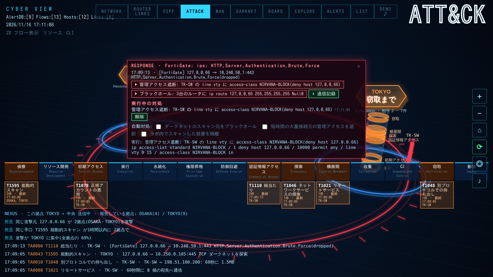
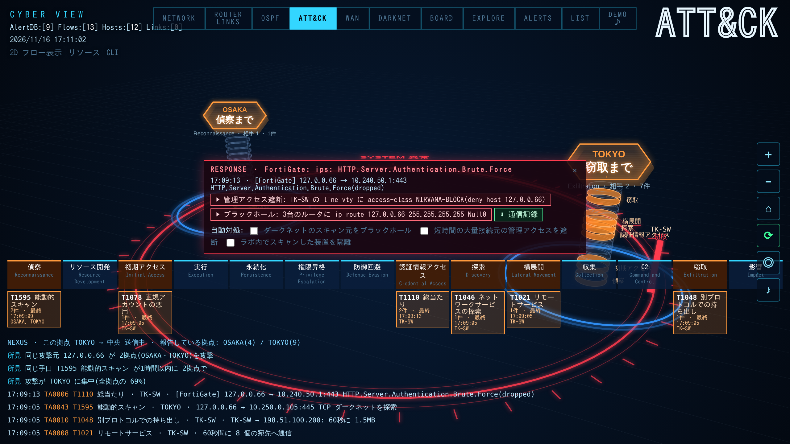
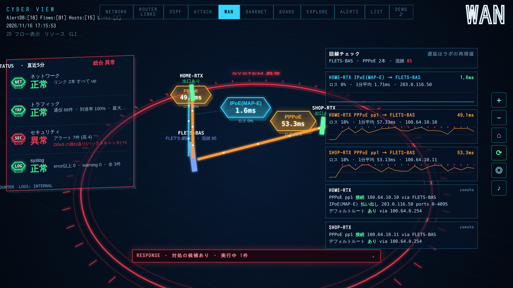

# ニルヴァーナ A〜E — 遮断・隔離 / ATT&CK / 複数拠点 / 回線チェック / フロー・外部センサー(v21)

この回の依頼は2段階です。まず、紹介された資料から必要な要素を拾いました。

- IT Leaders の NIRVANA改「組織をまたぐ分析」
- BIGLOBE の NIRVANA Rapps
- 日本ラッドの NIRVANA-R × アライドテレシス SES

そこから A〜E の5案を提案し、「a、b、c、d、e の対応お願いします」という依頼で全部作りました。

| 案 | 元の資料 | 作ったもの |
|---|---|---|
| A 回線チェック(フレッツ網) | BIGLOBE / 擬似フレッツ | `/cyber-view` の **WAN**: PPPoE / IPoE(MAP-E)/ IPsec / デフォルトルートの状態、経路ごとの遅延とロスの推移、注。実機 RTX 向けに SNMP の ipRouteTable と CPU の OID 指定 |
| B 警報からの遮断・隔離 | NIRVANA-R × SES、NIRVANA改 の自動防御 | **RESPONSE** パネル: 警報から本物の CLI を装置に入れる(access-class / Null0 / 隣の装置の shutdown)、解除、自動対処、警報の前後の通信記録(pcap) |
| C ATT&CK | NIRVANA改(2023年) | **ATT&CK** ビュー: 組織の青い輪、攻撃の進行度の橙の円柱、戦術 × 手法の表、時系列 |
| D フロー・外部センサー・メール | NIRVANA Rapps / NIRVANA-R | NetFlow v5 / sFlow v5 の受け口、他社セキュリティ製品の syslog(FortiGate / ASA / Snort・Suricata / Palo Alto)、メール通知、警報時の pcap |
| E 複数拠点の横断分析 | NIRVANA改(2023年)のネクサス型 | 各拠点の警報と ATT&CK のイベントを中央へ送り、共通の攻撃元・同時期の同じ手口・偏りを見つけて各拠点へ返す |

ラボ版とスタンドアロン版(実機向け)の両方で動きます。スタンドアロン版はラボ版と同じファイルを `cvs/` にコピーして使います。ずれはテストで検出します。

## B 警報からの遮断・隔離(RESPONSE)



警報(IDS / FW / DARKNET / SENSOR / NEXUS)が出ると、画面の下に RESPONSE が出て、取れる対処の候補が並びます。各候補はマウスを乗せると、実際に入れるコマンドが見えます。

| 疑わしい相手 | 候補 | 入れるコマンド(本物の CLI。手で打つのと同じ経路) |
|---|---|---|
| ラボの装置 | 隔離 | 隣の装置で、その装置に向いた IF を `shutdown` |
| 装置でないアドレス | 管理アクセス遮断 | `ip access-list standard NIRVANA-BLOCK` / `<n> deny host <ip>` / `10000 permit any` / `line vty 0 15` / `access-class NIRVANA-BLOCK in` |
| 装置でないアドレス | ブラックホール | 全ルータに `ip route <ip> 255.255.255.255 Null0` |

- **解除**: 入れたコマンドの逆を入れます(`no shutdown`、ACL の `no <n>`、`no ip route ... Null0`)。
- **自動対処**: RESPONSE のチェックボックスか `POST /api/response/auto` で、「この種類の警報が出たら、この対処」を決めます。同じ相手には1回だけ実行します。
- **通信記録**: ⬇ で、警報の 60秒前〜30秒後の通信記録を保存します。`NETLAB_CAPTURE=1`(root)ならパケットの pcap、そうでなければフロー・ダークネット・ログの JSON です。

この対処のために、エミュレータに次の機能を足しました。

- `line vty` の **`access-class <ACL> in`**: 本物の SSH / Telnet リスナーで、送信元を ACL で照合し、拒否なら接続直後に切ります。running-config と保存にも反映します。
- 標準 ACL の **1行削除**: `no <seq>` / `no deny host X`。
- **`ip route <net> <mask> Null0`**: 直結経路より細かい Null0 経路があれば、実機と同じく Null0 が勝って破棄されます。以前は直結が先に判定され、通ってしまっていました。

## C ATT&CK(NIRVANA改 Organizations View 風)



警報やログを ATT&CK の戦術・手法に結びつけ(`engine/attack_map.py`)、攻撃を受けている相手ごと・組織ごとに、どの段階まで進んだかを数えます。

| きっかけ | 戦術 / 手法 |
|---|---|
| 実リスナーへの大量接続、ダークネットへのスキャン | 偵察 TA0043 / T1595 能動的スキャン |
| ダークネットへの DNS / NTP 等の問い合わせ | リソース開発 TA0042 / T1584(踏み台探し) |
| 実 SSH / Telnet のログイン失敗が60秒に3回 | 認証情報アクセス TA0006 / T1110 総当たり |
| 総当たりの後のログイン成功 | 初期アクセス TA0001 / T1078 正規アカウントの悪用 |
| 装置からの ping スイープ | 探索 TA0007 / T1046 |
| 正規アカウントで入られた装置が探索を始める | 横展開 TA0008 / T1021 |
| ラボの外へ60秒に1MB以上 | 窃取 TA0010 / T1048 |
| フラッド、DDoS の跳ね返り | 影響 TA0040 / T1498 |
| 他社セキュリティ製品のアラート | シグネチャ名から推定(scan → T1595、brute → T1110、それ以外 → T1190) |

画面の見方:

- 3D: 組織を青い輪で表し、中央の円柱を ATT&CK の14段階で輪切りにします。到達した段階が橙に光ります。輪の中の小さな柱が、攻撃を受けている相手(装置)です。
- 下の表: 戦術 × 手法で、件数・最終時刻・相手を出します。その下が時系列です。

## E 複数拠点の横断分析(ネクサス)

各拠点が、新しい警報と ATT&CK のイベントを中央へ送ります(`engine/nexus.py`)。中央は集めたものを突き合わせ、所見を返します。

- 同じ攻撃元が2拠点以上
- 同じ手法が1時間以内に2拠点以上
- 攻撃が1拠点に6割以上集中

拠点側は、返ってきた所見を警報(花びら NEXUS)にします。中央の ATT&CK ビューには、拠点ごとの輪が並びます。

```bash
# 中央(自分も拠点 TOKYO として報告する)
NIRVANA_SITE_NAME=TOKYO NIRVANA_NEXUS_TOKEN=<共有の秘密> NIRVANA_NEXUS_URL=http://<中央>:8000 python app.py
# 拠点(ラボ版)
NIRVANA_SITE_NAME=OSAKA NIRVANA_NEXUS_TOKEN=<共有の秘密> NIRVANA_NEXUS_URL=http://<中央>:8000 python app.py
```

スタンドアロン版は `sources.nexus: {url, site, token}` を書きます。`url` を書かずに `token` だけ書けば、その画面が中央になります。報告の受け口 `/api/nexus/report` は `X-Nexus-Token` で認証します。

## A 回線チェック(WAN)



- **ラボ版**: 擬似フレッツの BAS に `pppoe congestion <0-100>`(夜間の PPPoE 混雑の再現)を入れると、PPPoE の経路だけ遅延とロスが増えます。IPoE(MAP-E)は網終端装置を通らないので影響を受けません。実際のフレッツで IPoE に切り替えると夜に速くなる理由そのものです。値は再現で、測定ではないことを画面に出しています。
- **スタンドアロン版**: `sources.wan_probe` の宛先へ本物の ping(ICMP)を打ちます。
  - root 不要の ICMP ソケット → raw ソケット → `ping` コマンドの順に試します。
  - `host:port` と書けば TCP の接続時間で測ります。
- 遅延が30ms以上、またはロスが5%以上、それが3回続くと注(`wan_slow` / `wan_loss`)を出します。しきい値は `NETLAB_WAN_RTT_MS` / `NETLAB_WAN_LOSS` で変えられます。
- **実機 RTX 向け**(スタンドアロン版の SNMP):
  - 経路表: inetCidr / ipCidr が無ければ、RFC1213 の ipRouteTable を読みます。経路数の OID が無いので、`full_every` 回ごとに表全体を取ります。
  - CPU: `devices[].snmp_cpu_oid`(または `sources.snmp.cpu.oid`)→ Cisco の cpmCPUTotal5minRev → HOST-RESOURCES-MIB hrProcessorLoad の平均、の順に読みます。ヤマハ独自の CPU の OID は公開資料で確かめられなかったので、決め打ちせずに設定にしました(`snmpwalk -v2c -c <comm> <RTX> 1.3.6.1.4.1.1182` で探して書く)。

## D フロー・外部センサー・メール・通信記録

- **NetFlow v5 / sFlow v5**(`engine/flow_collector.py`、ラボ版 `NETLAB_FLOW_COLLECT=2055,6343`、スタンドアロン版 `sources.flow`): 受けたフローを次のことに使います。
  - ダークネット観測(スタンドアロン版の DARKNET はこれで動く)
  - 外部への大量送信の検知
  - 通信の粒(スタンドアロン版の NETWORK に粒が出る)
- **他社セキュリティ製品の syslog**(`engine/sensor_syslog.py`): FortiGate の `type=utm subtype=ips`、ASA の 733101 / 733100 / 4000nn、Snort・Suricata の fast 形式、Palo Alto の THREAT を読み、警報(花びら SENSOR)にします。
  - ラボ版は `NETLAB_SYSLOG_LISTEN=0.0.0.0:5514` で受けます。
  - スタンドアロン版は Loki のログから読みます。
- **メール通知**: BOARD の ALERTS の連絡先に「メール」を足しました(宛先・SMTP・STARTTLS・認証)。パスワードは保存せず、環境変数 `NIRVANA_SMTP_PASSWORD` から読みます。
- **警報時の通信記録**: `NETLAB_CAPTURE=1`(root)で、lo のパケットの先頭256バイトを直近20000件まで保持し、`/api/alerts/<seq>/capture` で pcap にします。

## ライブ確認

本物のサーバーを3つ立てました。

- ラボ版 TOKYO(:8000、中央を兼ねる): センサー・キャプチャ・ダークネット 10.250.0.0/24
- ラボ版 OSAKA(:8001): ダークネット 10.249.99.0/24
- スタンドアロン版 NAGOYA(:8090): NetFlow 受け口・ダークネット・回線チェック

### 攻撃の流れ(TOKYO)

本物の paramiko で、127.0.0.66 から TK-SW(Catalyst)の実 SSH にパスワード違いを4回試し、そのあと正しいパスワードでログインしました。続けて、TK-SW から ping スイープと外部への大量 ping を実行しました。さらに本物の nmap で、TOKYO と OSAKA の両方のダークネットをスキャンしました。最後に `logger` で FortiGate の IPS ログを送りました。

```
brute: AuthenticationException ×4 then OK
login_brute       high IDS     127.0.0.66 → TK-SW: ログイン失敗 3回(user admin)
login_after_fail  high IDS     127.0.0.66 → TK-SW: 失敗 4回の後に admin でログイン成功
scan              high IDS     60秒間に 8 個の宛先へ通信
exfil             high IDS     TK-SW → 198.51.100.200: 60秒に 1.5MB
darknet_scan      high DARKNET 127.0.0.66 → 10.250.0.105:445 TCP ダークネットを探索
ext_sensor        high SENSOR  [FortiGate] 127.0.0.66 → 10.240.50.1:443 HTTP.Server.Authentication.Brute.Force(dropped)
nexus_finding     high NEXUS   [ネクサス] 同じ攻撃元 127.0.0.66 が 2拠点(OSAKA・TOKYO)を攻撃
nexus_finding     high NEXUS   [ネクサス] 同じ手口 T1595 能動的スキャン が1時間以内に 2拠点で

ATT&CK: TK-SW は 初期アクセス → 認証情報アクセス → 探索 → 横展開 → 窃取 まで(TOKYO は 窃取まで、OSAKA は 偵察まで)
OSAKA 側にも同じ所見が返ってきて警報になった
```

### 遮断(B)

画面の RESPONSE で「管理アクセス遮断」を押しました(Playwright で実際にクリック)。

```
127.0.0.66 → 10.240.50.1:22  b''                          ← 接続直後に切られる
127.0.0.67 → 10.240.50.1:22  b'SSH-2.0-paramiko_5.1.0'    ← ほかの送信元は通る
running-config: ip access-list standard NIRVANA-BLOCK / 1 deny host 127.0.0.66 / 10000 permit any / access-class NIRVANA-BLOCK in
```

総当たりの警報の通信記録を pcap で保存し、tcpdump で読みました。174パケットのうち、127.0.0.66 → 10.240.50.1:22 が62。SSH のバナー交換から読めました。

### フロー(D)

- **NetFlow**: 本物の softflowd(`softflowd -r dk.pcap -n 127.0.0.1:2055 -v 5`)で送りました。NetFlow の UDP 3つで68フロー届き、ダークネットの分類は スキャン 49 / 跳ね返り 12 / リフレクション準備 7 になりました。
  - lo でのライブ収集(`-i lo`)は、softflowd 側が1パケットも処理しませんでした(libpcap は受信しているのに処理0)。そのため、tcpdump で取った pcap を読ませています。
- **sFlow**: このサンドボックスには sFlow を送る側の本物の agent がありません。そこでテスト用の sFlow パケットを、本物の sFlow 受け口 sfcapd(nfdump)に読ませました。
  - 最初は raw packet header を4バイト境界に詰めておらず、sfcapd が `SFLOW: caught exception` で拒否しました(仕様違反)。直したあとは、sfcapd と ニルヴァーナが同じ値(198.51.100.6 → 10.250.9.8:22、12000バイト、200パケット)を読みました。
  - ニルヴァーナ側の受け口は元々 4バイト境界の長さで読む実装で、実際の agent の形に合っています。

### 回線チェック(A)

擬似フレッツの BAS に HOME-RTX(PPPoE と MAP-E)と SHOP-RTX(PPPoE)をつなぎ、`pppoe congestion 85` を入れました。

```
HOME-RTX IPoE(MAP-E) → FLETS-BAS 1.56ms ロス 0%
HOME-RTX PPPoE pp1 → FLETS-BAS 41.59ms ロス 15%
SHOP-RTX PPPoE pp1 → FLETS-BAS 73.7ms  ロス 17%
wan_loss HOME-RTX PPPoE pp1 → FLETS-BAS: パケットロス 6%(3回続けて 5% 以上)
```

### スタンドアロン版 NAGOYA

- NetFlow(softflowd)でダークネットの分類が出ました。
- ATT&CK は「影響まで」(跳ね返り = T1498)になりました。
- 中央に3拠点が並び、「同じ攻撃元 203.0.113.80 が 2拠点(NAGOYA・TOKYO)」「同じ手口 T1595 が 3拠点で」が NAGOYA に返ってきました。
- 回線チェックは本物の ICMP で 0.04ms(127.0.0.1)でした。

### 確認中に見つけて直したこと

- **Null0 が直結経路に負けていた**: `ip route 10.246.2.2 255.255.255.255 Null0` を入れても、直結の /24 が先に判定されて ping が通っていました。実機は細かい経路が勝つので、Null0 が勝つように直しました。
- **RESPONSE が最新の警報だけを見ていた**: 最新の警報が対処の無いもの(ネクサスの「偏り」)だと、パネルが出ませんでした。対処の候補がある、いちばん新しい警報を出すようにしました。
- **RESPONSE が3秒ごとに描き直されていた**: 押そうとしたボタンが消えていました(Playwright のクリックが `Element is not attached` で失敗して気づいた)。中身が変わった時だけ描き直すようにしました。
- **WAN で札が重なる・パネルに隠れる**: 同じ CPE の PPPoE と IPoE の札が重なり、右の CPE がパネルに隠れていました。配置を左に寄せ、札をずらしました。
- **スマホで RESPONSE が3D を隠す**: スマホでは最初は小さく出すようにしました(▾ / ▴ で切り替え、選択は端末ごとに記憶)。
- **スタンドアロン版の回線チェックが ping コマンド頼み**: このサンドボックスにも `python:3.11-slim` にも ping が無く、全部「不通」になっていました。Python で ICMP を直接送るようにしました。
- **試験用 sFlow パケットの4バイト境界の詰め忘れ**: 上記。

## 限界(正直に)

- ATT&CK との対応は、このエミュレータが検知できる事象に限ります(エンドポイントのエージェントは無い)。手法の推定も、シグネチャ名のキーワードによる簡易なものです。
- 回線チェックのラボの遅延は再現値です。本当の遅延を測るのはスタンドアロン版の ping だけです。
- 自動対処は誤遮断の危険があるので、既定では何も自動にしていません。
- ネクサスの中央は1台で、拠点間の通信は HTTP + 共有トークンです。本番で使うなら TLS の内側に置いてください。

## テスト

| ファイル | 確かめていること |
|---|---|
| `tests/test_nirvana_security_suite.py` | 本物の SSH の access-class 拒否と解除、隔離と解除、Null0、自動対処、ATT&CK の段階の進み方、ログインの検知、ネクサスの所見と拠点側の送信、回線の再現値と注、ラボの PPPoE と IPoE の差、NetFlow / sFlow の解析と本物の UDP 受信、他社の syslog、本物の SMTP 会話でのメール送信、pcap、通信記録 API |
| `tests/test_cyber_view_standalone.py` | ラボ版と同じファイルのずれ、NetFlow → ダークネット・粒・ATT&CK、外部センサー、ネクサスの中央、回線チェック、RFC1213 の経路表と CPU のフォールバック |
