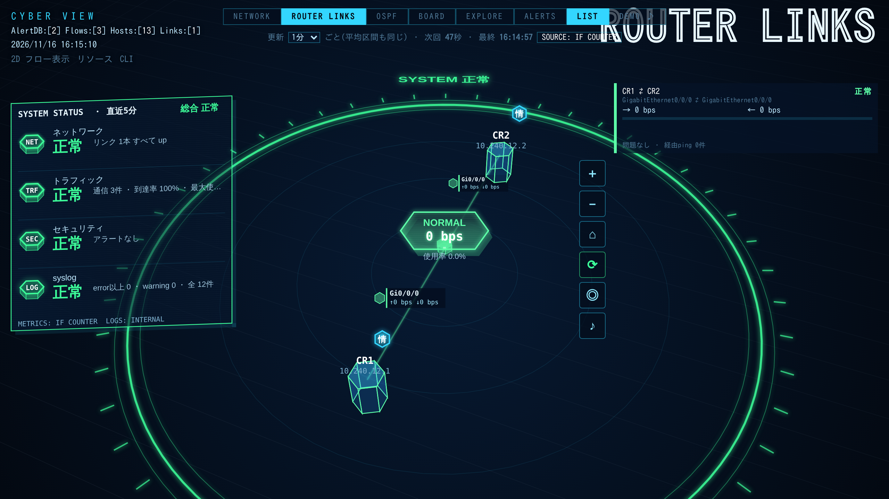

# 経路と CPU を SNMP で定期取得して「情」「注」を出す(v19)

依頼の流れ:

- 「経路の定期取得すれば情は出るのかな。MIB で定期取得できそう？」
- 「CPU も定期的に性能が取得できる時は情とかで出ても良いかも」

進めた順番は次のとおり。

1. エミュレータの SNMP に経路の MIB を足し、本物の snmpwalk で確かめる。
2. スタンドアロン版(実機向け)で、経路と CPU を SNMP で定期取得して「情」と「注」を出す。
3. ラボ版でも CPU の「情」と「注」を出す。

| 出るもの | 条件(既定値) | 見え方 |
|---|---|---|
| 情 `add` / `del` / `change` | 経路表の差分 | 「情 INFO 経路追加 S 172.16.50.0/24 via 10.240.12.2 [Gi0/0/0]」 |
| 情 `cpu_up` | CPU が前回より **+20 ポイント**以上 | 「情 INFO CPU 上昇 CPU 78% (+60)」 |
| 注 `cpu_high` | CPU **80%** 以上が **2回**続いた | 警報の花(NET の花びら、重要度 warning)。高い間は1回だけ |
| 情 `cpu_ok` | 高負荷から 80% 未満に戻った | 「情 INFO CPU 回復 CPU 74% に戻った」 |

しきい値は仮の値で、設定で変えられます。

- **スタンドアロン版**: `config.yaml` の `sources.snmp.cpu` に `high` / `jump` / `hold` を書きます。
- **ラボ版**: 環境変数 `NETLAB_CPU_HIGH` / `NETLAB_CPU_JUMP` / `NETLAB_CPU_HOLD` で指定します。

判定は `engine/route_watch.CpuWatch` の1か所にまとめてあり、両方の版がそれを使います(スタンドアロン版はファイルのコピーです)。

## 1. エミュレータの SNMP(IP-FORWARD-MIB)

`engine/protocols._route_mib` が、`show ip route` と同じ最良経路から次の値を作ります。

| MIB | OID | 中身 |
|---|---|---|
| inetCidrRouteTable(RFC 4292) | 1.3.6.1.2.1.4.24.7.1 | 索引: `1.4.宛先.長さ.2.0.0.1.4.次ホップ`。列: 7 ifIndex、8 種類(3 local / 4 remote)、9 プロトコル、10 経過時間、12 metric1、17 状態 |
| ipCidrRouteTable(旧) | 1.3.6.1.2.1.4.24.4.1 | 索引: `宛先.マスク.0.次ホップ`。古い機種向け |
| 経路数 | 4.24.6.0 / 4.24.3.0 | 変化があったときだけ表全体を取りに行くための値 |

プロトコルの番号は IANAipRouteProtocol に従います: 2 直結、3 スタティック、8 RIP、13 OSPF、14 BGP、16 EIGRP。

あわせて CISCO-PROCESS-MIB の列番号の誤りを直しました。エミュレータ・IaC の snmp.yml・app.py は、cpmCPUTotal5minRev を `.7` として扱っていましたが、`.7` は実際には 1minRev です。正しい OID は `1.3.6.1.4.1.9.9.109.1.1.1.1.8` です。

本物の net-snmp で、CR1 / CR2(`iac/cisco-traffic-monitoring/lab/provision_cisco_lab.sh`)に問い合わせた結果です。

```
$ snmpwalk -v2c -c netlab-ro 10.240.12.1 1.3.6.1.2.1.4.24.7.1.9
IP-FORWARD-MIB::inetCidrRouteProto.ipv4."10.240.1.0".24.2.0.0.ipv4."0.0.0.0" = INTEGER: local(2)
IP-FORWARD-MIB::inetCidrRouteProto.ipv4."10.240.2.0".24.2.0.0.ipv4."10.240.12.2" = INTEGER: netmgmt(3)
IP-FORWARD-MIB::inetCidrRouteProto.ipv4."10.240.12.0".30.2.0.0.ipv4."0.0.0.0" = INTEGER: local(2)
IP-FORWARD-MIB::inetCidrRouteProto.ipv4."172.16.99.0".24.2.0.0.ipv4."10.240.12.2" = INTEGER: netmgmt(3)
$ snmpget -v2c -c netlab-ro 10.240.12.1 1.3.6.1.2.1.4.24.6.0 1.3.6.1.4.1.9.9.109.1.1.1.1.8.1
IP-FORWARD-MIB::inetCidrRouteNumber.0 = Gauge32: 4
SNMPv2-SMI::enterprises.9.9.109.1.1.1.1.8.1 = Gauge32: 24
```

## 2. スタンドアロン版: SNMP を直接定期取得する

`sources.snmp` を書くと、スタンドアロン版が各装置の `mgmt_ip` に SNMPv2c で直接問い合わせます。Prometheus や Zabbix とは別の経路です。使うファイルは次のとおりです。

- `cvs/snmp_client.py`: 標準ライブラリだけで書いた SNMP クライアント(GET と GETBULK walk)。
- `cvs/snmp_poll.py`: 定期取得の本体。

```yaml
sources:
  snmp:
    community: netlab-ro      # 装置ごとに変えるなら devices[].snmp_community
    interval: 60              # 秒
    full_every: 5             # 経路数が変わらなくても5回に1回は表全体を取り直す
    cpu: {high: 80, jump: 20, hold: 2}
```

1回の取得で行うこと:

1. 経路数を GET で取ります。
2. 経路数が変わったとき、または `full_every` 回ごとに、経路表を walk します。
   - プロトコルの列を取り、続けて ifIndex の列を取ります。ifIndex は ifName に置き換えます。
   - inetCidrRouteTable が空の機種では ipCidrRouteTable を使います。
3. 前回との差分を情にします。
4. cpmCPUTotal5minRev を walk し、最大値で判定します。

`/api/traffic/routes` が返すイベントの形はラボ版と同じなので、画面には手を入れていません。取れなかった装置は `/api/health` の `errors` に `snmp:<id>` として出ます。

### ライブ確認(エミュレータの CR1 / CR2 を実機に見立てて)

設定は `interval: 5`、`cpu: {high: 20, jump: 5, hold: 2}` にしました。しきい値を下げてあるのは、注が出るところまで確かめるためです。この状態で CR1 と CR2 の経路を変えました。

```
CR1: ip route 172.16.50.0 255.255.255.0 10.240.12.2 / no ip route 172.16.99.0 ...
CR2: ip route 192.168.77.0 255.255.255.0 10.240.12.1

GET /api/traffic/routes?since=0
CR1 add S 172.16.50.0/24 via 10.240.12.2 [Gi0/0/0]
CR1 del S 172.16.99.0/24 via 10.240.12.2 [Gi0/0/0]
CR2 add S 192.168.77.0/24 via 10.240.12.1 [Gi0/0/0]

GET /api/traffic/alerts
cpu_high CPU 高負荷 CR1 の CPU が 22%(2回連続で 20% 以上)
```

## 3. ラボ版: CPU の情・注

ラボ版は経路の変化を3秒ごとに見る処理(`_route_watch_tick`)をすでに持っているので、その中で各装置の CPU も読むようにしました。値は SNMP の cpmCPUTotal と同じものです。

エミュレータの CPU は、ゆっくりした乱数の変化しかしません。そのままでは情も注も出ないので、**大きな ping を処理すると、経路上の装置の CPU が上がる**ようにしました。

- 上がる量は「往復のバイト数 ÷ 50000」ポイントで、上限は 60 です。
- `ping X repeat 1000 size 1500` で、およそ +60 になります。
- 通常の ping(5発 × 100byte)では上がりません。
- 35% を超えている間は、5秒ごとに平常値の方へ下がっていきます。

```
CR1# ping 10.240.12.2 repeat 1000 size 1500      → Success rate is 100 percent (1000/1000)
情  CR1 cpu_up  CPU 78% (+60)     情  CR2 cpu_up  CPU 74% (+60)
(もう1回)
情  CR1 cpu_up  CPU 99% (+34)
注  cpu_high warning NET  CR1 の CPU が 99%(2回連続で 80% 以上)
(しばらくして)
情  CR1 cpu_ok  CPU 78% に戻った
```



## テスト

`tests/test_snmp_route_cpu_info.py` で確かめていること:

- エミュレータの MIB に経路表・経路数・cpmCPUTotal5minRev(.8)があること。
- スタンドアロン版のクライアントでエミュレータの本物の SNMP(UDP)を walk し、経路の追加と削除が情になること。コミュニティが違えばエラーになること。
- CpuWatch の判定(+15 では情にしない、注は1回だけ、回復で情)。
- ラボ版で大きな ping を流すと情と注が出て、通常の ping では CPU が上がらないこと。
- `route_watch.py` のコピーがずれていないこと。

## 実機で使うとき

- Catalyst / ISR は IP-FORWARD-MIB に対応しています。古い IOS では inetCidrRouteTable が無いことがありますが、その場合は ipCidrRouteTable に切り替えます。
- 経路が多い装置では、表全体の walk が重くなります。経路数が変わらない間は表を取りに行かないので、`full_every` を大きめにしてください。
- SNMP の ACL で、ニルヴァーナを置いたサーバーを許可してください(`docs/real-catalyst-registration.md`)。
