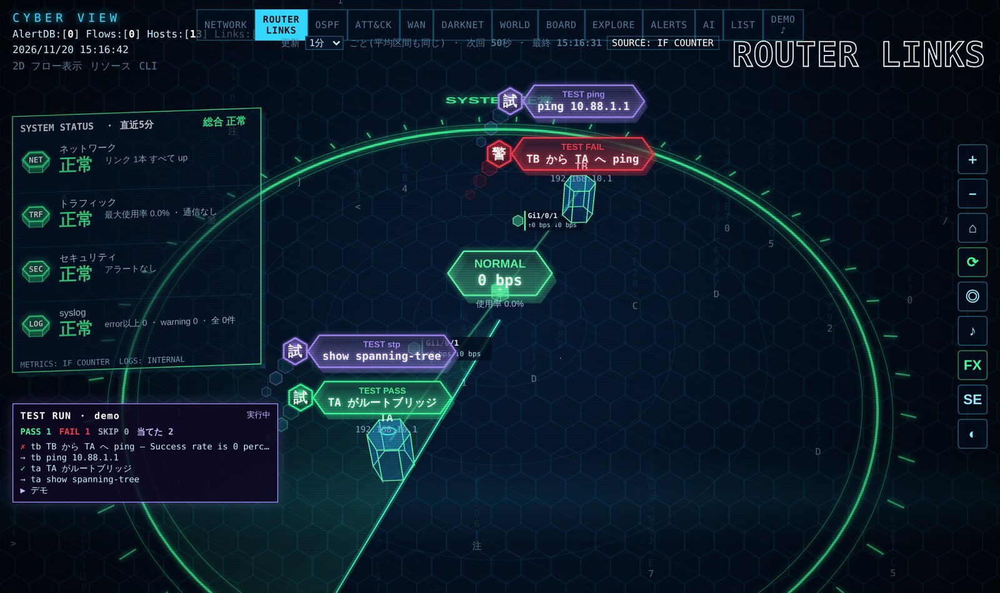

# 試験の様子を画面で見る(/cyber-view の「試」と TEST RUN)

Claude が裏で回している試験が、どの装置に何を当てて、通ったか落ちたかを、ニルヴァーナの画面でそのまま見られます。



| 表示 | 意味 |
|---|---|
| 装置の上の紫の「試」 | その装置に当てたコマンド(`show spanning-tree`、`ping …` など) |
| 装置の上の緑の「試」 | チェックが通った(TEST PASS) |
| 装置の上の赤の「警」 | チェックが落ちた(TEST FAIL)。理由も出す |
| 左下の TEST RUN | 試験の種類、PASS / FAIL / SKIP / 当てた数、直近 6 件。試験中と、終わってから 60 秒だけ出る |

装置が分からない出来事(pytest の 1 件ごとの結果など)は、TEST RUN パネルにだけ出ます。
単体版(`cyber-view-standalone`)には試験の口が無いので、何も出ません。

## 送り方

### シナリオ回帰

何もしなくても送ります。`show` / `ping` / `traceroute` を当てたときと、各チェックの合否です。
設定のコマンドは送りません。送るのをやめるときは `NETLAB_TEST_ACTIVITY=0` にします。
口の無い古いサーバーが相手でも、試験そのものは続きます。

```bash
python tests/scenario_regression.py http://127.0.0.1:8099
```

### pytest

`NETLAB_ACTIVITY_URL` に、起動中のニルヴァーナを指定したときだけ送ります。
ログインが要るサーバーなら、`NETLAB_ACTIVITY_TOKEN` にセッショントークンを入れます。

```bash
NETLAB_ACTIVITY_URL=http://127.0.0.1:8000 pytest tests/ -q
```

### 自分の試験から送る

`POST /api/testrun/event` に、1 件かリスト(最大 100 件)を JSON で送ります。

```json
{"kind": "probe", "suite": "manual", "name": "stp", "device": "sw1", "command": "show spanning-tree"}
{"kind": "fail",  "suite": "manual", "name": "SW1 がルート", "device": "sw1", "detail": "root is SW2"}
```

`kind` は `probe` / `pass` / `fail` / `skip` / `start` / `end` のどれかです。
`start` で新しい実行が始まり、`run` で実行を見分けます(省略すると直近の実行)。
`GET /api/testrun/events?since=<seq>` で、差分と、いま走っている実行の集計が返ります。
記録はメモリに最新 500 件だけ持ちます。装置の設定は何も変えません。

## ライブ確認(2026-11-20)

本物のサーバー(`uvicorn app:app`、`NETLAB_FAST_TIMERS=1`)で `/cyber-view?view=links` を開いたまま、
シナリオ回帰を流しました。12 シナリオ・全 PASS で、パネルに PASS 61、当てた 52 まで流れることを、
Playwright の画面写真で確かめました。上の写真は、装置 2 台に出来事を直接送って撮ったものです。

- TA の上: `show spanning-tree` を当てた紫の「試」と、PASS の緑の「試」
- TB の上: 落ちた ping の赤い「警」

試験は `tests/test_test_activity.py` です。
