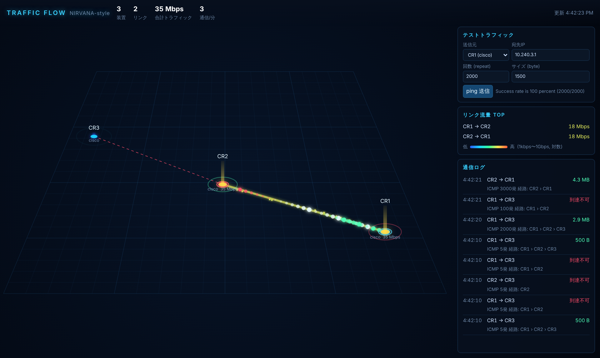

# トラフィックの流れの可視化 (`/traffic-flow`、NIRVANA風)

NICT の NIRVANA / NIRVANA改 のように、ネットワーク図の上を通信が光の粒として
流れていく様子をリアルタイムに見るページ。ログイン済みのブラウザで
`http://<エミュレータ>/traffic-flow` を開く(ページ自体は認証不要、データ取得は
`/dashboard` と同じログイン済みトークンで認証)。


## 見えるもの

| 表示 | 意味 | 元データ |
|---|---|---|
| 斜めの床面上の装置と線 | リンクで繋がった装置とリンク | vnet のリンク(`/api/link` で作ったもの) |
| 線の色・太さ | リンクの流量(1kbps〜1Gbps を対数で青→水色→緑→黄→赤) | IF の累積バイト数の差分(SNMP の `ifHCIn/OutOctets` と同じ値) |
| 線上を流れる小さな粒 | 方向ごとの流量(往路と復路は別レーン) | 同上 |
| 経路をたどる明るい彗星 | 1回の通信(ping)。白=往路、緑=応答、赤=到達不可で途中まで | フローイベント(経路・バイト数・成否) |
| 装置の柱の高さ | その装置を通る流量 | 同上 |
| 赤い破線 | shutdown されたリンク | `vnet.down_interfaces` |
| 波紋 | 通信の開始(送信元)と到着(宛先) | フローイベント |

右側に「テストトラフィック」(送信元・宛先IP・`repeat`・`size` を指定して
その装置から ping)、「リンク流量 TOP」、「通信ログ」(時刻・送信元→宛先・
バイト数・経路)。装置はドラッグで動かせ、配置はブラウザに保存される。

## 仕組み

- `ping <dest> repeat N size S` を打つと、`_learn_dataplane()`(app.py)が
  trace_path のホップ列から経路を求め、**その経路上のリンクにだけ**
  往路と復路のバイト数を加算し、フローイベントを記録する(最新500件)。
- `GET /api/traffic/flowmap?since=<seq>` が装置・リンク(両方向の累積
  バイト数・断の有無)・`since` より新しいイベントを返す。ページは2秒ごとに
  取得し、bps は前回値との差分で計算する。
- 描画は Canvas。外部ライブラリは使っていない。

## ライブ検証

CR1 ─ CR2 ─ CR3 の3台(`iac/cisco-traffic-monitoring/lab/provision_cisco_lab.sh`
+ CR3 を追加)で実施。

```
$ curl -s localhost:8000/api/traffic/flowmap   (cr1 から ping 10.240.3.1 repeat 300 size 1500 の後)
link cr1 GigabitEthernet0/0/0 <-> cr2 GigabitEthernet0/0/0 450000 450000
link cr2 GigabitEthernet0/0/2 <-> cr3 GigabitEthernet0/0/0 450000 450000
event cr1 -> 10.240.3.1 ['cr1', 'cr2', 'cr3'] True 450000
```

Playwright で開き、裏で ping を流しながら撮影(上の画像)。画面のフォームから
`ping 10.240.3.1 repeat 2000` を送ると `Success rate is 100 percent (2000/2000)`
が表示され、彗星が CR1→CR2→CR3 と流れた。CR3 の Gi0/0/0 を shutdown すると
リンクが赤い破線になり、以降の CR1→CR3 は赤い彗星が CR2 で止まり、
通信ログに「到達不可」と出る(下の画像)。スマホ幅(390px)でも横スクロール
なし・JS エラーなし。



## この作業で見つけて直したエミュレータ側の問題

1. **次ホップ側の IF を shutdown しても、その先のネットワークへの ping が
   成功していた** — `IcmpEngine._resolve_next_hop_detail` で、直結宛ては
   リンク断を見ていたが、スタティックルートのゲートウェイ経由の分岐だけ
   チェックが無かった(CR3 Gi0/0/0 を落としても CR1→CR3 LAN が 100% 成功し、
   彗星が赤い破線の上を通っていたことで気づいた)。
2. **直結の相手への ping で、経路が送信元だけになり、カウンタが無関係な
   リンクに加算されていた** — 直結の宛先は trace_path のホップに出ないため。
   宛先が直結の隣接なら経路に補うようにした(CR2→CR1 の ping で CR2–CR3
   リンクの流量が増えていた)。
3. **宛先 IP の持ち主を全装置から探していたため、同じ IP を持つ無関係な
   装置を宛先として拾うことがあった** — 経路の終点 → その隣接 → 全体の順で
   探すようにした(前回実行の装置が保存設定から復元されていて表面化した)。

## テスト

`tests/test_traffic_flow_view.py`: 多段ホップの経路・バイト数とリンクの往復
カウンタ、直結宛ての経路と無関係リンクに漏れないこと、到達不可イベント、
`since` の差分取得、次ホップ側 shutdown で先のネットワークに届かないこと
(と復旧)、ページの配信・認証除外・トークンキーの一致。

## スコープ外

- 記録されるのは ping(ICMP)だけ。PC 装置の ping(`_pc_ping`)や SSH/HTTP 等の
  実ソケット通信はフローイベントにならない
- NIRVANA の 3D 表示・IP アドレス空間の可視化・セキュリティアラート連携は無い
