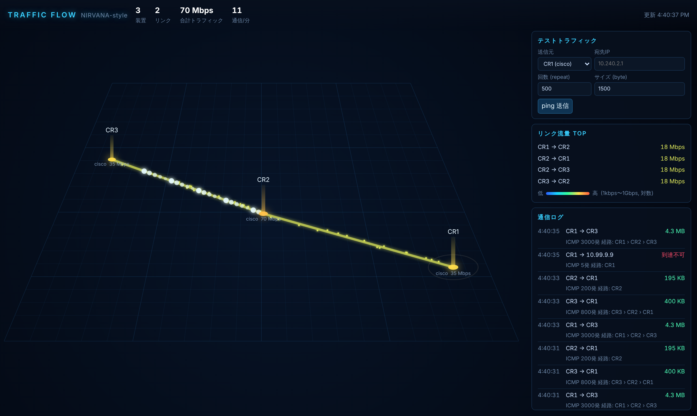
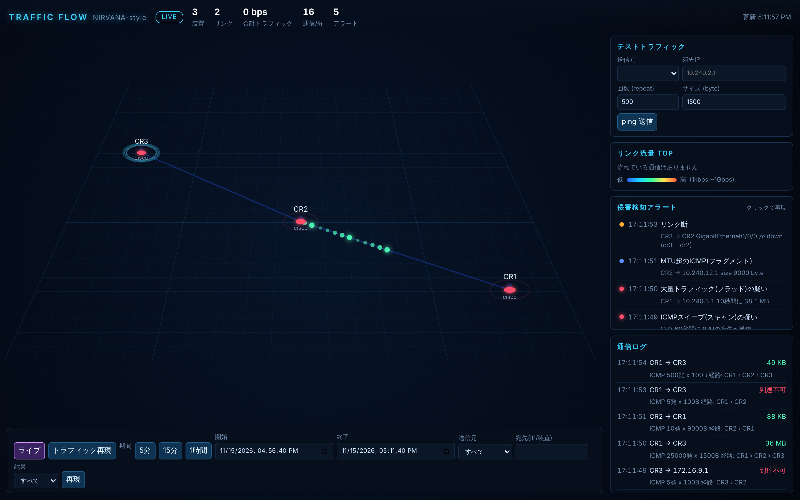
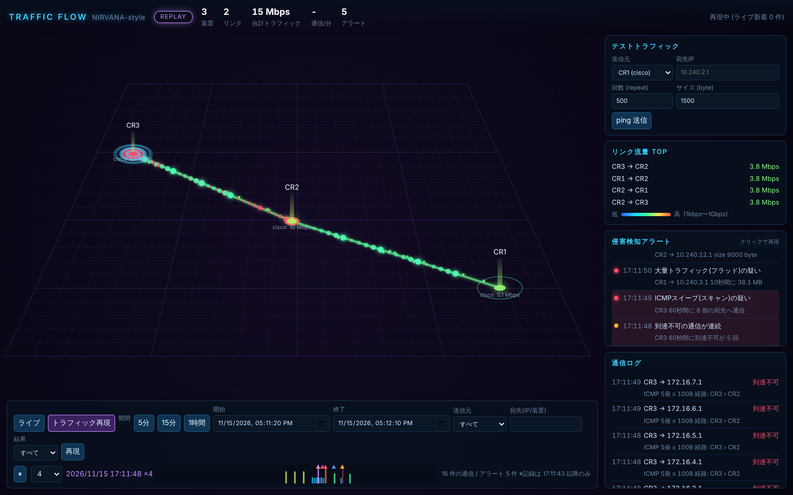

# トラフィックの流れの可視化 (`/traffic-flow`、NIRVANA風)

NICT の NIRVANA / NIRVANA改 のように、ネットワーク図の上を通信が光の粒として
流れていく様子をリアルタイムに見るページ。ログイン済みのブラウザで
`http://<エミュレータ>/traffic-flow` を開く(ページ自体は認証不要、データ取得は
`/dashboard` と同じログイン済みトークンで認証)。



## 見えるもの

| 表示 | 意味 | 元データ |
|---|---|---|
| 斜めの床面上の装置と線 | リンクで繋がった装置とリンク | vnet のリンク(`/api/link` で作ったもの) |
| 線の色・太さ | リンクの流量(1kbps〜1Gbps を対数で青→水色→緑→黄→赤) | IF の累積バイト数の差分(SNMP の `ifHCIn/OutOctets` と同じ値) |
| 線上を流れる小さな粒 | 方向ごとの流量(往路と復路は別レーン) | 同上 |
| 経路をたどる明るい彗星 | 1回の通信(ping)。白=往路、緑=応答、赤=到達不可で途中まで | フローイベント(経路・バイト数・成否) |
| 装置の柱の高さ | その装置を通る流量 | 同上 |
| 赤い破線 | shutdown されたリンク | `vnet.down_interfaces` |
| 波紋 | 通信の開始(送信元)と到着(宛先) | フローイベント |

右側に「テストトラフィック」(送信元・宛先IP・`repeat`・`size` を指定して
その装置から ping)、「リンク流量 TOP」、「通信ログ」(時刻・送信元→宛先・
バイト数・経路)。装置はドラッグで動かせ、配置はブラウザに保存される。

## 仕組み

- `ping <dest> repeat N size S` を打つと、`_learn_dataplane()`(app.py)が
  trace_path のホップ列から経路を求め、**その経路上のリンクにだけ**
  往路と復路のバイト数を加算し、フローイベントを記録する(最新500件)。
- `GET /api/traffic/flowmap?since=<seq>` が装置・リンク(両方向の累積
  バイト数・断の有無)・`since` より新しいイベントを返す。ページは2秒ごとに
  取得し、bps は前回値との差分で計算する。
- 描画は Canvas。外部ライブラリは使っていない。

## ライブ検証

CR1 ─ CR2 ─ CR3 の3台(`iac/cisco-traffic-monitoring/lab/provision_cisco_lab.sh`
+ CR3 を追加)で実施。

```
$ curl -s localhost:8000/api/traffic/flowmap   (cr1 から ping 10.240.3.1 repeat 300 size 1500 の後)
link cr1 GigabitEthernet0/0/0 <-> cr2 GigabitEthernet0/0/0 450000 450000
link cr2 GigabitEthernet0/0/2 <-> cr3 GigabitEthernet0/0/0 450000 450000
event cr1 -> 10.240.3.1 ['cr1', 'cr2', 'cr3'] True 450000
```

Playwright で開き、裏で ping を流しながら撮影(上の画像)。画面のフォームから
`ping 10.240.3.1 repeat 2000` を送ると `Success rate is 100 percent (2000/2000)`
が表示され、彗星が CR1→CR2→CR3 と流れた。CR3 の Gi0/0/0 を shutdown すると
リンクが赤い破線になり、以降の CR1→CR3 は赤い彗星が CR2 で止まり、
通信ログに「到達不可」と出る(下の画像)。スマホ幅(390px)でも横スクロール
なし・JS エラーなし。


## この作業で見つけて直したエミュレータ側の問題

1. **次ホップ側の IF を shutdown しても、その先のネットワークへの ping が
   成功していた** — `IcmpEngine._resolve_next_hop_detail` で、直結宛ては
   リンク断を見ていたが、スタティックルートのゲートウェイ経由の分岐だけ
   チェックが無かった(CR3 Gi0/0/0 を落としても CR1→CR3 LAN が 100% 成功し、
   彗星が赤い破線の上を通っていたことで気づいた)。
2. **直結の相手への ping で、経路が送信元だけになり、カウンタが無関係な
   リンクに加算されていた** — 直結の宛先は trace_path のホップに出ないため。
   宛先が直結の隣接なら経路に補うようにした(CR2→CR1 の ping で CR2–CR3
   リンクの流量が増えていた)。
3. **宛先 IP の持ち主を全装置から探していたため、同じ IP を持つ無関係な
   装置を宛先として拾うことがあった** — 経路の終点 → その隣接 → 全体の順で
   探すようにした(前回実行の装置が保存設定から復元されていて表面化した)。

## テスト

`tests/test_traffic_flow_view.py`: 多段ホップの経路・バイト数とリンクの往復
カウンタ、直結宛ての経路と無関係リンクに漏れないこと、到達不可イベント、
`since` の差分取得、次ホップ側 shutdown で先のネットワークに届かないこと
(と復旧)、ページの配信・認証除外・トークンキーの一致。

## スコープ外

- 記録されるのは ping(ICMP)だけ。PC 装置の ping(`_pc_ping`)や SSH/HTTP 等の
  実ソケット通信はフローイベントにならない
- NIRVANA の 3D 表示・IP アドレス空間の可視化・セキュリティアラート連携は無い

---

# CyNote風: 侵害検知アラート + トラフィック再現

NICT の NIRVANA改 を補強する構造計画研究所の「CyNote」の2機能
(セグメント侵害検知 / トラフィック再現機構)を、`/traffic-flow` に小さく
再現した。エンジンは `engine/traffic_analytics.py`(`FlowRecorder`)。



## 侵害検知(セグメント侵害検知に相当)

ping ごとのフローイベントとリンクの up/down を記録と同時にルールで評価し、
アラートを出す。アラートは右パネルに出て、送信元の装置が赤く脈動する。
同じ送信元(・宛先)の組は `cooldown` 秒間は再発報しない。

| ルール | 重要度 | 条件(既定値) |
|---|---|---|
| ICMPスイープ(スキャン)の疑い | high | 同じ送信元から 60 秒間に 8 個以上の異なる宛先 |
| 到達不可の通信が連続 | medium | 同じ送信元から 60 秒間に到達不可が 5 回以上 |
| 大量トラフィック(フラッド)の疑い | high | 同じ送信元→宛先で 10 秒間に 30MB 以上 |
| MTU超のICMP(フラグメント) | low | ICMP のサイズが 1500 byte 超 |
| リンク断 | medium | インタフェースの shutdown でリンクが落ちた |

しきい値は `engine/traffic_analytics.py` の `RULES`。`GET /api/traffic/alerts`
で一覧とルール定義が取れる。

## トラフィック再現(トラフィック再現機構に相当)

記録したフローイベントとリンク状態の変化を、**指定した期間・条件で当時の
時刻どおりに再生**する。画面下の再現バーで操作する。

- 期間: 5分 / 15分 / 1時間 のボタン、または開始・終了日時
- 条件: 送信元、宛先(IP または装置)、結果(すべて / 成功 / 到達不可)
- 再生: 一時停止・再生、速度 ×1 / ×4 / ×16 / ×60、タイムラインのクリックで移動
- タイムライン: 時間ごとの通信量の棒グラフ、アラート(三角、色は重要度)、リンク断(赤線)
- **アラートをクリックすると、その発生時刻の30秒前〜20秒後を自動で再現**
  (インシデント発生時刻に遡る)
- 再現中は背景が紫になり、リンクの流量は「直近5秒に再生された通信」から計算、
  リンク断はその時点の状態で表示する

API: `GET /api/traffic/history?start=&end=&src=&dst=&result=all|ok|ng`
(期間内のイベント・期間終了までのリンク状態変化・期間内のアラート)。



### ライブ検証

CR1 ─ CR2 ─ CR3 の3台で、通常通信 → CR3 から 172.16.1-9.1 へのスイープ →
CR1→CR3 へ 25000×1500byte → CR2 から 9000byte の ping → CR3 Gi0/0/0 の
shutdown / no shutdown、の順に実施。

```
1 high   scan          cr3 -> None        | 60秒間に 8 個の宛先へ通信 | related 8
2 medium unreach_burst cr3                | 60秒間に到達不可が 5 回
3 high   flood         cr1 -> 10.240.3.1  | 10秒間に 38.1 MB
4 low    large_icmp    cr2 -> 10.240.12.1 | size 9000 byte
5 medium link_down     cr3 -> cr2         | GigabitEthernet0/0/0 が down (cr3 - cr2)
```

Playwright で画面を操作し、5件がアラート欄に出ること、スキャンのアラートを
クリックすると REPLAY に切り替わってその時刻から再生されること(16件の通信 /
アラート5件)、結果=到達不可で絞ると10件になること、ライブに戻れることを
確認した。スマホ幅(390px)も横スクロールなし・JSエラーなし。

### 見つけたが直していないこと

**直結サブネット内の、どの装置も持っていない IP への ping が成功する**
(例: CR1 から自分の LAN 10.240.1.0/24 の 10.240.1.55 へ)。実機は ARP が解決
できず失敗する。スイープの検知を試していて気づいたが、
`tests/test_protocols.py::TestIcmp::test_ping_same_segment` が「同一セグメント
への ping は成功」(装置として置いていない LAN 上のホストも応答する)を仕様として
固定しており、ラボ全体の挙動を変えることになるので今回は変えていない。

### スコープ外

- 記録はプロセス内メモリのみ(最大 20000 件・24 時間)。再起動で消える
- パケットの中身(ペイロード)は持たない。CyNote の高機能検知エンジンや
  メモリプール/プレフィルタのような仕組みは無く、上の5ルールのみ
