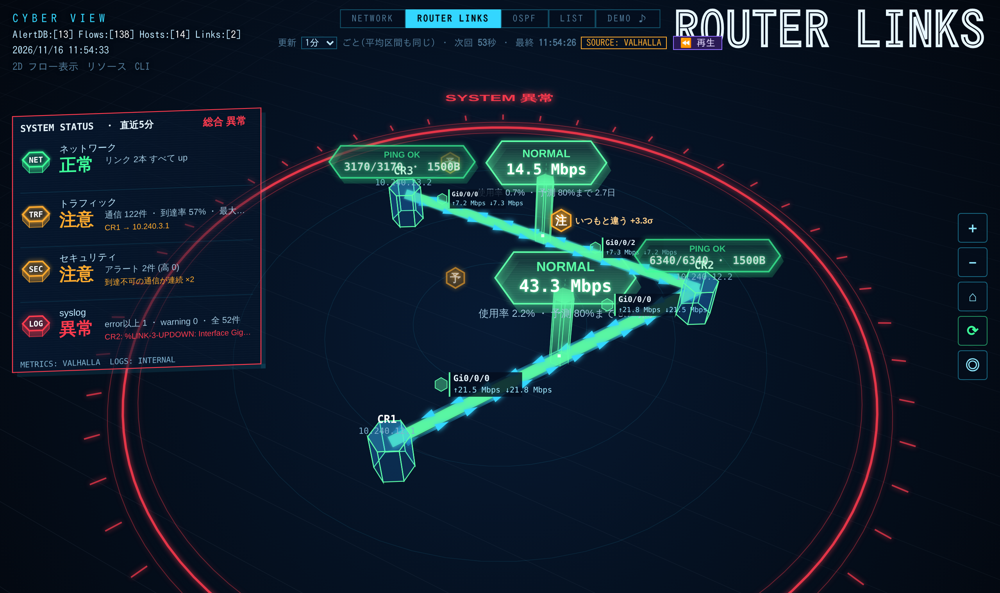
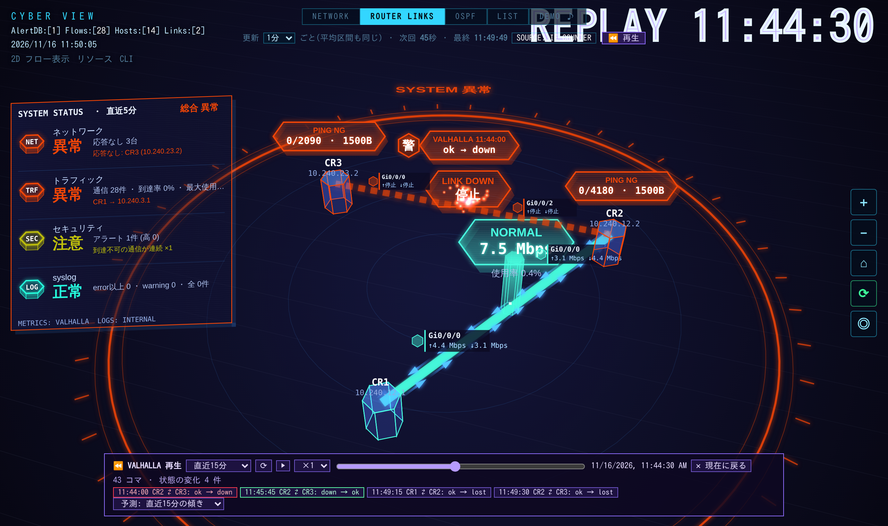
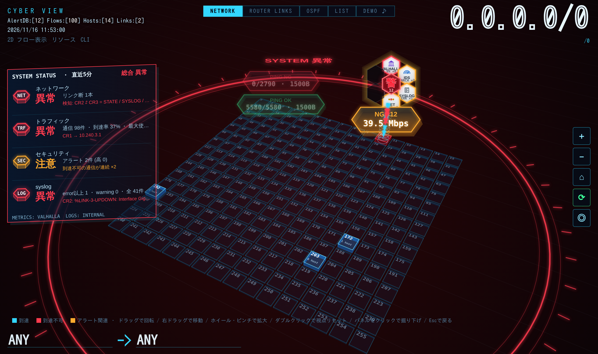
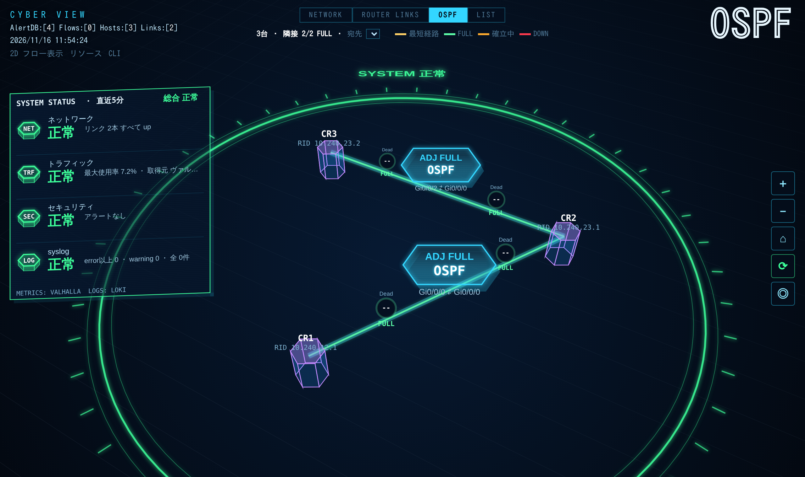

# ヴァルハラ × ニルヴァーナ(Prometheus と /cyber-view の連携)(v15)

依頼: 「ヴァルハラ自体も拡張してニルヴァーナと相乗効果でないかな」→ 提案した5つを「1、2、3、4、5をお願いします」。

ヴァルハラ = メトリクス収集基盤(Prometheus。画面上の呼び名、v14)、ニルヴァーナ = 3D 監視画面 `/cyber-view`。
これまではヴァルハラ → ニルヴァーナの一方向(流量・IF 状態を読むだけ)だったのを、両方向にした。

| # | 何をするか | どこ |
|---|---|---|
| ① | ニルヴァーナの判断(リンク状態・状態ボード・OSPF 隣接・警報件数・経路変化)をメトリクスで出し、ヴァルハラに貯めて警報ルールにかける | `GET /metrics`、`engine/valhalla.py` の `render_metrics`、IaC の `netlab-nirvana` ジョブと `valhalla-nirvana` ルール群 |
| ② | ヴァルハラの記録から過去を 3D で再生(状態変化の時刻にポップアップ) | ROUTER LINKS の「⏪ 再生」、`GET /api/valhalla/replay` |
| ③ | 使用率の予測(このままだと何日で 80%)と、平常時とのずれ(「いつもと違う ±zσ」) | リンクのプレート下段・「予」「注」の印、`GET /api/valhalla/forecast` |
| ④ | エミュレータの SNMP に OSPF-MIB を追加 → snmp_exporter → ヴァルハラ。スタンドアロン版も実機の OSPF 隣接を表示 | `engine/protocols.py` の `SnmpAgent._build_mib`、`snmp_exporter/snmp.yml`、スタンドアロン版の `/api/traffic/ospf` |
| ⑤ | ヴァルハラで発報中の警報を、ニルヴァーナの警報の花に「VALHALLA」の花びらで出す | `_valhalla_alert_loop`(15秒ごと)、スタンドアロン版は `AlertImporter` |

ラボ版・スタンドアロン版の両方で動く。Prometheus への問い合わせは標準ライブラリだけで書き、
`engine/valhalla.py` を `cyber-view-standalone/cvs/valhalla.py` にそのままコピーしている(ずれはテストで検出)。

## 使い方

```bash
# 監視基盤(snmp_exporter + ヴァルハラ + Grafana)を起動。ヴァルハラは /metrics も取りに来る
cd iac/cisco-traffic-monitoring && ./deploy.sh up
# エミュレータ側にヴァルハラの場所を教える(②③⑤ が有効になる)
PROMETHEUS_URL=http://127.0.0.1:9090 python app.py
```

- `/metrics` の認証: `NETLAB_METRICS_TOKEN` を設定すると `Authorization: Bearer <トークン>` で取れる
  (無ければ通常のセッショントークン、認証無効なら不要)。`deploy.sh` は同じ環境変数から
  `prometheus/nirvana.token`(.gitignore 済み)と取得先 `prometheus/nirvana_targets/nirvana.yml`(`EMU_URL`)を書く。
- 「⏪ 再生」ボタンは `GET /api/valhalla/status` でヴァルハラに届き、①を記録している時だけ出る。
- スタンドアロン版は設定ファイルの `sources.prometheus` があれば同じ機能が使える。再生・予測は snmp_exporter の
  生のメトリクス(`rate(ifHC*Octets)`・`ifOperStatus`・`ifHighSpeed`)から、OSPF は `ospfRouterId`/`ospfNbrState` から作る
  (SNMP では最短経路ツリーと Dead タイマーは取れないので出さない)。

## 出すメトリクス(①)

| メトリクス | 値 |
|---|---|
| `netlab_link_state{a,b,host_a,host_b}` | 0=正常 1=高負荷 2=危険 3=断 4=応答なし |
| `netlab_link_bps{…,dir="ab"\|"ba"}` / `netlab_link_util` | 方向ごとの bps / 使用率(大きい方) |
| `netlab_health_state{category}` | 状態ボード(network/traffic/security/syslog/overall)0=正常 1=注意 2=異常 |
| `netlab_ospf_adjacency_state{device,neighbor,area}` | 1=Down … 8=Full(両端から見た値) |
| `netlab_ospf_dead_remaining_seconds` / `netlab_ospf_spf_runs_total` | Dead タイマー残り / SPF 計算回数 |
| `netlab_alerts_total{rule,severity,source}` / `netlab_route_changes_total{device,kind}` | 起動からの警報件数 / 経路変化件数 |

警報ルール(`prometheus/alert_rules.yml` の `valhalla-nirvana`): `NirvanaLinkDown`(断が1分)、
`NirvanaHealthCritical`(観点が異常のまま5分)、`NirvanaLinkCapacityForecast`(`predict_linear` で7日以内に80%)、
`NirvanaOspfSpfChurn`(SPF が5分で5回以上)。SNMP 側には `CiscoOspfNeighborNotFull`(OSPF-MIB の隣接が Full でない)を追加。

## ライブ確認(本物の Prometheus 2.x / snmp_exporter / Grafana を docker で起動、CR1─CR2─CR3 で OSPF)

OSPF-MIB を snmpwalk で(CR2 から見た2つの隣接が Full=8):

```
iso.3.6.1.2.1.14.1.1.0 = IpAddress: 10.240.23.1
iso.3.6.1.2.1.14.10.1.3.10.240.12.1.0 = IpAddress: 10.240.12.1
iso.3.6.1.2.1.14.10.1.3.10.240.23.2.0 = IpAddress: 10.240.23.2
iso.3.6.1.2.1.14.10.1.6.10.240.12.1.0 = INTEGER: 8
iso.3.6.1.2.1.14.10.1.6.10.240.23.2.0 = INTEGER: 8
```

ヴァルハラのターゲット(`netlab-nirvana` が up)と、snmp_exporter 経由の `ospfNbrState`:

```
cisco-snmp  .../snmp?auth=netlab_v2&module=cisco_if&target=10.240.12.2  up
netlab-nirvana  http://localhost:8000/metrics  up
ospfNbrState{instance="10.240.12.1",ospfNbrIpAddr="10.240.12.2",ospfNbrRtrId="10.240.23.1",router="CR1"} 8
```

CR2 Gi0/0/2 を shutdown して1分半 → ヴァルハラで `NirvanaLinkDown` が firing → ニルヴァーナに取り込まれた:

```
NirvanaLinkDown firing CR2
valhalla VALHALLA ヴァルハラ: NirvanaLinkDown  high
```

no shutdown 後、再生 API に断と復旧の両方が出る:

```
27 frames
1794829438.0 CR2 ⇄ CR3: ok → down
1794829548.0 CR2 ⇄ CR3: down → ok
```

予測(ping 量を時間とともに増やした状態。`fit_window=2m`):
`cr1⇄cr2 util 0.0030, slope/day 2.18, days_to_alert 0.37, z 3.26`。

スタンドアロン版(同じヴァルハラ、job `cisco-snmp`)でも `/api/traffic/ospf` が CR1〜CR3 の Router-ID と
2本の隣接 `full` を返し、再生は断・復旧4件、予測もリンク単位で返ることを確認した。






## ライブ確認で見つけて直したこと

- 予測値が 0..1 を超えて「7日後 1351%」と出ていた → 0..1 に収めた。
- 予測を別のプレートとして積むと、隣のリンクのプレートや上の SYSTEM 表示と重なった → 既存プレートの下段に
  「予測 80%まで N日」を足し、左に「予」の印だけを置く形にした。
- 再生中のリンクの IF 名が「?」になっていた(記録に IF 名が無い)→ 現在のリンク一覧から引く。再生中は
  検知経路のチップ(その時刻の根拠を持たない)を出さない。

## 制約

- 再生は①を記録し始めてからの分だけ。ヴァルハラの保持期間(既定 15 日)より前は見られない。
- 予測は直線のあてはめ。データが短い間は「予測: 直近15分の傾き」に切り替えると出やすい。
- ラボ版のエミュレータを再起動すると SNMP コミュニティと OSPF の設定は戻らない(永続化の対象外、既存の範囲)。
  そのため再起動直後はヴァルハラの `CiscoSnmpUnreachable` が出る。
