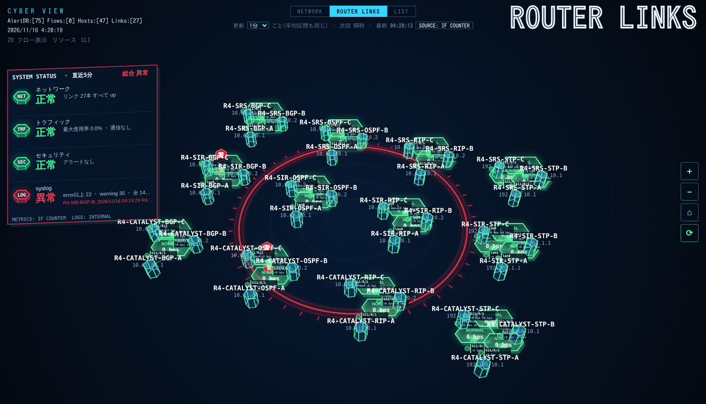
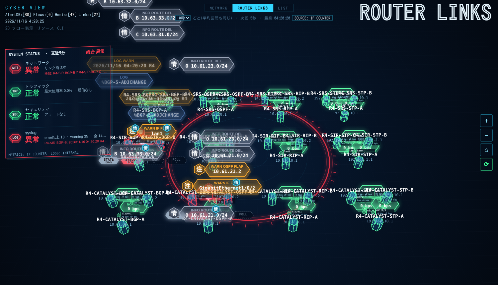

# Catalyst / SR-S / Si-R × STP / RIP / OSPF / BGP — 正常時と障害時の Cyber View(モックNIRVANA)動作確認

各機種3台の構成で、STP・RIP・OSPF・BGP の「正常 → 障害 → 復旧 → フラップ」を実際に起こし、
`/cyber-view` が使う API(`/api/traffic/links` / `health` / `alerts` / `routes` / `logs`)が
期待どおりに反応するかを自動で確認した。最終結果は **12 シナリオ・144 項目すべて OK**。
途中で見つかったエミュレータ側の不具合4件と表示の問題1件は修正済み(下記)。

- 実行日: 2026-11-16 / 実行環境: このリポジトリのサンドボックス(`NETLAB_AUTH_DISABLE=1 python3 -m uvicorn app:app`)
- 検証スクリプト: `tools/verification/vendor_protocol_matrix.py <装置IDの接頭辞> [catalyst/ospf ...]`。実サーバーに `/api/device` `/api/link` `/api/cli` で構成を投入し、APIの応答を判定
- 指標の取得元: エミュレータ内部(IF カウンタ・内部ログ)。Prometheus / Loki は使っていない
  (`PROMETHEUS_URL` / `LOKI_URL` 未設定時の既定の経路。全項目が内部経路で通ったので、Prometheus 側の切り分けは不要だった)

## 構成

```
ルーティング(RIP/OSPF/BGP)            STP
  LAN-A ── A ══ B ══ C ── LAN-C          A ── B
                                          \  /
                                           C        (A の priority を 4096 に下げてルートにする)
```

| 機種 | IF | アドレス | 設定の書き方 |
|---|---|---|---|
| Catalyst | Gi1/0/1〜3 (`no switchport` で L3) | 10.61.x.0/24 | IOS(`router ospf` / `router rip` / `router bgp` / `spanning-tree mode rapid-pvst`) |
| SR-S | Gi1/0/1〜3 | 10.62.x.0/24 | このエミュレータの SR-S は IOS 形式の CLI |
| Si-R | lan0 / lan1(`ether 1 1 vlan untag 1` + `lan 0 vlan 1` で ether ポートと結ぶ) | 10.63.x.0/24 | Si-R 形式(`ip rip use on` / `ospf use on` + `lan N ip ospf use on` / `bgp as` + `bgp neighbor N address <ip> remote-as <as>` / `stp mode stp`) |

BGP は A=AS65001、B=AS65002、C=AS65003 の eBGP。A と C が自分の LAN を広告する。

障害の起こし方: Catalyst/SR-S は B の C 向け IF で `shutdown`、Si-R は `ether 1 2 use off`(実機に shutdown は無い)。
STP はルートブリッジ A の A-B 側 IF を落とす。

## 確認項目と結果

### ルーティング(RIP / OSPF / BGP)— 各13項目

| # | 段階 | 確認内容 | catalyst | srs | sir |
|---|---|---|---|---|---|
| 1 | 正常 | A が LAN-C を学習(`show ip route` に R / O / B) | ✅ | ✅ | ✅ |
| 2 | 正常 | links API に A-B / B-C があり state=ok(画面は緑の NORMAL) | ✅ | ✅ | ✅ |
| 3 | 正常 | 経路追加の INFO イベント(画面は「情 INFO ROUTE ADD」) | ✅ | ✅ | ✅ |
| 4 | 障害 | B-C が LINK DOWN | ✅ | ✅ | ✅ |
| 5 | 障害 | 検知経路に STATE と SYSLOG の両方 | ✅ | ✅ | ✅ |
| 6 | 障害 | 状態ボードのネットワーク観点が「異常」 | ✅ | ✅ | ✅ |
| 7 | 障害 | link_down アラート | ✅ | ✅ | ✅ |
| 8 | 障害 | A から LAN-C の経路が消える | ✅ | ✅ | ✅ |
| 9 | 障害 | 経路削除の INFO イベント(「情 INFO ROUTE DEL」) | ✅ | ✅ | ✅ |
| 10 | 復旧 | 経路が戻る | ✅ | ✅ | ✅ |
| 11 | 復旧 | B-C が LINK DOWN でなくなる | ✅ | ✅ | ✅ |
| 12 | フラップ | shutdown/no shutdown ×2 で if_flap(「注 WARN IF FLAP」) | ✅ | ✅ | ✅ |
| 13 | ログ | RIP / OSPF / BGP のログが記録されている | ✅ | ✅ | ✅ |

上の表は RIP・OSPF・BGP の3プロトコルとも同じ結果(3機種 × 3プロトコル × 13項目 = 117項目)。

### STP — 9項目

| # | 段階 | 確認内容 | catalyst | srs | sir |
|---|---|---|---|---|---|
| 1 | 正常 | 三角形のどこかが Blocking(ループ回避) | ✅ | ✅ | ✅ |
| 2 | 正常 | priority を下げた A がルート | ✅ | ✅ | ✅ |
| 3 | 正常 | STP が動いているので MAC フラップは出ない | ✅ | ✅ | ✅ |
| 4 | 正常 | links API に3本とも ok | ✅ | ✅ | ✅ |
| 5 | 障害 | A-B が LINK DOWN | ✅ | ✅ | ✅ |
| 6 | 障害 | 迂回のため Blocking が解除される | ✅ | ✅ | ✅ |
| 7 | 障害 | STP / トポロジ変更のログ | ✅ | ✅ | ✅ |
| 8 | 障害 | 状態ボードのネットワーク観点が「異常」 | ✅ | ✅ | ✅ |
| 9 | 復旧 | A-B が LINK DOWN でなくなる | ✅ | ✅ | ✅ |

## それぞれの状況(正常時の実際の出力)

### Catalyst

```
# RIP: A の show ip route
R        10.61.11.0/24 [120/1] via 10.61.10.2, GigabitEthernet1/0/1
R        10.61.13.0/24 [120/2] via 10.61.10.2, GigabitEthernet1/0/1      ← LAN-C

# OSPF: A の show ip route / B の show ip ospf neighbor
O        10.61.21.0/24 [110/20] via 10.61.20.2, GigabitEthernet1/0/1
O        10.61.23.0/24 [110/30] via 10.61.20.2, GigabitEthernet1/0/1     ← LAN-C
Neighbor ID     Pri   State           Dead Time   Address         Interface
10.61.20.1      1     Full/DROther    00:00:39    10.61.20.1      GigabitEthernet1/0/1
10.61.21.2      1     Full/DR         00:00:31    10.61.21.2      GigabitEthernet1/0/2

# BGP: A の show ip route / B の show ip bgp summary
B        10.61.33.0/24 [20/0] via 10.61.30.2, GigabitEthernet1/0/1       ← LAN-C (AS65003 発)
10.61.30.1      4 65001     103      37        1    0    0 00:04:10  1
10.61.31.2      4 65003     194      40        1    0    0 00:04:01  1

# STP: C の show spanning-tree(A がルート、C の Gi1/0/1 が Alternate/Blocking)
Gi1/0/2             Root  FWD 19        128.1    P2p
Gi1/0/1             Altn  BLK 19        128.1    P2p
```

### SR-S

```
R        10.62.13.0/24 [120/2] via 10.62.10.2, GigabitEthernet1/0/1      (RIP)
O        10.62.23.0/24 [110/30] via 10.62.20.2, GigabitEthernet1/0/1     (OSPF)
B        10.62.33.0/24 [20/0] via 10.62.30.2, GigabitEthernet1/0/1       (BGP)
# B の BGP ピア: 10.62.30.1 (AS65001) / 10.62.31.2 (AS65003) ともに Established
# STP: C の Gi1/0/1 が Altn BLK
```

### Si-R

```
R        10.63.13.0/24 [120/2] via 10.63.10.2, lan0                     (RIP)
O        10.63.23.0/24 [110/30] via 10.63.20.2, lan0                    (OSPF)
B        10.63.33.0/24 [20/0] via 10.63.30.2, lan0                      (BGP)

# OSPF: B の show ip ospf neighbor(Si-R 形式)
Neighbor ID     Pri  State        Deadtime  Address          DDL  ReqL  RtrL
10.63.20.1      1    Full/DROther 00:00:26  10.63.20.1       0    0     0
10.63.21.2      1    Full/DR      00:00:09  10.63.21.2       0    0     0

# STP: C の show spanning-tree(Si-R 形式)
ether 1 2       128.1    Blocking(Alternate)   ...
ether 1 1       128.1    Forwarding(Root)      ...
```

## 障害時の画面

正常時(ROUTER LINKS。上の段が SR-S、中央が Si-R、下の段が Catalyst の3台ずつ):



Catalyst/OSPF の B-C と Si-R/BGP の B-C を同時に落としたところ。該当リンクが赤い LINK DOWN になり、
STATE / SYSLOG の検知チップが点灯、A に「情 INFO ROUTE DEL」、繰り返しによる「注 WARN … FLAP」、
状態ボードはネットワーク「異常 リンク断 2本」:



検証全体で出たアラート(参考): link_down 30件(各機種10)、if_flap 9件、route_flap 12件、
ospf_flap 3件、stp_root_flap 2件、syslog_error 12件(`%LINK-3-UPDOWN` の down が重要度3のため)。

## 見つかって直した不具合

1. **STP: 有効化した後に張ったリンクが STP に参加しない**(`engine/protocols.py` StpEngine)
   ポートを `spanning-tree mode` 実行時点の隣接からしか作っておらず、後から張ったリンクの BPDU を
   捨てていた。三角形でも Blocking にならず、C は自分がルートでポート0個と表示していた。
   BPDU 受信時・送信時に、リンクの張られている(かつ落ちていない)隣接をポートにするよう修正。
2. **STP が動いていてもループ作成時に MAC フラップ/ストームのログを出していた**(`VirtualNetwork._notify_loop_events`)
   ループ上のスイッチが全て STP を動かしているときは出さないようにした(STP 無しのループでは従来どおり出る)。
3. **STP の Blocking ログが約2秒ごとに繰り返し出ていた**
   BPDU のたびに役割を再計算して、そのたびにログを出していた。新たに Blocking になったときだけに修正
   (Si-R 形式の `[STP] port state changed to Blocking` も同じログからの変換なので一緒に直った)。
4. **Si-R の `bgp neighbor N address <ip> remote-as <as>` が指定 IP を使っていなかった**(`app.py`)
   常に「最初の隣接」をピアにしていたため、隣接が2台ある B で2本目のネイバー(C)が A に付き、
   AS も食い違って B-C 間のセッションが無かった(結果、B-C を落としても A の経路が消えなかった)。
   `show ip bgp summary` の Neighbor 列も `192.168.1.<装置ID>` という壊れた表示だった。IP から相手を特定するよう修正。
5. **(表示)ROUTER LINKS で装置が多いと1つの輪に重なって読めない**(`static/cyber_view.html`)
   連結成分(つながっている装置のまとまり)ごとに小さな輪にして格子状に並べ、全体が入るようにカメラを引くようにした。

回帰テスト: `tests/test_stp_late_links.py`(1〜3)、`tests/test_sir_bgp_neighbor_by_ip.py`(4)。

## 検証スクリプト側で気をつけた点(実機どおりの仕様)

- Si-R の `ether G P use off` で落ちる `lan` は、`ether G P vlan untag V` と `lan N vlan V` で結び付いている必要がある。
  結び付けないと、どの lan も落ちない(最初の実行ではこれでSi-Rの障害が起きず NG になっていた — 不具合ではない)。
- SR-S はこのエミュレータでは IOS 形式の CLI で動く(Si-R 形式の `lan 0 ip address` は `% Invalid input` になる)。

## 残っている気づき(今回は直していない)

- Si-R の `show spanning-tree` で、ルートブリッジのはずの A に `Forwarding(Root)` のポートが表示される・
  `Designated Bridge ID` が全ポート自分の 32768 になる(Si-R 形式の表示側。STP の動作自体は正しい)。
- Si-R / SR-S でも STP のログが Cisco 形式の `%SPANTREE-6-PORTDPVSTP` で併記される。
- SR-S に Si-R 形式の `lan 0 ip address ...` を打つと、CLI は `% Invalid input` を返すのに running-config には残る。
