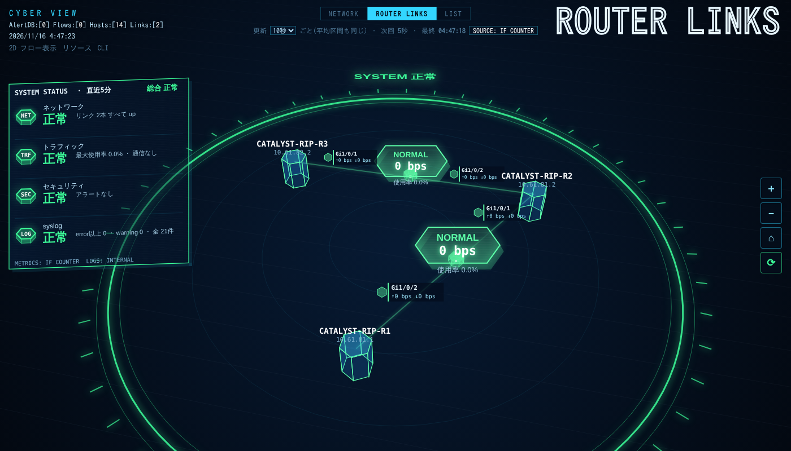
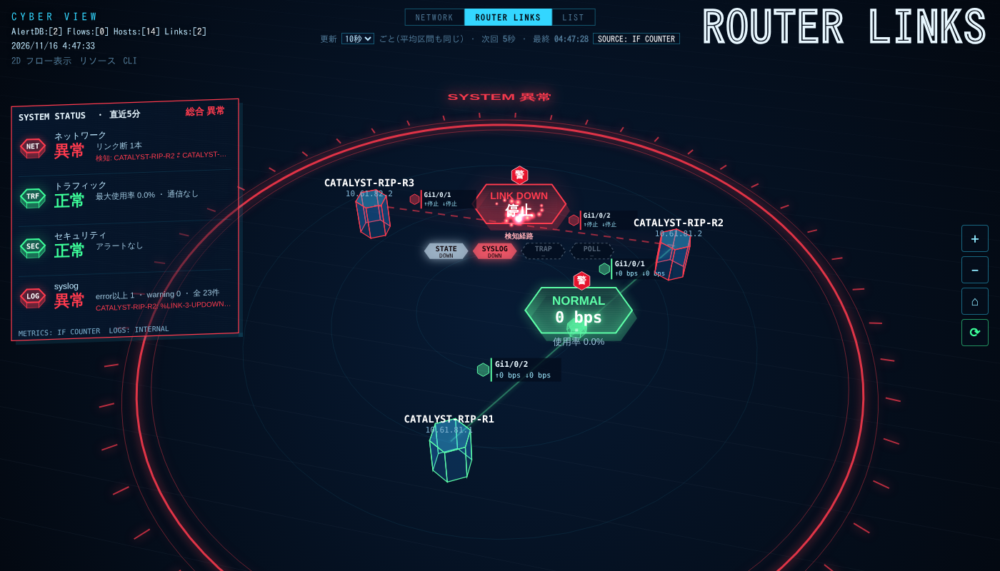

# Cisco Catalyst × RIP — 3台構成の正常/障害試験

- 実行: 2026-11-16 04:47 / 所要 59 秒 / 専用環境(保存設定を消してエミュレータを新規起動、他シナリオの装置は無し)
- 結果: **14 / 14 項目 OK** ✅
- 再実行: `python3 tools/verification/scenario_report.py catalyst rip --devices 3`

## 構成(台数から自動で割り当て)

```
LAN 10.61.110.0/24 ── CATALYST-RIP-R1 ══ CATALYST-RIP-R2 ══ CATALYST-RIP-R3 ── LAN 10.61.111.0/24
```

| 装置 | IF | アドレス |
|---|---|---|
| CATALYST-RIP-R1 | GigabitEthernet1/0/2 | 10.61.81.1/24 |
| CATALYST-RIP-R1 | GigabitEthernet1/0/3 | 10.61.110.1/24 |
| CATALYST-RIP-R2 | GigabitEthernet1/0/1 | 10.61.81.2/24 |
| CATALYST-RIP-R2 | GigabitEthernet1/0/2 | 10.61.82.1/24 |
| CATALYST-RIP-R3 | GigabitEthernet1/0/1 | 10.61.82.2/24 |
| CATALYST-RIP-R3 | GigabitEthernet1/0/3 | 10.61.111.1/24 |

| リンク | 装置A IF | 装置B IF | ネットワーク |
|---|---|---|---|
| CATALYST-RIP-R1 ⇔ CATALYST-RIP-R2 | GigabitEthernet1/0/2 | GigabitEthernet1/0/1 | 10.61.81.0/24 |
| CATALYST-RIP-R2 ⇔ CATALYST-RIP-R3 | GigabitEthernet1/0/2 | GigabitEthernet1/0/1 | 10.61.82.0/24 |

## 投入したコマンド

<details><summary>CATALYST-RIP-R1(19 行)</summary>

```
configure terminal
interface GigabitEthernet1/0/2
no switchport
ip address 10.61.81.1 255.255.255.0
no shutdown
end
configure terminal
interface GigabitEthernet1/0/3
no switchport
ip address 10.61.110.1 255.255.255.0
no shutdown
end
configure terminal
ip routing
router rip
version 2
network 10.0.0.0
no auto-summary
end
```
</details>

<details><summary>CATALYST-RIP-R2(43 行)</summary>

```
configure terminal
interface GigabitEthernet1/0/1
no switchport
ip address 10.61.81.2 255.255.255.0
no shutdown
end
configure terminal
interface GigabitEthernet1/0/2
no switchport
ip address 10.61.82.1 255.255.255.0
no shutdown
end
configure terminal
ip routing
router rip
version 2
network 10.0.0.0
no auto-summary
end
configure terminal
interface GigabitEthernet1/0/2
shutdown
end
configure terminal
interface GigabitEthernet1/0/2
no shutdown
end
configure terminal
interface GigabitEthernet1/0/2
shutdown
end
configure terminal
interface GigabitEthernet1/0/2
no shutdown
end
configure terminal
interface GigabitEthernet1/0/2
shutdown
end
configure terminal
interface GigabitEthernet1/0/2
no shutdown
end
```
</details>

<details><summary>CATALYST-RIP-R3(19 行)</summary>

```
configure terminal
interface GigabitEthernet1/0/1
no switchport
ip address 10.61.82.2 255.255.255.0
no shutdown
end
configure terminal
interface GigabitEthernet1/0/3
no switchport
ip address 10.61.111.1 255.255.255.0
no shutdown
end
configure terminal
ip routing
router rip
version 2
network 10.0.0.0
no auto-summary
end
```
</details>

## 確認項目

| 段階 | 確認内容 | 結果 | 補足 |
|---|---|---|---|
| 正常 | CATALYST-RIP-R1 が CATALYST-RIP-R3 の LAN 10.61.111.0/24 を学習(R) | ✅ |  |
| 正常 | 全リンクが links API で state=ok(画面は緑の NORMAL) | ✅ |  |
| 正常 | 経路追加の INFO(情)が出る | ✅ |  |
| 正常 | 状態ボードのネットワーク観点が正常 | ✅ |  |
| 障害 | CATALYST-RIP-R2-CATALYST-RIP-R3 が LINK DOWN | ✅ |  |
| 障害 | 検知経路に STATE と SYSLOG | ✅ |  |
| 障害 | 状態ボードのネットワーク観点が異常 | ✅ |  |
| 障害 | link_down アラート | ✅ |  |
| 障害 | CATALYST-RIP-R1 から LAN 10.61.111.0/24 の経路が消える | ✅ |  |
| 障害 | 経路削除の INFO(情)が出る | ✅ |  |
| 復旧 | 経路が戻る | ✅ |  |
| 復旧 | LINK DOWN が解除される | ✅ |  |
| フラップ | if_flap(注 WARN IF FLAP)が出る | ✅ |  |
| フラップ | 状態ボードの syslog 観点にフラップ件数 | ✅ |  |

## 画面(ROUTER LINKS)

**正常時**



**障害時**



## 段階ごとの記録

### 正常(04:47:16)

CATALYST-RIP-R1 から CATALYST-RIP-R3 の LAN まで経路が通っている状態

**状態ボード**: network=ok「リンク 2本 すべて up」 / traffic=ok「最大使用率 0.0% ・ 通信なし」 / security=ok「アラートなし」 / syslog=ok「error以上 0 ・ warning 0 ・ 全 21件」

**リンク**

| A | B | 状態 | LINK DOWN | 検知経路 |
|---|---|---|---|---|
| CATALYST-RIP-R1 | CATALYST-RIP-R2 | ok | - | STATE:up, SYSLOG:up |
| CATALYST-RIP-R2 | CATALYST-RIP-R3 | ok | - | STATE:up, SYSLOG:up |

`CATALYST-RIP-R1# show ip route`

```
Codes: L - local, C - connected, S - static, R - RIP, B - BGP,
       D - EIGRP, EX - EIGRP external, O - OSPF, IA - OSPF inter area,
       N1 - OSPF NSSA external type 1, N2 - OSPF NSSA external type 2,
       E1 - OSPF external type 1, E2 - OSPF external type 2,
       i - IS-IS, * - candidate default, U - per-user static route

Gateway of last resort is not set

C        10.61.110.0/24 is directly connected, GigabitEthernet1/0/3
L        10.61.110.1/32 is directly connected, GigabitEthernet1/0/3
C        10.61.81.0/24 is directly connected, GigabitEthernet1/0/2
L        10.61.81.1/32 is directly connected, GigabitEthernet1/0/2
C        192.168.10.0/24 is directly connected, Vlan10
L        192.168.10.1/32 is directly connected, Vlan10
R        10.61.111.0/24 [120/2] via 10.61.81.2, GigabitEthernet1/0/2
R        10.61.82.0/24 [120/1] via 10.61.81.2, GigabitEthernet1/0/2
```

`CATALYST-RIP-R2# show ip route`

```
Codes: L - local, C - connected, S - static, R - RIP, B - BGP,
       D - EIGRP, EX - EIGRP external, O - OSPF, IA - OSPF inter area,
       N1 - OSPF NSSA external type 1, N2 - OSPF NSSA external type 2,
       E1 - OSPF external type 1, E2 - OSPF external type 2,
       i - IS-IS, * - candidate default, U - per-user static route

Gateway of last resort is not set

C        10.61.81.0/24 is directly connected, GigabitEthernet1/0/1
L        10.61.81.2/32 is directly connected, GigabitEthernet1/0/1
C        10.61.82.0/24 is directly connected, GigabitEthernet1/0/2
L        10.61.82.1/32 is directly connected, GigabitEthernet1/0/2
C        192.168.10.0/24 is directly connected, Vlan10
L        192.168.10.1/32 is directly connected, Vlan10
R        10.61.110.0/24 [120/1] via 10.61.81.1, GigabitEthernet1/0/1
R        10.61.111.0/24 [120/1] via 10.61.82.2, GigabitEthernet1/0/2
```

**ログ**(/cyber-view が見ているもの、9 件)

```
04:47:05 CATALYST-RIP-R1 sev5 %RIPV2-5-RDBUPDATE: Sending update to 224.0.0.9 via all interfaces - v2 10.61.81.0/24, 10.61.110.0/24
04:47:05 CATALYST-RIP-R2 sev5 %RIPV2-5-RDBUPDATE: Sending update to 224.0.0.9 via all interfaces - v2 10.61.81.0/24, 10.61.82.0/24
04:47:06 CATALYST-RIP-R2 sev6 %RIPV2-6-RDBUPDATE: Updating full routing table - 10.61.110.0/24 [120/1] via CATALYST-RIP-R1
04:47:07 CATALYST-RIP-R1 sev6 %RIPV2-6-RDBUPDATE: Updating full routing table - 10.61.82.0/24 [120/1] via CATALYST-RIP-R2
04:47:08 CATALYST-RIP-R3 sev5 %RIPV2-5-RDBUPDATE: Sending update to 224.0.0.9 via all interfaces - v2 10.61.82.0/24, 10.61.111.0/24
04:47:09 CATALYST-RIP-R3 sev6 %RIPV2-6-RDBUPDATE: Updating full routing table - 10.61.81.0/24 [120/1] via CATALYST-RIP-R2
04:47:09 CATALYST-RIP-R3 sev6 %RIPV2-6-RDBUPDATE: Updating full routing table - 10.61.110.0/24 [120/2] via CATALYST-RIP-R2
04:47:11 CATALYST-RIP-R2 sev6 %RIPV2-6-RDBUPDATE: Updating full routing table - 10.61.111.0/24 [120/1] via CATALYST-RIP-R3
04:47:12 CATALYST-RIP-R1 sev6 %RIPV2-6-RDBUPDATE: Updating full routing table - 10.61.111.0/24 [120/2] via CATALYST-RIP-R2
```

**アラート**(0 件)


**経路の変化(情 INFO)**(6 件)

- CATALYST-RIP-R2 add R 10.61.110.0/24 via 10.61.81.1
- CATALYST-RIP-R1 add R 10.61.82.0/24 via 10.61.81.2
- CATALYST-RIP-R3 add R 10.61.110.0/24 via 10.61.82.1
- CATALYST-RIP-R3 add R 10.61.81.0/24 via 10.61.82.1
- CATALYST-RIP-R1 add R 10.61.111.0/24 via 10.61.81.2
- CATALYST-RIP-R2 add R 10.61.111.0/24 via 10.61.82.2

### 障害(04:47:36)

CATALYST-RIP-R2 の GigabitEthernet1/0/2 を落とした状態

**状態ボード**: network=crit「リンク断 1本」 / traffic=ok「最大使用率 0.0% ・ 通信なし」 / security=ok「アラートなし」 / syslog=crit「error以上 1 ・ warning 0 ・ 全 23件」

**リンク**

| A | B | 状態 | LINK DOWN | 検知経路 |
|---|---|---|---|---|
| CATALYST-RIP-R1 | CATALYST-RIP-R2 | ok | - | STATE:up, SYSLOG:up |
| CATALYST-RIP-R2 | CATALYST-RIP-R3 | down | はい | STATE:down, SYSLOG:down |

`CATALYST-RIP-R1# show ip route`

```
Codes: L - local, C - connected, S - static, R - RIP, B - BGP,
       D - EIGRP, EX - EIGRP external, O - OSPF, IA - OSPF inter area,
       N1 - OSPF NSSA external type 1, N2 - OSPF NSSA external type 2,
       E1 - OSPF external type 1, E2 - OSPF external type 2,
       i - IS-IS, * - candidate default, U - per-user static route

Gateway of last resort is not set

C        10.61.110.0/24 is directly connected, GigabitEthernet1/0/3
L        10.61.110.1/32 is directly connected, GigabitEthernet1/0/3
C        10.61.81.0/24 is directly connected, GigabitEthernet1/0/2
L        10.61.81.1/32 is directly connected, GigabitEthernet1/0/2
C        192.168.10.0/24 is directly connected, Vlan10
L        192.168.10.1/32 is directly connected, Vlan10
R        10.61.82.0/24 [120/1] via 10.61.81.2, GigabitEthernet1/0/2
```

`CATALYST-RIP-R2# show ip route`

```
Codes: L - local, C - connected, S - static, R - RIP, B - BGP,
       D - EIGRP, EX - EIGRP external, O - OSPF, IA - OSPF inter area,
       N1 - OSPF NSSA external type 1, N2 - OSPF NSSA external type 2,
       E1 - OSPF external type 1, E2 - OSPF external type 2,
       i - IS-IS, * - candidate default, U - per-user static route

Gateway of last resort is not set

C        10.61.81.0/24 is directly connected, GigabitEthernet1/0/1
L        10.61.81.2/32 is directly connected, GigabitEthernet1/0/1
C        192.168.10.0/24 is directly connected, Vlan10
L        192.168.10.1/32 is directly connected, Vlan10
R        10.61.110.0/24 [120/1] via 10.61.81.1, GigabitEthernet1/0/1
```

**ログ**(/cyber-view が見ているもの、2 件)

```
04:47:24 CATALYST-RIP-R2 sev3 %LINK-3-UPDOWN: Interface GigabitEthernet1/0/2, changed state to down
04:47:24 CATALYST-RIP-R2 sev5 %LINEPROTO-5-UPDOWN: Line protocol on Interface GigabitEthernet1/0/2, changed state to down
```

**アラート**(2 件)

- [medium/SYSLOG] 装置が error 以上のログを出力 — CATALYST-RIP-R2: %LINK-3-UPDOWN: Interface GigabitEthernet1/0/2, changed state to down
- [medium/NET] リンク断 — CATALYST-RIP-R2: GigabitEthernet1/0/2 が down (catalyst-rip-r2 - catalyst-rip-r3)

**経路の変化(情 INFO)**(3 件)

- CATALYST-RIP-R1 del R 10.61.111.0/24 via 10.61.81.2
- CATALYST-RIP-R2 del R 10.61.111.0/24 via 10.61.82.2
- CATALYST-RIP-R2 del C 10.61.82.0/24 [GigabitEthernet1/0/2]

### 復旧(04:47:49)

戻した状態

**状態ボード**: network=ok「リンク 2本 すべて up」 / traffic=ok「最大使用率 0.0% ・ 通信なし」 / security=ok「アラートなし」 / syslog=crit「error以上 1 ・ warning 0 ・ 全 27件」

**リンク**

| A | B | 状態 | LINK DOWN | 検知経路 |
|---|---|---|---|---|
| CATALYST-RIP-R1 | CATALYST-RIP-R2 | ok | - | STATE:up, SYSLOG:up |
| CATALYST-RIP-R2 | CATALYST-RIP-R3 | ok | - | STATE:up, SYSLOG:up |

`CATALYST-RIP-R1# show ip route`

```
Codes: L - local, C - connected, S - static, R - RIP, B - BGP,
       D - EIGRP, EX - EIGRP external, O - OSPF, IA - OSPF inter area,
       N1 - OSPF NSSA external type 1, N2 - OSPF NSSA external type 2,
       E1 - OSPF external type 1, E2 - OSPF external type 2,
       i - IS-IS, * - candidate default, U - per-user static route

Gateway of last resort is not set

C        10.61.110.0/24 is directly connected, GigabitEthernet1/0/3
L        10.61.110.1/32 is directly connected, GigabitEthernet1/0/3
C        10.61.81.0/24 is directly connected, GigabitEthernet1/0/2
L        10.61.81.1/32 is directly connected, GigabitEthernet1/0/2
C        192.168.10.0/24 is directly connected, Vlan10
L        192.168.10.1/32 is directly connected, Vlan10
R        10.61.111.0/24 [120/2] via 10.61.81.2, GigabitEthernet1/0/2
R        10.61.82.0/24 [120/1] via 10.61.81.2, GigabitEthernet1/0/2
```

`CATALYST-RIP-R2# show ip route`

```
Codes: L - local, C - connected, S - static, R - RIP, B - BGP,
       D - EIGRP, EX - EIGRP external, O - OSPF, IA - OSPF inter area,
       N1 - OSPF NSSA external type 1, N2 - OSPF NSSA external type 2,
       E1 - OSPF external type 1, E2 - OSPF external type 2,
       i - IS-IS, * - candidate default, U - per-user static route

Gateway of last resort is not set

C        10.61.81.0/24 is directly connected, GigabitEthernet1/0/1
L        10.61.81.2/32 is directly connected, GigabitEthernet1/0/1
C        10.61.82.0/24 is directly connected, GigabitEthernet1/0/2
L        10.61.82.1/32 is directly connected, GigabitEthernet1/0/2
C        192.168.10.0/24 is directly connected, Vlan10
L        192.168.10.1/32 is directly connected, Vlan10
R        10.61.110.0/24 [120/1] via 10.61.81.1, GigabitEthernet1/0/1
R        10.61.111.0/24 [120/1] via 10.61.82.2, GigabitEthernet1/0/2
```

**ログ**(/cyber-view が見ているもの、4 件)

```
04:47:36 CATALYST-RIP-R2 sev3 %LINK-3-UPDOWN: Interface GigabitEthernet1/0/2, changed state to up
04:47:36 CATALYST-RIP-R2 sev5 %LINEPROTO-5-UPDOWN: Line protocol on Interface GigabitEthernet1/0/2, changed state to up
04:47:46 CATALYST-RIP-R2 sev6 %RIPV2-6-RDBUPDATE: Updating full routing table - 10.61.111.0/24 [120/1] via CATALYST-RIP-R3
04:47:48 CATALYST-RIP-R1 sev6 %RIPV2-6-RDBUPDATE: Updating full routing table - 10.61.111.0/24 [120/2] via CATALYST-RIP-R2
```

**アラート**(0 件)


**経路の変化(情 INFO)**(3 件)

- CATALYST-RIP-R2 add C 10.61.82.0/24 [GigabitEthernet1/0/2]
- CATALYST-RIP-R1 add R 10.61.111.0/24 via 10.61.81.2
- CATALYST-RIP-R2 add R 10.61.111.0/24 via 10.61.82.2

### フラップ(04:47:59)

落とす/戻すを2回繰り返した直後

**状態ボード**: network=ok「リンク 2本 すべて up」 / traffic=ok「最大使用率 0.0% ・ 通信なし」 / security=ok「アラートなし」 / syslog=crit「error以上 3 ・ warning 0 ・ 全 35件 ・ フラップ 4件」

**リンク**

| A | B | 状態 | LINK DOWN | 検知経路 |
|---|---|---|---|---|
| CATALYST-RIP-R1 | CATALYST-RIP-R2 | ok | - | STATE:up, SYSLOG:up |
| CATALYST-RIP-R2 | CATALYST-RIP-R3 | ok | - | STATE:up, SYSLOG:up |

`CATALYST-RIP-R2# show ip route`

```
Codes: L - local, C - connected, S - static, R - RIP, B - BGP,
       D - EIGRP, EX - EIGRP external, O - OSPF, IA - OSPF inter area,
       N1 - OSPF NSSA external type 1, N2 - OSPF NSSA external type 2,
       E1 - OSPF external type 1, E2 - OSPF external type 2,
       i - IS-IS, * - candidate default, U - per-user static route

Gateway of last resort is not set

C        10.61.81.0/24 is directly connected, GigabitEthernet1/0/1
L        10.61.81.2/32 is directly connected, GigabitEthernet1/0/1
C        10.61.82.0/24 is directly connected, GigabitEthernet1/0/2
L        10.61.82.1/32 is directly connected, GigabitEthernet1/0/2
C        192.168.10.0/24 is directly connected, Vlan10
L        192.168.10.1/32 is directly connected, Vlan10
R        10.61.110.0/24 [120/1] via 10.61.81.1, GigabitEthernet1/0/1
```

**ログ**(/cyber-view が見ているもの、8 件)

```
04:47:49 CATALYST-RIP-R2 sev3 %LINK-3-UPDOWN: Interface GigabitEthernet1/0/2, changed state to down
04:47:49 CATALYST-RIP-R2 sev5 %LINEPROTO-5-UPDOWN: Line protocol on Interface GigabitEthernet1/0/2, changed state to down
04:47:52 CATALYST-RIP-R2 sev3 %LINK-3-UPDOWN: Interface GigabitEthernet1/0/2, changed state to up
04:47:52 CATALYST-RIP-R2 sev5 %LINEPROTO-5-UPDOWN: Line protocol on Interface GigabitEthernet1/0/2, changed state to up
04:47:52 CATALYST-RIP-R2 sev3 %LINK-3-UPDOWN: Interface GigabitEthernet1/0/2, changed state to down
04:47:52 CATALYST-RIP-R2 sev5 %LINEPROTO-5-UPDOWN: Line protocol on Interface GigabitEthernet1/0/2, changed state to down
04:47:52 CATALYST-RIP-R2 sev3 %LINK-3-UPDOWN: Interface GigabitEthernet1/0/2, changed state to up
04:47:52 CATALYST-RIP-R2 sev5 %LINEPROTO-5-UPDOWN: Line protocol on Interface GigabitEthernet1/0/2, changed state to up
```

**アラート**(6 件)

- [warning/SYSLOG] インタフェースのフラップ — CATALYST-RIP-R2: GigabitEthernet1/0/2: 60秒に 3 回 状態変化
- [warning/NET] 経路のフラップ — CATALYST-RIP-R1: 10.61.111.0/24: 120秒に 4 回 追加/削除/変更
- [warning/NET] 経路のフラップ — CATALYST-RIP-R2: 10.61.111.0/24: 120秒に 4 回 追加/削除/変更
- [medium/NET] リンク断 — CATALYST-RIP-R2: GigabitEthernet1/0/2 が down (catalyst-rip-r2 - catalyst-rip-r3)
- [medium/NET] リンク断 — CATALYST-RIP-R2: GigabitEthernet1/0/2 が down (catalyst-rip-r2 - catalyst-rip-r3)
- [warning/NET] 経路のフラップ — CATALYST-RIP-R2: 10.61.82.0/24: 120秒に 4 回 追加/削除/変更

**経路の変化(情 INFO)**(4 件)

- CATALYST-RIP-R1 del R 10.61.111.0/24 via 10.61.81.2
- CATALYST-RIP-R2 del R 10.61.111.0/24 via 10.61.82.2
- CATALYST-RIP-R2 del C 10.61.82.0/24 [GigabitEthernet1/0/2]
- CATALYST-RIP-R2 add C 10.61.82.0/24 [GigabitEthernet1/0/2]

