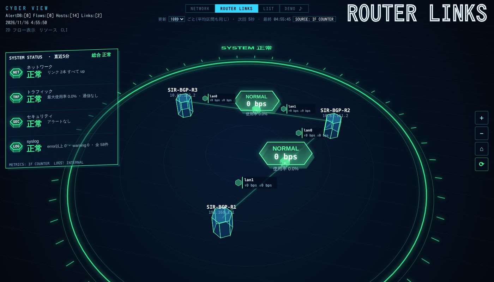
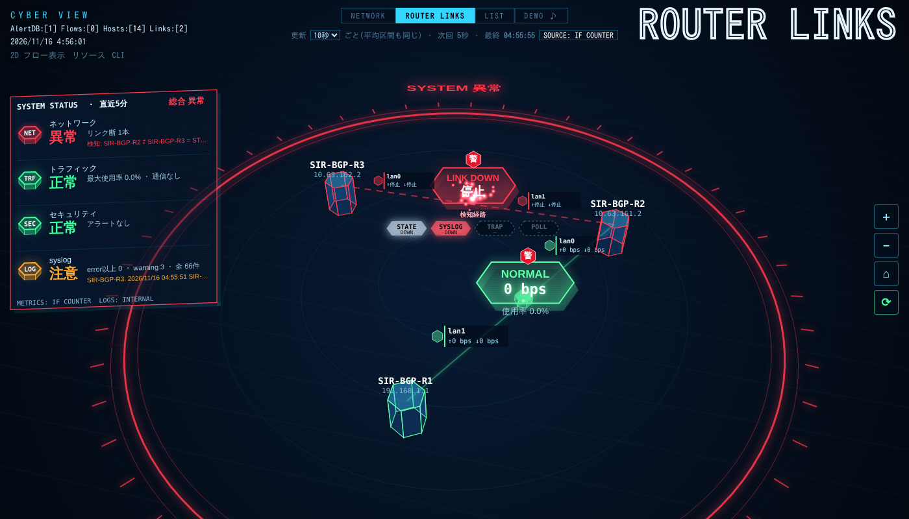

# Fujitsu Si-R × BGP — 3台構成の正常/障害試験

- 実行: 2026-11-16 04:55 / 所要 46 秒 / 専用環境(保存設定を消してエミュレータを新規起動、他シナリオの装置は無し)
- 結果: **14 / 14 項目 OK** ✅
- 再実行: `python3 tools/verification/scenario_report.py sir bgp --devices 3`

## 構成(台数から自動で割り当て)

```
LAN 10.63.190.0/24 ── SIR-BGP-R1 ══ SIR-BGP-R2 ══ SIR-BGP-R3 ── LAN 10.63.191.0/24
```

| 装置 | IF | アドレス |
|---|---|---|
| SIR-BGP-R1 | lan1 | 10.63.161.1/24 |
| SIR-BGP-R1 | lan2 | 10.63.190.1/24 |
| SIR-BGP-R2 | lan0 | 10.63.161.2/24 |
| SIR-BGP-R2 | lan1 | 10.63.162.1/24 |
| SIR-BGP-R3 | lan0 | 10.63.162.2/24 |
| SIR-BGP-R3 | lan2 | 10.63.191.1/24 |

| リンク | 装置A IF | 装置B IF | ネットワーク |
|---|---|---|---|
| SIR-BGP-R1 ⇔ SIR-BGP-R2 | lan1 | lan0 | 10.63.161.0/24 |
| SIR-BGP-R2 ⇔ SIR-BGP-R3 | lan1 | lan0 | 10.63.162.0/24 |

## 投入したコマンド

<details><summary>SIR-BGP-R1(20 行)</summary>

```
configure
ether 1 1 vlan untag 1
ether 1 2 vlan untag 2
ether 1 3 vlan untag 3
lan 0 vlan 1
lan 1 vlan 2
lan 2 vlan 3
exit
configure
lan 1 ip address 10.63.161.1/24 3
exit
configure
lan 2 ip address 10.63.190.1/24 3
exit
configure
bgp use on
bgp as 65001
bgp neighbor 0 address 10.63.161.2 remote-as 65002
bgp network 10.63.190.0/24
exit
```
</details>

<details><summary>SIR-BGP-R2(38 行)</summary>

```
configure
ether 1 1 vlan untag 1
ether 1 2 vlan untag 2
ether 1 3 vlan untag 3
lan 0 vlan 1
lan 1 vlan 2
lan 2 vlan 3
exit
configure
lan 0 ip address 10.63.161.2/24 3
exit
configure
lan 1 ip address 10.63.162.1/24 3
exit
configure
bgp use on
bgp as 65002
bgp neighbor 0 address 10.63.161.1 remote-as 65001
bgp neighbor 1 address 10.63.162.2 remote-as 65003
exit
configure
ether 1 2 use off
exit
configure
ether 1 2 use on
exit
configure
ether 1 2 use off
exit
configure
ether 1 2 use on
exit
configure
ether 1 2 use off
exit
configure
ether 1 2 use on
exit
```
</details>

<details><summary>SIR-BGP-R3(20 行)</summary>

```
configure
ether 1 1 vlan untag 1
ether 1 2 vlan untag 2
ether 1 3 vlan untag 3
lan 0 vlan 1
lan 1 vlan 2
lan 2 vlan 3
exit
configure
lan 0 ip address 10.63.162.2/24 3
exit
configure
lan 2 ip address 10.63.191.1/24 3
exit
configure
bgp use on
bgp as 65003
bgp neighbor 0 address 10.63.162.1 remote-as 65002
bgp network 10.63.191.0/24
exit
```
</details>

## 確認項目

| 段階 | 確認内容 | 結果 | 補足 |
|---|---|---|---|
| 正常 | SIR-BGP-R1 が SIR-BGP-R3 の LAN 10.63.191.0/24 を学習(B) | ✅ |  |
| 正常 | 全リンクが links API で state=ok(画面は緑の NORMAL) | ✅ |  |
| 正常 | 経路追加の INFO(情)が出る | ✅ |  |
| 正常 | 状態ボードのネットワーク観点が正常 | ✅ |  |
| 障害 | SIR-BGP-R2-SIR-BGP-R3 が LINK DOWN | ✅ |  |
| 障害 | 検知経路に STATE と SYSLOG | ✅ |  |
| 障害 | 状態ボードのネットワーク観点が異常 | ✅ |  |
| 障害 | link_down アラート | ✅ |  |
| 障害 | SIR-BGP-R1 から LAN 10.63.191.0/24 の経路が消える | ✅ |  |
| 障害 | 経路削除の INFO(情)が出る | ✅ |  |
| 復旧 | 経路が戻る | ✅ |  |
| 復旧 | LINK DOWN が解除される | ✅ |  |
| フラップ | if_flap(注 WARN IF FLAP)が出る | ✅ |  |
| フラップ | 状態ボードの syslog 観点にフラップ件数 | ✅ |  |

## 画面(ROUTER LINKS)

**正常時**



**障害時**



## 段階ごとの記録

### 正常(04:55:43)

SIR-BGP-R1 から SIR-BGP-R3 の LAN まで経路が通っている状態

**状態ボード**: network=ok「リンク 2本 すべて up」 / traffic=ok「最大使用率 0.0% ・ 通信なし」 / security=ok「アラートなし」 / syslog=ok「error以上 0 ・ warning 0 ・ 全 58件」

**リンク**

| A | B | 状態 | LINK DOWN | 検知経路 |
|---|---|---|---|---|
| SIR-BGP-R1 | SIR-BGP-R2 | ok | - | STATE:up, SYSLOG:up |
| SIR-BGP-R2 | SIR-BGP-R3 | ok | - | STATE:up, SYSLOG:up |

`SIR-BGP-R1# show ip route`

```
Codes: L - local, C - connected, S - static, R - RIP, B - BGP,
       D - EIGRP, EX - EIGRP external, O - OSPF, IA - OSPF inter area,
       N1 - OSPF NSSA external type 1, N2 - OSPF NSSA external type 2,
       E1 - OSPF external type 1, E2 - OSPF external type 2,
       i - IS-IS, * - candidate default, U - per-user static route

Gateway of last resort is not set

C        10.63.161.0/24 is directly connected, lan1
L        10.63.161.1/32 is directly connected, lan1
C        10.63.190.0/24 is directly connected, lan2
L        10.63.190.1/32 is directly connected, lan2
C        192.168.1.0/24 is directly connected, lan0
L        192.168.1.1/32 is directly connected, lan0
C        203.0.113.0/30 is directly connected, wan1
L        203.0.113.1/32 is directly connected, wan1
B        10.63.191.0/24 [20/0] via 10.63.161.2, lan1
```

`SIR-BGP-R2# show ip bgp summary`

```
BGP router identifier 10.63.161.2, local AS number 65002
BGP table version is 1, main routing table version 1

Neighbor        V    AS MsgRcvd MsgSent   TblVer  InQ OutQ Up/Down  State/PfxRcd
10.63.161.1     4 65001     144     167        1    0    0 00:00:04  1
10.63.162.2     4 65003      31     189        1    0    0 00:00:04  1
```

**ログ**(/cyber-view が見ているもの、43 件)

```
04:55:36 SIR-BGP-R1 sev6 2026/11/16 04:55:36 SIR-BGP-R1 Si-R G120 : [BGP] 2026/11/16 04:55:36 SIR-BGP-R1: [BGP] BGP started: AS=65001 router-id=203.0.113.
04:55:36 SIR-BGP-R1 sev6 2026/11/16 04:55:36 SIR-BGP-R1: [BGP] peer 10.63.161.2 AS65002 state: Idle
04:55:36 SIR-BGP-R1 sev6 2026/11/16 04:55:36 SIR-BGP-R1 Si-R G120 : [BGP] 2026/11/16 04:55:36 SIR-BGP-R1: [BGP] peer 10.63.161.2 AS65002 state: Idle
04:55:36 SIR-BGP-R1 sev6 2026/11/16 04:55:36 SIR-BGP-R1 Si-R G120 : [SYSTEM] configuration mode exited by admin
04:55:36 SIR-BGP-R2 sev6 2026/11/16 04:55:36 SIR-BGP-R2 Si-R G120 : [SYSTEM] configuration mode entered by admin (console)
04:55:36 SIR-BGP-R2 sev6 2026/11/16 04:55:36 SIR-BGP-R2 Si-R G120 : [BGP] BGP process started
04:55:36 SIR-BGP-R2 sev6 2026/11/16 04:55:36 SIR-BGP-R2: [BGP] BGP started: AS=65002 router-id=10.63.161.2
04:55:36 SIR-BGP-R2 sev6 2026/11/16 04:55:36 SIR-BGP-R2 Si-R G120 : [BGP] 2026/11/16 04:55:36 SIR-BGP-R2: [BGP] BGP started: AS=65002 router-id=10.63.161.
04:55:36 SIR-BGP-R2 sev6 2026/11/16 04:55:36 SIR-BGP-R2: [BGP] peer 10.63.161.1 AS65001 state: Idle
04:55:36 SIR-BGP-R2 sev6 2026/11/16 04:55:36 SIR-BGP-R2 Si-R G120 : [BGP] 2026/11/16 04:55:36 SIR-BGP-R2: [BGP] peer 10.63.161.1 AS65001 state: Idle
04:55:36 SIR-BGP-R2 sev6 2026/11/16 04:55:36 SIR-BGP-R2: [BGP] peer 10.63.162.2 AS65003 state: Idle
04:55:36 SIR-BGP-R2 sev6 2026/11/16 04:55:36 SIR-BGP-R2 Si-R G120 : [BGP] 2026/11/16 04:55:36 SIR-BGP-R2: [BGP] peer 10.63.162.2 AS65003 state: Idle
04:55:36 SIR-BGP-R2 sev6 2026/11/16 04:55:36 SIR-BGP-R2 Si-R G120 : [SYSTEM] configuration mode exited by admin
04:55:36 SIR-BGP-R3 sev6 2026/11/16 04:55:36 SIR-BGP-R3 Si-R G120 : [SYSTEM] configuration mode entered by admin (console)
04:55:36 SIR-BGP-R3 sev6 2026/11/16 04:55:36 SIR-BGP-R3 Si-R G120 : [BGP] BGP process started
04:55:36 SIR-BGP-R3 sev6 2026/11/16 04:55:36 SIR-BGP-R3: [BGP] BGP started: AS=65003 router-id=10.63.162.2
04:55:36 SIR-BGP-R3 sev6 2026/11/16 04:55:36 SIR-BGP-R3 Si-R G120 : [BGP] 2026/11/16 04:55:36 SIR-BGP-R3: [BGP] BGP started: AS=65003 router-id=10.63.162.
04:55:36 SIR-BGP-R3 sev6 2026/11/16 04:55:36 SIR-BGP-R3: [BGP] peer 10.63.162.1 AS65002 state: Idle
04:55:36 SIR-BGP-R3 sev6 2026/11/16 04:55:36 SIR-BGP-R3 Si-R G120 : [BGP] 2026/11/16 04:55:36 SIR-BGP-R3: [BGP] peer 10.63.162.1 AS65002 state: Idle
04:55:36 SIR-BGP-R3 sev6 2026/11/16 04:55:36 SIR-BGP-R3 Si-R G120 : [SYSTEM] configuration mode exited by admin
04:55:39 SIR-BGP-R1 sev6 2026/11/16 04:55:39 SIR-BGP-R1: [BGP] peer SIR-BGP-R2 AS65002 state: Established
04:55:39 SIR-BGP-R1 sev6 2026/11/16 04:55:39 SIR-BGP-R1 Si-R G120 : [BGP] peer unknown (AS65002) state: Established
04:55:39 SIR-BGP-R1 sev5 %BGP-5-ADJCHANGE: neighbor SIR-BGP-R2 Up
04:55:39 SIR-BGP-R2 sev5 %BGP-5-ADJCHANGE: neighbor SIR-BGP-R1 Up
04:55:39 SIR-BGP-R2 sev6 2026/11/16 04:55:39 SIR-BGP-R2: [BGP] peer SIR-BGP-R1 AS65001 state: Established
04:55:39 SIR-BGP-R2 sev6 2026/11/16 04:55:39 SIR-BGP-R2 Si-R G120 : [BGP] peer unknown (AS65001) state: Established
04:55:39 SIR-BGP-R2 sev6 2026/11/16 04:55:39 SIR-BGP-R2: [BGP] peer SIR-BGP-R3 AS65003 state: Established
04:55:39 SIR-BGP-R2 sev6 2026/11/16 04:55:39 SIR-BGP-R2 Si-R G120 : [BGP] peer unknown (AS65003) state: Established
04:55:39 SIR-BGP-R2 sev5 %BGP-5-ADJCHANGE: neighbor SIR-BGP-R3 Up
04:55:39 SIR-BGP-R3 sev5 %BGP-5-ADJCHANGE: neighbor SIR-BGP-R2 Up
04:55:39 SIR-BGP-R3 sev6 2026/11/16 04:55:39 SIR-BGP-R3: [BGP] peer SIR-BGP-R2 AS65002 state: Established
04:55:39 SIR-BGP-R3 sev6 2026/11/16 04:55:39 SIR-BGP-R3 Si-R G120 : [BGP] peer unknown (AS65002) state: Established
04:55:39 SIR-BGP-R1 sev6 %BGP-6-TABLECHG: Neighbor SIR-BGP-R2 UPDATE sent, 1 prefix(es)
04:55:39 SIR-BGP-R1 sev6 2026/11/16 04:55:39 SIR-BGP-R1 Si-R G120 : [BGP] peer SIR-BGP-R2 (ASunknown) state: Established
04:55:39 SIR-BGP-R2 sev6 %BGP-6-TABLECHG: Neighbor SIR-BGP-R1 UPDATE sent, 1 prefix(es)
04:55:39 SIR-BGP-R2 sev6 2026/11/16 04:55:39 SIR-BGP-R2 Si-R G120 : [BGP] peer SIR-BGP-R1 (ASunknown) state: Established
04:55:39 SIR-BGP-R2 sev6 %BGP-6-TABLECHG: Neighbor SIR-BGP-R3 UPDATE sent, 1 prefix(es)
04:55:39 SIR-BGP-R2 sev6 2026/11/16 04:55:39 SIR-BGP-R2 Si-R G120 : [BGP] peer SIR-BGP-R3 (ASunknown) state: Established
04:55:39 SIR-BGP-R3 sev6 %BGP-6-TABLECHG: Neighbor SIR-BGP-R2 UPDATE sent, 1 prefix(es)
04:55:39 SIR-BGP-R3 sev6 2026/11/16 04:55:39 SIR-BGP-R3 Si-R G120 : [BGP] peer SIR-BGP-R2 (ASunknown) state: Established
```

**アラート**(0 件)


**経路の変化(情 INFO)**(4 件)

- SIR-BGP-R1 add B 10.63.191.0/24 via 10.63.161.2
- SIR-BGP-R2 add B 10.63.190.0/24 via 10.63.161.1
- SIR-BGP-R2 add B 10.63.191.0/24 via 10.63.162.2
- SIR-BGP-R3 add B 10.63.190.0/24 via 10.63.162.1

### 障害(04:56:03)

SIR-BGP-R2 の lan1 を落とした状態

**状態ボード**: network=crit「リンク断 1本」 / traffic=ok「最大使用率 0.0% ・ 通信なし」 / security=ok「アラートなし」 / syslog=warn「error以上 0 ・ warning 3 ・ 全 66件」

**リンク**

| A | B | 状態 | LINK DOWN | 検知経路 |
|---|---|---|---|---|
| SIR-BGP-R1 | SIR-BGP-R2 | ok | - | STATE:up, SYSLOG:up |
| SIR-BGP-R2 | SIR-BGP-R3 | down | はい | STATE:down, SYSLOG:down |

`SIR-BGP-R1# show ip route`

```
Codes: L - local, C - connected, S - static, R - RIP, B - BGP,
       D - EIGRP, EX - EIGRP external, O - OSPF, IA - OSPF inter area,
       N1 - OSPF NSSA external type 1, N2 - OSPF NSSA external type 2,
       E1 - OSPF external type 1, E2 - OSPF external type 2,
       i - IS-IS, * - candidate default, U - per-user static route

Gateway of last resort is not set

C        10.63.161.0/24 is directly connected, lan1
L        10.63.161.1/32 is directly connected, lan1
C        10.63.190.0/24 is directly connected, lan2
L        10.63.190.1/32 is directly connected, lan2
C        192.168.1.0/24 is directly connected, lan0
L        192.168.1.1/32 is directly connected, lan0
C        203.0.113.0/30 is directly connected, wan1
L        203.0.113.1/32 is directly connected, wan1
```

`SIR-BGP-R2# show ip bgp summary`

```
BGP router identifier 10.63.161.2, local AS number 65002
BGP table version is 1, main routing table version 1

Neighbor        V    AS MsgRcvd MsgSent   TblVer  InQ OutQ Up/Down  State/PfxRcd
10.63.161.1     4 65001      38      19        1    0    0 00:00:24  1
10.63.162.2     4 65003      44      34        1    0    0 00:00:00  Idle
```

**ログ**(/cyber-view が見ているもの、8 件)

```
04:55:51 SIR-BGP-R2 sev6 2026/11/16 04:55:51 SIR-BGP-R2 Si-R G120 : [SYSTEM] configuration mode entered by admin (console)
04:55:51 SIR-BGP-R2 sev6 2026/11/16 04:55:51 SIR-BGP-R2 Si-R G120 : [LINK] ether1 Link Up (1Gbps full-duplex)
04:55:51 SIR-BGP-R2 sev4 2026/11/16 04:55:51 SIR-BGP-R2 Si-R G120 : [LINK] lan1 Link Down
04:55:51 SIR-BGP-R2 sev5 %BGP-5-ADJCHANGE: neighbor 10.63.162.2 Down — interface shutdown (撤去prefix 1)
04:55:51 SIR-BGP-R2 sev4 2026/11/16 04:55:51 SIR-BGP-R2 Si-R G120 : [BGP] peer down
04:55:51 SIR-BGP-R3 sev5 %BGP-5-ADJCHANGE: neighbor 10.63.162.1 Down — interface shutdown (撤去prefix 1)
04:55:51 SIR-BGP-R3 sev4 2026/11/16 04:55:51 SIR-BGP-R3 Si-R G120 : [BGP] peer down
04:55:51 SIR-BGP-R2 sev6 2026/11/16 04:55:51 SIR-BGP-R2 Si-R G120 : [SYSTEM] configuration mode exited by admin
```

**アラート**(1 件)

- [medium/NET] リンク断 — SIR-BGP-R2: lan1 が down (sir-bgp-r2 - sir-bgp-r3)

**経路の変化(情 INFO)**(4 件)

- SIR-BGP-R1 del B 10.63.191.0/24 via 10.63.161.2
- SIR-BGP-R2 del C 10.63.162.0/24 [lan1]
- SIR-BGP-R2 del B 10.63.191.0/24 via 10.63.162.2
- SIR-BGP-R3 del B 10.63.190.0/24 via 10.63.162.1

### 復旧(04:56:07)

戻した状態

**状態ボード**: network=ok「リンク 2本 すべて up」 / traffic=ok「最大使用率 0.0% ・ 通信なし」 / security=ok「アラートなし」 / syslog=warn「error以上 0 ・ warning 3 ・ 全 78件」

**リンク**

| A | B | 状態 | LINK DOWN | 検知経路 |
|---|---|---|---|---|
| SIR-BGP-R1 | SIR-BGP-R2 | ok | - | STATE:up, SYSLOG:up |
| SIR-BGP-R2 | SIR-BGP-R3 | ok | - | STATE:up, SYSLOG:up |

`SIR-BGP-R1# show ip route`

```
Codes: L - local, C - connected, S - static, R - RIP, B - BGP,
       D - EIGRP, EX - EIGRP external, O - OSPF, IA - OSPF inter area,
       N1 - OSPF NSSA external type 1, N2 - OSPF NSSA external type 2,
       E1 - OSPF external type 1, E2 - OSPF external type 2,
       i - IS-IS, * - candidate default, U - per-user static route

Gateway of last resort is not set

C        10.63.161.0/24 is directly connected, lan1
L        10.63.161.1/32 is directly connected, lan1
C        10.63.190.0/24 is directly connected, lan2
L        10.63.190.1/32 is directly connected, lan2
C        192.168.1.0/24 is directly connected, lan0
L        192.168.1.1/32 is directly connected, lan0
C        203.0.113.0/30 is directly connected, wan1
L        203.0.113.1/32 is directly connected, wan1
B        10.63.191.0/24 [20/0] via 10.63.161.2, lan1
```

`SIR-BGP-R2# show ip bgp summary`

```
BGP router identifier 10.63.161.2, local AS number 65002
BGP table version is 1, main routing table version 1

Neighbor        V    AS MsgRcvd MsgSent   TblVer  InQ OutQ Up/Down  State/PfxRcd
10.63.161.1     4 65001     146     119        1    0    0 00:00:28  1
10.63.162.2     4 65003      19     137        1    0    0 00:00:02  1
```

**ログ**(/cyber-view が見ているもの、12 件)

```
04:56:03 SIR-BGP-R2 sev6 2026/11/16 04:56:03 SIR-BGP-R2 Si-R G120 : [SYSTEM] configuration mode entered by admin (console)
04:56:03 SIR-BGP-R2 sev6 2026/11/16 04:56:03 SIR-BGP-R2 Si-R G120 : [LINK] ether1 Link Up (1Gbps full-duplex)
04:56:03 SIR-BGP-R2 sev5 2026/11/16 04:56:03 SIR-BGP-R2 Si-R G120 : [LINK] lan1 Link Up (1Gbps full-duplex)
04:56:05 SIR-BGP-R2 sev6 2026/11/16 04:56:05 SIR-BGP-R2: [BGP] peer SIR-BGP-R3 AS65003 state: Established
04:56:05 SIR-BGP-R2 sev6 2026/11/16 04:56:05 SIR-BGP-R2 Si-R G120 : [BGP] peer unknown (AS65003) state: Established
04:56:05 SIR-BGP-R2 sev5 %BGP-5-ADJCHANGE: neighbor SIR-BGP-R3 Up
04:56:05 SIR-BGP-R3 sev5 %BGP-5-ADJCHANGE: neighbor SIR-BGP-R2 Up
04:56:05 SIR-BGP-R2 sev6 %BGP-6-TABLECHG: Neighbor SIR-BGP-R3 UPDATE sent, 1 prefix(es)
04:56:05 SIR-BGP-R2 sev6 2026/11/16 04:56:05 SIR-BGP-R2 Si-R G120 : [BGP] peer SIR-BGP-R3 (ASunknown) state: Established
04:56:05 SIR-BGP-R3 sev6 %BGP-6-TABLECHG: Neighbor SIR-BGP-R2 UPDATE sent, 1 prefix(es)
04:56:05 SIR-BGP-R3 sev6 2026/11/16 04:56:05 SIR-BGP-R3 Si-R G120 : [BGP] peer SIR-BGP-R2 (ASunknown) state: Established
04:56:05 SIR-BGP-R2 sev6 2026/11/16 04:56:05 SIR-BGP-R2 Si-R G120 : [SYSTEM] configuration mode exited by admin
```

**アラート**(0 件)


**経路の変化(情 INFO)**(1 件)

- SIR-BGP-R2 add C 10.63.162.0/24 [lan1]

### フラップ(04:56:18)

落とす/戻すを2回繰り返した直後

**状態ボード**: network=ok「リンク 2本 すべて up」 / traffic=ok「最大使用率 0.0% ・ 通信なし」 / security=ok「アラートなし」 / syslog=warn「error以上 0 ・ warning 9 ・ 全 113件 ・ フラップ 1件」

**リンク**

| A | B | 状態 | LINK DOWN | 検知経路 |
|---|---|---|---|---|
| SIR-BGP-R1 | SIR-BGP-R2 | ok | - | STATE:up, SYSLOG:up |
| SIR-BGP-R2 | SIR-BGP-R3 | ok | - | STATE:up, SYSLOG:up |

`SIR-BGP-R2# show ip bgp summary`

```
BGP router identifier 10.63.161.2, local AS number 65002
BGP table version is 1, main routing table version 1

Neighbor        V    AS MsgRcvd MsgSent   TblVer  InQ OutQ Up/Down  State/PfxRcd
10.63.161.1     4 65001      98      40        1    0    0 00:00:38  1
10.63.162.2     4 65003      77     160        1    0    0 00:00:07  1
```

**ログ**(/cyber-view が見ているもの、35 件)

```
04:56:07 SIR-BGP-R2 sev6 2026/11/16 04:56:07 SIR-BGP-R2 Si-R G120 : [SYSTEM] configuration mode entered by admin (console)
04:56:07 SIR-BGP-R2 sev6 2026/11/16 04:56:07 SIR-BGP-R2 Si-R G120 : [LINK] ether1 Link Up (1Gbps full-duplex)
04:56:07 SIR-BGP-R2 sev4 2026/11/16 04:56:07 SIR-BGP-R2 Si-R G120 : [LINK] lan1 Link Down
04:56:07 SIR-BGP-R2 sev5 %BGP-5-ADJCHANGE: neighbor 10.63.162.2 Down — interface shutdown (撤去prefix 1)
04:56:07 SIR-BGP-R2 sev4 2026/11/16 04:56:07 SIR-BGP-R2 Si-R G120 : [BGP] peer down
04:56:07 SIR-BGP-R3 sev5 %BGP-5-ADJCHANGE: neighbor 10.63.162.1 Down — interface shutdown (撤去prefix 1)
04:56:07 SIR-BGP-R3 sev4 2026/11/16 04:56:07 SIR-BGP-R3 Si-R G120 : [BGP] peer down
04:56:07 SIR-BGP-R2 sev6 2026/11/16 04:56:07 SIR-BGP-R2 Si-R G120 : [SYSTEM] configuration mode exited by admin
04:56:07 SIR-BGP-R2 sev5 2026/11/16 04:56:07 SIR-BGP-R2 Si-R G120 : [LINK] lan1 Link Up (1Gbps full-duplex)
04:56:08 SIR-BGP-R2 sev6 2026/11/16 04:56:08 SIR-BGP-R2: [BGP] peer SIR-BGP-R3 AS65003 state: Established
04:56:08 SIR-BGP-R2 sev6 2026/11/16 04:56:08 SIR-BGP-R2 Si-R G120 : [BGP] peer unknown (AS65003) state: Established
04:56:08 SIR-BGP-R2 sev5 %BGP-5-ADJCHANGE: neighbor SIR-BGP-R3 Up
04:56:08 SIR-BGP-R3 sev5 %BGP-5-ADJCHANGE: neighbor SIR-BGP-R2 Up
04:56:09 SIR-BGP-R2 sev6 %BGP-6-TABLECHG: Neighbor SIR-BGP-R3 UPDATE sent, 1 prefix(es)
04:56:09 SIR-BGP-R2 sev6 2026/11/16 04:56:09 SIR-BGP-R2 Si-R G120 : [BGP] peer SIR-BGP-R3 (ASunknown) state: Established
04:56:09 SIR-BGP-R3 sev6 %BGP-6-TABLECHG: Neighbor SIR-BGP-R2 UPDATE sent, 1 prefix(es)
04:56:09 SIR-BGP-R3 sev6 2026/11/16 04:56:09 SIR-BGP-R3 Si-R G120 : [BGP] peer SIR-BGP-R2 (ASunknown) state: Established
04:56:09 SIR-BGP-R2 sev6 2026/11/16 04:56:09 SIR-BGP-R2 Si-R G120 : [SYSTEM] configuration mode exited by admin
04:56:09 SIR-BGP-R2 sev6 2026/11/16 04:56:09 SIR-BGP-R2 Si-R G120 : [SYSTEM] configuration mode entered by admin (console)
04:56:09 SIR-BGP-R2 sev6 2026/11/16 04:56:09 SIR-BGP-R2 Si-R G120 : [LINK] ether1 Link Up (1Gbps full-duplex)
04:56:09 SIR-BGP-R2 sev4 2026/11/16 04:56:09 SIR-BGP-R2 Si-R G120 : [LINK] lan1 Link Down
04:56:09 SIR-BGP-R2 sev5 %BGP-5-ADJCHANGE: neighbor 10.63.162.2 Down — interface shutdown (撤去prefix 1)
04:56:09 SIR-BGP-R2 sev4 2026/11/16 04:56:09 SIR-BGP-R2 Si-R G120 : [BGP] peer down
04:56:09 SIR-BGP-R3 sev5 %BGP-5-ADJCHANGE: neighbor 10.63.162.1 Down — interface shutdown (撤去prefix 1)
04:56:09 SIR-BGP-R3 sev4 2026/11/16 04:56:09 SIR-BGP-R3 Si-R G120 : [BGP] peer down
04:56:09 SIR-BGP-R2 sev5 2026/11/16 04:56:09 SIR-BGP-R2 Si-R G120 : [LINK] lan1 Link Up (1Gbps full-duplex)
04:56:10 SIR-BGP-R2 sev6 2026/11/16 04:56:10 SIR-BGP-R2: [BGP] peer SIR-BGP-R3 AS65003 state: Established
04:56:10 SIR-BGP-R2 sev6 2026/11/16 04:56:10 SIR-BGP-R2 Si-R G120 : [BGP] peer unknown (AS65003) state: Established
04:56:10 SIR-BGP-R2 sev5 %BGP-5-ADJCHANGE: neighbor SIR-BGP-R3 Up
04:56:10 SIR-BGP-R3 sev5 %BGP-5-ADJCHANGE: neighbor SIR-BGP-R2 Up
04:56:11 SIR-BGP-R2 sev6 %BGP-6-TABLECHG: Neighbor SIR-BGP-R3 UPDATE sent, 1 prefix(es)
04:56:11 SIR-BGP-R2 sev6 2026/11/16 04:56:11 SIR-BGP-R2 Si-R G120 : [BGP] peer SIR-BGP-R3 (ASunknown) state: Established
04:56:11 SIR-BGP-R3 sev6 %BGP-6-TABLECHG: Neighbor SIR-BGP-R2 UPDATE sent, 1 prefix(es)
04:56:11 SIR-BGP-R3 sev6 2026/11/16 04:56:11 SIR-BGP-R3 Si-R G120 : [BGP] peer SIR-BGP-R2 (ASunknown) state: Established
04:56:11 SIR-BGP-R2 sev6 2026/11/16 04:56:11 SIR-BGP-R2 Si-R G120 : [SYSTEM] configuration mode exited by admin
```

**アラート**(3 件)

- [warning/SYSLOG] インタフェースのフラップ — SIR-BGP-R2: lan1: 60秒に 3 回 状態変化
- [medium/NET] リンク断 — SIR-BGP-R2: lan1 が down (sir-bgp-r2 - sir-bgp-r3)
- [medium/NET] リンク断 — SIR-BGP-R2: lan1 が down (sir-bgp-r2 - sir-bgp-r3)

**経路の変化(情 INFO)**(3 件)

- SIR-BGP-R1 add B 10.63.191.0/24 via 10.63.161.2
- SIR-BGP-R2 add B 10.63.191.0/24 via 10.63.162.2
- SIR-BGP-R3 add B 10.63.190.0/24 via 10.63.162.1

