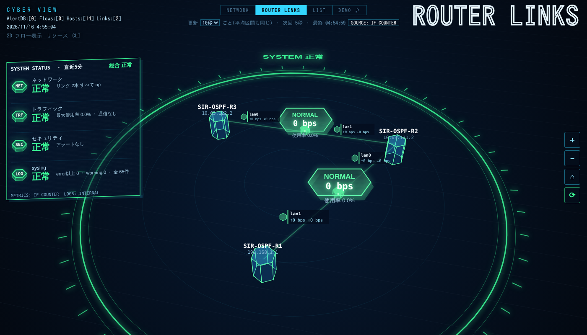
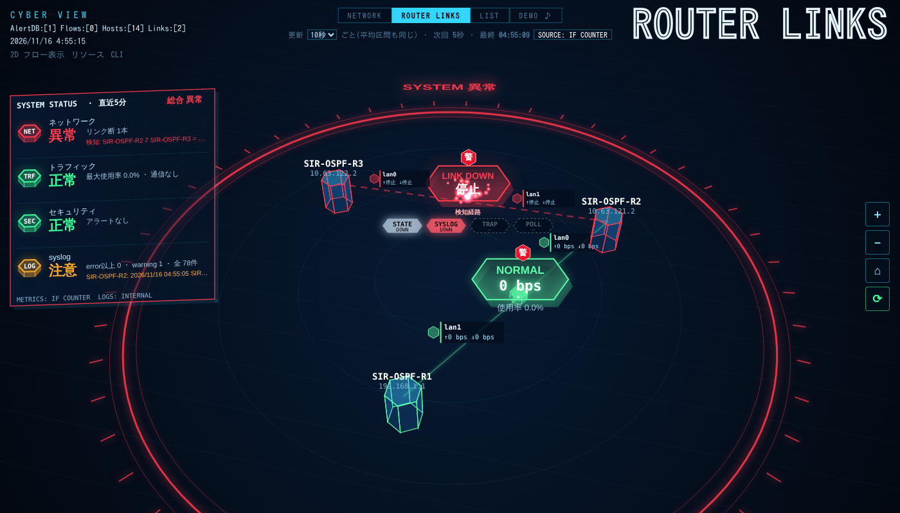

# Fujitsu Si-R × OSPF — 3台構成の正常/障害試験

- 実行: 2026-11-16 04:54 / 所要 47 秒 / 専用環境(保存設定を消してエミュレータを新規起動、他シナリオの装置は無し)
- 結果: **14 / 14 項目 OK** ✅
- 再実行: `python3 tools/verification/scenario_report.py sir ospf --devices 3`

## 構成(台数から自動で割り当て)

```
LAN 10.63.150.0/24 ── SIR-OSPF-R1 ══ SIR-OSPF-R2 ══ SIR-OSPF-R3 ── LAN 10.63.151.0/24
```

| 装置 | IF | アドレス |
|---|---|---|
| SIR-OSPF-R1 | lan1 | 10.63.121.1/24 |
| SIR-OSPF-R1 | lan2 | 10.63.150.1/24 |
| SIR-OSPF-R2 | lan0 | 10.63.121.2/24 |
| SIR-OSPF-R2 | lan1 | 10.63.122.1/24 |
| SIR-OSPF-R3 | lan0 | 10.63.122.2/24 |
| SIR-OSPF-R3 | lan2 | 10.63.151.1/24 |

| リンク | 装置A IF | 装置B IF | ネットワーク |
|---|---|---|---|
| SIR-OSPF-R1 ⇔ SIR-OSPF-R2 | lan1 | lan0 | 10.63.121.0/24 |
| SIR-OSPF-R2 ⇔ SIR-OSPF-R3 | lan1 | lan0 | 10.63.122.0/24 |

## 投入したコマンド

<details><summary>SIR-OSPF-R1(20 行)</summary>

```
configure
ether 1 1 vlan untag 1
ether 1 2 vlan untag 2
ether 1 3 vlan untag 3
lan 0 vlan 1
lan 1 vlan 2
lan 2 vlan 3
exit
configure
lan 1 ip address 10.63.121.1/24 3
exit
configure
lan 2 ip address 10.63.150.1/24 3
exit
configure
ospf use on
ospf area 0.0.0.0
lan 1 ip ospf use on
lan 2 ip ospf use on
exit
```
</details>

<details><summary>SIR-OSPF-R2(38 行)</summary>

```
configure
ether 1 1 vlan untag 1
ether 1 2 vlan untag 2
ether 1 3 vlan untag 3
lan 0 vlan 1
lan 1 vlan 2
lan 2 vlan 3
exit
configure
lan 0 ip address 10.63.121.2/24 3
exit
configure
lan 1 ip address 10.63.122.1/24 3
exit
configure
ospf use on
ospf area 0.0.0.0
lan 0 ip ospf use on
lan 1 ip ospf use on
exit
configure
ether 1 2 use off
exit
configure
ether 1 2 use on
exit
configure
ether 1 2 use off
exit
configure
ether 1 2 use on
exit
configure
ether 1 2 use off
exit
configure
ether 1 2 use on
exit
```
</details>

<details><summary>SIR-OSPF-R3(20 行)</summary>

```
configure
ether 1 1 vlan untag 1
ether 1 2 vlan untag 2
ether 1 3 vlan untag 3
lan 0 vlan 1
lan 1 vlan 2
lan 2 vlan 3
exit
configure
lan 0 ip address 10.63.122.2/24 3
exit
configure
lan 2 ip address 10.63.151.1/24 3
exit
configure
ospf use on
ospf area 0.0.0.0
lan 0 ip ospf use on
lan 2 ip ospf use on
exit
```
</details>

## 確認項目

| 段階 | 確認内容 | 結果 | 補足 |
|---|---|---|---|
| 正常 | SIR-OSPF-R1 が SIR-OSPF-R3 の LAN 10.63.151.0/24 を学習(O) | ✅ |  |
| 正常 | 全リンクが links API で state=ok(画面は緑の NORMAL) | ✅ |  |
| 正常 | 経路追加の INFO(情)が出る | ✅ |  |
| 正常 | 状態ボードのネットワーク観点が正常 | ✅ |  |
| 障害 | SIR-OSPF-R2-SIR-OSPF-R3 が LINK DOWN | ✅ |  |
| 障害 | 検知経路に STATE と SYSLOG | ✅ |  |
| 障害 | 状態ボードのネットワーク観点が異常 | ✅ |  |
| 障害 | link_down アラート | ✅ |  |
| 障害 | SIR-OSPF-R1 から LAN 10.63.151.0/24 の経路が消える | ✅ |  |
| 障害 | 経路削除の INFO(情)が出る | ✅ |  |
| 復旧 | 経路が戻る | ✅ |  |
| 復旧 | LINK DOWN が解除される | ✅ |  |
| フラップ | if_flap(注 WARN IF FLAP)が出る | ✅ |  |
| フラップ | 状態ボードの syslog 観点にフラップ件数 | ✅ |  |

## 画面(ROUTER LINKS)

**正常時**



**障害時**



## 段階ごとの記録

### 正常(04:54:57)

SIR-OSPF-R1 から SIR-OSPF-R3 の LAN まで経路が通っている状態

**状態ボード**: network=ok「リンク 2本 すべて up」 / traffic=ok「最大使用率 0.0% ・ 通信なし」 / security=ok「アラートなし」 / syslog=ok「error以上 0 ・ warning 0 ・ 全 65件」

**リンク**

| A | B | 状態 | LINK DOWN | 検知経路 |
|---|---|---|---|---|
| SIR-OSPF-R1 | SIR-OSPF-R2 | ok | - | STATE:up, SYSLOG:up |
| SIR-OSPF-R2 | SIR-OSPF-R3 | ok | - | STATE:up, SYSLOG:up |

`SIR-OSPF-R1# show ip route`

```
Codes: L - local, C - connected, S - static, R - RIP, B - BGP,
       D - EIGRP, EX - EIGRP external, O - OSPF, IA - OSPF inter area,
       N1 - OSPF NSSA external type 1, N2 - OSPF NSSA external type 2,
       E1 - OSPF external type 1, E2 - OSPF external type 2,
       i - IS-IS, * - candidate default, U - per-user static route

Gateway of last resort is not set

C        10.63.121.0/24 is directly connected, lan1
L        10.63.121.1/32 is directly connected, lan1
C        10.63.150.0/24 is directly connected, lan2
L        10.63.150.1/32 is directly connected, lan2
C        192.168.1.0/24 is directly connected, lan0
L        192.168.1.1/32 is directly connected, lan0
C        203.0.113.0/30 is directly connected, wan1
L        203.0.113.1/32 is directly connected, wan1
O        10.63.122.0/24 [110/20] via 10.63.121.2, lan1
O        10.63.151.0/24 [110/30] via 10.63.121.2, lan1
```

`SIR-OSPF-R2# show ip ospf neighbor`

```
Neighbor information with all interfaces, result:
Neighbor with lan0 result:
Neighbor ID     Pri  State        Deadtime  Address          DDL  ReqL  RtrL
203.0.113.1     1    Full/DR      00:00:33  203.0.113.1      0    0     0
10.63.122.2     1    Full/BDR     00:00:33  10.63.122.2      0    0     0
```

**ログ**(/cyber-view が見ているもの、50 件)

```
04:54:49 SIR-OSPF-R2 sev6 2026/11/16 04:54:49 SIR-OSPF-R2 Si-R G120 : [OSPF] 2026/11/16 04:54:49 SIR-OSPF-R2: [OSPF] ospf use on: router-id=10.0.99.1 area=0.
04:54:49 SIR-OSPF-R2 sev6 2026/11/16 04:54:49 SIR-OSPF-R2: [OSPF] ospf use on: router-id=10.63.121.2 area=0.0.0.0
04:54:49 SIR-OSPF-R2 sev6 2026/11/16 04:54:49 SIR-OSPF-R2 Si-R G120 : [OSPF] 2026/11/16 04:54:49 SIR-OSPF-R2: [OSPF] ospf use on: router-id=10.63.121.2 area=
04:54:49 SIR-OSPF-R2 sev6 2026/11/16 04:54:49 SIR-OSPF-R2 Si-R G120 : [SYSTEM] configuration mode exited by admin
04:54:49 SIR-OSPF-R3 sev6 2026/11/16 04:54:49 SIR-OSPF-R3 Si-R G120 : [SYSTEM] configuration mode entered by admin (console)
04:54:49 SIR-OSPF-R3 sev6 2026/11/16 04:54:49 SIR-OSPF-R3 Si-R G120 : [OSPF] OSPF process started
04:54:49 SIR-OSPF-R3 sev6 2026/11/16 04:54:49 SIR-OSPF-R3: [OSPF] ospf use on: router-id=10.0.197.1 area=0.0.0.0
04:54:49 SIR-OSPF-R3 sev6 2026/11/16 04:54:49 SIR-OSPF-R3 Si-R G120 : [OSPF] 2026/11/16 04:54:49 SIR-OSPF-R3: [OSPF] ospf use on: router-id=10.0.197.1 area=0
04:54:49 SIR-OSPF-R3 sev6 2026/11/16 04:54:49 SIR-OSPF-R3: [OSPF] ospf use on: router-id=10.63.122.2 area=0.0.0.0
04:54:49 SIR-OSPF-R3 sev6 2026/11/16 04:54:49 SIR-OSPF-R3 Si-R G120 : [OSPF] 2026/11/16 04:54:49 SIR-OSPF-R3: [OSPF] ospf use on: router-id=10.63.122.2 area=
04:54:49 SIR-OSPF-R3 sev6 2026/11/16 04:54:49 SIR-OSPF-R3 Si-R G120 : [SYSTEM] configuration mode exited by admin
04:54:51 SIR-OSPF-R3 sev6 2026/11/16 04:54:51 SIR-OSPF-R3: [OSPF] DR elected: 10.63.122.2 (priority=1) on GigabitEthernet0/0
04:54:51 SIR-OSPF-R3 sev6 2026/11/16 04:54:51 SIR-OSPF-R3 Si-R G120 : [OSPF] DR elected
04:54:51 SIR-OSPF-R3 sev5 %OSPF-5-ADJCHG: Process 1, Nbr 10.63.121.2 on GigabitEthernet from LOADING to FULL, Loading Done
04:54:51 SIR-OSPF-R3 sev6 2026/11/16 04:54:51 SIR-OSPF-R3 Si-R G120 : [OSPF] neighbor 10.63.121.2 on GigabitEthernet state: Full
04:54:51 SIR-OSPF-R1 sev6 2026/11/16 04:54:51 SIR-OSPF-R1: [OSPF] SPF: 2 routes calculated
04:54:51 SIR-OSPF-R1 sev6 2026/11/16 04:54:51 SIR-OSPF-R1 Si-R G120 : [OSPF] SPF calculation done
04:54:51 SIR-OSPF-R2 sev6 2026/11/16 04:54:51 SIR-OSPF-R2: [OSPF] SPF: 2 routes calculated
04:54:51 SIR-OSPF-R2 sev6 2026/11/16 04:54:51 SIR-OSPF-R2 Si-R G120 : [OSPF] SPF calculation done
04:54:51 SIR-OSPF-R3 sev6 2026/11/16 04:54:51 SIR-OSPF-R3: [OSPF] SPF: 3 routes calculated
04:54:51 SIR-OSPF-R3 sev6 2026/11/16 04:54:51 SIR-OSPF-R3 Si-R G120 : [OSPF] SPF calculation done
04:54:51 SIR-OSPF-R2 sev6 2026/11/16 04:54:51 SIR-OSPF-R2: [OSPF] DR elected: 203.0.113.1 (priority=1) on GigabitEthernet0/0
04:54:51 SIR-OSPF-R2 sev6 2026/11/16 04:54:51 SIR-OSPF-R2 Si-R G120 : [OSPF] DR elected
04:54:51 SIR-OSPF-R2 sev5 %OSPF-5-ADJCHG: Process 1, Nbr 203.0.113.1 on GigabitEthernet from LOADING to FULL, Loading Done
04:54:51 SIR-OSPF-R2 sev6 2026/11/16 04:54:51 SIR-OSPF-R2 Si-R G120 : [OSPF] neighbor 203.0.113.1 on GigabitEthernet state: Full
04:54:51 SIR-OSPF-R2 sev6 2026/11/16 04:54:51 SIR-OSPF-R2: [OSPF] SPF: 3 routes calculated
04:54:51 SIR-OSPF-R3 sev6 2026/11/16 04:54:51 SIR-OSPF-R3: [OSPF] SPF: 4 routes calculated
04:54:52 SIR-OSPF-R2 sev5 %OSPF-5-ADJCHG: Process 1, Nbr 10.63.122.2 on GigabitEthernet from LOADING to FULL, Loading Done
04:54:52 SIR-OSPF-R2 sev6 2026/11/16 04:54:52 SIR-OSPF-R2 Si-R G120 : [OSPF] neighbor 10.63.122.2 on GigabitEthernet state: Full
04:54:52 SIR-OSPF-R1 sev6 2026/11/16 04:54:52 SIR-OSPF-R1: [OSPF] SPF: 2 routes calculated
04:54:52 SIR-OSPF-R1 sev6 2026/11/16 04:54:52 SIR-OSPF-R1 Si-R G120 : [OSPF] SPF calculation done
04:54:52 SIR-OSPF-R2 sev6 2026/11/16 04:54:52 SIR-OSPF-R2: [OSPF] SPF: 4 routes calculated
04:54:52 SIR-OSPF-R2 sev6 2026/11/16 04:54:52 SIR-OSPF-R2 Si-R G120 : [OSPF] SPF calculation done
04:54:52 SIR-OSPF-R3 sev6 2026/11/16 04:54:52 SIR-OSPF-R3: [OSPF] SPF: 4 routes calculated
04:54:52 SIR-OSPF-R3 sev6 2026/11/16 04:54:52 SIR-OSPF-R3 Si-R G120 : [OSPF] SPF calculation done
04:54:52 SIR-OSPF-R1 sev6 2026/11/16 04:54:52 SIR-OSPF-R1: [OSPF] DR elected: 203.0.113.1 (priority=1) on GigabitEthernet0/0
04:54:52 SIR-OSPF-R1 sev6 2026/11/16 04:54:52 SIR-OSPF-R1 Si-R G120 : [OSPF] DR elected
04:54:52 SIR-OSPF-R1 sev5 %OSPF-5-ADJCHG: Process 1, Nbr 10.63.121.2 on GigabitEthernet from LOADING to FULL, Loading Done
04:54:52 SIR-OSPF-R1 sev6 2026/11/16 04:54:52 SIR-OSPF-R1 Si-R G120 : [OSPF] neighbor 10.63.121.2 on GigabitEthernet state: Full
04:54:52 SIR-OSPF-R1 sev6 2026/11/16 04:54:52 SIR-OSPF-R1: [OSPF] SPF: 4 routes calculated
```

**アラート**(0 件)


**経路の変化(情 INFO)**(6 件)

- SIR-OSPF-R1 add O 10.63.122.0/24 via 10.63.121.2 [lan1]
- SIR-OSPF-R1 add O 10.63.151.0/24 via 10.63.121.2 [lan1]
- SIR-OSPF-R2 add O 10.63.150.0/24 via 10.63.121.1 [wan1]
- SIR-OSPF-R2 add O 10.63.151.0/24 via 10.63.122.2 [lan1]
- SIR-OSPF-R3 add O 10.63.121.0/24 via 10.63.122.1
- SIR-OSPF-R3 add O 10.63.150.0/24 via 10.63.122.1

### 障害(04:55:17)

SIR-OSPF-R2 の lan1 を落とした状態

**状態ボード**: network=crit「リンク断 1本」 / traffic=ok「最大使用率 0.0% ・ 通信なし」 / security=ok「アラートなし」 / syslog=warn「error以上 0 ・ warning 1 ・ 全 78件」

**リンク**

| A | B | 状態 | LINK DOWN | 検知経路 |
|---|---|---|---|---|
| SIR-OSPF-R1 | SIR-OSPF-R2 | ok | - | STATE:up, SYSLOG:up |
| SIR-OSPF-R2 | SIR-OSPF-R3 | down | はい | STATE:down, SYSLOG:down |

`SIR-OSPF-R1# show ip route`

```
Codes: L - local, C - connected, S - static, R - RIP, B - BGP,
       D - EIGRP, EX - EIGRP external, O - OSPF, IA - OSPF inter area,
       N1 - OSPF NSSA external type 1, N2 - OSPF NSSA external type 2,
       E1 - OSPF external type 1, E2 - OSPF external type 2,
       i - IS-IS, * - candidate default, U - per-user static route

Gateway of last resort is not set

C        10.63.121.0/24 is directly connected, lan1
L        10.63.121.1/32 is directly connected, lan1
C        10.63.150.0/24 is directly connected, lan2
L        10.63.150.1/32 is directly connected, lan2
C        192.168.1.0/24 is directly connected, lan0
L        192.168.1.1/32 is directly connected, lan0
C        203.0.113.0/30 is directly connected, wan1
L        203.0.113.1/32 is directly connected, wan1
```

`SIR-OSPF-R2# show ip ospf neighbor`

```
Neighbor information with all interfaces, result:
Neighbor with lan0 result:
Neighbor ID     Pri  State        Deadtime  Address          DDL  ReqL  RtrL
203.0.113.1     1    Full/DR      00:00:12  203.0.113.1      0    0     0
```

**ログ**(/cyber-view が見ているもの、13 件)

```
04:55:05 SIR-OSPF-R2 sev6 2026/11/16 04:55:05 SIR-OSPF-R2 Si-R G120 : [SYSTEM] configuration mode entered by admin (console)
04:55:05 SIR-OSPF-R2 sev6 2026/11/16 04:55:05 SIR-OSPF-R2 Si-R G120 : [LINK] ether1 Link Up (1Gbps full-duplex)
04:55:05 SIR-OSPF-R2 sev4 2026/11/16 04:55:05 SIR-OSPF-R2 Si-R G120 : [LINK] lan1 Link Down
04:55:05 SIR-OSPF-R2 sev5 %OSPF-5-ADJCHG: Process 1, Nbr 10.63.122.2 interface down, changing state from FULL to DOWN
04:55:05 SIR-OSPF-R2 sev6 2026/11/16 04:55:05 SIR-OSPF-R2 Si-R G120 : [OSPF] neighbor 10.63.122.2 on lan0 state: Full
04:55:05 SIR-OSPF-R2 sev6 2026/11/16 04:55:05 SIR-OSPF-R2: [OSPF] SPF: 4 routes calculated
04:55:05 SIR-OSPF-R2 sev6 2026/11/16 04:55:05 SIR-OSPF-R2 Si-R G120 : [OSPF] SPF calculation done
04:55:05 SIR-OSPF-R1 sev6 2026/11/16 04:55:05 SIR-OSPF-R1: [OSPF] SPF: 2 routes calculated
04:55:05 SIR-OSPF-R1 sev6 2026/11/16 04:55:05 SIR-OSPF-R1 Si-R G120 : [OSPF] SPF calculation done
04:55:05 SIR-OSPF-R2 sev6 2026/11/16 04:55:05 SIR-OSPF-R2: [OSPF] SPF: 2 routes calculated
04:55:05 SIR-OSPF-R3 sev6 2026/11/16 04:55:05 SIR-OSPF-R3: [OSPF] SPF: 4 routes calculated
04:55:05 SIR-OSPF-R3 sev6 2026/11/16 04:55:05 SIR-OSPF-R3 Si-R G120 : [OSPF] SPF calculation done
04:55:05 SIR-OSPF-R2 sev6 2026/11/16 04:55:05 SIR-OSPF-R2 Si-R G120 : [SYSTEM] configuration mode exited by admin
```

**アラート**(1 件)

- [medium/NET] リンク断 — SIR-OSPF-R2: lan1 が down (sir-ospf-r2 - sir-ospf-r3)

**経路の変化(情 INFO)**(4 件)

- SIR-OSPF-R1 del O 10.63.122.0/24 via 10.63.121.2 [lan1]
- SIR-OSPF-R1 del O 10.63.151.0/24 via 10.63.121.2 [lan1]
- SIR-OSPF-R2 del C 10.63.122.0/24 [lan1]
- SIR-OSPF-R2 del O 10.63.151.0/24 via 10.63.122.2 [lan1]

### 復旧(04:55:25)

戻した状態

**状態ボード**: network=ok「リンク 2本 すべて up」 / traffic=ok「最大使用率 0.0% ・ 通信なし」 / security=ok「アラートなし」 / syslog=warn「error以上 0 ・ warning 1 ・ 全 96件」

**リンク**

| A | B | 状態 | LINK DOWN | 検知経路 |
|---|---|---|---|---|
| SIR-OSPF-R1 | SIR-OSPF-R2 | ok | - | STATE:up, SYSLOG:up |
| SIR-OSPF-R2 | SIR-OSPF-R3 | ok | - | STATE:up, SYSLOG:up |

`SIR-OSPF-R1# show ip route`

```
Codes: L - local, C - connected, S - static, R - RIP, B - BGP,
       D - EIGRP, EX - EIGRP external, O - OSPF, IA - OSPF inter area,
       N1 - OSPF NSSA external type 1, N2 - OSPF NSSA external type 2,
       E1 - OSPF external type 1, E2 - OSPF external type 2,
       i - IS-IS, * - candidate default, U - per-user static route

Gateway of last resort is not set

C        10.63.121.0/24 is directly connected, lan1
L        10.63.121.1/32 is directly connected, lan1
C        10.63.150.0/24 is directly connected, lan2
L        10.63.150.1/32 is directly connected, lan2
C        192.168.1.0/24 is directly connected, lan0
L        192.168.1.1/32 is directly connected, lan0
C        203.0.113.0/30 is directly connected, wan1
L        203.0.113.1/32 is directly connected, wan1
O        10.63.122.0/24 [110/11] via 10.63.121.2, lan1
O        10.63.151.0/24 [110/21] via 10.63.121.2, lan1
```

`SIR-OSPF-R2# show ip ospf neighbor`

```
Neighbor information with all interfaces, result:
Neighbor with lan0 result:
Neighbor ID     Pri  State        Deadtime  Address          DDL  ReqL  RtrL
203.0.113.1     1    Full/DR      00:00:05  203.0.113.1      0    0     0
10.63.122.2     1    Full/BDR     00:00:37  10.63.122.2      0    0     0
```

**ログ**(/cyber-view が見ているもの、18 件)

```
04:55:17 SIR-OSPF-R2 sev6 2026/11/16 04:55:17 SIR-OSPF-R2 Si-R G120 : [SYSTEM] configuration mode entered by admin (console)
04:55:17 SIR-OSPF-R2 sev6 2026/11/16 04:55:17 SIR-OSPF-R2 Si-R G120 : [LINK] ether1 Link Up (1Gbps full-duplex)
04:55:17 SIR-OSPF-R2 sev5 2026/11/16 04:55:17 SIR-OSPF-R2 Si-R G120 : [LINK] lan1 Link Up (1Gbps full-duplex)
04:55:17 SIR-OSPF-R1 sev6 2026/11/16 04:55:17 SIR-OSPF-R1: [OSPF] SPF: 3 routes calculated
04:55:17 SIR-OSPF-R1 sev6 2026/11/16 04:55:17 SIR-OSPF-R1 Si-R G120 : [OSPF] SPF calculation done
04:55:17 SIR-OSPF-R2 sev6 2026/11/16 04:55:17 SIR-OSPF-R2: [OSPF] SPF: 3 routes calculated
04:55:17 SIR-OSPF-R2 sev6 2026/11/16 04:55:17 SIR-OSPF-R2 Si-R G120 : [OSPF] SPF calculation done
04:55:17 SIR-OSPF-R3 sev6 2026/11/16 04:55:17 SIR-OSPF-R3: [OSPF] SPF: 4 routes calculated
04:55:17 SIR-OSPF-R3 sev6 2026/11/16 04:55:17 SIR-OSPF-R3 Si-R G120 : [OSPF] SPF calculation done
04:55:17 SIR-OSPF-R2 sev6 2026/11/16 04:55:17 SIR-OSPF-R2 Si-R G120 : [SYSTEM] configuration mode exited by admin
04:55:23 SIR-OSPF-R2 sev5 %OSPF-5-ADJCHG: Process 1, Nbr 10.63.122.2 on GigabitEthernet from LOADING to FULL, Loading Done
04:55:23 SIR-OSPF-R2 sev6 2026/11/16 04:55:23 SIR-OSPF-R2 Si-R G120 : [OSPF] neighbor 10.63.122.2 on GigabitEthernet state: Full
04:55:23 SIR-OSPF-R1 sev6 2026/11/16 04:55:23 SIR-OSPF-R1: [OSPF] SPF: 4 routes calculated
04:55:23 SIR-OSPF-R1 sev6 2026/11/16 04:55:23 SIR-OSPF-R1 Si-R G120 : [OSPF] SPF calculation done
04:55:23 SIR-OSPF-R2 sev6 2026/11/16 04:55:23 SIR-OSPF-R2: [OSPF] SPF: 4 routes calculated
04:55:23 SIR-OSPF-R2 sev6 2026/11/16 04:55:23 SIR-OSPF-R2 Si-R G120 : [OSPF] SPF calculation done
04:55:23 SIR-OSPF-R3 sev6 2026/11/16 04:55:23 SIR-OSPF-R3: [OSPF] SPF: 4 routes calculated
04:55:23 SIR-OSPF-R3 sev6 2026/11/16 04:55:23 SIR-OSPF-R3 Si-R G120 : [OSPF] SPF calculation done
```

**アラート**(0 件)


**経路の変化(情 INFO)**(4 件)

- SIR-OSPF-R1 add O 10.63.122.0/24 via 10.63.121.2 [lan1]
- SIR-OSPF-R2 add C 10.63.122.0/24 [lan1]
- SIR-OSPF-R1 add O 10.63.151.0/24 via 10.63.121.2 [lan1]
- SIR-OSPF-R2 add O 10.63.151.0/24 via 10.63.122.2 [lan1]

### フラップ(04:55:31)

落とす/戻すを2回繰り返した直後

**状態ボード**: network=ok「リンク 2本 すべて up」 / traffic=ok「最大使用率 0.0% ・ 通信なし」 / security=ok「アラートなし」 / syslog=warn「error以上 0 ・ warning 3 ・ 全 114件 ・ フラップ 4件」

**リンク**

| A | B | 状態 | LINK DOWN | 検知経路 |
|---|---|---|---|---|
| SIR-OSPF-R1 | SIR-OSPF-R2 | ok | - | STATE:up, SYSLOG:up |
| SIR-OSPF-R2 | SIR-OSPF-R3 | ok | - | STATE:up, SYSLOG:up |

`SIR-OSPF-R2# show ip ospf neighbor`

```
Neighbor information with all interfaces, result:
Neighbor with lan0 result:
Neighbor ID     Pri  State        Deadtime  Address          DDL  ReqL  RtrL
203.0.113.1     1    Full/DR      00:00:38  203.0.113.1      0    0     0
```

**ログ**(/cyber-view が見ているもの、18 件)

```
04:55:25 SIR-OSPF-R2 sev6 2026/11/16 04:55:25 SIR-OSPF-R2 Si-R G120 : [SYSTEM] configuration mode entered by admin (console)
04:55:25 SIR-OSPF-R2 sev6 2026/11/16 04:55:25 SIR-OSPF-R2 Si-R G120 : [LINK] ether1 Link Up (1Gbps full-duplex)
04:55:25 SIR-OSPF-R2 sev4 2026/11/16 04:55:25 SIR-OSPF-R2 Si-R G120 : [LINK] lan1 Link Down
04:55:25 SIR-OSPF-R2 sev5 %OSPF-5-ADJCHG: Process 1, Nbr 10.63.122.2 interface down, changing state from FULL to DOWN
04:55:25 SIR-OSPF-R2 sev6 2026/11/16 04:55:25 SIR-OSPF-R2 Si-R G120 : [OSPF] neighbor 10.63.122.2 on lan0 state: Full
04:55:25 SIR-OSPF-R2 sev6 2026/11/16 04:55:25 SIR-OSPF-R2: [OSPF] SPF: 4 routes calculated
04:55:25 SIR-OSPF-R2 sev6 2026/11/16 04:55:25 SIR-OSPF-R2 Si-R G120 : [OSPF] SPF calculation done
04:55:25 SIR-OSPF-R1 sev6 2026/11/16 04:55:25 SIR-OSPF-R1: [OSPF] SPF: 2 routes calculated
04:55:25 SIR-OSPF-R1 sev6 2026/11/16 04:55:25 SIR-OSPF-R1 Si-R G120 : [OSPF] SPF calculation done
04:55:25 SIR-OSPF-R2 sev6 2026/11/16 04:55:25 SIR-OSPF-R2: [OSPF] SPF: 2 routes calculated
04:55:25 SIR-OSPF-R3 sev6 2026/11/16 04:55:25 SIR-OSPF-R3: [OSPF] SPF: 4 routes calculated
04:55:25 SIR-OSPF-R3 sev6 2026/11/16 04:55:25 SIR-OSPF-R3 Si-R G120 : [OSPF] SPF calculation done
04:55:25 SIR-OSPF-R2 sev6 2026/11/16 04:55:25 SIR-OSPF-R2 Si-R G120 : [SYSTEM] configuration mode exited by admin
04:55:25 SIR-OSPF-R2 sev5 2026/11/16 04:55:25 SIR-OSPF-R2 Si-R G120 : [LINK] lan1 Link Up (1Gbps full-duplex)
04:55:25 SIR-OSPF-R1 sev6 2026/11/16 04:55:25 SIR-OSPF-R1: [OSPF] SPF: 3 routes calculated
04:55:25 SIR-OSPF-R2 sev6 2026/11/16 04:55:25 SIR-OSPF-R2: [OSPF] SPF: 3 routes calculated
04:55:25 SIR-OSPF-R2 sev4 2026/11/16 04:55:25 SIR-OSPF-R2 Si-R G120 : [LINK] lan1 Link Down
04:55:25 SIR-OSPF-R2 sev5 2026/11/16 04:55:25 SIR-OSPF-R2 Si-R G120 : [LINK] lan1 Link Up (1Gbps full-duplex)
```

**アラート**(6 件)

- [warning/SYSLOG] インタフェースのフラップ — SIR-OSPF-R2: lan1: 60秒に 3 回 状態変化
- [warning/SYSLOG] OSPFネイバーのフラップ — SIR-OSPF-R2: 10.63.122.2: 120秒に 3 回 状態変化
- [medium/NET] リンク断 — SIR-OSPF-R2: lan1 が down (sir-ospf-r2 - sir-ospf-r3)
- [medium/NET] リンク断 — SIR-OSPF-R2: lan1 が down (sir-ospf-r2 - sir-ospf-r3)
- [warning/NET] 経路のフラップ — SIR-OSPF-R1: 10.63.151.0/24: 120秒に 4 回 追加/削除/変更
- [warning/NET] 経路のフラップ — SIR-OSPF-R2: 10.63.151.0/24: 120秒に 4 回 追加/削除/変更

**経路の変化(情 INFO)**(2 件)

- SIR-OSPF-R1 del O 10.63.151.0/24 via 10.63.121.2 [lan1]
- SIR-OSPF-R2 del O 10.63.151.0/24 via 10.63.122.2 [lan1]

