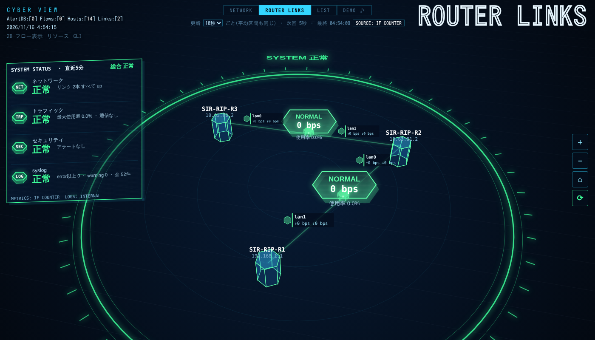
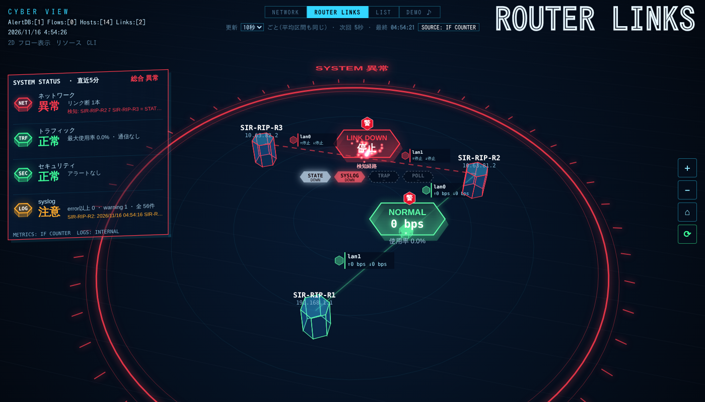

# Fujitsu Si-R × RIP — 3台構成の正常/障害試験

- 実行: 2026-11-16 04:53 / 所要 59 秒 / 専用環境(保存設定を消してエミュレータを新規起動、他シナリオの装置は無し)
- 結果: **14 / 14 項目 OK** ✅
- 再実行: `python3 tools/verification/scenario_report.py sir rip --devices 3`

## 構成(台数から自動で割り当て)

```
LAN 10.63.110.0/24 ── SIR-RIP-R1 ══ SIR-RIP-R2 ══ SIR-RIP-R3 ── LAN 10.63.111.0/24
```

| 装置 | IF | アドレス |
|---|---|---|
| SIR-RIP-R1 | lan1 | 10.63.81.1/24 |
| SIR-RIP-R1 | lan2 | 10.63.110.1/24 |
| SIR-RIP-R2 | lan0 | 10.63.81.2/24 |
| SIR-RIP-R2 | lan1 | 10.63.82.1/24 |
| SIR-RIP-R3 | lan0 | 10.63.82.2/24 |
| SIR-RIP-R3 | lan2 | 10.63.111.1/24 |

| リンク | 装置A IF | 装置B IF | ネットワーク |
|---|---|---|---|
| SIR-RIP-R1 ⇔ SIR-RIP-R2 | lan1 | lan0 | 10.63.81.0/24 |
| SIR-RIP-R2 ⇔ SIR-RIP-R3 | lan1 | lan0 | 10.63.82.0/24 |

## 投入したコマンド

<details><summary>SIR-RIP-R1(19 行)</summary>

```
configure
ether 1 1 vlan untag 1
ether 1 2 vlan untag 2
ether 1 3 vlan untag 3
lan 0 vlan 1
lan 1 vlan 2
lan 2 vlan 3
exit
configure
lan 1 ip address 10.63.81.1/24 3
exit
configure
lan 2 ip address 10.63.110.1/24 3
exit
configure
ip rip use on
ip rip network 10.63.81.0/24
ip rip network 10.63.110.0/24
exit
```
</details>

<details><summary>SIR-RIP-R2(37 行)</summary>

```
configure
ether 1 1 vlan untag 1
ether 1 2 vlan untag 2
ether 1 3 vlan untag 3
lan 0 vlan 1
lan 1 vlan 2
lan 2 vlan 3
exit
configure
lan 0 ip address 10.63.81.2/24 3
exit
configure
lan 1 ip address 10.63.82.1/24 3
exit
configure
ip rip use on
ip rip network 10.63.81.0/24
ip rip network 10.63.82.0/24
exit
configure
ether 1 2 use off
exit
configure
ether 1 2 use on
exit
configure
ether 1 2 use off
exit
configure
ether 1 2 use on
exit
configure
ether 1 2 use off
exit
configure
ether 1 2 use on
exit
```
</details>

<details><summary>SIR-RIP-R3(19 行)</summary>

```
configure
ether 1 1 vlan untag 1
ether 1 2 vlan untag 2
ether 1 3 vlan untag 3
lan 0 vlan 1
lan 1 vlan 2
lan 2 vlan 3
exit
configure
lan 0 ip address 10.63.82.2/24 3
exit
configure
lan 2 ip address 10.63.111.1/24 3
exit
configure
ip rip use on
ip rip network 10.63.82.0/24
ip rip network 10.63.111.0/24
exit
```
</details>

## 確認項目

| 段階 | 確認内容 | 結果 | 補足 |
|---|---|---|---|
| 正常 | SIR-RIP-R1 が SIR-RIP-R3 の LAN 10.63.111.0/24 を学習(R) | ✅ |  |
| 正常 | 全リンクが links API で state=ok(画面は緑の NORMAL) | ✅ |  |
| 正常 | 経路追加の INFO(情)が出る | ✅ |  |
| 正常 | 状態ボードのネットワーク観点が正常 | ✅ |  |
| 障害 | SIR-RIP-R2-SIR-RIP-R3 が LINK DOWN | ✅ |  |
| 障害 | 検知経路に STATE と SYSLOG | ✅ |  |
| 障害 | 状態ボードのネットワーク観点が異常 | ✅ |  |
| 障害 | link_down アラート | ✅ |  |
| 障害 | SIR-RIP-R1 から LAN 10.63.111.0/24 の経路が消える | ✅ |  |
| 障害 | 経路削除の INFO(情)が出る | ✅ |  |
| 復旧 | 経路が戻る | ✅ |  |
| 復旧 | LINK DOWN が解除される | ✅ |  |
| フラップ | if_flap(注 WARN IF FLAP)が出る | ✅ |  |
| フラップ | 状態ボードの syslog 観点にフラップ件数 | ✅ |  |

## 画面(ROUTER LINKS)

**正常時**



**障害時**



## 段階ごとの記録

### 正常(04:54:07)

SIR-RIP-R1 から SIR-RIP-R3 の LAN まで経路が通っている状態

**状態ボード**: network=ok「リンク 2本 すべて up」 / traffic=ok「最大使用率 0.0% ・ 通信なし」 / security=ok「アラートなし」 / syslog=ok「error以上 0 ・ warning 0 ・ 全 52件」

**リンク**

| A | B | 状態 | LINK DOWN | 検知経路 |
|---|---|---|---|---|
| SIR-RIP-R1 | SIR-RIP-R2 | ok | - | STATE:up, SYSLOG:up |
| SIR-RIP-R2 | SIR-RIP-R3 | ok | - | STATE:up, SYSLOG:up |

`SIR-RIP-R1# show ip route`

```
Codes: L - local, C - connected, S - static, R - RIP, B - BGP,
       D - EIGRP, EX - EIGRP external, O - OSPF, IA - OSPF inter area,
       N1 - OSPF NSSA external type 1, N2 - OSPF NSSA external type 2,
       E1 - OSPF external type 1, E2 - OSPF external type 2,
       i - IS-IS, * - candidate default, U - per-user static route

Gateway of last resort is not set

C        10.63.110.0/24 is directly connected, lan2
L        10.63.110.1/32 is directly connected, lan2
C        10.63.81.0/24 is directly connected, lan1
L        10.63.81.1/32 is directly connected, lan1
C        192.168.1.0/24 is directly connected, lan0
L        192.168.1.1/32 is directly connected, lan0
C        203.0.113.0/30 is directly connected, wan1
L        203.0.113.1/32 is directly connected, wan1
R        10.63.111.0/24 [120/2] via 10.63.81.2, lan1
R        10.63.82.0/24 [120/1] via 10.63.81.2, lan1
```

`SIR-RIP-R2# show ip route`

```
Codes: L - local, C - connected, S - static, R - RIP, B - BGP,
       D - EIGRP, EX - EIGRP external, O - OSPF, IA - OSPF inter area,
       N1 - OSPF NSSA external type 1, N2 - OSPF NSSA external type 2,
       E1 - OSPF external type 1, E2 - OSPF external type 2,
       i - IS-IS, * - candidate default, U - per-user static route

Gateway of last resort is not set

C        10.63.81.0/24 is directly connected, lan0
L        10.63.81.2/32 is directly connected, lan0
C        10.63.82.0/24 is directly connected, lan1
L        10.63.82.1/32 is directly connected, lan1
C        203.0.113.0/30 is directly connected, wan1
L        203.0.113.1/32 is directly connected, wan1
R        10.63.110.0/24 [120/1] via 10.63.81.1, lan0
R        10.63.111.0/24 [120/1] via 10.63.82.2, lan1
```

**ログ**(/cyber-view が見ているもの、37 件)

```
04:53:50 SIR-RIP-R1 sev6 2026/11/16 04:53:50 SIR-RIP-R1 Si-R G120 : [SYSTEM] configuration mode entered by admin (console)
04:53:50 SIR-RIP-R1 sev6 2026/11/16 04:53:50 SIR-RIP-R1 Si-R G120 : [RIP] RIPv2 started on all configured interfaces
04:53:50 SIR-RIP-R1 sev6 2026/11/16 04:53:50 SIR-RIP-R1: [RIP] RIPv2 started. Networks: 10.63.81.0/24
04:53:50 SIR-RIP-R1 sev6 2026/11/16 04:53:50 SIR-RIP-R1 Si-R G120 : [RIP] RIPv2 started
04:53:51 SIR-RIP-R1 sev6 2026/11/16 04:53:51 SIR-RIP-R1: [RIP] RIPv2 started. Networks: 10.63.81.0/24, 10.63.110.0/24
04:53:51 SIR-RIP-R1 sev6 2026/11/16 04:53:51 SIR-RIP-R1 Si-R G120 : [RIP] RIPv2 started
04:53:51 SIR-RIP-R1 sev6 2026/11/16 04:53:51 SIR-RIP-R1 Si-R G120 : [SYSTEM] configuration mode exited by admin
04:53:51 SIR-RIP-R2 sev6 2026/11/16 04:53:51 SIR-RIP-R2 Si-R G120 : [SYSTEM] configuration mode entered by admin (console)
04:53:51 SIR-RIP-R2 sev6 2026/11/16 04:53:51 SIR-RIP-R2 Si-R G120 : [RIP] RIPv2 started on all configured interfaces
04:53:51 SIR-RIP-R2 sev6 2026/11/16 04:53:51 SIR-RIP-R2: [RIP] RIPv2 started. Networks: 10.63.81.0/24
04:53:51 SIR-RIP-R2 sev6 2026/11/16 04:53:51 SIR-RIP-R2 Si-R G120 : [RIP] RIPv2 started
04:53:52 SIR-RIP-R2 sev6 2026/11/16 04:53:52 SIR-RIP-R2: [RIP] learned: 10.63.110.0/24 metric=1 via SIR-RIP-R1
04:53:52 SIR-RIP-R2 sev6 2026/11/16 04:53:52 SIR-RIP-R2 Si-R G120 : [RIP] learned 2026/11 via SIR-RIP-R1
04:53:54 SIR-RIP-R2 sev6 2026/11/16 04:53:54 SIR-RIP-R2: [RIP] RIPv2 started. Networks: 10.63.81.0/24, 10.63.82.0/24
04:53:54 SIR-RIP-R2 sev6 2026/11/16 04:53:54 SIR-RIP-R2 Si-R G120 : [RIP] RIPv2 started
04:53:54 SIR-RIP-R2 sev6 2026/11/16 04:53:54 SIR-RIP-R2: [RIP] learned: 10.63.110.0/24 metric=1 via SIR-RIP-R1
04:53:54 SIR-RIP-R2 sev6 2026/11/16 04:53:54 SIR-RIP-R2 Si-R G120 : [RIP] learned 2026/11 via SIR-RIP-R1
04:53:55 SIR-RIP-R1 sev6 2026/11/16 04:53:55 SIR-RIP-R1: [RIP] learned: 10.63.82.0/24 metric=1 via SIR-RIP-R2
04:53:55 SIR-RIP-R1 sev6 2026/11/16 04:53:55 SIR-RIP-R1 Si-R G120 : [RIP] learned 2026/11 via SIR-RIP-R2
04:53:56 SIR-RIP-R2 sev6 2026/11/16 04:53:56 SIR-RIP-R2 Si-R G120 : [SYSTEM] configuration mode exited by admin
04:53:56 SIR-RIP-R3 sev6 2026/11/16 04:53:56 SIR-RIP-R3 Si-R G120 : [SYSTEM] configuration mode entered by admin (console)
04:53:56 SIR-RIP-R3 sev6 2026/11/16 04:53:56 SIR-RIP-R3 Si-R G120 : [RIP] RIPv2 started on all configured interfaces
04:53:56 SIR-RIP-R3 sev6 2026/11/16 04:53:56 SIR-RIP-R3: [RIP] RIPv2 started. Networks: 10.63.82.0/24
04:53:56 SIR-RIP-R3 sev6 2026/11/16 04:53:56 SIR-RIP-R3 Si-R G120 : [RIP] RIPv2 started
04:53:56 SIR-RIP-R3 sev6 2026/11/16 04:53:56 SIR-RIP-R3: [RIP] learned: 10.63.81.0/24 metric=1 via SIR-RIP-R2
04:53:56 SIR-RIP-R3 sev6 2026/11/16 04:53:56 SIR-RIP-R3 Si-R G120 : [RIP] learned 2026/11 via SIR-RIP-R2
04:53:56 SIR-RIP-R3 sev6 2026/11/16 04:53:56 SIR-RIP-R3: [RIP] learned: 10.63.110.0/24 metric=2 via SIR-RIP-R2
04:53:58 SIR-RIP-R3 sev6 2026/11/16 04:53:58 SIR-RIP-R3: [RIP] RIPv2 started. Networks: 10.63.82.0/24, 10.63.111.0/24
04:53:58 SIR-RIP-R3 sev6 2026/11/16 04:53:58 SIR-RIP-R3 Si-R G120 : [RIP] RIPv2 started
04:53:58 SIR-RIP-R3 sev6 2026/11/16 04:53:58 SIR-RIP-R3: [RIP] learned: 10.63.81.0/24 metric=1 via SIR-RIP-R2
04:53:58 SIR-RIP-R3 sev6 2026/11/16 04:53:58 SIR-RIP-R3 Si-R G120 : [RIP] learned 2026/11 via SIR-RIP-R2
04:53:58 SIR-RIP-R3 sev6 2026/11/16 04:53:58 SIR-RIP-R3: [RIP] learned: 10.63.110.0/24 metric=2 via SIR-RIP-R2
04:54:00 SIR-RIP-R2 sev6 2026/11/16 04:54:00 SIR-RIP-R2: [RIP] learned: 10.63.111.0/24 metric=1 via SIR-RIP-R3
04:54:00 SIR-RIP-R2 sev6 2026/11/16 04:54:00 SIR-RIP-R2 Si-R G120 : [RIP] learned 2026/11 via SIR-RIP-R3
04:54:02 SIR-RIP-R1 sev6 2026/11/16 04:54:02 SIR-RIP-R1: [RIP] learned: 10.63.111.0/24 metric=2 via SIR-RIP-R2
04:54:02 SIR-RIP-R1 sev6 2026/11/16 04:54:02 SIR-RIP-R1 Si-R G120 : [RIP] learned 2026/11 via SIR-RIP-R2
04:54:04 SIR-RIP-R3 sev6 2026/11/16 04:54:04 SIR-RIP-R3 Si-R G120 : [SYSTEM] configuration mode exited by admin
```

**アラート**(0 件)


**経路の変化(情 INFO)**(6 件)

- SIR-RIP-R2 add R 10.63.110.0/24 via 10.63.81.1
- SIR-RIP-R1 add R 10.63.82.0/24 via 10.63.81.2
- SIR-RIP-R2 add R 10.63.111.0/24 via 10.63.82.2
- SIR-RIP-R3 add R 10.63.110.0/24 via 10.63.82.1
- SIR-RIP-R3 add R 10.63.81.0/24 via 10.63.82.1
- SIR-RIP-R1 add R 10.63.111.0/24 via 10.63.81.2

### 障害(04:54:29)

SIR-RIP-R2 の lan1 を落とした状態

**状態ボード**: network=crit「リンク断 1本」 / traffic=ok「最大使用率 0.0% ・ 通信なし」 / security=ok「アラートなし」 / syslog=warn「error以上 0 ・ warning 1 ・ 全 56件」

**リンク**

| A | B | 状態 | LINK DOWN | 検知経路 |
|---|---|---|---|---|
| SIR-RIP-R1 | SIR-RIP-R2 | ok | - | STATE:up, SYSLOG:up |
| SIR-RIP-R2 | SIR-RIP-R3 | down | はい | STATE:down, SYSLOG:down |

`SIR-RIP-R1# show ip route`

```
Codes: L - local, C - connected, S - static, R - RIP, B - BGP,
       D - EIGRP, EX - EIGRP external, O - OSPF, IA - OSPF inter area,
       N1 - OSPF NSSA external type 1, N2 - OSPF NSSA external type 2,
       E1 - OSPF external type 1, E2 - OSPF external type 2,
       i - IS-IS, * - candidate default, U - per-user static route

Gateway of last resort is not set

C        10.63.110.0/24 is directly connected, lan2
L        10.63.110.1/32 is directly connected, lan2
C        10.63.81.0/24 is directly connected, lan1
L        10.63.81.1/32 is directly connected, lan1
C        192.168.1.0/24 is directly connected, lan0
L        192.168.1.1/32 is directly connected, lan0
C        203.0.113.0/30 is directly connected, wan1
L        203.0.113.1/32 is directly connected, wan1
R        10.63.82.0/24 [120/1] via 10.63.81.2, lan1
```

`SIR-RIP-R2# show ip route`

```
Codes: L - local, C - connected, S - static, R - RIP, B - BGP,
       D - EIGRP, EX - EIGRP external, O - OSPF, IA - OSPF inter area,
       N1 - OSPF NSSA external type 1, N2 - OSPF NSSA external type 2,
       E1 - OSPF external type 1, E2 - OSPF external type 2,
       i - IS-IS, * - candidate default, U - per-user static route

Gateway of last resort is not set

C        10.63.81.0/24 is directly connected, lan0
L        10.63.81.2/32 is directly connected, lan0
C        203.0.113.0/30 is directly connected, wan1
L        203.0.113.1/32 is directly connected, wan1
R        10.63.110.0/24 [120/1] via 10.63.81.1, lan0
```

**ログ**(/cyber-view が見ているもの、4 件)

```
04:54:16 SIR-RIP-R2 sev6 2026/11/16 04:54:16 SIR-RIP-R2 Si-R G120 : [SYSTEM] configuration mode entered by admin (console)
04:54:16 SIR-RIP-R2 sev6 2026/11/16 04:54:16 SIR-RIP-R2 Si-R G120 : [LINK] ether1 Link Up (1Gbps full-duplex)
04:54:16 SIR-RIP-R2 sev4 2026/11/16 04:54:16 SIR-RIP-R2 Si-R G120 : [LINK] lan1 Link Down
04:54:19 SIR-RIP-R2 sev6 2026/11/16 04:54:19 SIR-RIP-R2 Si-R G120 : [SYSTEM] configuration mode exited by admin
```

**アラート**(1 件)

- [medium/NET] リンク断 — SIR-RIP-R2: lan1 が down (sir-rip-r2 - sir-rip-r3)

**経路の変化(情 INFO)**(3 件)

- SIR-RIP-R1 del R 10.63.111.0/24 via 10.63.81.2
- SIR-RIP-R2 del R 10.63.111.0/24 via 10.63.82.2
- SIR-RIP-R2 del C 10.63.82.0/24 [lan1]

### 復旧(04:54:36)

戻した状態

**状態ボード**: network=ok「リンク 2本 すべて up」 / traffic=ok「最大使用率 0.0% ・ 通信なし」 / security=ok「アラートなし」 / syslog=warn「error以上 0 ・ warning 1 ・ 全 64件」

**リンク**

| A | B | 状態 | LINK DOWN | 検知経路 |
|---|---|---|---|---|
| SIR-RIP-R1 | SIR-RIP-R2 | ok | - | STATE:up, SYSLOG:up |
| SIR-RIP-R2 | SIR-RIP-R3 | ok | - | STATE:up, SYSLOG:up |

`SIR-RIP-R1# show ip route`

```
Codes: L - local, C - connected, S - static, R - RIP, B - BGP,
       D - EIGRP, EX - EIGRP external, O - OSPF, IA - OSPF inter area,
       N1 - OSPF NSSA external type 1, N2 - OSPF NSSA external type 2,
       E1 - OSPF external type 1, E2 - OSPF external type 2,
       i - IS-IS, * - candidate default, U - per-user static route

Gateway of last resort is not set

C        10.63.110.0/24 is directly connected, lan2
L        10.63.110.1/32 is directly connected, lan2
C        10.63.81.0/24 is directly connected, lan1
L        10.63.81.1/32 is directly connected, lan1
C        192.168.1.0/24 is directly connected, lan0
L        192.168.1.1/32 is directly connected, lan0
C        203.0.113.0/30 is directly connected, wan1
L        203.0.113.1/32 is directly connected, wan1
R        10.63.111.0/24 [120/2] via 10.63.81.2, lan1
R        10.63.82.0/24 [120/1] via 10.63.81.2, lan1
```

`SIR-RIP-R2# show ip route`

```
Codes: L - local, C - connected, S - static, R - RIP, B - BGP,
       D - EIGRP, EX - EIGRP external, O - OSPF, IA - OSPF inter area,
       N1 - OSPF NSSA external type 1, N2 - OSPF NSSA external type 2,
       E1 - OSPF external type 1, E2 - OSPF external type 2,
       i - IS-IS, * - candidate default, U - per-user static route

Gateway of last resort is not set

C        10.63.81.0/24 is directly connected, lan0
L        10.63.81.2/32 is directly connected, lan0
C        10.63.82.0/24 is directly connected, lan1
L        10.63.82.1/32 is directly connected, lan1
C        203.0.113.0/30 is directly connected, wan1
L        203.0.113.1/32 is directly connected, wan1
R        10.63.110.0/24 [120/1] via 10.63.81.1, lan0
R        10.63.111.0/24 [120/1] via 10.63.82.2, lan1
```

**ログ**(/cyber-view が見ているもの、8 件)

```
04:54:29 SIR-RIP-R2 sev6 2026/11/16 04:54:29 SIR-RIP-R2 Si-R G120 : [SYSTEM] configuration mode entered by admin (console)
04:54:29 SIR-RIP-R2 sev6 2026/11/16 04:54:29 SIR-RIP-R2 Si-R G120 : [LINK] ether1 Link Up (1Gbps full-duplex)
04:54:29 SIR-RIP-R2 sev5 2026/11/16 04:54:29 SIR-RIP-R2 Si-R G120 : [LINK] lan1 Link Up (1Gbps full-duplex)
04:54:29 SIR-RIP-R2 sev6 2026/11/16 04:54:29 SIR-RIP-R2 Si-R G120 : [SYSTEM] configuration mode exited by admin
04:54:31 SIR-RIP-R2 sev6 2026/11/16 04:54:31 SIR-RIP-R2: [RIP] learned: 10.63.111.0/24 metric=1 via SIR-RIP-R3
04:54:31 SIR-RIP-R2 sev6 2026/11/16 04:54:31 SIR-RIP-R2 Si-R G120 : [RIP] learned 2026/11 via SIR-RIP-R3
04:54:32 SIR-RIP-R1 sev6 2026/11/16 04:54:32 SIR-RIP-R1: [RIP] learned: 10.63.111.0/24 metric=2 via SIR-RIP-R2
04:54:32 SIR-RIP-R1 sev6 2026/11/16 04:54:32 SIR-RIP-R1 Si-R G120 : [RIP] learned 2026/11 via SIR-RIP-R2
```

**アラート**(0 件)


**経路の変化(情 INFO)**(3 件)

- SIR-RIP-R2 add R 10.63.111.0/24 via 10.63.82.2
- SIR-RIP-R2 add C 10.63.82.0/24 [lan1]
- SIR-RIP-R1 add R 10.63.111.0/24 via 10.63.81.2

### フラップ(04:54:44)

落とす/戻すを2回繰り返した直後

**状態ボード**: network=ok「リンク 2本 すべて up」 / traffic=ok「最大使用率 0.0% ・ 通信なし」 / security=ok「アラートなし」 / syslog=warn「error以上 0 ・ warning 3 ・ 全 73件 ・ フラップ 4件」

**リンク**

| A | B | 状態 | LINK DOWN | 検知経路 |
|---|---|---|---|---|
| SIR-RIP-R1 | SIR-RIP-R2 | ok | - | STATE:up, SYSLOG:up |
| SIR-RIP-R2 | SIR-RIP-R3 | ok | - | STATE:up, SYSLOG:up |

`SIR-RIP-R2# show ip route`

```
Codes: L - local, C - connected, S - static, R - RIP, B - BGP,
       D - EIGRP, EX - EIGRP external, O - OSPF, IA - OSPF inter area,
       N1 - OSPF NSSA external type 1, N2 - OSPF NSSA external type 2,
       E1 - OSPF external type 1, E2 - OSPF external type 2,
       i - IS-IS, * - candidate default, U - per-user static route

Gateway of last resort is not set

C        10.63.81.0/24 is directly connected, lan0
L        10.63.81.2/32 is directly connected, lan0
C        10.63.82.0/24 is directly connected, lan1
L        10.63.82.1/32 is directly connected, lan1
C        203.0.113.0/30 is directly connected, wan1
L        203.0.113.1/32 is directly connected, wan1
R        10.63.110.0/24 [120/1] via 10.63.81.1, lan0
```

**ログ**(/cyber-view が見ているもの、9 件)

```
04:54:36 SIR-RIP-R2 sev6 2026/11/16 04:54:36 SIR-RIP-R2 Si-R G120 : [SYSTEM] configuration mode entered by admin (console)
04:54:36 SIR-RIP-R2 sev6 2026/11/16 04:54:36 SIR-RIP-R2 Si-R G120 : [LINK] ether1 Link Up (1Gbps full-duplex)
04:54:36 SIR-RIP-R2 sev4 2026/11/16 04:54:36 SIR-RIP-R2 Si-R G120 : [LINK] lan1 Link Down
04:54:38 SIR-RIP-R2 sev6 2026/11/16 04:54:38 SIR-RIP-R2 Si-R G120 : [SYSTEM] configuration mode exited by admin
04:54:38 SIR-RIP-R2 sev6 2026/11/16 04:54:38 SIR-RIP-R2 Si-R G120 : [SYSTEM] configuration mode entered by admin (console)
04:54:38 SIR-RIP-R2 sev6 2026/11/16 04:54:38 SIR-RIP-R2 Si-R G120 : [LINK] ether1 Link Up (1Gbps full-duplex)
04:54:38 SIR-RIP-R2 sev5 2026/11/16 04:54:38 SIR-RIP-R2 Si-R G120 : [LINK] lan1 Link Up (1Gbps full-duplex)
04:54:38 SIR-RIP-R2 sev4 2026/11/16 04:54:38 SIR-RIP-R2 Si-R G120 : [LINK] lan1 Link Down
04:54:38 SIR-RIP-R2 sev5 2026/11/16 04:54:38 SIR-RIP-R2 Si-R G120 : [LINK] lan1 Link Up (1Gbps full-duplex)
```

**アラート**(6 件)

- [warning/SYSLOG] インタフェースのフラップ — SIR-RIP-R2: lan1: 60秒に 3 回 状態変化
- [warning/NET] 経路のフラップ — SIR-RIP-R1: 10.63.111.0/24: 120秒に 4 回 追加/削除/変更
- [warning/NET] 経路のフラップ — SIR-RIP-R2: 10.63.111.0/24: 120秒に 4 回 追加/削除/変更
- [medium/NET] リンク断 — SIR-RIP-R2: lan1 が down (sir-rip-r2 - sir-rip-r3)
- [medium/NET] リンク断 — SIR-RIP-R2: lan1 が down (sir-rip-r2 - sir-rip-r3)
- [warning/NET] 経路のフラップ — SIR-RIP-R2: 10.63.82.0/24: 120秒に 4 回 追加/削除/変更

**経路の変化(情 INFO)**(4 件)

- SIR-RIP-R1 del R 10.63.111.0/24 via 10.63.81.2
- SIR-RIP-R2 del R 10.63.111.0/24 via 10.63.82.2
- SIR-RIP-R2 del C 10.63.82.0/24 [lan1]
- SIR-RIP-R2 add C 10.63.82.0/24 [lan1]

