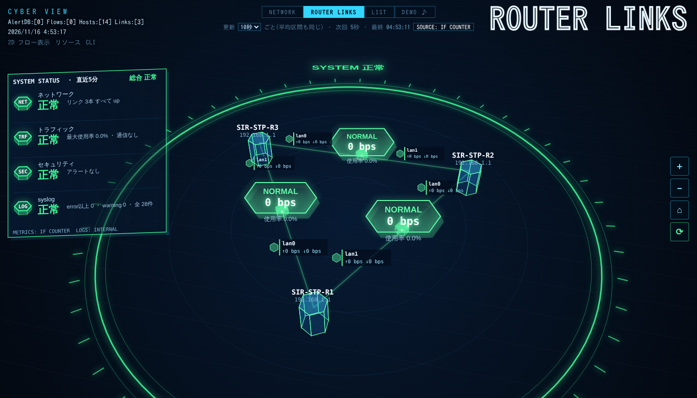
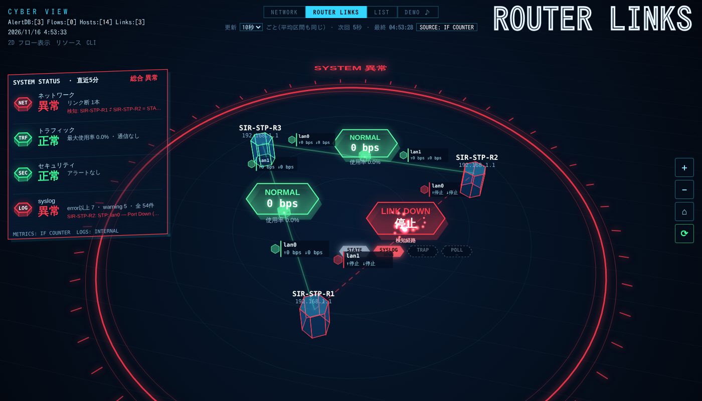

# Fujitsu Si-R × STP — 3台構成の正常/障害試験

- 実行: 2026-11-16 04:52 / 所要 51 秒 / 専用環境(保存設定を消してエミュレータを新規起動、他シナリオの装置は無し)
- 結果: **10 / 10 項目 OK** ✅
- 再実行: `python3 tools/verification/scenario_report.py sir stp --devices 3`

## 構成(台数から自動で割り当て)

```
SIR-STP-R1 → SIR-STP-R2 → SIR-STP-R3 → SIR-STP-R1   (リング)
```

SIR-STP-R1 の priority を 4096 に下げてルートブリッジにする。

| リンク | 装置A IF | 装置B IF | ネットワーク |
|---|---|---|---|
| SIR-STP-R1 ⇔ SIR-STP-R2 | lan1 | lan0 | L2 |
| SIR-STP-R2 ⇔ SIR-STP-R3 | lan1 | lan0 | L2 |
| SIR-STP-R3 ⇔ SIR-STP-R1 | lan1 | lan0 | L2 |

## 投入したコマンド

<details><summary>SIR-STP-R1(20 行)</summary>

```
configure
ether 1 1 vlan untag 1
ether 1 2 vlan untag 2
ether 1 3 vlan untag 3
lan 0 vlan 1
lan 1 vlan 2
lan 2 vlan 3
exit
configure
stp mode stp
exit
configure
stp priority 4096
exit
configure
ether 1 2 use off
exit
configure
ether 1 2 use on
exit
```
</details>

<details><summary>SIR-STP-R2(11 行)</summary>

```
configure
ether 1 1 vlan untag 1
ether 1 2 vlan untag 2
ether 1 3 vlan untag 3
lan 0 vlan 1
lan 1 vlan 2
lan 2 vlan 3
exit
configure
stp mode stp
exit
```
</details>

<details><summary>SIR-STP-R3(11 行)</summary>

```
configure
ether 1 1 vlan untag 1
ether 1 2 vlan untag 2
ether 1 3 vlan untag 3
lan 0 vlan 1
lan 1 vlan 2
lan 2 vlan 3
exit
configure
stp mode stp
exit
```
</details>

## 確認項目

| 段階 | 確認内容 | 結果 | 補足 |
|---|---|---|---|
| 正常 | リングのどこか1台が Blocking(ループ回避) | ✅ |  |
| 正常 | STP が動いているのでループでも MAC フラップは出ない | ✅ |  |
| 正常 | リンク 3 本が links API で state=ok | ✅ |  |
| 正常 | Blocking のログが繰り返し出ない(状態変化の時だけ) | ✅ |  |
| 障害 | SIR-STP-R1-SIR-STP-R2 が LINK DOWN | ✅ |  |
| 障害 | 迂回のため Blocking が解除される | ✅ |  |
| 障害 | トポロジ変更のログ | ✅ |  |
| 障害 | 状態ボードのネットワーク観点が異常 | ✅ |  |
| 復旧 | LINK DOWN が解除される | ✅ |  |
| 復旧 | ふたたびどこか1台が Blocking | ✅ |  |

## 画面(ROUTER LINKS)

**正常時**



**障害時**



## 段階ごとの記録

### 正常(04:53:09)

SIR-STP-R1 がルートのリング

**状態ボード**: network=ok「リンク 3本 すべて up」 / traffic=ok「最大使用率 0.0% ・ 通信なし」 / security=ok「アラートなし」 / syslog=ok「error以上 0 ・ warning 0 ・ 全 28件」

**リンク**

| A | B | 状態 | LINK DOWN | 検知経路 |
|---|---|---|---|---|
| SIR-STP-R1 | SIR-STP-R2 | ok | - | STATE:up |
| SIR-STP-R1 | SIR-STP-R3 | ok | - | STATE:up |
| SIR-STP-R2 | SIR-STP-R3 | ok | - | STATE:up |

`SIR-STP-R1# show spanning-tree`

```
Spanning tree enabled protocol IEEE
Root ID    Priority    32769
           Address     00:0e:0e:19:c9:04
           Cost        19
           Hello Time 2sec  Max Age 20sec  Forward Delay 15sec

Bridge ID  Priority    32768
           Address     00:0e:0e:22:69:6a
           Hello Time 2sec  Max Age 20sec  Forward Delay 15sec
STP Mode   stp

Interface       Port ID  Status(Role)          Designated Bridge ID
ether 1 2       128.1    Forwarding(Root)          32768 00:0e:0e:22:69:6a
ether 1 1       128.1    Forwarding(Designated)          32768 00:0e:0e:22:69:6a
```

`SIR-STP-R2# show spanning-tree`

```
Spanning tree enabled protocol IEEE
Root ID    Priority    32768
           Address     00:0e:0e:19:c9:04
           Hello Time 2sec  Max Age 20sec  Forward Delay 15sec

Bridge ID  Priority    32768
           Address     00:0e:0e:19:c9:04
           Hello Time 2sec  Max Age 20sec  Forward Delay 15sec
STP Mode   stp

Interface       Port ID  Status(Role)          Designated Bridge ID
ether 1 1       128.1    Forwarding(Designated)          32768 00:0e:0e:19:c9:04
ether 1 2       128.1    Forwarding(Designated)          32768 00:0e:0e:19:c9:04
```

`SIR-STP-R3# show spanning-tree`

```
Spanning tree enabled protocol IEEE
Root ID    Priority    32769
           Address     00:0e:0e:19:c9:04
           Cost        19
           Hello Time 2sec  Max Age 20sec  Forward Delay 15sec

Bridge ID  Priority    32768
           Address     00:0e:0e:f5:dc:7f
           Hello Time 2sec  Max Age 20sec  Forward Delay 15sec
STP Mode   stp

Interface       Port ID  Status(Role)          Designated Bridge ID
ether 1 2       128.1    Blocking(Alternate)          32768 00:0e:0e:f5:dc:7f
ether 1 1       128.1    Forwarding(Root)          32768 00:0e:0e:f5:dc:7f
```

**ログ**(/cyber-view が見ているもの、0 件)


**アラート**(0 件)


### 障害(04:53:36)

SIR-STP-R1 の lan1 を落とした状態

**状態ボード**: network=crit「リンク断 1本」 / traffic=ok「最大使用率 0.0% ・ 通信なし」 / security=ok「アラートなし」 / syslog=crit「error以上 7 ・ warning 5 ・ 全 54件」

**リンク**

| A | B | 状態 | LINK DOWN | 検知経路 |
|---|---|---|---|---|
| SIR-STP-R1 | SIR-STP-R2 | down | はい | STATE:down, SYSLOG:down |
| SIR-STP-R1 | SIR-STP-R3 | ok | - | STATE:up |
| SIR-STP-R2 | SIR-STP-R3 | ok | - | STATE:up |

`SIR-STP-R1# show spanning-tree`

```
Spanning tree enabled protocol IEEE
Root ID    Priority    32769
           Address     00:0e:0e:19:c9:04
           Cost        38
           Hello Time 2sec  Max Age 20sec  Forward Delay 15sec

Bridge ID  Priority    32768
           Address     00:0e:0e:22:69:6a
           Hello Time 2sec  Max Age 20sec  Forward Delay 15sec
STP Mode   stp

Interface       Port ID  Status(Role)          Designated Bridge ID
ether 1 1       128.1    Forwarding(Root)          32768 00:0e:0e:22:69:6a
```

`SIR-STP-R2# show spanning-tree`

```
Spanning tree enabled protocol IEEE
Root ID    Priority    32768
           Address     00:0e:0e:19:c9:04
           Hello Time 2sec  Max Age 20sec  Forward Delay 15sec

Bridge ID  Priority    32768
           Address     00:0e:0e:19:c9:04
           Hello Time 2sec  Max Age 20sec  Forward Delay 15sec
STP Mode   stp

Interface       Port ID  Status(Role)          Designated Bridge ID
ether 1 2       128.1    Forwarding(Designated)          32768 00:0e:0e:19:c9:04
```

`SIR-STP-R3# show spanning-tree`

```
Spanning tree enabled protocol IEEE
Root ID    Priority    32769
           Address     00:0e:0e:19:c9:04
           Cost        19
           Hello Time 2sec  Max Age 20sec  Forward Delay 15sec

Bridge ID  Priority    32768
           Address     00:0e:0e:f5:dc:7f
           Hello Time 2sec  Max Age 20sec  Forward Delay 15sec
STP Mode   stp

Interface       Port ID  Status(Role)          Designated Bridge ID
ether 1 2       128.1    Forwarding(Designated)          32768 00:0e:0e:f5:dc:7f
ether 1 1       128.1    Forwarding(Root)          32768 00:0e:0e:f5:dc:7f
```

**ログ**(/cyber-view が見ているもの、26 件)

```
04:53:18 SIR-STP-R1 sev6 2026/11/16 04:53:18 SIR-STP-R1 Si-R G120 : [SYSTEM] configuration mode entered by admin (console)
04:53:18 SIR-STP-R1 sev6 2026/11/16 04:53:18 SIR-STP-R1 Si-R G120 : [LINK] ether1 Link Up (1Gbps full-duplex)
04:53:18 SIR-STP-R1 sev4 2026/11/16 04:53:18 SIR-STP-R1 Si-R G120 : [LINK] lan1 Link Down
04:53:18 SIR-STP-R1 sev3 %LINK-3-UPDOWN: Interface lan1, changed state to down
04:53:18 SIR-STP-R1 sev4 STP: lan1 — Port Down (接続先: sir-stp-r2)
04:53:18 SIR-STP-R1 sev3 2026/11/16 04:53:18 SIR-STP-R1 Si-R G120 : [STP] %LINK-3-UPDOWN: Interface lan1, changed state to down
04:53:18 SIR-STP-R1 sev4 STP: lan1 — Port Down (接続先
04:53:18 SIR-STP-R1 sev3 %LINK-3-UPDOWN: Interface lan1, changed state to down
STP: lan1 — Port Down (接続先: sir-stp-r2)
04:53:18 SIR-STP-R1 sev6 %SPANTREE-6-TOPOTRAP: Topology change detected on port ion (TC count: 1)
04:53:18 SIR-STP-R1 sev6 2026/11/16 04:53:18 SIR-STP-R1 Si-R G120 : [STP] topology change detected
04:53:18 SIR-STP-R1 sev5 %SPANTREE-5-ROOTCHANGE: Root port lost. Initiating re-election...
04:53:18 SIR-STP-R1 sev6 2026/11/16 04:53:18 SIR-STP-R1 Si-R G120 : [STP] root bridge changed
04:53:18 SIR-STP-R1 sev3 Topology Change: Root port failed, reconverging...
04:53:18 SIR-STP-R2 sev3 %LINK-3-UPDOWN: Interface lan0, changed state to down
04:53:18 SIR-STP-R2 sev4 STP: lan0 — Port Down (接続先: sir-stp-r1)
04:53:18 SIR-STP-R2 sev3 2026/11/16 04:53:18 SIR-STP-R2 Si-R G120 : [STP] %LINK-3-UPDOWN: Interface lan0, changed state to down
04:53:18 SIR-STP-R2 sev4 STP: lan0 — Port Down (接続先
04:53:18 SIR-STP-R2 sev3 %LINK-3-UPDOWN: Interface lan0, changed state to down
STP: lan0 — Port Down (接続先: sir-stp-r1)
04:53:18 SIR-STP-R2 sev6 %SPANTREE-6-TOPOTRAP: Topology change detected on port ion (TC count: 1)
04:53:18 SIR-STP-R2 sev6 2026/11/16 04:53:18 SIR-STP-R2 Si-R G120 : [STP] topology change detected
04:53:18 SIR-STP-R3 sev6 %SPANTREE-6-TOPOTRAP: Topology change detected on SIR-STP-R1 (累計 TC count: 1)
04:53:18 SIR-STP-R3 sev6 2026/11/16 04:53:18 SIR-STP-R3 Si-R G120 : [STP] topology change detected
04:53:18 SIR-STP-R3 sev6 %SPANTREE-6-TOPOTRAP: Topology change detected on SIR-STP-R2 (累計 TC count: 2)
04:53:18 SIR-STP-R3 sev6 %SPANTREE-6-PORTDPVSTP: Port lan1 instance 0 state: BLOCKING (ループ防止)
04:53:18 SIR-STP-R3 sev6 2026/11/16 04:53:18 SIR-STP-R3 Si-R G120 : [STP] port state changed to Blocking
04:53:18 SIR-STP-R1 sev6 2026/11/16 04:53:18 SIR-STP-R1 Si-R G120 : [SYSTEM] configuration mode exited by admin
```

**アラート**(3 件)

- [medium/SYSLOG] 装置が error 以上のログを出力 — SIR-STP-R1: %LINK-3-UPDOWN: Interface lan1, changed state to down
- [medium/SYSLOG] 装置が error 以上のログを出力 — SIR-STP-R2: %LINK-3-UPDOWN: Interface lan0, changed state to down
- [medium/NET] リンク断 — SIR-STP-R1: lan1 が down (sir-stp-r1 - sir-stp-r2)

### 復旧(04:53:45)

戻した状態

**状態ボード**: network=ok「リンク 3本 すべて up」 / traffic=ok「最大使用率 0.0% ・ 通信なし」 / security=ok「アラートなし」 / syslog=crit「error以上 7 ・ warning 5 ・ 全 62件」

**リンク**

| A | B | 状態 | LINK DOWN | 検知経路 |
|---|---|---|---|---|
| SIR-STP-R1 | SIR-STP-R2 | ok | - | STATE:up, SYSLOG:up |
| SIR-STP-R1 | SIR-STP-R3 | ok | - | STATE:up |
| SIR-STP-R2 | SIR-STP-R3 | ok | - | STATE:up |

`SIR-STP-R1# show spanning-tree`

```
Spanning tree enabled protocol IEEE
Root ID    Priority    32769
           Address     00:0e:0e:19:c9:04
           Cost        19
           Hello Time 2sec  Max Age 20sec  Forward Delay 15sec

Bridge ID  Priority    32768
           Address     00:0e:0e:22:69:6a
           Hello Time 2sec  Max Age 20sec  Forward Delay 15sec
STP Mode   stp

Interface       Port ID  Status(Role)          Designated Bridge ID
ether 1 1       128.1    Forwarding(Designated)          32768 00:0e:0e:22:69:6a
ether 1 2       128.1    Forwarding(Root)          32768 00:0e:0e:22:69:6a
```

`SIR-STP-R2# show spanning-tree`

```
Spanning tree enabled protocol IEEE
Root ID    Priority    32768
           Address     00:0e:0e:19:c9:04
           Hello Time 2sec  Max Age 20sec  Forward Delay 15sec

Bridge ID  Priority    32768
           Address     00:0e:0e:19:c9:04
           Hello Time 2sec  Max Age 20sec  Forward Delay 15sec
STP Mode   stp

Interface       Port ID  Status(Role)          Designated Bridge ID
ether 1 2       128.1    Forwarding(Designated)          32768 00:0e:0e:19:c9:04
ether 1 1       128.1    Forwarding(Designated)          32768 00:0e:0e:19:c9:04
```

`SIR-STP-R3# show spanning-tree`

```
Spanning tree enabled protocol IEEE
Root ID    Priority    32769
           Address     00:0e:0e:19:c9:04
           Cost        19
           Hello Time 2sec  Max Age 20sec  Forward Delay 15sec

Bridge ID  Priority    32768
           Address     00:0e:0e:f5:dc:7f
           Hello Time 2sec  Max Age 20sec  Forward Delay 15sec
STP Mode   stp

Interface       Port ID  Status(Role)          Designated Bridge ID
ether 1 2       128.1    Blocking(Alternate)          32768 00:0e:0e:f5:dc:7f
ether 1 1       128.1    Forwarding(Root)          32768 00:0e:0e:f5:dc:7f
```

**ログ**(/cyber-view が見ているもの、8 件)

```
04:53:36 SIR-STP-R1 sev6 2026/11/16 04:53:36 SIR-STP-R1 Si-R G120 : [SYSTEM] configuration mode entered by admin (console)
04:53:36 SIR-STP-R1 sev6 2026/11/16 04:53:36 SIR-STP-R1 Si-R G120 : [LINK] ether1 Link Up (1Gbps full-duplex)
04:53:36 SIR-STP-R1 sev5 2026/11/16 04:53:36 SIR-STP-R1 Si-R G120 : [LINK] lan1 Link Up (1Gbps full-duplex)
04:53:36 SIR-STP-R1 sev3 %LINK-3-UPDOWN: Interface lan1, changed state to up (peer: sir-stp-r2), state: BLOCKING
04:53:36 SIR-STP-R1 sev6 2026/11/16 04:53:36 SIR-STP-R1 Si-R G120 : [STP] port state changed to Blocking
04:53:36 SIR-STP-R2 sev3 %LINK-3-UPDOWN: Interface lan0, changed state to up (peer: sir-stp-r1), state: BLOCKING
04:53:36 SIR-STP-R2 sev6 2026/11/16 04:53:36 SIR-STP-R2 Si-R G120 : [STP] port state changed to Blocking
04:53:36 SIR-STP-R1 sev6 2026/11/16 04:53:36 SIR-STP-R1 Si-R G120 : [SYSTEM] configuration mode exited by admin
```

**アラート**(0 件)


