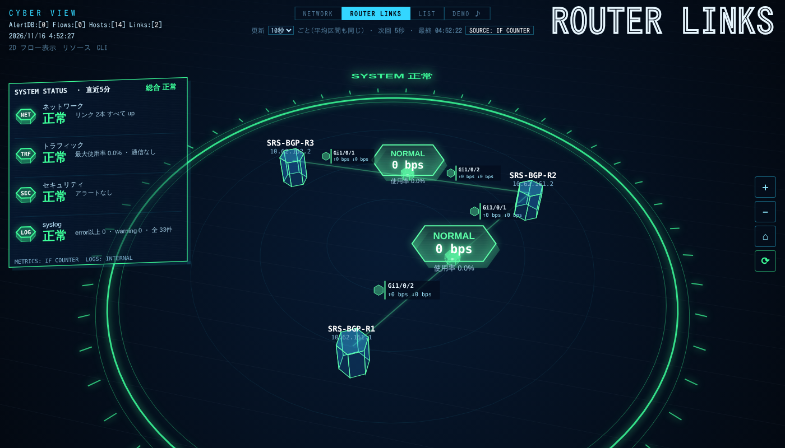
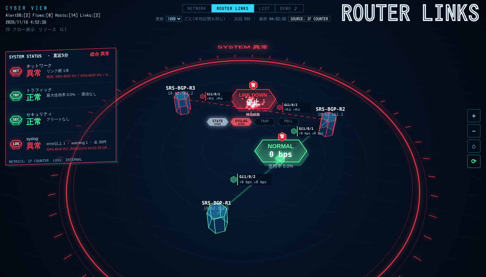

# Fujitsu SR-S × BGP — 3台構成の正常/障害試験

- 実行: 2026-11-16 04:52 / 所要 46 秒 / 専用環境(保存設定を消してエミュレータを新規起動、他シナリオの装置は無し)
- 結果: **14 / 14 項目 OK** ✅
- 再実行: `python3 tools/verification/scenario_report.py srs bgp --devices 3`

## 構成(台数から自動で割り当て)

```
LAN 10.62.190.0/24 ── SRS-BGP-R1 ══ SRS-BGP-R2 ══ SRS-BGP-R3 ── LAN 10.62.191.0/24
```

| 装置 | IF | アドレス |
|---|---|---|
| SRS-BGP-R1 | GigabitEthernet1/0/2 | 10.62.161.1/24 |
| SRS-BGP-R1 | GigabitEthernet1/0/3 | 10.62.190.1/24 |
| SRS-BGP-R2 | GigabitEthernet1/0/1 | 10.62.161.2/24 |
| SRS-BGP-R2 | GigabitEthernet1/0/2 | 10.62.162.1/24 |
| SRS-BGP-R3 | GigabitEthernet1/0/1 | 10.62.162.2/24 |
| SRS-BGP-R3 | GigabitEthernet1/0/3 | 10.62.191.1/24 |

| リンク | 装置A IF | 装置B IF | ネットワーク |
|---|---|---|---|
| SRS-BGP-R1 ⇔ SRS-BGP-R2 | GigabitEthernet1/0/2 | GigabitEthernet1/0/1 | 10.62.161.0/24 |
| SRS-BGP-R2 ⇔ SRS-BGP-R3 | GigabitEthernet1/0/2 | GigabitEthernet1/0/1 | 10.62.162.0/24 |

## 投入したコマンド

<details><summary>SRS-BGP-R1(18 行)</summary>

```
configure terminal
interface GigabitEthernet1/0/2
no switchport
ip address 10.62.161.1 255.255.255.0
no shutdown
end
configure terminal
interface GigabitEthernet1/0/3
no switchport
ip address 10.62.190.1 255.255.255.0
no shutdown
end
configure terminal
ip routing
router bgp 65001
neighbor 10.62.161.2 remote-as 65002
network 10.62.190.0 mask 255.255.255.0
end
```
</details>

<details><summary>SRS-BGP-R2(42 行)</summary>

```
configure terminal
interface GigabitEthernet1/0/1
no switchport
ip address 10.62.161.2 255.255.255.0
no shutdown
end
configure terminal
interface GigabitEthernet1/0/2
no switchport
ip address 10.62.162.1 255.255.255.0
no shutdown
end
configure terminal
ip routing
router bgp 65002
neighbor 10.62.161.1 remote-as 65001
neighbor 10.62.162.2 remote-as 65003
end
configure terminal
interface GigabitEthernet1/0/2
shutdown
end
configure terminal
interface GigabitEthernet1/0/2
no shutdown
end
configure terminal
interface GigabitEthernet1/0/2
shutdown
end
configure terminal
interface GigabitEthernet1/0/2
no shutdown
end
configure terminal
interface GigabitEthernet1/0/2
shutdown
end
configure terminal
interface GigabitEthernet1/0/2
no shutdown
end
```
</details>

<details><summary>SRS-BGP-R3(18 行)</summary>

```
configure terminal
interface GigabitEthernet1/0/1
no switchport
ip address 10.62.162.2 255.255.255.0
no shutdown
end
configure terminal
interface GigabitEthernet1/0/3
no switchport
ip address 10.62.191.1 255.255.255.0
no shutdown
end
configure terminal
ip routing
router bgp 65003
neighbor 10.62.162.1 remote-as 65002
network 10.62.191.0 mask 255.255.255.0
end
```
</details>

## 確認項目

| 段階 | 確認内容 | 結果 | 補足 |
|---|---|---|---|
| 正常 | SRS-BGP-R1 が SRS-BGP-R3 の LAN 10.62.191.0/24 を学習(B) | ✅ |  |
| 正常 | 全リンクが links API で state=ok(画面は緑の NORMAL) | ✅ |  |
| 正常 | 経路追加の INFO(情)が出る | ✅ |  |
| 正常 | 状態ボードのネットワーク観点が正常 | ✅ |  |
| 障害 | SRS-BGP-R2-SRS-BGP-R3 が LINK DOWN | ✅ |  |
| 障害 | 検知経路に STATE と SYSLOG | ✅ |  |
| 障害 | 状態ボードのネットワーク観点が異常 | ✅ |  |
| 障害 | link_down アラート | ✅ |  |
| 障害 | SRS-BGP-R1 から LAN 10.62.191.0/24 の経路が消える | ✅ |  |
| 障害 | 経路削除の INFO(情)が出る | ✅ |  |
| 復旧 | 経路が戻る | ✅ |  |
| 復旧 | LINK DOWN が解除される | ✅ |  |
| フラップ | if_flap(注 WARN IF FLAP)が出る | ✅ |  |
| フラップ | 状態ボードの syslog 観点にフラップ件数 | ✅ |  |

## 画面(ROUTER LINKS)

**正常時**



**障害時**



## 段階ごとの記録

### 正常(04:52:20)

SRS-BGP-R1 から SRS-BGP-R3 の LAN まで経路が通っている状態

**状態ボード**: network=ok「リンク 2本 すべて up」 / traffic=ok「最大使用率 0.0% ・ 通信なし」 / security=ok「アラートなし」 / syslog=ok「error以上 0 ・ warning 0 ・ 全 33件」

**リンク**

| A | B | 状態 | LINK DOWN | 検知経路 |
|---|---|---|---|---|
| SRS-BGP-R1 | SRS-BGP-R2 | ok | - | STATE:up, SYSLOG:up |
| SRS-BGP-R2 | SRS-BGP-R3 | ok | - | STATE:up, SYSLOG:up |

`SRS-BGP-R1# show ip route`

```
Codes: L - local, C - connected, S - static, R - RIP, B - BGP,
       D - EIGRP, EX - EIGRP external, O - OSPF, IA - OSPF inter area,
       N1 - OSPF NSSA external type 1, N2 - OSPF NSSA external type 2,
       E1 - OSPF external type 1, E2 - OSPF external type 2,
       i - IS-IS, * - candidate default, U - per-user static route

Gateway of last resort is not set

C        10.62.161.0/24 is directly connected, GigabitEthernet1/0/2
L        10.62.161.1/32 is directly connected, GigabitEthernet1/0/2
C        10.62.190.0/24 is directly connected, GigabitEthernet1/0/3
L        10.62.190.1/32 is directly connected, GigabitEthernet1/0/3
C        192.168.10.0/24 is directly connected, Vlan10
L        192.168.10.1/32 is directly connected, Vlan10
B        10.62.191.0/24 [20/0] via 10.62.161.2, GigabitEthernet1/0/2
```

`SRS-BGP-R2# show ip bgp summary`

```
BGP router identifier 10.62.162.1, local AS number 65002
BGP table version is 1, main routing table version 1

Neighbor        V    AS MsgRcvd MsgSent   TblVer  InQ OutQ Up/Down  State/PfxRcd
10.62.161.1     4 65001      71     142        1    0    0 00:00:04  1
10.62.162.2     4 65003     124     135        1    0    0 00:00:04  1
```

**ログ**(/cyber-view が見ているもの、15 件)

```
04:52:13 SRS-BGP-R1 sev5 %BGP-5-ADJCHANGE: Process 65001 started. Router ID 10.62.161.1
04:52:13 SRS-BGP-R1 sev5 %BGP-5-ADJCHANGE: neighbor 10.62.161.2 Down
04:52:13 SRS-BGP-R2 sev5 %BGP-5-ADJCHANGE: Process 65002 started. Router ID 10.62.162.1
04:52:13 SRS-BGP-R2 sev5 %BGP-5-ADJCHANGE: neighbor 10.62.161.1 Down
04:52:13 SRS-BGP-R2 sev5 %BGP-5-ADJCHANGE: neighbor 10.62.162.2 Down
04:52:13 SRS-BGP-R3 sev5 %BGP-5-ADJCHANGE: Process 65003 started. Router ID 10.62.162.2
04:52:13 SRS-BGP-R3 sev5 %BGP-5-ADJCHANGE: neighbor 10.62.162.1 Down
04:52:16 SRS-BGP-R1 sev5 %BGP-5-ADJCHANGE: neighbor SRS-BGP-R2 Up
04:52:16 SRS-BGP-R2 sev5 %BGP-5-ADJCHANGE: neighbor SRS-BGP-R1 Up
04:52:16 SRS-BGP-R2 sev5 %BGP-5-ADJCHANGE: neighbor SRS-BGP-R3 Up
04:52:16 SRS-BGP-R3 sev5 %BGP-5-ADJCHANGE: neighbor SRS-BGP-R2 Up
04:52:16 SRS-BGP-R1 sev6 %BGP-6-TABLECHG: Neighbor SRS-BGP-R2 UPDATE sent, 1 prefix(es)
04:52:16 SRS-BGP-R2 sev6 %BGP-6-TABLECHG: Neighbor SRS-BGP-R1 UPDATE sent, 1 prefix(es)
04:52:16 SRS-BGP-R2 sev6 %BGP-6-TABLECHG: Neighbor SRS-BGP-R3 UPDATE sent, 1 prefix(es)
04:52:16 SRS-BGP-R3 sev6 %BGP-6-TABLECHG: Neighbor SRS-BGP-R2 UPDATE sent, 1 prefix(es)
```

**アラート**(0 件)


**経路の変化(情 INFO)**(4 件)

- SRS-BGP-R1 add B 10.62.191.0/24 via 10.62.161.2
- SRS-BGP-R2 add B 10.62.190.0/24 via 10.62.161.1
- SRS-BGP-R2 add B 10.62.191.0/24 via 10.62.162.2
- SRS-BGP-R3 add B 10.62.190.0/24 via 10.62.162.1

### 障害(04:52:40)

SRS-BGP-R2 の GigabitEthernet1/0/2 を落とした状態

**状態ボード**: network=crit「リンク断 1本」 / traffic=ok「最大使用率 0.0% ・ 通信なし」 / security=ok「アラートなし」 / syslog=crit「error以上 1 ・ warning 1 ・ 全 38件」

**リンク**

| A | B | 状態 | LINK DOWN | 検知経路 |
|---|---|---|---|---|
| SRS-BGP-R1 | SRS-BGP-R2 | ok | - | STATE:up, SYSLOG:up |
| SRS-BGP-R2 | SRS-BGP-R3 | down | はい | STATE:down, SYSLOG:down |

`SRS-BGP-R1# show ip route`

```
Codes: L - local, C - connected, S - static, R - RIP, B - BGP,
       D - EIGRP, EX - EIGRP external, O - OSPF, IA - OSPF inter area,
       N1 - OSPF NSSA external type 1, N2 - OSPF NSSA external type 2,
       E1 - OSPF external type 1, E2 - OSPF external type 2,
       i - IS-IS, * - candidate default, U - per-user static route

Gateway of last resort is not set

C        10.62.161.0/24 is directly connected, GigabitEthernet1/0/2
L        10.62.161.1/32 is directly connected, GigabitEthernet1/0/2
C        10.62.190.0/24 is directly connected, GigabitEthernet1/0/3
L        10.62.190.1/32 is directly connected, GigabitEthernet1/0/3
C        192.168.10.0/24 is directly connected, Vlan10
L        192.168.10.1/32 is directly connected, Vlan10
```

`SRS-BGP-R2# show ip bgp summary`

```
BGP router identifier 10.62.162.1, local AS number 65002
BGP table version is 1, main routing table version 1

Neighbor        V    AS MsgRcvd MsgSent   TblVer  InQ OutQ Up/Down  State/PfxRcd
10.62.161.1     4 65001      52     108        1    0    0 00:00:24  1
10.62.162.2     4 65003     176      49        1    0    0 00:00:00  Idle
```

**ログ**(/cyber-view が見ているもの、5 件)

```
04:52:28 SRS-BGP-R2 sev3 %LINK-3-UPDOWN: Interface GigabitEthernet1/0/2, changed state to down
04:52:28 SRS-BGP-R2 sev5 %LINEPROTO-5-UPDOWN: Line protocol on Interface GigabitEthernet1/0/2, changed state to down
04:52:28 SRS-BGP-R2 sev4 2026/11/16 04:52:28 SRS-BGP-R2 Si-R G120 : [LINK] GigabitEthernet1/0/2 Link Down
04:52:28 SRS-BGP-R2 sev5 %BGP-5-ADJCHANGE: neighbor 10.62.162.2 Down — interface shutdown (撤去prefix 1)
04:52:28 SRS-BGP-R3 sev5 %BGP-5-ADJCHANGE: neighbor 10.62.162.1 Down — interface shutdown (撤去prefix 1)
```

**アラート**(2 件)

- [medium/SYSLOG] 装置が error 以上のログを出力 — SRS-BGP-R2: %LINK-3-UPDOWN: Interface GigabitEthernet1/0/2, changed state to down
- [medium/NET] リンク断 — SRS-BGP-R2: GigabitEthernet1/0/2 が down (srs-bgp-r2 - srs-bgp-r3)

**経路の変化(情 INFO)**(4 件)

- SRS-BGP-R1 del B 10.62.191.0/24 via 10.62.161.2
- SRS-BGP-R2 del C 10.62.162.0/24 [GigabitEthernet1/0/2]
- SRS-BGP-R2 del B 10.62.191.0/24 via 10.62.162.2
- SRS-BGP-R3 del B 10.62.190.0/24 via 10.62.162.1

### 復旧(04:52:44)

戻した状態

**状態ボード**: network=ok「リンク 2本 すべて up」 / traffic=ok「最大使用率 0.0% ・ 通信なし」 / security=ok「アラートなし」 / syslog=crit「error以上 1 ・ warning 1 ・ 全 45件」

**リンク**

| A | B | 状態 | LINK DOWN | 検知経路 |
|---|---|---|---|---|
| SRS-BGP-R1 | SRS-BGP-R2 | ok | - | STATE:up, SYSLOG:up |
| SRS-BGP-R2 | SRS-BGP-R3 | ok | - | STATE:up, SYSLOG:up |

`SRS-BGP-R1# show ip route`

```
Codes: L - local, C - connected, S - static, R - RIP, B - BGP,
       D - EIGRP, EX - EIGRP external, O - OSPF, IA - OSPF inter area,
       N1 - OSPF NSSA external type 1, N2 - OSPF NSSA external type 2,
       E1 - OSPF external type 1, E2 - OSPF external type 2,
       i - IS-IS, * - candidate default, U - per-user static route

Gateway of last resort is not set

C        10.62.161.0/24 is directly connected, GigabitEthernet1/0/2
L        10.62.161.1/32 is directly connected, GigabitEthernet1/0/2
C        10.62.190.0/24 is directly connected, GigabitEthernet1/0/3
L        10.62.190.1/32 is directly connected, GigabitEthernet1/0/3
C        192.168.10.0/24 is directly connected, Vlan10
L        192.168.10.1/32 is directly connected, Vlan10
B        10.62.191.0/24 [20/0] via 10.62.161.2, GigabitEthernet1/0/2
```

`SRS-BGP-R2# show ip bgp summary`

```
BGP router identifier 10.62.162.1, local AS number 65002
BGP table version is 1, main routing table version 1

Neighbor        V    AS MsgRcvd MsgSent   TblVer  InQ OutQ Up/Down  State/PfxRcd
10.62.161.1     4 65001      55      62        1    0    0 00:00:28  1
10.62.162.2     4 65003      91     130        1    0    0 00:00:02  1
```

**ログ**(/cyber-view が見ているもの、7 件)

```
04:52:40 SRS-BGP-R2 sev3 %LINK-3-UPDOWN: Interface GigabitEthernet1/0/2, changed state to up
04:52:40 SRS-BGP-R2 sev5 %LINEPROTO-5-UPDOWN: Line protocol on Interface GigabitEthernet1/0/2, changed state to up
04:52:40 SRS-BGP-R2 sev5 2026/11/16 04:52:40 SRS-BGP-R2 Si-R G120 : [LINK] GigabitEthernet1/0/2 Link Up (1Gbps full-duplex)
04:52:42 SRS-BGP-R2 sev5 %BGP-5-ADJCHANGE: neighbor SRS-BGP-R3 Up
04:52:42 SRS-BGP-R3 sev5 %BGP-5-ADJCHANGE: neighbor SRS-BGP-R2 Up
04:52:42 SRS-BGP-R2 sev6 %BGP-6-TABLECHG: Neighbor SRS-BGP-R3 UPDATE sent, 1 prefix(es)
04:52:42 SRS-BGP-R3 sev6 %BGP-6-TABLECHG: Neighbor SRS-BGP-R2 UPDATE sent, 1 prefix(es)
```

**アラート**(0 件)


**経路の変化(情 INFO)**(1 件)

- SRS-BGP-R2 add C 10.62.162.0/24 [GigabitEthernet1/0/2]

### フラップ(04:52:55)

落とす/戻すを2回繰り返した直後

**状態ボード**: network=ok「リンク 2本 すべて up」 / traffic=ok「最大使用率 0.0% ・ 通信なし」 / security=ok「アラートなし」 / syslog=crit「error以上 3 ・ warning 3 ・ 全 69件 ・ フラップ 1件」

**リンク**

| A | B | 状態 | LINK DOWN | 検知経路 |
|---|---|---|---|---|
| SRS-BGP-R1 | SRS-BGP-R2 | ok | - | STATE:up, SYSLOG:up |
| SRS-BGP-R2 | SRS-BGP-R3 | ok | - | STATE:up, SYSLOG:up |

`SRS-BGP-R2# show ip bgp summary`

```
BGP router identifier 10.62.162.1, local AS number 65002
BGP table version is 1, main routing table version 1

Neighbor        V    AS MsgRcvd MsgSent   TblVer  InQ OutQ Up/Down  State/PfxRcd
10.62.161.1     4 65001     161      49        1    0    0 00:00:38  1
10.62.162.2     4 65003      81     200        1    0    0 00:00:07  1
```

**ログ**(/cyber-view が見ているもの、24 件)

```
04:52:44 SRS-BGP-R2 sev3 %LINK-3-UPDOWN: Interface GigabitEthernet1/0/2, changed state to down
04:52:44 SRS-BGP-R2 sev5 %LINEPROTO-5-UPDOWN: Line protocol on Interface GigabitEthernet1/0/2, changed state to down
04:52:44 SRS-BGP-R2 sev4 2026/11/16 04:52:44 SRS-BGP-R2 Si-R G120 : [LINK] GigabitEthernet1/0/2 Link Down
04:52:44 SRS-BGP-R2 sev5 %BGP-5-ADJCHANGE: neighbor 10.62.162.2 Down — interface shutdown (撤去prefix 1)
04:52:44 SRS-BGP-R3 sev5 %BGP-5-ADJCHANGE: neighbor 10.62.162.1 Down — interface shutdown (撤去prefix 1)
04:52:44 SRS-BGP-R2 sev3 %LINK-3-UPDOWN: Interface GigabitEthernet1/0/2, changed state to up
04:52:44 SRS-BGP-R2 sev5 %LINEPROTO-5-UPDOWN: Line protocol on Interface GigabitEthernet1/0/2, changed state to up
04:52:44 SRS-BGP-R2 sev5 2026/11/16 04:52:44 SRS-BGP-R2 Si-R G120 : [LINK] GigabitEthernet1/0/2 Link Up (1Gbps full-duplex)
04:52:45 SRS-BGP-R2 sev5 %BGP-5-ADJCHANGE: neighbor SRS-BGP-R3 Up
04:52:45 SRS-BGP-R3 sev5 %BGP-5-ADJCHANGE: neighbor SRS-BGP-R2 Up
04:52:46 SRS-BGP-R2 sev6 %BGP-6-TABLECHG: Neighbor SRS-BGP-R3 UPDATE sent, 1 prefix(es)
04:52:46 SRS-BGP-R3 sev6 %BGP-6-TABLECHG: Neighbor SRS-BGP-R2 UPDATE sent, 1 prefix(es)
04:52:46 SRS-BGP-R2 sev3 %LINK-3-UPDOWN: Interface GigabitEthernet1/0/2, changed state to down
04:52:46 SRS-BGP-R2 sev5 %LINEPROTO-5-UPDOWN: Line protocol on Interface GigabitEthernet1/0/2, changed state to down
04:52:46 SRS-BGP-R2 sev4 2026/11/16 04:52:46 SRS-BGP-R2 Si-R G120 : [LINK] GigabitEthernet1/0/2 Link Down
04:52:46 SRS-BGP-R2 sev5 %BGP-5-ADJCHANGE: neighbor 10.62.162.2 Down — interface shutdown (撤去prefix 1)
04:52:46 SRS-BGP-R3 sev5 %BGP-5-ADJCHANGE: neighbor 10.62.162.1 Down — interface shutdown (撤去prefix 1)
04:52:46 SRS-BGP-R2 sev3 %LINK-3-UPDOWN: Interface GigabitEthernet1/0/2, changed state to up
04:52:46 SRS-BGP-R2 sev5 %LINEPROTO-5-UPDOWN: Line protocol on Interface GigabitEthernet1/0/2, changed state to up
04:52:46 SRS-BGP-R2 sev5 2026/11/16 04:52:46 SRS-BGP-R2 Si-R G120 : [LINK] GigabitEthernet1/0/2 Link Up (1Gbps full-duplex)
04:52:48 SRS-BGP-R2 sev5 %BGP-5-ADJCHANGE: neighbor SRS-BGP-R3 Up
04:52:48 SRS-BGP-R3 sev5 %BGP-5-ADJCHANGE: neighbor SRS-BGP-R2 Up
04:52:48 SRS-BGP-R2 sev6 %BGP-6-TABLECHG: Neighbor SRS-BGP-R3 UPDATE sent, 1 prefix(es)
04:52:48 SRS-BGP-R3 sev6 %BGP-6-TABLECHG: Neighbor SRS-BGP-R2 UPDATE sent, 1 prefix(es)
```

**アラート**(3 件)

- [warning/SYSLOG] インタフェースのフラップ — SRS-BGP-R2: GigabitEthernet1/0/2: 60秒に 3 回 状態変化
- [medium/NET] リンク断 — SRS-BGP-R2: GigabitEthernet1/0/2 が down (srs-bgp-r2 - srs-bgp-r3)
- [medium/NET] リンク断 — SRS-BGP-R2: GigabitEthernet1/0/2 が down (srs-bgp-r2 - srs-bgp-r3)

**経路の変化(情 INFO)**(3 件)

- SRS-BGP-R1 add B 10.62.191.0/24 via 10.62.161.2
- SRS-BGP-R2 add B 10.62.191.0/24 via 10.62.162.2
- SRS-BGP-R3 add B 10.62.190.0/24 via 10.62.162.1

