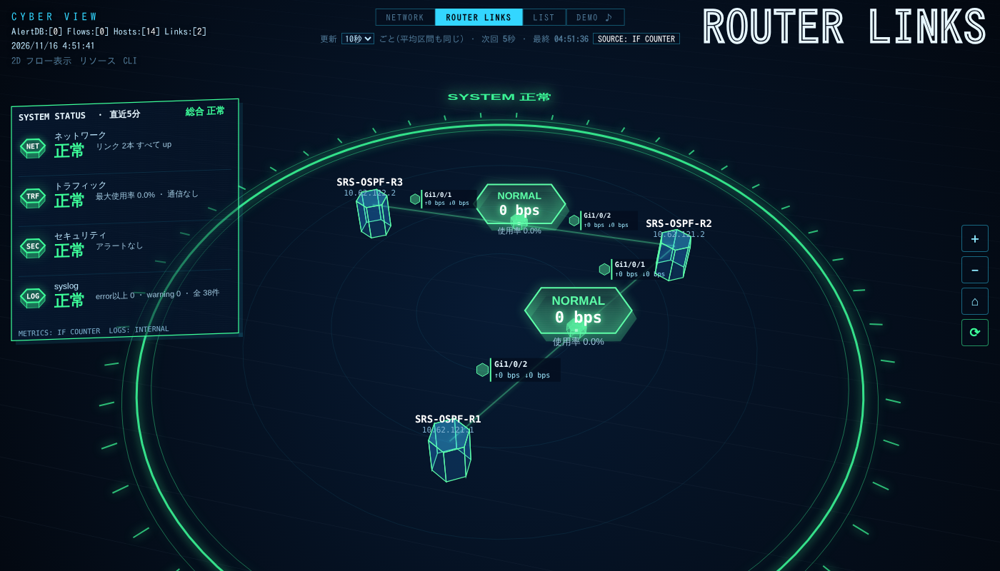
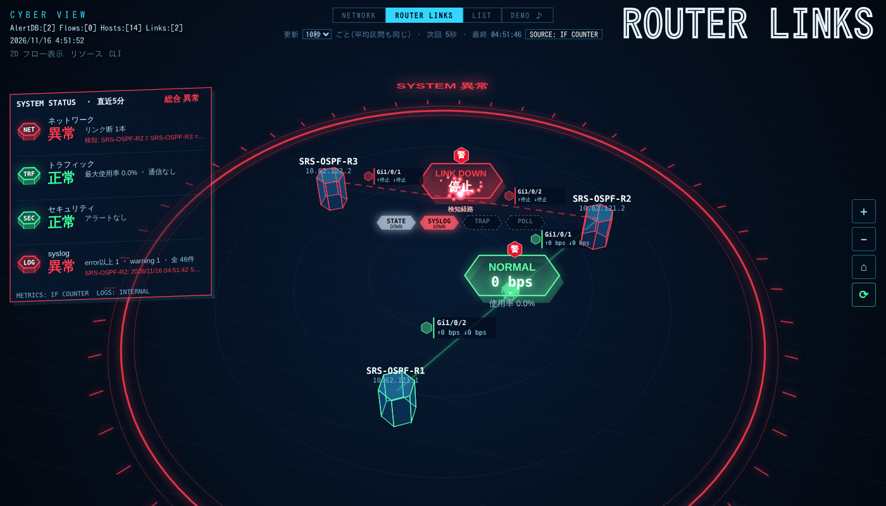

# Fujitsu SR-S × OSPF — 3台構成の正常/障害試験

- 実行: 2026-11-16 04:51 / 所要 47 秒 / 専用環境(保存設定を消してエミュレータを新規起動、他シナリオの装置は無し)
- 結果: **14 / 14 項目 OK** ✅
- 再実行: `python3 tools/verification/scenario_report.py srs ospf --devices 3`

## 構成(台数から自動で割り当て)

```
LAN 10.62.150.0/24 ── SRS-OSPF-R1 ══ SRS-OSPF-R2 ══ SRS-OSPF-R3 ── LAN 10.62.151.0/24
```

| 装置 | IF | アドレス |
|---|---|---|
| SRS-OSPF-R1 | GigabitEthernet1/0/2 | 10.62.121.1/24 |
| SRS-OSPF-R1 | GigabitEthernet1/0/3 | 10.62.150.1/24 |
| SRS-OSPF-R2 | GigabitEthernet1/0/1 | 10.62.121.2/24 |
| SRS-OSPF-R2 | GigabitEthernet1/0/2 | 10.62.122.1/24 |
| SRS-OSPF-R3 | GigabitEthernet1/0/1 | 10.62.122.2/24 |
| SRS-OSPF-R3 | GigabitEthernet1/0/3 | 10.62.151.1/24 |

| リンク | 装置A IF | 装置B IF | ネットワーク |
|---|---|---|---|
| SRS-OSPF-R1 ⇔ SRS-OSPF-R2 | GigabitEthernet1/0/2 | GigabitEthernet1/0/1 | 10.62.121.0/24 |
| SRS-OSPF-R2 ⇔ SRS-OSPF-R3 | GigabitEthernet1/0/2 | GigabitEthernet1/0/1 | 10.62.122.0/24 |

## 投入したコマンド

<details><summary>SRS-OSPF-R1(18 行)</summary>

```
configure terminal
interface GigabitEthernet1/0/2
no switchport
ip address 10.62.121.1 255.255.255.0
no shutdown
end
configure terminal
interface GigabitEthernet1/0/3
no switchport
ip address 10.62.150.1 255.255.255.0
no shutdown
end
configure terminal
ip routing
router ospf 1
network 10.62.121.0 0.0.0.255 area 0
network 10.62.150.0 0.0.0.255 area 0
end
```
</details>

<details><summary>SRS-OSPF-R2(42 行)</summary>

```
configure terminal
interface GigabitEthernet1/0/1
no switchport
ip address 10.62.121.2 255.255.255.0
no shutdown
end
configure terminal
interface GigabitEthernet1/0/2
no switchport
ip address 10.62.122.1 255.255.255.0
no shutdown
end
configure terminal
ip routing
router ospf 1
network 10.62.121.0 0.0.0.255 area 0
network 10.62.122.0 0.0.0.255 area 0
end
configure terminal
interface GigabitEthernet1/0/2
shutdown
end
configure terminal
interface GigabitEthernet1/0/2
no shutdown
end
configure terminal
interface GigabitEthernet1/0/2
shutdown
end
configure terminal
interface GigabitEthernet1/0/2
no shutdown
end
configure terminal
interface GigabitEthernet1/0/2
shutdown
end
configure terminal
interface GigabitEthernet1/0/2
no shutdown
end
```
</details>

<details><summary>SRS-OSPF-R3(18 行)</summary>

```
configure terminal
interface GigabitEthernet1/0/1
no switchport
ip address 10.62.122.2 255.255.255.0
no shutdown
end
configure terminal
interface GigabitEthernet1/0/3
no switchport
ip address 10.62.151.1 255.255.255.0
no shutdown
end
configure terminal
ip routing
router ospf 1
network 10.62.122.0 0.0.0.255 area 0
network 10.62.151.0 0.0.0.255 area 0
end
```
</details>

## 確認項目

| 段階 | 確認内容 | 結果 | 補足 |
|---|---|---|---|
| 正常 | SRS-OSPF-R1 が SRS-OSPF-R3 の LAN 10.62.151.0/24 を学習(O) | ✅ |  |
| 正常 | 全リンクが links API で state=ok(画面は緑の NORMAL) | ✅ |  |
| 正常 | 経路追加の INFO(情)が出る | ✅ |  |
| 正常 | 状態ボードのネットワーク観点が正常 | ✅ |  |
| 障害 | SRS-OSPF-R2-SRS-OSPF-R3 が LINK DOWN | ✅ |  |
| 障害 | 検知経路に STATE と SYSLOG | ✅ |  |
| 障害 | 状態ボードのネットワーク観点が異常 | ✅ |  |
| 障害 | link_down アラート | ✅ |  |
| 障害 | SRS-OSPF-R1 から LAN 10.62.151.0/24 の経路が消える | ✅ |  |
| 障害 | 経路削除の INFO(情)が出る | ✅ |  |
| 復旧 | 経路が戻る | ✅ |  |
| 復旧 | LINK DOWN が解除される | ✅ |  |
| フラップ | if_flap(注 WARN IF FLAP)が出る | ✅ |  |
| フラップ | 状態ボードの syslog 観点にフラップ件数 | ✅ |  |

## 画面(ROUTER LINKS)

**正常時**



**障害時**



## 段階ごとの記録

### 正常(04:51:34)

SRS-OSPF-R1 から SRS-OSPF-R3 の LAN まで経路が通っている状態

**状態ボード**: network=ok「リンク 2本 すべて up」 / traffic=ok「最大使用率 0.0% ・ 通信なし」 / security=ok「アラートなし」 / syslog=ok「error以上 0 ・ warning 0 ・ 全 38件」

**リンク**

| A | B | 状態 | LINK DOWN | 検知経路 |
|---|---|---|---|---|
| SRS-OSPF-R1 | SRS-OSPF-R2 | ok | - | STATE:up, SYSLOG:up |
| SRS-OSPF-R2 | SRS-OSPF-R3 | ok | - | STATE:up, SYSLOG:up |

`SRS-OSPF-R1# show ip route`

```
Codes: L - local, C - connected, S - static, R - RIP, B - BGP,
       D - EIGRP, EX - EIGRP external, O - OSPF, IA - OSPF inter area,
       N1 - OSPF NSSA external type 1, N2 - OSPF NSSA external type 2,
       E1 - OSPF external type 1, E2 - OSPF external type 2,
       i - IS-IS, * - candidate default, U - per-user static route

Gateway of last resort is not set

C        10.62.121.0/24 is directly connected, GigabitEthernet1/0/2
L        10.62.121.1/32 is directly connected, GigabitEthernet1/0/2
C        10.62.150.0/24 is directly connected, GigabitEthernet1/0/3
L        10.62.150.1/32 is directly connected, GigabitEthernet1/0/3
C        192.168.10.0/24 is directly connected, Vlan10
L        192.168.10.1/32 is directly connected, Vlan10
O        10.62.122.0/24 [110/20] via 10.62.121.2, GigabitEthernet1/0/2
O        10.62.151.0/24 [110/30] via 10.62.121.2, GigabitEthernet1/0/2
```

`SRS-OSPF-R2# show ip ospf neighbor`

```
Neighbor ID     Pri   State           Dead Time   Address         Interface
10.62.121.1     1     Full/DROther    00:00:33    10.62.121.1     GigabitEthernet1/0/1
10.62.122.2     1     Full/DR         00:00:33    10.62.122.2     GigabitEthernet1/0/2
```

**ログ**(/cyber-view が見ているもの、20 件)

```
04:51:26 SRS-OSPF-R1 sev5 %OSPF-5-ADJCHG: Process 1 started. Router ID 10.0.73.1, Area 0.0.0.0
04:51:26 SRS-OSPF-R1 sev5 %OSPF-5-ADJCHG: Process 1 started. Router ID 10.62.121.1, Area 0.0.0.0
04:51:26 SRS-OSPF-R2 sev5 %OSPF-5-ADJCHG: Process 1 started. Router ID 10.0.101.1, Area 0.0.0.0
04:51:26 SRS-OSPF-R2 sev5 %OSPF-5-ADJCHG: Process 1 started. Router ID 10.62.122.1, Area 0.0.0.0
04:51:26 SRS-OSPF-R3 sev5 %OSPF-5-ADJCHG: Process 1 started. Router ID 10.0.41.1, Area 0.0.0.0
04:51:26 SRS-OSPF-R3 sev5 %OSPF-5-ADJCHG: Process 1 started. Router ID 10.62.122.2, Area 0.0.0.0
04:51:28 SRS-OSPF-R3 sev6 %OSPF-6-DRCHG: DR Change from 0.0.0.0 to 10.62.122.2 on GigabitEthernet0/0
04:51:28 SRS-OSPF-R3 sev5 %OSPF-5-ADJCHG: Process 1, Nbr 10.62.122.1 on GigabitEthernet from LOADING to FULL, Loading Done
04:51:28 SRS-OSPF-R1 sev6 %OSPF-6-LOGADJ: Process 1: SPF calculation complete, 2 routes
04:51:28 SRS-OSPF-R2 sev6 %OSPF-6-LOGADJ: Process 1: SPF calculation complete, 2 routes
04:51:28 SRS-OSPF-R3 sev6 %OSPF-6-LOGADJ: Process 1: SPF calculation complete, 3 routes
04:51:28 SRS-OSPF-R2 sev6 %OSPF-6-DRCHG: DR Change from 0.0.0.0 to 10.62.122.2 on GigabitEthernet0/0
04:51:28 SRS-OSPF-R2 sev5 %OSPF-5-ADJCHG: Process 1, Nbr 10.62.121.1 on GigabitEthernet from LOADING to FULL, Loading Done
04:51:28 SRS-OSPF-R2 sev6 %OSPF-6-LOGADJ: Process 1: SPF calculation complete, 3 routes
04:51:28 SRS-OSPF-R3 sev6 %OSPF-6-LOGADJ: Process 1: SPF calculation complete, 4 routes
04:51:29 SRS-OSPF-R2 sev5 %OSPF-5-ADJCHG: Process 1, Nbr 10.62.122.2 on GigabitEthernet from LOADING to FULL, Loading Done
04:51:29 SRS-OSPF-R2 sev6 %OSPF-6-LOGADJ: Process 1: SPF calculation complete, 4 routes
04:51:29 SRS-OSPF-R1 sev6 %OSPF-6-DRCHG: DR Change from 0.0.0.0 to 10.62.122.1 on GigabitEthernet0/0
04:51:29 SRS-OSPF-R1 sev5 %OSPF-5-ADJCHG: Process 1, Nbr 10.62.122.1 on GigabitEthernet from LOADING to FULL, Loading Done
04:51:29 SRS-OSPF-R1 sev6 %OSPF-6-LOGADJ: Process 1: SPF calculation complete, 4 routes
```

**アラート**(0 件)


**経路の変化(情 INFO)**(6 件)

- SRS-OSPF-R1 add O 10.62.122.0/24 via 10.62.121.2
- SRS-OSPF-R1 add O 10.62.151.0/24 via 10.62.121.2
- SRS-OSPF-R2 add O 10.62.150.0/24 via 10.62.121.1 [GigabitEthernet1/0/1]
- SRS-OSPF-R2 add O 10.62.151.0/24 via 10.62.122.2 [GigabitEthernet1/0/2]
- SRS-OSPF-R3 add O 10.62.121.0/24 via 10.62.122.1 [GigabitEthernet1/0/1]
- SRS-OSPF-R3 add O 10.62.150.0/24 via 10.62.122.1 [GigabitEthernet1/0/1]

### 障害(04:51:54)

SRS-OSPF-R2 の GigabitEthernet1/0/2 を落とした状態

**状態ボード**: network=crit「リンク断 1本」 / traffic=ok「最大使用率 0.0% ・ 通信なし」 / security=ok「アラートなし」 / syslog=crit「error以上 1 ・ warning 1 ・ 全 46件」

**リンク**

| A | B | 状態 | LINK DOWN | 検知経路 |
|---|---|---|---|---|
| SRS-OSPF-R1 | SRS-OSPF-R2 | ok | - | STATE:up, SYSLOG:up |
| SRS-OSPF-R2 | SRS-OSPF-R3 | down | はい | STATE:down, SYSLOG:down |

`SRS-OSPF-R1# show ip route`

```
Codes: L - local, C - connected, S - static, R - RIP, B - BGP,
       D - EIGRP, EX - EIGRP external, O - OSPF, IA - OSPF inter area,
       N1 - OSPF NSSA external type 1, N2 - OSPF NSSA external type 2,
       E1 - OSPF external type 1, E2 - OSPF external type 2,
       i - IS-IS, * - candidate default, U - per-user static route

Gateway of last resort is not set

C        10.62.121.0/24 is directly connected, GigabitEthernet1/0/2
L        10.62.121.1/32 is directly connected, GigabitEthernet1/0/2
C        10.62.150.0/24 is directly connected, GigabitEthernet1/0/3
L        10.62.150.1/32 is directly connected, GigabitEthernet1/0/3
C        192.168.10.0/24 is directly connected, Vlan10
L        192.168.10.1/32 is directly connected, Vlan10
```

`SRS-OSPF-R2# show ip ospf neighbor`

```
Neighbor ID     Pri   State           Dead Time   Address         Interface
10.62.121.1     1     Full/DROther    00:00:34    10.62.121.1     GigabitEthernet1/0/1
```

**ログ**(/cyber-view が見ているもの、8 件)

```
04:51:42 SRS-OSPF-R2 sev3 %LINK-3-UPDOWN: Interface GigabitEthernet1/0/2, changed state to down
04:51:42 SRS-OSPF-R2 sev5 %LINEPROTO-5-UPDOWN: Line protocol on Interface GigabitEthernet1/0/2, changed state to down
04:51:42 SRS-OSPF-R2 sev4 2026/11/16 04:51:42 SRS-OSPF-R2 Si-R G120 : [LINK] GigabitEthernet1/0/2 Link Down
04:51:42 SRS-OSPF-R2 sev5 %OSPF-5-ADJCHG: Process 1, Nbr 10.62.122.2 interface down, changing state from FULL to DOWN
04:51:42 SRS-OSPF-R2 sev6 %OSPF-6-LOGADJ: Process 1: SPF calculation complete, 4 routes
04:51:42 SRS-OSPF-R1 sev6 %OSPF-6-LOGADJ: Process 1: SPF calculation complete, 2 routes
04:51:42 SRS-OSPF-R2 sev6 %OSPF-6-LOGADJ: Process 1: SPF calculation complete, 2 routes
04:51:42 SRS-OSPF-R3 sev6 %OSPF-6-LOGADJ: Process 1: SPF calculation complete, 4 routes
```

**アラート**(2 件)

- [medium/SYSLOG] 装置が error 以上のログを出力 — SRS-OSPF-R2: %LINK-3-UPDOWN: Interface GigabitEthernet1/0/2, changed state to down
- [medium/NET] リンク断 — SRS-OSPF-R2: GigabitEthernet1/0/2 が down (srs-ospf-r2 - srs-ospf-r3)

**経路の変化(情 INFO)**(4 件)

- SRS-OSPF-R1 del O 10.62.122.0/24 via 10.62.121.2
- SRS-OSPF-R1 del O 10.62.151.0/24 via 10.62.121.2
- SRS-OSPF-R2 del C 10.62.122.0/24 [GigabitEthernet1/0/2]
- SRS-OSPF-R2 del O 10.62.151.0/24 via 10.62.122.2 [GigabitEthernet1/0/2]

### 復旧(04:52:02)

戻した状態

**状態ボード**: network=ok「リンク 2本 すべて up」 / traffic=ok「最大使用率 0.0% ・ 通信なし」 / security=ok「アラートなし」 / syslog=crit「error以上 1 ・ warning 1 ・ 全 56件」

**リンク**

| A | B | 状態 | LINK DOWN | 検知経路 |
|---|---|---|---|---|
| SRS-OSPF-R1 | SRS-OSPF-R2 | ok | - | STATE:up, SYSLOG:up |
| SRS-OSPF-R2 | SRS-OSPF-R3 | ok | - | STATE:up, SYSLOG:up |

`SRS-OSPF-R1# show ip route`

```
Codes: L - local, C - connected, S - static, R - RIP, B - BGP,
       D - EIGRP, EX - EIGRP external, O - OSPF, IA - OSPF inter area,
       N1 - OSPF NSSA external type 1, N2 - OSPF NSSA external type 2,
       E1 - OSPF external type 1, E2 - OSPF external type 2,
       i - IS-IS, * - candidate default, U - per-user static route

Gateway of last resort is not set

C        10.62.121.0/24 is directly connected, GigabitEthernet1/0/2
L        10.62.121.1/32 is directly connected, GigabitEthernet1/0/2
C        10.62.150.0/24 is directly connected, GigabitEthernet1/0/3
L        10.62.150.1/32 is directly connected, GigabitEthernet1/0/3
C        192.168.10.0/24 is directly connected, Vlan10
L        192.168.10.1/32 is directly connected, Vlan10
O        10.62.122.0/24 [110/20] via 10.62.121.2, GigabitEthernet1/0/2
O        10.62.151.0/24 [110/30] via 10.62.121.2, GigabitEthernet1/0/2
```

`SRS-OSPF-R2# show ip ospf neighbor`

```
Neighbor ID     Pri   State           Dead Time   Address         Interface
10.62.121.1     1     Full/DROther    00:00:36    10.62.121.1     GigabitEthernet1/0/1
10.62.122.2     1     Full/DR         00:00:37    10.62.122.2     GigabitEthernet1/0/2
```

**ログ**(/cyber-view が見ているもの、10 件)

```
04:51:54 SRS-OSPF-R2 sev3 %LINK-3-UPDOWN: Interface GigabitEthernet1/0/2, changed state to up
04:51:54 SRS-OSPF-R2 sev5 %LINEPROTO-5-UPDOWN: Line protocol on Interface GigabitEthernet1/0/2, changed state to up
04:51:54 SRS-OSPF-R2 sev5 2026/11/16 04:51:54 SRS-OSPF-R2 Si-R G120 : [LINK] GigabitEthernet1/0/2 Link Up (1Gbps full-duplex)
04:51:54 SRS-OSPF-R1 sev6 %OSPF-6-LOGADJ: Process 1: SPF calculation complete, 3 routes
04:51:54 SRS-OSPF-R2 sev6 %OSPF-6-LOGADJ: Process 1: SPF calculation complete, 3 routes
04:51:54 SRS-OSPF-R3 sev6 %OSPF-6-LOGADJ: Process 1: SPF calculation complete, 4 routes
04:52:00 SRS-OSPF-R2 sev5 %OSPF-5-ADJCHG: Process 1, Nbr 10.62.122.2 on GigabitEthernet from LOADING to FULL, Loading Done
04:52:00 SRS-OSPF-R1 sev6 %OSPF-6-LOGADJ: Process 1: SPF calculation complete, 4 routes
04:52:00 SRS-OSPF-R2 sev6 %OSPF-6-LOGADJ: Process 1: SPF calculation complete, 4 routes
04:52:00 SRS-OSPF-R3 sev6 %OSPF-6-LOGADJ: Process 1: SPF calculation complete, 4 routes
```

**アラート**(0 件)


**経路の変化(情 INFO)**(4 件)

- SRS-OSPF-R1 add O 10.62.122.0/24 via 10.62.121.2
- SRS-OSPF-R2 add C 10.62.122.0/24 [GigabitEthernet1/0/2]
- SRS-OSPF-R1 add O 10.62.151.0/24 via 10.62.121.2
- SRS-OSPF-R2 add O 10.62.151.0/24 via 10.62.122.2 [GigabitEthernet1/0/2]

### フラップ(04:52:08)

落とす/戻すを2回繰り返した直後

**状態ボード**: network=ok「リンク 2本 すべて up」 / traffic=ok「最大使用率 0.0% ・ 通信なし」 / security=ok「アラートなし」 / syslog=crit「error以上 3 ・ warning 3 ・ 全 75件 ・ フラップ 4件」

**リンク**

| A | B | 状態 | LINK DOWN | 検知経路 |
|---|---|---|---|---|
| SRS-OSPF-R1 | SRS-OSPF-R2 | ok | - | STATE:up, SYSLOG:up |
| SRS-OSPF-R2 | SRS-OSPF-R3 | ok | - | STATE:up, SYSLOG:up |

`SRS-OSPF-R2# show ip ospf neighbor`

```
Neighbor ID     Pri   State           Dead Time   Address         Interface
10.62.121.1     1     Full/DROther    00:00:30    10.62.121.1     GigabitEthernet1/0/1
```

**ログ**(/cyber-view が見ているもの、19 件)

```
04:52:02 SRS-OSPF-R2 sev3 %LINK-3-UPDOWN: Interface GigabitEthernet1/0/2, changed state to down
04:52:02 SRS-OSPF-R2 sev5 %LINEPROTO-5-UPDOWN: Line protocol on Interface GigabitEthernet1/0/2, changed state to down
04:52:02 SRS-OSPF-R2 sev4 2026/11/16 04:52:02 SRS-OSPF-R2 Si-R G120 : [LINK] GigabitEthernet1/0/2 Link Down
04:52:02 SRS-OSPF-R2 sev5 %OSPF-5-ADJCHG: Process 1, Nbr 10.62.122.2 interface down, changing state from FULL to DOWN
04:52:02 SRS-OSPF-R2 sev6 %OSPF-6-LOGADJ: Process 1: SPF calculation complete, 4 routes
04:52:02 SRS-OSPF-R1 sev6 %OSPF-6-LOGADJ: Process 1: SPF calculation complete, 2 routes
04:52:02 SRS-OSPF-R2 sev6 %OSPF-6-LOGADJ: Process 1: SPF calculation complete, 2 routes
04:52:02 SRS-OSPF-R3 sev6 %OSPF-6-LOGADJ: Process 1: SPF calculation complete, 4 routes
04:52:02 SRS-OSPF-R2 sev3 %LINK-3-UPDOWN: Interface GigabitEthernet1/0/2, changed state to up
04:52:02 SRS-OSPF-R2 sev5 %LINEPROTO-5-UPDOWN: Line protocol on Interface GigabitEthernet1/0/2, changed state to up
04:52:02 SRS-OSPF-R2 sev5 2026/11/16 04:52:02 SRS-OSPF-R2 Si-R G120 : [LINK] GigabitEthernet1/0/2 Link Up (1Gbps full-duplex)
04:52:02 SRS-OSPF-R1 sev6 %OSPF-6-LOGADJ: Process 1: SPF calculation complete, 3 routes
04:52:02 SRS-OSPF-R2 sev6 %OSPF-6-LOGADJ: Process 1: SPF calculation complete, 3 routes
04:52:02 SRS-OSPF-R2 sev3 %LINK-3-UPDOWN: Interface GigabitEthernet1/0/2, changed state to down
04:52:02 SRS-OSPF-R2 sev5 %LINEPROTO-5-UPDOWN: Line protocol on Interface GigabitEthernet1/0/2, changed state to down
04:52:02 SRS-OSPF-R2 sev4 2026/11/16 04:52:02 SRS-OSPF-R2 Si-R G120 : [LINK] GigabitEthernet1/0/2 Link Down
04:52:02 SRS-OSPF-R2 sev3 %LINK-3-UPDOWN: Interface GigabitEthernet1/0/2, changed state to up
04:52:02 SRS-OSPF-R2 sev5 %LINEPROTO-5-UPDOWN: Line protocol on Interface GigabitEthernet1/0/2, changed state to up
04:52:02 SRS-OSPF-R2 sev5 2026/11/16 04:52:02 SRS-OSPF-R2 Si-R G120 : [LINK] GigabitEthernet1/0/2 Link Up (1Gbps full-duplex)
```

**アラート**(6 件)

- [warning/SYSLOG] インタフェースのフラップ — SRS-OSPF-R2: GigabitEthernet1/0/2: 60秒に 3 回 状態変化
- [warning/SYSLOG] OSPFネイバーのフラップ — SRS-OSPF-R2: 10.62.122.2: 120秒に 3 回 状態変化
- [medium/NET] リンク断 — SRS-OSPF-R2: GigabitEthernet1/0/2 が down (srs-ospf-r2 - srs-ospf-r3)
- [medium/NET] リンク断 — SRS-OSPF-R2: GigabitEthernet1/0/2 が down (srs-ospf-r2 - srs-ospf-r3)
- [warning/NET] 経路のフラップ — SRS-OSPF-R1: 10.62.151.0/24: 120秒に 4 回 追加/削除/変更
- [warning/NET] 経路のフラップ — SRS-OSPF-R2: 10.62.151.0/24: 120秒に 4 回 追加/削除/変更

**経路の変化(情 INFO)**(2 件)

- SRS-OSPF-R1 del O 10.62.151.0/24 via 10.62.121.2
- SRS-OSPF-R2 del O 10.62.151.0/24 via 10.62.122.2 [GigabitEthernet1/0/2]

