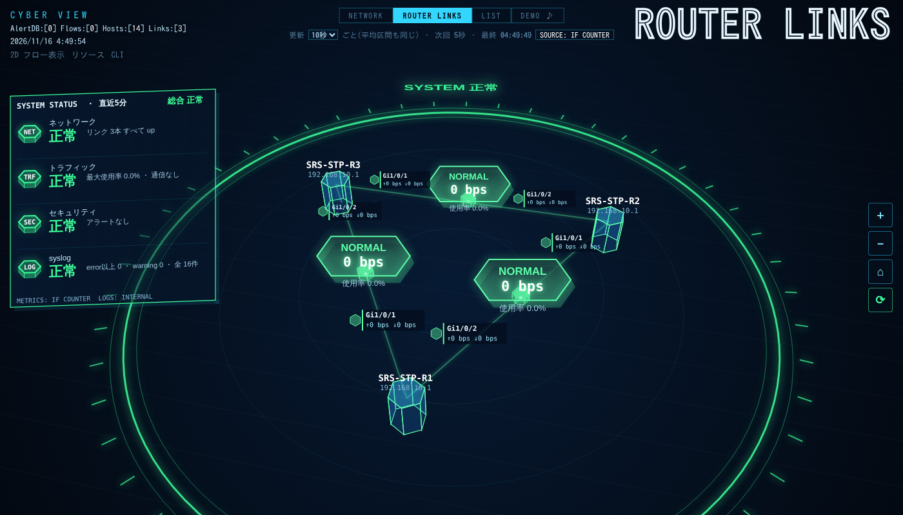
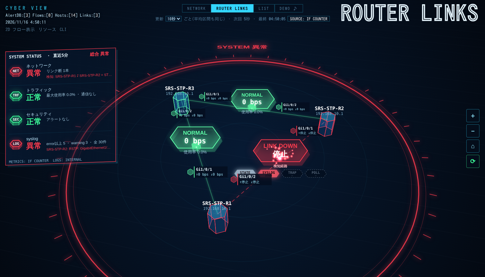

# Fujitsu SR-S × STP — 3台構成の正常/障害試験

- 実行: 2026-11-16 04:49 / 所要 51 秒 / 専用環境(保存設定を消してエミュレータを新規起動、他シナリオの装置は無し)
- 結果: **10 / 10 項目 OK** ✅
- 再実行: `python3 tools/verification/scenario_report.py srs stp --devices 3`

## 構成(台数から自動で割り当て)

```
SRS-STP-R1 → SRS-STP-R2 → SRS-STP-R3 → SRS-STP-R1   (リング)
```

SRS-STP-R1 の priority を 4096 に下げてルートブリッジにする。

| リンク | 装置A IF | 装置B IF | ネットワーク |
|---|---|---|---|
| SRS-STP-R1 ⇔ SRS-STP-R2 | GigabitEthernet1/0/2 | GigabitEthernet1/0/1 | L2 |
| SRS-STP-R2 ⇔ SRS-STP-R3 | GigabitEthernet1/0/2 | GigabitEthernet1/0/1 | L2 |
| SRS-STP-R3 ⇔ SRS-STP-R1 | GigabitEthernet1/0/2 | GigabitEthernet1/0/1 | L2 |

## 投入したコマンド

<details><summary>SRS-STP-R1(14 行)</summary>

```
configure terminal
spanning-tree mode rapid-pvst
end
configure terminal
spanning-tree vlan 1 priority 4096
end
configure terminal
interface GigabitEthernet1/0/2
shutdown
end
configure terminal
interface GigabitEthernet1/0/2
no shutdown
end
```
</details>

<details><summary>SRS-STP-R2(3 行)</summary>

```
configure terminal
spanning-tree mode rapid-pvst
end
```
</details>

<details><summary>SRS-STP-R3(3 行)</summary>

```
configure terminal
spanning-tree mode rapid-pvst
end
```
</details>

## 確認項目

| 段階 | 確認内容 | 結果 | 補足 |
|---|---|---|---|
| 正常 | リングのどこか1台が Blocking(ループ回避) | ✅ |  |
| 正常 | STP が動いているのでループでも MAC フラップは出ない | ✅ |  |
| 正常 | リンク 3 本が links API で state=ok | ✅ |  |
| 正常 | Blocking のログが繰り返し出ない(状態変化の時だけ) | ✅ |  |
| 障害 | SRS-STP-R1-SRS-STP-R2 が LINK DOWN | ✅ |  |
| 障害 | 迂回のため Blocking が解除される | ✅ |  |
| 障害 | トポロジ変更のログ | ✅ |  |
| 障害 | 状態ボードのネットワーク観点が異常 | ✅ |  |
| 復旧 | LINK DOWN が解除される | ✅ |  |
| 復旧 | ふたたびどこか1台が Blocking | ✅ |  |

## 画面(ROUTER LINKS)

**正常時**



**障害時**



## 段階ごとの記録

### 正常(04:49:46)

SRS-STP-R1 がルートのリング

**状態ボード**: network=ok「リンク 3本 すべて up」 / traffic=ok「最大使用率 0.0% ・ 通信なし」 / security=ok「アラートなし」 / syslog=ok「error以上 0 ・ warning 0 ・ 全 16件」

**リンク**

| A | B | 状態 | LINK DOWN | 検知経路 |
|---|---|---|---|---|
| SRS-STP-R1 | SRS-STP-R3 | ok | - | STATE:up |
| SRS-STP-R1 | SRS-STP-R2 | ok | - | STATE:up |
| SRS-STP-R2 | SRS-STP-R3 | ok | - | STATE:up |

`SRS-STP-R1# show spanning-tree`

```
VLAN0001
  Spanning tree enabled protocol rstp
  Root ID    Priority    4097
             Address     000e.0e86.d190
             This bridge is the root

  Bridge ID  Priority    4097  (priority 4096 sys-id-ext 1)
             Address     000e.0e86.d190
             Hello Time  1 sec  Max Age 20 sec  Forward Delay 15 sec
             Topology Change count  0
             Time since topology change never

Interface           Role Sts Cost      Prio.Nbr Type
--------------------------------------------------------------------
Gi1/0/1             Desg  FWD 19        128.1    P2p
Gi1/0/2             Desg  FWD 19        128.1    P2p
```

`SRS-STP-R2# show spanning-tree`

```
VLAN0001
  Spanning tree enabled protocol rstp
  Root ID    Priority    4097
             Address     000e.0e86.d190
             Cost        19  Port 0
             Hello Time  2 sec  Max Age 20 sec  Forward Delay 15 sec

  Bridge ID  Priority    32769  (priority 32768 sys-id-ext 1)
             Address     000e.0eec.00c0
             Hello Time  1 sec  Max Age 20 sec  Forward Delay 15 sec
             Topology Change count  0
             Time since topology change never

Interface           Role Sts Cost      Prio.Nbr Type
--------------------------------------------------------------------
Gi1/0/2             Altn  BLK 19        128.1    P2p
Gi1/0/1             Root  FWD 19        128.1    P2p
```

`SRS-STP-R3# show spanning-tree`

```
VLAN0001
  Spanning tree enabled protocol rstp
  Root ID    Priority    4097
             Address     000e.0e86.d190
             Cost        19  Port 0
             Hello Time  2 sec  Max Age 20 sec  Forward Delay 15 sec

  Bridge ID  Priority    32769  (priority 32768 sys-id-ext 1)
             Address     000e.0ee0.cd10
             Hello Time  1 sec  Max Age 20 sec  Forward Delay 15 sec
             Topology Change count  0
             Time since topology change never

Interface           Role Sts Cost      Prio.Nbr Type
--------------------------------------------------------------------
Gi1/0/2             Root  FWD 19        128.1    P2p
Gi1/0/1             Desg  FWD 19        128.1    P2p
```

**ログ**(/cyber-view が見ているもの、0 件)


**アラート**(0 件)


### 障害(04:50:13)

SRS-STP-R1 の GigabitEthernet1/0/2 を落とした状態

**状態ボード**: network=crit「リンク断 1本」 / traffic=ok「最大使用率 0.0% ・ 通信なし」 / security=ok「アラートなし」 / syslog=crit「error以上 5 ・ warning 3 ・ 全 30件」

**リンク**

| A | B | 状態 | LINK DOWN | 検知経路 |
|---|---|---|---|---|
| SRS-STP-R1 | SRS-STP-R3 | ok | - | STATE:up |
| SRS-STP-R1 | SRS-STP-R2 | down | はい | STATE:down, SYSLOG:down |
| SRS-STP-R2 | SRS-STP-R3 | ok | - | STATE:up |

`SRS-STP-R1# show spanning-tree`

```
VLAN0001
  Spanning tree enabled protocol rstp
  Root ID    Priority    4097
             Address     000e.0e86.d190
             This bridge is the root

  Bridge ID  Priority    4097  (priority 4096 sys-id-ext 1)
             Address     000e.0e86.d190
             Hello Time  1 sec  Max Age 20 sec  Forward Delay 15 sec
             Topology Change count  1
             Time since topology change 00:18

Interface           Role Sts Cost      Prio.Nbr Type
--------------------------------------------------------------------
Gi1/0/1             Desg  FWD 19        128.1    P2p
```

`SRS-STP-R2# show spanning-tree`

```
VLAN0001
  Spanning tree enabled protocol rstp
  Root ID    Priority    4097
             Address     000e.0e86.d190
             Cost        38  Port 0
             Hello Time  2 sec  Max Age 20 sec  Forward Delay 15 sec

  Bridge ID  Priority    32769  (priority 32768 sys-id-ext 1)
             Address     000e.0eec.00c0
             Hello Time  1 sec  Max Age 20 sec  Forward Delay 15 sec
             Topology Change count  1
             Time since topology change 00:18

Interface           Role Sts Cost      Prio.Nbr Type
--------------------------------------------------------------------
Gi1/0/2             Root  FWD 19        128.1    P2p
```

`SRS-STP-R3# show spanning-tree`

```
VLAN0001
  Spanning tree enabled protocol rstp
  Root ID    Priority    4097
             Address     000e.0e86.d190
             Cost        19  Port 0
             Hello Time  2 sec  Max Age 20 sec  Forward Delay 15 sec

  Bridge ID  Priority    32769  (priority 32768 sys-id-ext 1)
             Address     000e.0ee0.cd10
             Hello Time  1 sec  Max Age 20 sec  Forward Delay 15 sec
             Topology Change count  2
             Time since topology change 00:18

Interface           Role Sts Cost      Prio.Nbr Type
--------------------------------------------------------------------
Gi1/0/2             Root  FWD 19        128.1    P2p
Gi1/0/1             Desg  FWD 19        128.1    P2p
```

**ログ**(/cyber-view が見ているもの、14 件)

```
04:49:55 SRS-STP-R1 sev3 %LINK-3-UPDOWN: Interface GigabitEthernet1/0/2, changed state to down
04:49:55 SRS-STP-R1 sev5 %LINEPROTO-5-UPDOWN: Line protocol on Interface GigabitEthernet1/0/2, changed state to down
04:49:55 SRS-STP-R1 sev4 2026/11/16 04:49:55 SRS-STP-R1 Si-R G120 : [LINK] GigabitEthernet1/0/2 Link Down
04:49:55 SRS-STP-R1 sev4 RSTP: GigabitEthernet1/0/2 — Port Down (接続先: srs-stp-r2)
04:49:55 SRS-STP-R1 sev3 %LINK-3-UPDOWN: Interface GigabitEthernet1/0/2, changed state to down
RSTP: GigabitEthernet1/0/2 — Port Down (接続先: srs-stp-r2)
04:49:55 SRS-STP-R1 sev6 %SPANTREE-6-TOPOTRAP: Topology change detected on port ion (TC count: 1)
04:49:55 SRS-STP-R2 sev3 %LINK-3-UPDOWN: Interface GigabitEthernet1/0/1, changed state to down
04:49:55 SRS-STP-R2 sev4 RSTP: GigabitEthernet1/0/1 — Port Down (接続先: srs-stp-r1)
04:49:55 SRS-STP-R2 sev3 %LINK-3-UPDOWN: Interface GigabitEthernet1/0/1, changed state to down
RSTP: GigabitEthernet1/0/1 — Port Down (接続先: srs-stp-r1)
04:49:55 SRS-STP-R2 sev6 %SPANTREE-6-TOPOTRAP: Topology change detected on port ion (TC count: 1)
04:49:55 SRS-STP-R2 sev5 %SPANTREE-5-ROOTCHANGE: Root port lost. Initiating re-election...
04:49:55 SRS-STP-R2 sev3 Topology Change: Root port failed, reconverging...
04:49:55 SRS-STP-R3 sev6 %SPANTREE-6-TOPOTRAP: Topology change detected on SRS-STP-R1 (累計 TC count: 1)
04:49:55 SRS-STP-R3 sev6 %SPANTREE-6-TOPOTRAP: Topology change detected on SRS-STP-R2 (累計 TC count: 2)
```

**アラート**(3 件)

- [medium/SYSLOG] 装置が error 以上のログを出力 — SRS-STP-R1: %LINK-3-UPDOWN: Interface GigabitEthernet1/0/2, changed state to down
- [medium/SYSLOG] 装置が error 以上のログを出力 — SRS-STP-R2: %LINK-3-UPDOWN: Interface GigabitEthernet1/0/1, changed state to down
- [medium/NET] リンク断 — SRS-STP-R1: GigabitEthernet1/0/2 が down (srs-stp-r1 - srs-stp-r2)

### 復旧(04:50:23)

戻した状態

**状態ボード**: network=ok「リンク 3本 すべて up」 / traffic=ok「最大使用率 0.0% ・ 通信なし」 / security=ok「アラートなし」 / syslog=crit「error以上 5 ・ warning 3 ・ 全 42件」

**リンク**

| A | B | 状態 | LINK DOWN | 検知経路 |
|---|---|---|---|---|
| SRS-STP-R1 | SRS-STP-R3 | ok | - | STATE:up |
| SRS-STP-R1 | SRS-STP-R2 | ok | - | STATE:up, SYSLOG:up |
| SRS-STP-R2 | SRS-STP-R3 | ok | - | STATE:up |

`SRS-STP-R1# show spanning-tree`

```
VLAN0001
  Spanning tree enabled protocol rstp
  Root ID    Priority    4097
             Address     000e.0e86.d190
             This bridge is the root

  Bridge ID  Priority    4097  (priority 4096 sys-id-ext 1)
             Address     000e.0e86.d190
             Hello Time  1 sec  Max Age 20 sec  Forward Delay 15 sec
             Topology Change count  1
             Time since topology change 00:28

Interface           Role Sts Cost      Prio.Nbr Type
--------------------------------------------------------------------
Gi1/0/1             Desg  FWD 19        128.1    P2p
Gi1/0/2             Desg  FWD 19        128.1    P2p
```

`SRS-STP-R2# show spanning-tree`

```
VLAN0001
  Spanning tree enabled protocol rstp
  Root ID    Priority    4097
             Address     000e.0e86.d190
             Cost        19  Port 0
             Hello Time  2 sec  Max Age 20 sec  Forward Delay 15 sec

  Bridge ID  Priority    32769  (priority 32768 sys-id-ext 1)
             Address     000e.0eec.00c0
             Hello Time  1 sec  Max Age 20 sec  Forward Delay 15 sec
             Topology Change count  1
             Time since topology change 00:28

Interface           Role Sts Cost      Prio.Nbr Type
--------------------------------------------------------------------
Gi1/0/2             Altn  BLK 19        128.1    P2p
Gi1/0/1             Root  FWD 19        128.1    P2p
```

`SRS-STP-R3# show spanning-tree`

```
VLAN0001
  Spanning tree enabled protocol rstp
  Root ID    Priority    4097
             Address     000e.0e86.d190
             Cost        19  Port 0
             Hello Time  2 sec  Max Age 20 sec  Forward Delay 15 sec

  Bridge ID  Priority    32769  (priority 32768 sys-id-ext 1)
             Address     000e.0ee0.cd10
             Hello Time  1 sec  Max Age 20 sec  Forward Delay 15 sec
             Topology Change count  2
             Time since topology change 00:28

Interface           Role Sts Cost      Prio.Nbr Type
--------------------------------------------------------------------
Gi1/0/2             Root  FWD 19        128.1    P2p
Gi1/0/1             Desg  FWD 19        128.1    P2p
```

**ログ**(/cyber-view が見ているもの、12 件)

```
04:50:13 SRS-STP-R1 sev3 %LINK-3-UPDOWN: Interface GigabitEthernet1/0/2, changed state to up
04:50:13 SRS-STP-R1 sev5 %LINEPROTO-5-UPDOWN: Line protocol on Interface GigabitEthernet1/0/2, changed state to up
04:50:13 SRS-STP-R1 sev5 2026/11/16 04:50:13 SRS-STP-R1 Si-R G120 : [LINK] GigabitEthernet1/0/2 Link Up (1Gbps full-duplex)
04:50:13 SRS-STP-R1 sev3 %LINK-3-UPDOWN: Interface GigabitEthernet1/0/2, changed state to up (peer: srs-stp-r2), state: DISCARDING
04:50:13 SRS-STP-R1 sev6 RSTP: GigabitEthernet1/0/2 → LEARNING (Proposal/Agreement)
04:50:13 SRS-STP-R1 sev6 %SPANTREE-6-PORTDPVSTP: Port GigabitEthernet1/0/2 instance 0 moving from LEARNING to FORWARDING
04:50:13 SRS-STP-R1 sev6 Topology Change: GigabitEthernet1/0/2 transitioned to FORWARDING
04:50:13 SRS-STP-R2 sev3 %LINK-3-UPDOWN: Interface GigabitEthernet1/0/1, changed state to up (peer: srs-stp-r1), state: DISCARDING
04:50:13 SRS-STP-R2 sev6 RSTP: GigabitEthernet1/0/1 → LEARNING (Proposal/Agreement)
04:50:13 SRS-STP-R2 sev6 %SPANTREE-6-PORTDPVSTP: Port GigabitEthernet1/0/2 instance 0 state: BLOCKING (ループ防止)
04:50:14 SRS-STP-R2 sev6 %SPANTREE-6-PORTDPVSTP: Port GigabitEthernet1/0/1 instance 0 moving from LEARNING to FORWARDING
04:50:14 SRS-STP-R2 sev6 Topology Change: GigabitEthernet1/0/1 transitioned to FORWARDING
```

**アラート**(0 件)


