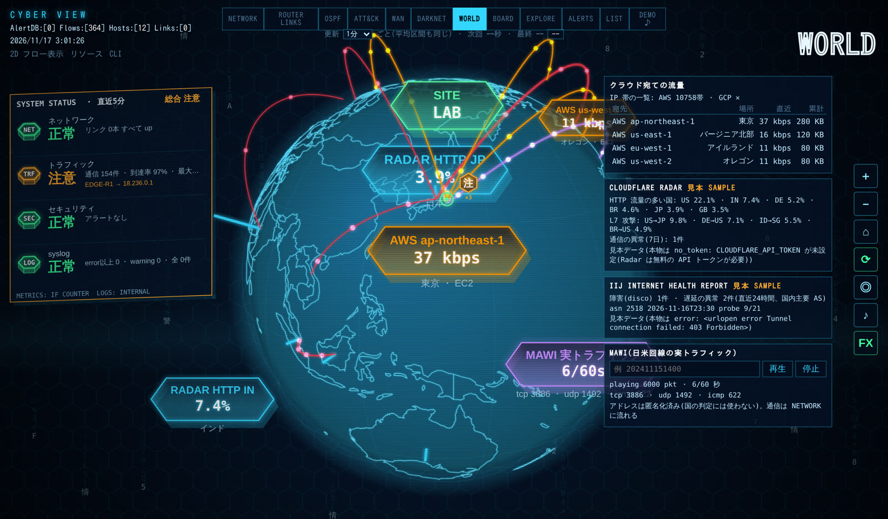
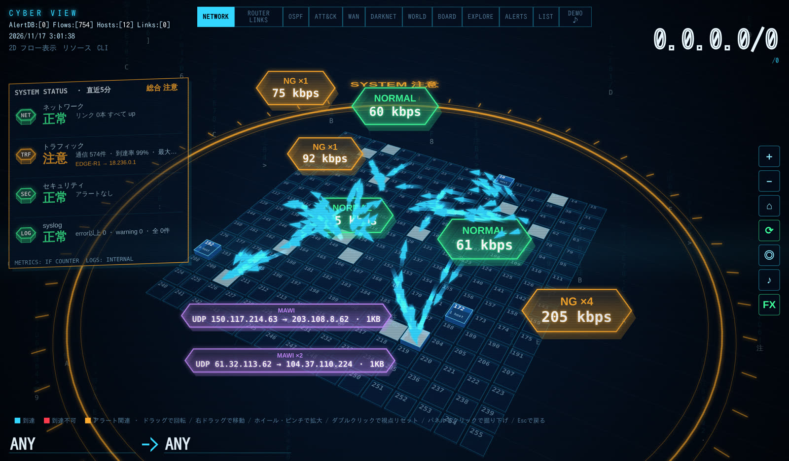
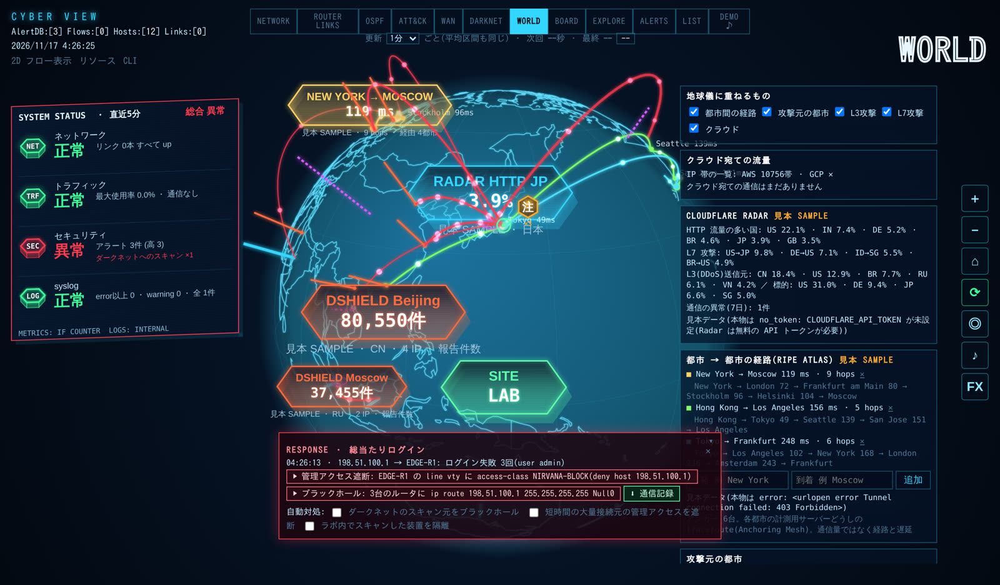
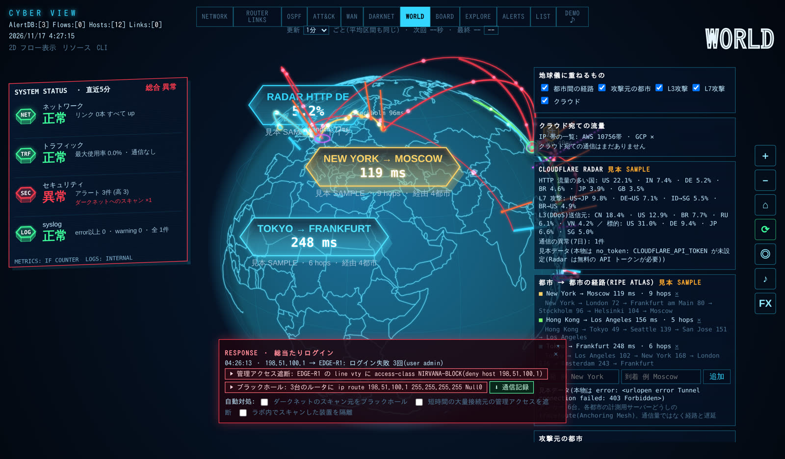
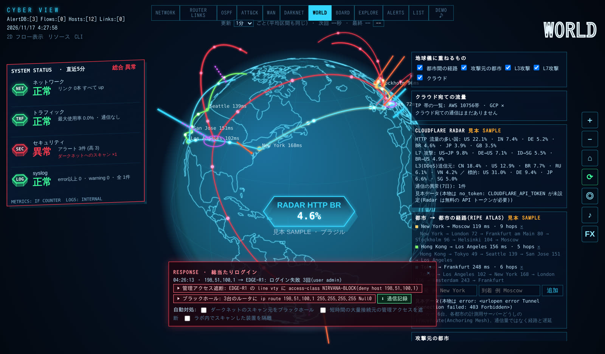

# WORLD(地球儀)— クラウド宛ての流量・Cloudflare Radar・IIJ IHR・MAWI

`/cyber-view` の **WORLD** ボタン(`?view=world`)。地球儀の上に次の4つを重ねる。

| 何を | どこから | 地球儀での見え方 |
|---|---|---|
| ラボ/自社から **AWS・Google Cloud** の各リージョンへの流量 | 公開されている IP 帯の一覧(AWS `ip-ranges.json`、GCP `cloud.json`)と、装置の ping・NetFlow/sFlow の宛先 IP を最長一致で照合 | 拠点(SITE)からリージョンへの弧(AWS 橙 / GCP 青)とプレート(直近 bps・累計) |
| 世界の **HTTP 流量の多い国**・**L7 攻撃の発信国→標的国**・**通信の異常** | Cloudflare Radar API(無料の API トークンが必要) | 国の位置に立つ柱(上位5つはプレート)、攻撃は赤い弧 |
| 日本の主要 AS の **遅延の異常**・**障害(到達不能)** | IIJ Internet Health Report(IHR)API(トークン不要) | 「注」の印、右のパネル |
| **日米回線の本物のトラフィック** | MAWI(WIDE プロジェクト samplepoint-F)の pcap を再生 | 太平洋の紫の帯。フローは NETWORK ビューに紫の「MAWI」で流れる |

MAWI を再生中の NETWORK ビュー(紫が MAWI のフロー):

## 正直な限界

- **地球儀は「どこへ流れているか」だけで、Google や AWS の中身の流量は誰にも取れない。** 取れるのは「自社から
  各クラウドのどのリージョンへ何 bps 流れたか」(宛先 IP が公開 IP 帯に入るかで判定)。
- **Radar / IHR の値は割合・件数**。回線の bps ではない(Cloudflare が見た世界の HTTP の割合など)。
- **MAWI のアドレスは匿名化**(上位ビットの構造を保つ方式)されているので、国・クラウドの判定には使わない。
  プロトコル・ポート・量・時間の形は本物。地球儀では日米間の帯としてだけ表示する。
- 見本モード(`NETLAB_WORLD_SAMPLE=1`)は、取得に失敗した元だけを本物の応答と同じ形の作り物に差し替え、画面に
  「見本 SAMPLE」と出す。**見本からは警報を作らない。**

## 仕組み

- `engine/world_sources.py`
  - `CloudRanges`: AWS / GCP の IP 帯を読み込み、最長一致。同じ帯なら `AMAZON` より具体的なサービス(EC2/S3…)を優先。
    取得に失敗したら `data/world/` のキャッシュを使う。リージョン → 場所(`AWS_REGIONS` / `GCP_REGIONS`)。
  - `RadarClient`: `/radar/http/top/locations`・`/radar/attacks/layer7/top/attacks`・`/radar/traffic_anomalies`
    (形は github.com/cloudflare/api-schemas の openapi.json で確認)。`CLOUDFLARE_API_TOKEN` が無ければ `no_token`。
  - `IhrClient`: `/network_delay/alarms/`(`timebin__gte` 必須、`startpoint_name` は `|` 区切りで日本の主要 AS)と
    `/disco/events/`(形は ihr-django の serializers で確認)。同じ事象は1つにまとめる。
  - `WorldState`: 10分ごとに更新、宛先 IP ごとの流量をリージョンへ積算(`observe_flow`)。MAWI のフローは数えない。
- `engine/mawi.py`: pcap / pcap.gz(URL ならダウンロードしながら展開)を読み、1秒ごとにフローへまとめて、上位だけを
  指定の速さで NetFlow/sFlow と同じ入口(`_on_flow`、`via: 'mawi'`)へ流す。Ethernet(VLAN タグ可)/ Raw IP /
  Linux SLL。pcapng は未対応。
- `engine/traffic_analytics.py`: 警報 `ihr_outage` / `ihr_delay`(偏差 10 以上)/ `radar_anomaly`(日本のみ)、花びら WORLD。
- 地図: `static/world/world.json`(Natural Earth 1:110m のパブリックドメインの国境・海岸線を world-atlas から、
  国名は i18n-iso-countries から。`tools/build_world_data.py` で作る)。

## API と設定

| | |
|---|---|
| `GET /api/world` | クラウドのリージョン別流量・Radar・IHR・拠点の位置・MAWI の状態 |
| `POST /api/world/refresh` | 今すぐ取り直す |
| `POST /api/mawi/replay` | `{"stamp":"202411151400"}` か `{"source":"<URL かローカルの pcap(.gz)>"}`、`limit`(既定 200000 パケット)・`speed`(1=実時間)・`topk`(1秒あたりのフロー数)・`loop` |
| `POST /api/mawi/stop` / `GET /api/mawi/status` | 停止 / 状態(プロトコル別の数・よく使われたポート) |

| 環境変数 | |
|---|---|
| `CLOUDFLARE_API_TOKEN` | Radar のトークン(Cloudflare のダッシュボードで「Radar: Read」の無料トークン) |
| `NETLAB_WORLD_FETCH=0` | 外部へ取りに行かない(テストは既定でこれ) |
| `NETLAB_WORLD_SAMPLE=1` | 取れなかった元を見本で埋める(画面に SAMPLE) |
| `NIRVANA_SITE_LATLON` | 拠点の緯度,経度(既定 `35.68,139.69` 東京) |

## ライブ検証(この作業環境で)

- **AWS**: 本物の `ip-ranges.json` を取得(10758 帯)。ラボの Cisco から `ping 13.112.1.1 repeat 200 size 1400` 等を
  打つと、東京(ap-northeast-1 EC2)・バージニア北部・アイルランド・オレゴンへの弧と bps が地球儀に出た(上の画像)。
- **Google Cloud / Radar / IHR / MAWI**: この作業環境の通信ポリシーで `www.gstatic.com`・`api.cloudflare.com`・
  `ihr.iijlab.net`・`mawi.wide.ad.jp` がブロック(403)。画面にはそれぞれ「取得できません(理由)」と出ることを確認し、
  応答の形は各プロジェクトの公開スキーマで確認した。見本モードで表示を確認。
- **MAWI の再生**: 本物の MAWI と同じ形式の pcap(6000 パケット、Ethernet、gzip)を手元で作って再生し、NETWORK ビューに
  紫の MAWI フローが流れ、地球儀の帯に「6/60s」・プロトコル別の数が出ることを確認(上の画像)。
- **未確認**: 本物の Radar・IHR・MAWI のデータでの表示。これらのホストを許可した環境(作成済みの
  `network-lab-emulator` 環境)の新しいセッションで確認する。Radar はさらにトークンが必要。

テスト: `tests/test_world_view.py`(9件。外部へは出ない)。

## 出典・ライセンス

- Cloudflare Radar(CC BY-NC 4.0。表示に出典を出す)、IIJ Internet Health Report、MAWI Working Group Traffic Archive
  (WIDE プロジェクト)、AWS / Google Cloud の公開 IP 帯一覧、Natural Earth(パブリックドメイン)・world-atlas(ISC)・
  i18n-iso-countries(MIT)。

---

# 都市の粒度(都市 → 都市の経路・攻撃元の都市・L3 攻撃)

依頼「チャイナからアメリカ、アメリカの都市からロシアの都市レベルの通信がわかるといいなぁ」への対応。

**先に結論**: 他人どうしの都市間の「流量」は、どこも公開していない(通信事業者の機密・個人情報)。
代わりに、公開されていて都市の粒度で取れる3つを地球儀に重ねた。

| 何を | どこから | 地球儀での見え方 | 数字の意味 |
|---|---|---|---|
| ① 都市 → 都市の**本物の経路と遅延** | RIPE Atlas のアンカー(各都市に置かれた計測用サーバー)どうしが常に測っている traceroute(Anchoring Mesh)。閲覧はキー不要 | 通過した都市を順に結ぶ色付きの弧、都市ごとの遅延(ms)、到着点のプレート「NEW YORK → MOSCOW 119 ms」 | 遅延とホップ数。**通信量ではない** |
| ② **攻撃元の都市** | (a) 自分の拠点に来た外部の相手(ダークネットに届いた送信元・NetFlow/sFlow の外からの相手・SSH/Telnet のログイン失敗) (b) SANS ISC / DShield の公開 API(世界中のセンサーに届いた攻撃の送信元 IP 上位) | (a) 都市 → SITE の赤い弧とプレート「MOSCOW → LAB 48件」 (b) 都市に立つ橙の柱とプレート「DSHIELD Beijing 80,550件」 | (a) 自分が観測した本物の件数 (b) DShield の**報告件数**(センサーが送ったファイアウォールのログの行数。攻撃の回数そのものではない) |
| ③ 国 → 国の **L3(DDoS)攻撃** | Cloudflare Radar `/radar/attacks/layer3/top/locations/origin`・`/target`(要トークン) | 送信元の国に紫の点線の柱、標的の国に紫の輪 | Cloudflare が止めた L3 攻撃に占める割合(%) |

IP → 都市は DB-IP の「IP to City Lite」(CC BY 4.0、毎月更新、キー不要、約 130MB の CSV.gz)。
初回は裏でダウンロードして読み込み(数十秒〜数分)、`data/world/geoip-city.pkl` に保存して次から数秒で読む。
**精度は都市単位でおおむね5〜8割、ロシア・中国はもっと粗い**(画面にも出す)。ルーターの IP は会社の本社の
場所になることもあるので、①の途中の都市は目安(両端はアンカーの本当の場所)。

ヨーロッパ側(ニューヨーク → ロンドン → フランクフルト → ストックホルム → ヘルシンキ → モスクワ、119 ms):

アメリカ側(香港 → 東京 → シアトル → サンノゼ → ロサンゼルス):

(画像は見本モード。プレートの下に「見本 SAMPLE」と出ている数字は作り物。「MOSCOW → LAB」「上海・北京からの
ログイン失敗」は本物のパケットとログイン試行で、都市への当てはめだけが見本の都市DB。)

## 操作

- 右のパネル「地球儀に重ねるもの」で 都市間の経路 / 攻撃元の都市 / L3攻撃 / L7攻撃 / クラウド を切り替え
  (`localStorage cvWorldLayers`)。
- 「都市 → 都市の経路」の欄で 出発・到着 の都市を入れて「追加」(候補はアンカーのある都市)、✕ で外す。
  都市名(部分一致)・国コード(`RU`)・アンカー名のどれでも。最大8組。既定は ニューヨーク→モスクワ、
  香港→ロサンゼルス、東京→フランクフルト。
- 中国本土にはアンカーがほとんど無いので、「中国 → アメリカ」の経路は香港などで代える。中国からの攻撃元は②で見る。

## 仕組み

- `engine/world_geo.py`
  - `GeoCity`: CSV(`ip_start, ip_end, continent, country, stateprov, city, latitude, longitude`)を IPv4 だけ
    配列に持ち二分探索。`NETLAB_GEOIP_DB`(手元の CSV / CSV.gz)→ 保存済み → DB-IP の今月・先月の版、の順。
  - `PeerTracker`: 外部の相手を IP ごとに数え(私設・CGNAT・ループバックは除く)、都市ごとにまとめる。
    ダークネットは `darknet.events` から、ログイン失敗は `app._on_auth`、フローは `app._on_flow`(外 → 自分の装置のみ、MAWI は除く)。
  - `DShieldClient`: `https://isc.sans.edu/api/topips/records/200?json`(IP は0埋め)。
  - `AtlasClient`: `/api/v2/anchors/` → 宛先アンカーの `/api/v2/anchor-measurements/?target=<id>`(無ければ
    `/api/v2/measurements/?target=<fqdn>&type=traceroute` で Mesh を探す)→ `/api/v2/measurements/<id>/latest/?probe_ids=<出発アンカーの probe>`。
    結果の読み方は RIPE-NCC の ripe-atlas-sagan に合わせた。60km 以内の連続する都市は1つにまとめる
    (DB-IP の「Frankfurt am Main」とアンカーの「Frankfurt」など)。
- `engine/world_sources.py`: `WorldState` が10分ごとに Radar(L3 を追加)・IHR・DShield・Atlas を取り直す。
  都市DBが後から揃ったら、その時点で都市に置き直す。

| API | |
|---|---|
| `GET /api/world` | 追加: `geo`(都市DBの状態)・`peers`・`dshield`・`atlas`・`pairs`、`radar.l3` |
| `POST /api/world/paths` | `{"pairs": [{"from": "New York", "to": "Moscow"}]}` で組を入れ替えて取り直す(空は 400) |
| `GET /api/world/anchors?q=` | アンカーのある都市の候補 |
| `GET /api/world/geo?ip=` | IP → 都市 |

| 環境変数 | |
|---|---|
| `NETLAB_GEOIP_DB` | 手元の DB-IP City Lite の CSV / CSV.gz(ダウンロードしない) |
| `NETLAB_GEOIP_FETCH=0` | 都市DBを取りに行かない(メモリが少ない環境向け。読み込むと約 100MB 増える) |

## ライブ検証(この作業環境で)

- この作業環境からは `atlas.ripe.net`・`download.db-ip.com`・`isc.sans.edu`・`api.cloudflare.com` がすべて
  遮断(接続拒否)。応答の形は Cloudflare の openapi.json、RIPE-NCC の ripe-atlas-cousteau / sagan で確認し、
  見本モード(`NETLAB_WORLD_SAMPLE=1`、IP は文書用の帯 192.0.2.0/24・198.51.100.0/24 だけ)で表示を確認した。
- **本物の通信で確認したもの**: lo に 198.51.100.1 / .4 / .8 を足し、
  - `tools/darknet_traffic.py --src 198.51.100.8 scan` で本物のパケットをダークネット(10.250.0.0/24、lo に引き込み)へ48個 →
    `peers` に Moscow(darknet 48)、地球儀に「MOSCOW → LAB 48件」の赤い弧。
  - paramiko で Cisco の実 SSH(203.0.113.2:22)へ送信元 198.51.100.4・.1 から誤パスワード4回ずつ → Shanghai・Beijing
    (login 4)。同時に既存の総当たり検知と RESPONSE パネルも出た。
  - `POST /api/world/paths` で「東京 → モスクワ」(見本に計測なし)→「経路の計測結果がまだありません」、
    「北京 → モスクワ」→「アンカーが見つかりません: Beijing」、空 → 400。
- **未確認**: 本物の DB-IP / RIPE Atlas / DShield / Radar L3 のデータでの表示。作成済みの環境
  「network-lab-emulator」に上の4ホストを許可して、新しいセッションで確認する。

テスト: `tests/test_world_city.py`(10件。外部へは出ない)。

出典: IP Geolocation by DB-IP(https://db-ip.com、CC BY 4.0)、RIPE Atlas(RIPE NCC)、SANS Internet Storm Center / DShield、
Cloudflare Radar(CC BY-NC 4.0)。

## IIJ Internet Health Report の移転(2026-11-21)

実際の PC から WORLD を開いたところ、IIJ Internet Health Report だけが「取得できません HTTP Error 400: Bad Request」になりました。
PC からの `curl` で、原因が 2 つ分かりました。

1. `ihr.iijlab.net` は `https://www.ihr.live/ihr/api/...` へ 301 で移転していた。
2. 新しい API は、知らない項目を `{"error":"invalid_query_params","unexpected":["format"],"allowed":[...]}` の 400 で断る。それまで送っていた `format=json` が断られていた。

`IhrClient` の接続先を `https://www.ihr.live/ihr/api` に変え、`format=json` を送らないようにしました。
また、400 `invalid_query_params` が返ったときは、断られた項目(`unexpected`)を外して 1 回だけやり直します。
API の項目がまた変わっても、画面が止まらないようにするためです。
それ以外のエラーは、返事の中身を付けて「取得できません」に出します。

この作業環境からは `www.ihr.live` にも届かないため、本物の応答での確認はユーザーの PC で行います。
試験は `tests/test_world_view.py::test_ihr_new_host_and_drops_rejected_params` です。
