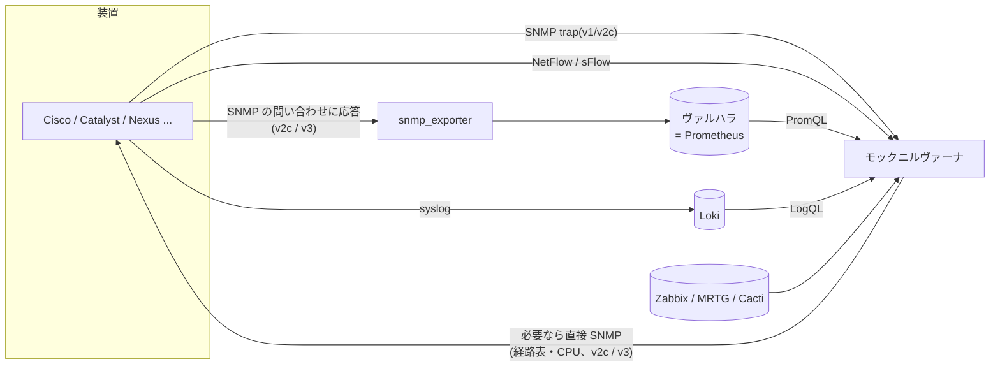

## はじめに

NICT の **NIRVANA改** というシステムがあります。ネットワークの通信や攻撃の警報を、立体のアニメーションで見せるものです。2010 年代の半ばに、展示会などでよく話題になりました。研究用のシステムなので、一般には配布されていません。

この記事のプロジェクトでは、NIRVANA改 の「眺めているだけで状況が分かる」という発想を借りています。そのうえで、今の監視の道具(Prometheus・Loki・SNMPv3・LLM)と組み合わせて、Claude と一緒に作り直しました。元の作品を写すのではなく、今の技術で解釈し直す、いわゆる**リイマジン**です。

本物ではないので、本記事では **モックニルヴァーナ** と呼びます。画面上の名前は「CYBER VIEW」で、NIRVANA の名前やロゴは使っていません。

土台は、自作のマルチベンダー**ネットワーク機器エミュレータ**です。「show コマンドの文字列を返すだけ」のエミュレータではありません。プロトコルの多くが本物のソケット・本物のパケットで動いています(OSPF・BGP・RIP・SNMP・SSH/Telnet・NETCONF・gNMI など)。そのため、snmpwalk・nmap・Prometheus の snmp_exporter といった本物のツールを、そのまま装置に向けられます。

> 対応機種(エミュレータの device_type)は Cisco IOS / Catalyst / Nexus / ASA / Arista / Juniper / Yamaha RTX / FortiGate / F5 BIG-IP / 富士通 Si-R・SR-S / APRESIA / AWS ALB などです。

## 全体の構成

モックニルヴァーナは2つの形で動きます。

- **ラボ版**(`/cyber-view`): エミュレータの中の装置を、エミュレータの内部状態から直接見ます。
- **単体版**(`cyber-view-standalone/`): 実機の監視基盤からデータを読みます。

単体版は、いま使っている監視をそのまま使います。いちばん多い形は、Prometheus(画面上の呼び名は「ヴァルハラ」)の値を読むやり方です。



よく聞かれるので、SNMP の流れを書いておきます。

- **定期的な値**(流量・IF の状態・死活)は、**装置が「受ける」側**です。snmp_exporter が装置に問い合わせて、装置が答えます。その結果がヴァルハラ(Prometheus)に溜まり、ニルヴァーナはヴァルハラから PromQL で読みます。ニルヴァーナが SNMP を直接受信しているわけではありません。
- **SNMPv3 も同じ流れ**です。エミュレータのモック Catalyst・Cisco・Nexus・Arista などは SNMPv3(USM)の問い合わせに応答します。本物の net-snmp と snmp_exporter から v3 で読めることを確かめました。
- 経路表と CPU は、単体版が装置に**直接** SNMP(v2c / v3)で問い合わせることもできます。
- **trap** だけは装置からニルヴァーナへ**直接届く**形です。今は v1/v2c だけを受けられ、v3 の trap は未対応です。

## できること

### 1. ネットワークを立体で眺める

IP アドレスの空間を 16×16 のパネルにして、`/0 → /8 → /16 → /24` とクリックで掘り下げます。

- `/24` まで下りると、サブネットはワイヤーフレームの球になり、装置はその中の柱として立ちます。
- ping などの通信は、三角形の粒になって流れます。
- 警報が出ると、赤い「警」の六角形が出て、花びらのような形で開きます。花びらの1枚1枚が検知元を表します(IDS・FW・SYSLOG・LOOP・DARKNET・WORLD・AI など)。

### 2. リンク断を「4つの経路」で確かめる

リンクが落ちたとき、どの方法で分かったのかをチップで並べます。

| 経路 | 何を見るか |
|---|---|
| STATE | エミュレータ内部の IF の状態 |
| SYSLOG | `%LINK-3-UPDOWN` などのログ |
| TRAP | linkDown / linkUp の trap |
| POLL | Prometheus から読んだ `ifOperStatus` |

どれか1つでも「断」なら、リンク断として表示します。SNMP が応答しなくなった装置は、灰色で点滅する「NO RESPONSE」になります。


### 3. OSPF の隣接と最短経路ツリー

OSPF モードでは、次のものが見えます。

- エリアの円と、ABR(エリアの境目のルータ)
- 隣接ごとの Dead タイマーの残り時間(円弧でカウントダウン)
- 宛先までの最短経路ツリー(金色の矢印)
- SPF を計算し直したときの波紋

IF を落とすと、Dead タイマーが切れて隣接が外れ、経路が引き直される様子をそのまま見られます。


### 4. L2 ループ

スイッチをループ状につなぐと、次のことが起きます。

- 輪になったリンクを検知し、警報(花びら LOOP)を出す
- MAC フラップのログを出す
- ブロードキャストストームとして、トラフィックと CPU が跳ね上がる

止め方も、本物のコマンドで再現しています。

- `storm-control`
- `bpduguard`
- `errdisable recovery`
- APRESIA の `loopdetect`


### 5. 攻撃の検知と対処

次のような攻撃を、エミュレータへの**実際の接続**から数えて検知します。どれも本物のツール(nmap、ZGrab2 など)を当てて確かめています。

- ポートスキャン
- SSH / Telnet の総当たり
- ASA の `threat-detection scanning-threat` による自動シャン
- IOS の `login block-for` による締め出し

検知した警報は、ATT&CK の戦術・手法に対応づけて表示します。

**RESPONSE** パネルからは、遮断の手順を本物の CLI として装置に入れられます。

- `access-class`(VTY への接続を絞る)
- `ip route ... Null0`(宛先への通信を捨てる)
- `shutdown`(IF を止める)

元に戻す手順も一緒に記録されます。自動で対処する設定も用意していますが、既定はオフです。


### 6. DARKNET(NICTER 風)

使われていないアドレスの帯(ダークネット)に届いた通信を、次の4種類に分けて集計します。

- スキャン
- バックスキャッタ(なりすまし攻撃の跳ね返り)
- 設定ミス
- リフレクション攻撃

root で動かすと、loopback に引き込んだ帯に届く**本物のパケット**を受け身で読みます。


### 7. WORLD(地球儀)

地球儀の上に、次のものを重ねて表示します。

- 自拠点から各クラウド(AWS / GCP)のリージョンへの流量
- 攻撃元の都市
- RIPE Atlas の都市間 traceroute
- Cloudflare Radar と IIJ IHR の障害・遅延情報


### 8. AI にログを読ませて対処を考えさせる

**AI** ボタンを押すと、syslog とニルヴァーナ自身の検知を AI に読ませます。AI は Claude / Groq などの OpenAI 互換 API / Ollama から選べます。返ってくるのは要約・原因・対処の CLI です。

- 送る前に、パスワード・community・鍵を伏せます。IP アドレスも `IP_1` のように伏せ、答えの中で元に戻します。
- `reload` や `write erase` のような危険なコマンドは、提案されても実行できないようにしています。
- 対処は、人が確認して「実行」を押したときだけ装置に入ります(ラボ版)。
- AI が使えないときは、ルールで解析します。


### 9. 古い監視にも足せる

10年前の現場は MRTG(1995年)・Cacti(2001年)・Zabbix が中心でした。Prometheus の 1.0 は 2016 年、Loki は 2019 年です。そのため単体版は、次のどれからでも流量を読めます。

- Prometheus
- Zabbix
- MRTG の `.log` / rrd
- Cacti の RRD

`install.sh` は、これらを自動で探して設定ファイルを作ります。


### 10. Grafana 風のボード・SNMPv3・その他

- **BOARD / EXPLORE / ALERTS**: Grafana 相当のダッシュボードです。小さな PromQL 評価器を持ち、Grafana の JSON も取り込めます。
- **ヴァルハラとの双方向連携**:
  - ニルヴァーナの判定を `/metrics` で Prometheus に出す
  - ヴァルハラの履歴を使って、過去の状況を再生したり、先を予測したりする
  - ヴァルハラの警報を、ニルヴァーナの花びらとして表示する
- **SNMPv3**: エミュレータの装置が USM で応答します。対応する方式は次のとおりです。
  - 認証: MD5 / SHA / SHA-2
  - 暗号: DES / AES-128 / AES-192 / AES-256
- **背景と BGM**: 背景は標準 / 金魚鉢 / 富士山 / 太陽系から、BGM はジャズ / レゲエ / アンビエントから選べます。BGM は Web Audio で合成しています。

## できないこと(正直に)

| 項目 | 状況 |
|---|---|
| 本物の NIRVANA改 との互換 | ありません。見た目と発想を借りた別物です |
| L2 の本物のフレーム | エミュレータの装置同士は loopback 上の IP でつながっています。PPPoE や 802.1X の EAPOL は、仮想のリンクの上で状態遷移として再現しています。本物の Ethernet フレームではありません |
| ラボ版のフローの粒 | ラボの中で粒として記録されるのは、主に ping(ICMP)です。単体版は NetFlow / sFlow を受けられます |
| 大量の負荷 | Python の thread-per-connection なので、ロードバランサの試験は 100 CPS・数十並列あたりで頭打ちになります |
| SNMPv3 | 3DES・v3 での SET・v3 の trap は未対応です |
| 外部データ | この開発環境からは Cloudflare Radar・RIPE Atlas・本物のクラウド AI に届きませんでした。そのため一部は「見本」データで確かめています。画面に「見本 SAMPLE」と出ます |
| AI の答え | 提案です。正しいとは限りません。どのプロバイダ・モデルが答えたかを必ず表示しています |

## 面白かったこと

### 本物のツールを当てると、エミュレータの嘘がばれる

いちばん面白かったのはここです。本物のツールで確かめるたびに、エミュレータの「それっぽいだけ」の部分が見つかりました。

- **MRTG の cfgmaker** を当てたら、2台に1台くらいが「応答なし」になりました。原因は、SNMP の request-id が負の数のときに符号化できず、応答を返していなかったことでした(Perl の SNMP ライブラリは負の request-id をよく使います)。
- **Prometheus の snmp_exporter** で数分見ていたら、CPU が 95% に張り付きました。CPU の値を「問い合わせの回数」で揺らしていたためで、時間で揺らすように直しました。
- **Batfish** で設定を解析したら、ABR(エリアの境目のルータ)で area 0 側の隣接が張れていないことが分かりました。
- **nmap** を当てたら、消したはずの装置のポートが開いたままでした。

### 「ニルヴァーナ」と「ヴァルハラ」

Prometheus を画面上で「ヴァルハラ」と呼んでいます。理由は、ニルヴァーナ(涅槃)と対になる名前が欲しかったからです。どちらも死後の世界ですが、片方は北欧神話、片方は仏教です。画面上の呼び名を変えただけなので、設定項目や API の名前は Prometheus のままです。

### 金魚鉢と太陽系

ネットワークの監視画面に、金魚鉢と太陽系の背景があります。どちらも画像ファイルは使わず、Canvas で描いています。

- 金魚鉢は、ネットワークを丸ごと金魚鉢に入れて眺める表示です。ユーザーの希望で残しています。
- 太陽系は、落ち着いて眺められる壁紙として作りました。惑星はとてもゆっくり公転し、水星で約1分、海王星で約35分かけて1周します。

監視画面は一日中つけっぱなしにするものなので、「落ち着く」のも大事な機能だと思っています。


### AI に育てられる

この記事のほとんどの機能は、スマホから日本語で「〜も欲しい」と頼んで、Claude が実装・ライブ検証・ドキュメント化までしたものです。人と AI がやりとりしながら一緒に伸びていく、いわば「AI 共進化」の記録でもあります。

## 試し方

```bash
git clone https://github.com/w-index-m/nirvana-lab
cd network-lab-emulator
pip install -r requirements.txt
NETLAB_AUTH_DISABLE=1 python app.py
# → http://localhost:8000/cyber-view (DEMO ボタンで障害シナリオが流れます)
```

実機の監視に足す場合は、こちらを使います。

```bash
cd cyber-view-standalone
./install.sh --detect-only   # Prometheus / Loki / Zabbix / MRTG / Cacti を探す
./install.sh                 # config.yaml を作って起動方法を表示
```

## まとめ

- 10年前の「見て分かる」可視化を、今の監視(Prometheus・Loki・SNMPv3・LLM)の上に作り直しました。
- 本物のプロトコルで動くエミュレータに、本物のツールを当てて確かめています。その過程で、エミュレータ自身のバグがたくさん見つかりました。
- できないことは、画面と文書で正直に書いています。

細かい記録(実際に打ったコマンドと結果)は、リポジトリの `docs/` にあります。
